# FC41D Driver / FC41D Sürücüsü

**[English](#english)** | **[Türkçe](#türkçe)**

| | |
|---|---|
| **File / Dosya** | `README.md` |
| **Brief / Özellik** | Short usage guide of the TMS320F2800157 driver for the Quectel FC41D (Wi-Fi + BLE) module / Quectel FC41D (Wi-Fi + BLE) modülü için TMS320F2800157 sürücüsünün kısa kullanım kılavuzu |
| **Author / Yazar** | Furkan YAYLA |
| **Mail** | furkan.yayla.dev@gmail.com |
| **Created / Oluşturulma** | 2026-10-05 |

**Revisions / Revizyonlar**

| Rev | Date / Tarih | Description / Açıklama |
|---|---|---|
| R1 | 2026-10-05 | First version (Turkish) / İlk sürüm (Türkçe) |
| R2 | 2026-10-05 | English and Turkish in one file / İngilizce ve Türkçe tek dosyada |
| R3 | 2026-10-05 | Mermaid diagrams / Mermaid diyagramları |
| R4 | 2026-10-05 | Sequence and state diagrams / Sıra ve durum diyagramları |
| R5 | 2026-10-06 | Prepared for publication: requirements and integration steps / Yayın hazırlığı: gereksinimler ve entegrasyon adımları |
| R6 | 2026-10-06 | Folder renamed to `FC41D_Driver`, include paths updated / Klasör `FC41D_Driver` olarak yeniden adlandırıldı, include yolları güncellendi |

---

## Diagrams / Diyagramlar

*The diagrams use Mermaid (GitHub, VS Code Markdown preview and most viewers draw them). / Diyagramlar Mermaid ile çizilmiştir (GitHub, VS Code Markdown önizlemesi ve çoğu görüntüleyici gösterir).*

### 1. Layers / Katmanlar

*The application only talks to `FC41D_api`. Everything below it is internal. / Uygulama sadece `FC41D_api` ile konuşur, altındaki her şey sürücünün içidir.*

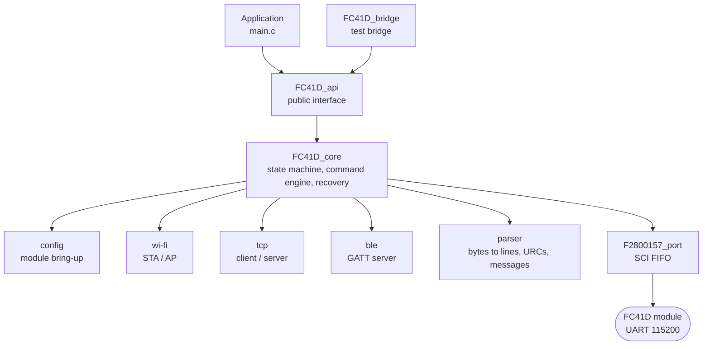

### 2. Main loop integration / Ana döngüye bağlanma

*The tick runs every millisecond, polling on every main-loop pass. / Tik her milisaniye, polling ana döngünün her turunda çalışır.*

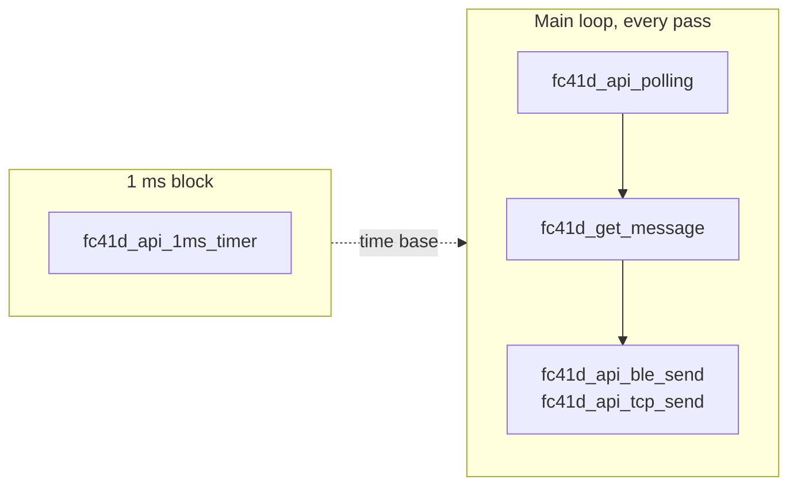

### 3. Start-up order / Açılış sırası

*Only the features of the chosen type are started, BLE first. / Sadece seçilen türdeki özellikler başlatılır, önce BLE.*

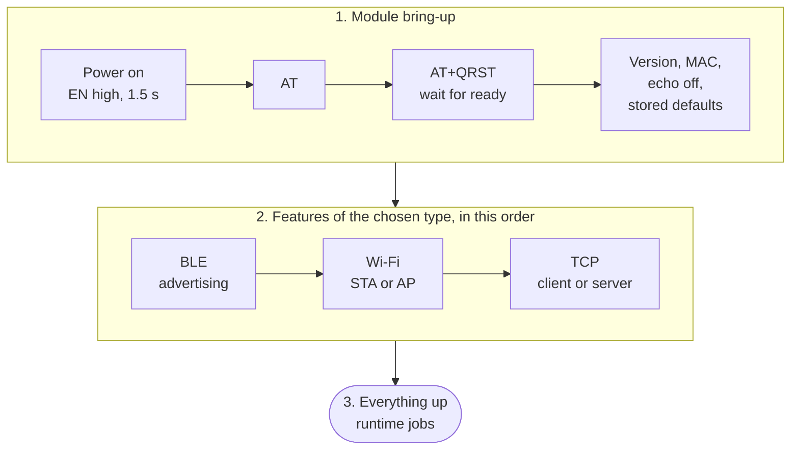

### 4. Data flow / Veri akışı

*Both directions go through the same driver and the same two calls. / İki yön de aynı sürücüden ve aynı iki çağrıdan geçer.*

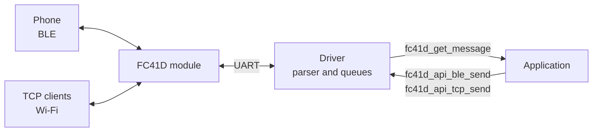

### 5. Recovery decision / Kurtarma kararı

*While a phone uses BLE the module is never reset. / Telefon BLE'yi kullanırken modül asla resetlenmez.*

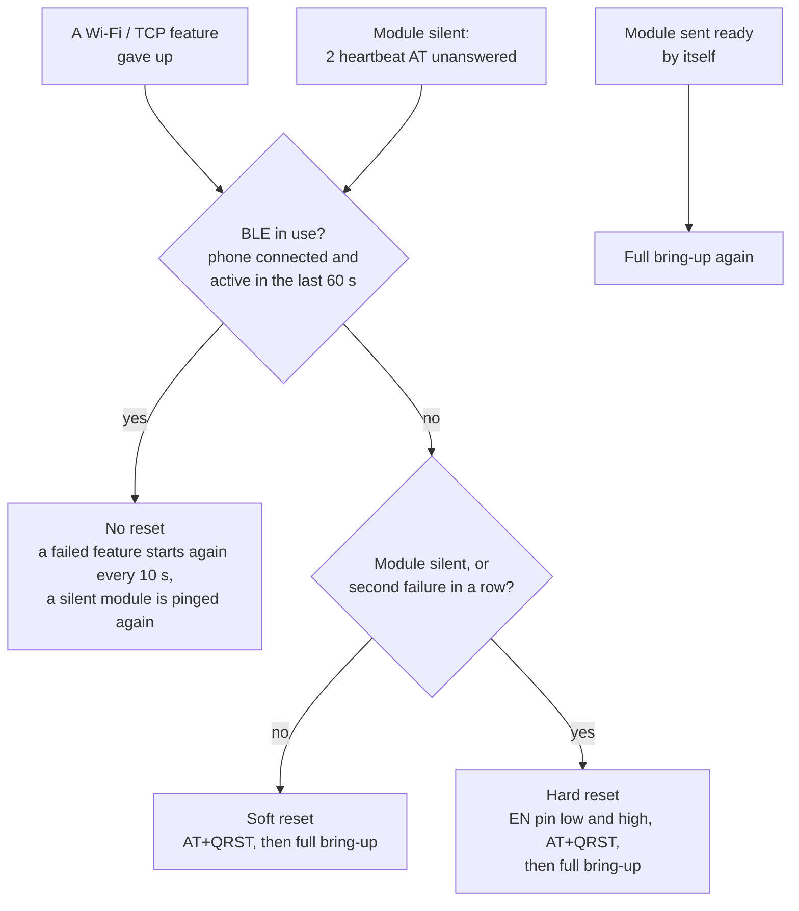

### 6. Message round trip through the bridge / Köprü ile mesajın gidiş-dönüşü

*A BLE text reaches a TCP client and the answer returns to the phone. The driver sends one AT command at a time. / Bir BLE metni TCP istemcisine ulaşır, cevap telefona döner. Sürücü aynı anda tek AT komutu gönderir.*

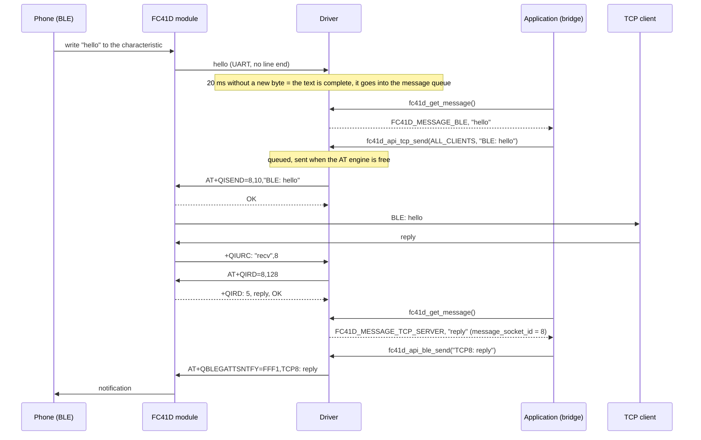

### 7. Wi-Fi link lost while a phone uses BLE / Telefon BLE kullanırken Wi-Fi kopması

*Only Wi-Fi and TCP are set up again. BLE keeps working and the module is not reset. / Sadece Wi-Fi ve TCP yeniden kurulur. BLE çalışmaya devam eder, modül resetlenmez.*

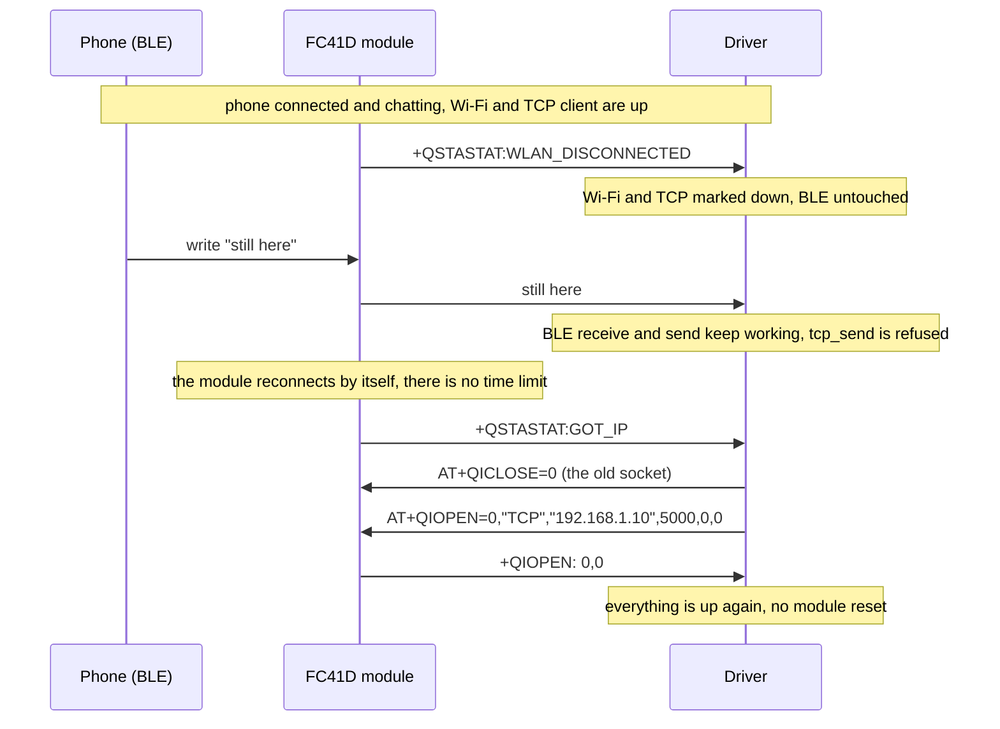

### 8. Changing the Wi-Fi at run time / Wi-Fi'ı çalışma anında değiştirme

*Station shown. For an access point the driver sends AT+QSOFTAPSTOP and then AT+QSOFTAP. / İstasyon gösterilmiştir. Access point'te sürücü önce AT+QSOFTAPSTOP, sonra AT+QSOFTAP gönderir.*

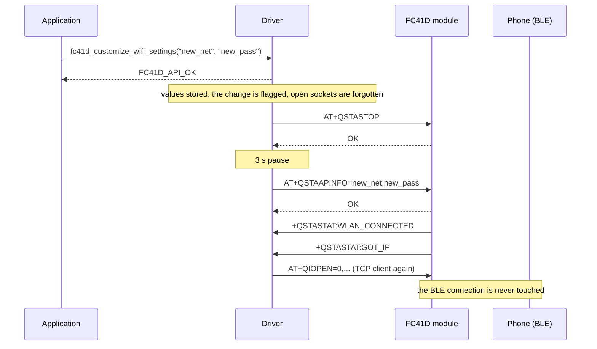

### 9. Module loses power / Modülün gücünün kesilmesi

*While a phone uses BLE the reset waits. The module comes back with ready and the driver sets everything up again. / Telefon BLE kullanırken reset beklenir. Modül ready ile geri gelir, sürücü her şeyi yeniden kurar.*

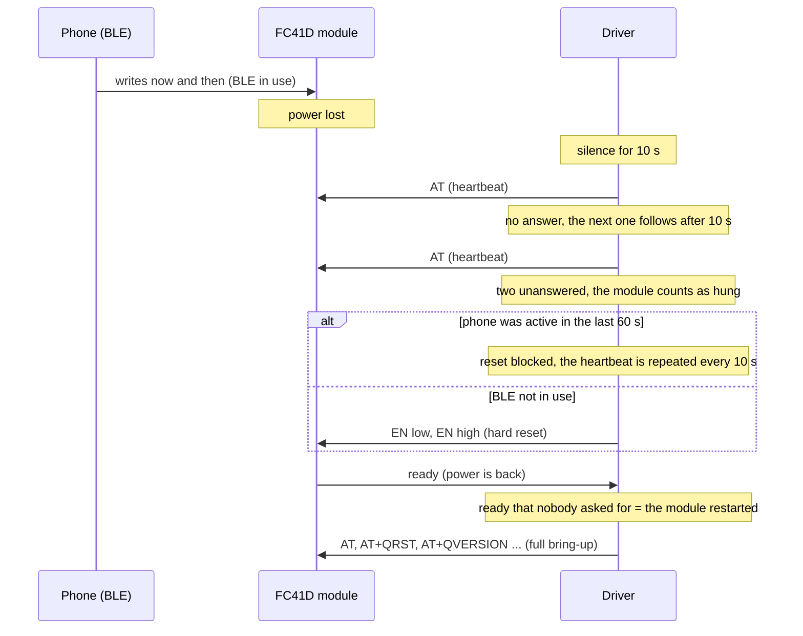

### 10. Driver state machine / Sürücü durum makinesi

*Simplified: in the code a short pause (DELAY) sits between the steps. "Runtime" is the idle state with everything up. / Sadeleştirilmiştir: kodda adımların arasında kısa bir bekleme (DELAY) vardır. "Runtime", her şey ayaktayken boşta durumdur.*

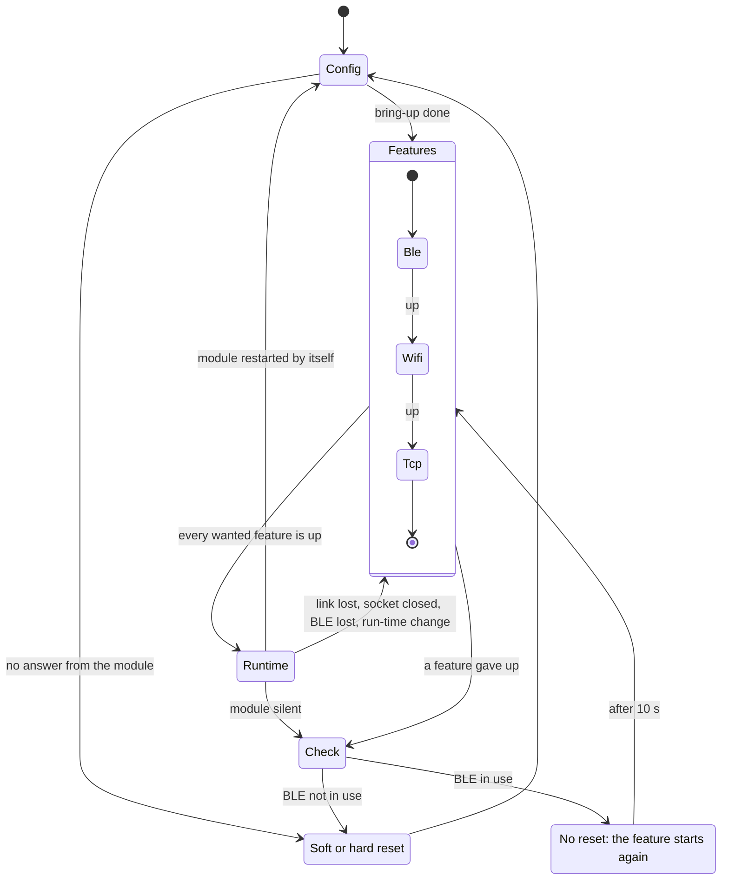

### 11. BLE channel / BLE kanalı

*The module advertises again by itself after a disconnect. "Active" is what protects the module from a reset. / Modül bağlantı kopunca kendiliğinden yeniden reklam yapar. Modülü reset'ten koruyan durum "Active"tir.*

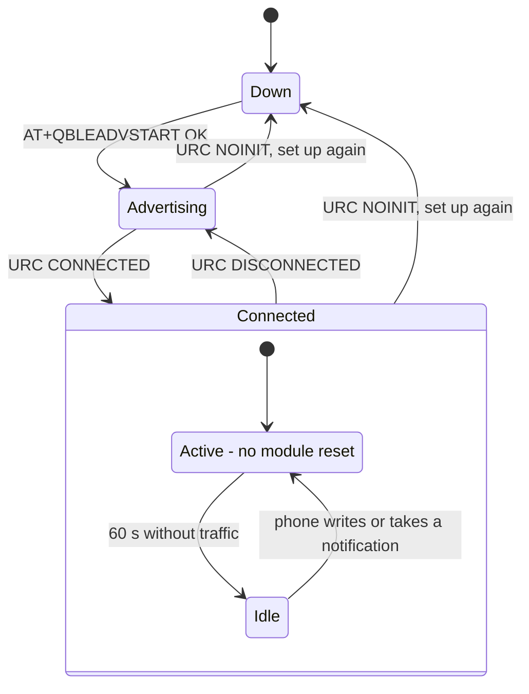

### 12. Wi-Fi station steps / Wi-Fi istasyonu adımları

*A wrong password gives no message at all, so the first connect has a 20 s limit. After a first success the module reconnects by itself and there is no limit. / Yanlış şifre hiçbir mesaj üretmez, bu yüzden ilk bağlanmanın 20 s sınırı vardır. İlk başarıdan sonra modül kendi yeniden bağlanır, sınır yoktur.*

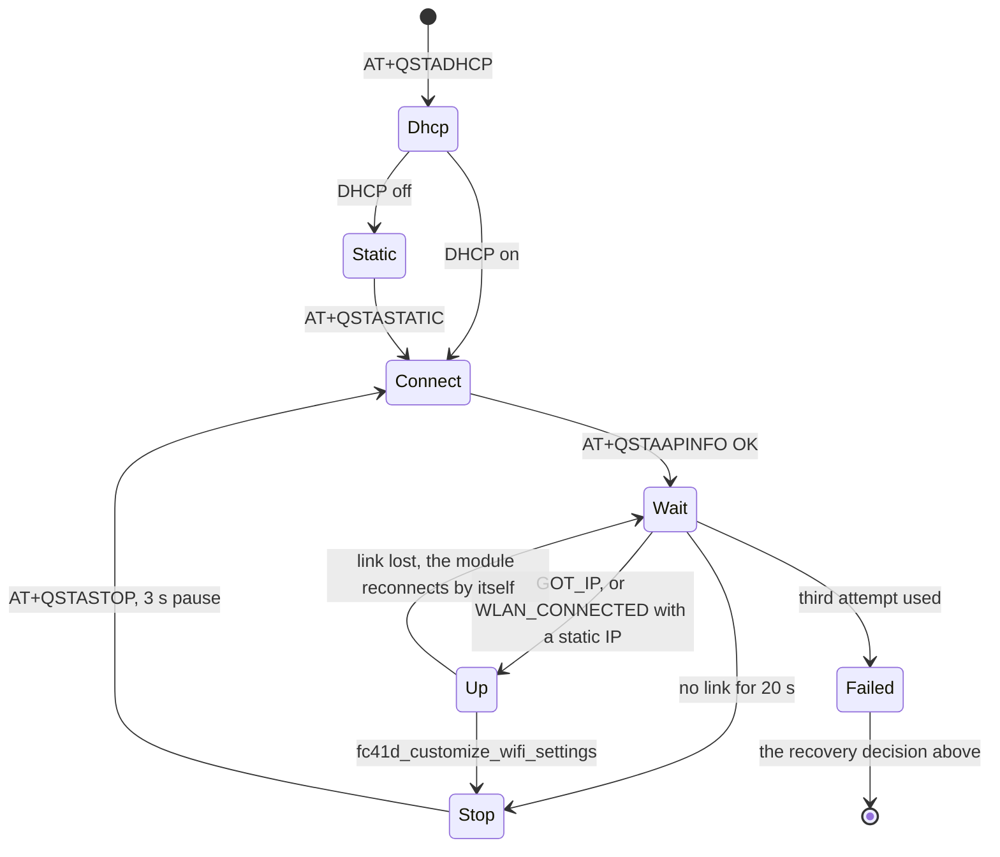

---

<a id="english"></a>
# English

## What it does

The driver manages the module over the UART (SCI-B, 115200) with AT commands. It can run **BLE (GATT server)**, **Wi-Fi (STA or AP)** and **TCP (client or server)** at the same time. No call blocks: everything advances in the state machine that runs in the main loop.

## Files

| File | Purpose |
|---|---|
| `FC41D_api.h/.c` | The only interface exposed to the application. The application includes only this |
| `FC41D_bridge.h/.c` | Test application: BLE ↔ TCP message bridge |
| `INC/FC41D_core.h`, `SRC/FC41D_core.c` | Driver core: state machine, command engine, recovery |
| `SRC/FC41D_parser.c` | Parses the bytes from the module, builds AT commands with `fc41d_format` |
| `SRC/FC41D_config.c`, `FC41D_ble.c`, `FC41D_wi-fi.c`, `FC41D_tcp.c` | Bring-up steps |
| `SRC/F2800157_port.c`, `INC/F2800157_port.h` | UART layer on the SCI FIFO |

## Requirements

- **MCU:** Texas Instruments C2000. Developed and tested on the TMS320F2800157-Q1. The UART layer (`SRC/F2800157_port.c`) uses the C2000Ware **driverlib** SCI functions; other C2000 devices with the same SCI API should work but are untested.
- **Compiler:** TI C2000 code generation tools. Tested with 22.6.3.LTS and `--c99 -v28 -ml -mt --float_support=fpu32 --abi=eabi`.
- **Module:** Quectel FC41D on a 3.3 V UART, 115200 8N1. Tested with firmware `FC41DAAR03A16M02` (see the module reference in `docs/`).
- **Files that are not part of this repository:** C2000Ware driverlib (`sci.h`, `inc/hw_types.h`, from Texas Instruments). `INC/HOL_Queue.h` (the ring buffer the driver uses) is included.

## Integration

1. Add the **repository root** (the folder that contains `FC41D_Driver/`) to the compiler include path. Every driver include is written as `#include "FC41D_Driver/..."`.
2. Add `FC41D_api.c` and all files in `SRC/` to your project. Add `FC41D_bridge.c` only if you want the BLE ↔ TCP test bridge.
3. **Linker section:** the driver instance is placed in a section called `debug_data` (`#pragma DATA_SECTION`), because internal RAM was tight in the original project. Either add such a section to your linker command file (for example `debug_data : > RAMLS0D`, room for about 2 kwords) or delete the two `#pragma DATA_SECTION` lines in `FC41D_api.c` and `FC41D_bridge.c`; the objects then go to `.bss`.
4. **Set up the SCI yourself** before `fc41d_api_initialize`: TX/RX pins, 115200 baud, 8N1 and the FIFOs enabled (the port layer uses the 16-level TX/RX FIFO status).
5. Make the three calls shown in Quick start.

## Quick start

**1) Settings table** (it stays in flash, no function call is needed to fill it):

```c
static const fc41d_api_settings_t fc41d_settings = {
    .type = FC41D_BLE_GATT_WITH_WIFI_AP_AND_TCP_SERVER,
    .setup = {
        .ble_gatt_config   = { .device_name = "FC41D_Dev", .service_uuid = "FFF0", .characteristic_uuid = "FFF1" },
        .wi_fi_ap_config   = { .ssid = "FC41D_AP", .password = "12345678" },
        .tcp_server_config = { .port = 8080 },
    },
    // .enable_pin_high = en_high, .enable_pin_low = en_low,   // module EN pin (for the hard reset)
};
```

The available types are in `FC41D_core.h`: `FC41D_BLE_GATT_ONLY`, `FC41D_WIFI_STA_AND_TCP_CLIENT`, `FC41D_BLE_GATT_WITH_WIFI_STA_AND_TCP_CLIENT`, ... Fill `.wi_fi_sta_config` for STA and `.tcp_client_config` for a TCP client.

**2) Three calls** (in your main file):

```c
fc41d_api_initialize(&g_fc41d_api, SCIB_BASE, &fc41d_settings);   // once, after the SCI is set up
fc41d_api_1ms_timer(&g_fc41d_api);   // in the 1 ms block, EVERY millisecond. Nothing happens without it
fc41d_api_polling(&g_fc41d_api);     // on EVERY pass of the main loop (outside the 1 ms block)
```

## Receiving messages (BLE, TCP client, TCP server: one function)

```c
char text[FC41D_MESSAGE_MAX];
uint16_t length;

switch(fc41d_get_message(&g_fc41d_api, text, &length)) {
    case FC41D_MESSAGE_BLE:        /* the phone wrote                         */ break;
    case FC41D_MESSAGE_TCP_SERVER: /* sender: g_fc41d_api.message_socket_id   */ break;
    case FC41D_MESSAGE_TCP_CLIENT: /* the server we are connected to          */ break;
    default:                       /* FC41D_MESSAGE_NONE                      */ break;
}
```

`text` ends with a NUL and `length` is the number of characters. At most `FC41D_MESSAGE_MAX - 1` (95) characters arrive at once. TCP is a byte stream: if you need message borders, end your messages with a delimiter of your own.

## Sending messages

```c
fc41d_api_ble_send(&g_fc41d_api, "hello", 5);                                  // BLE notification
fc41d_api_tcp_send(&g_fc41d_api, g_fc41d_api.message_socket_id, "hello", 5);   // one client
fc41d_api_tcp_send(&g_fc41d_api, FC41D_API_TCP_ALL_CLIENTS, "hello", 5);       // every connected client
```

The return value is the number of bytes queued. **0 = refused** (that channel is down, the text has CR/LF, a TCP text has `"`, or the queue is full). Each channel looks at its own state: while Wi-Fi is down BLE keeps sending.

## Changing settings at run time

```c
fc41d_customize_wifi_settings(&g_fc41d_api, "new_network", "new_password");   // STA: joins the new network, AP: renamed
fc41d_customize_tcp_settings(&g_fc41d_api, ip, 5000);                         // ip: uint8_t[4]; ignored by a TCP server (may be NULL)
```

Only the Wi-Fi or the socket is set up again; a connected BLE phone stays connected. Nothing happens if the value is the same. Call them from the main loop. The return value is `FC41D_API_OK`, `_INVALID_VALUE` (empty or long name, AP password shorter than 8, port 0, ...) or `_NOT_SUPPORTED`.

## Connection loss and recovery

- If one of Wi-Fi, TCP or BLE drops, **only that one** is set up again; the others keep working. `fc41d_api_is_ready` means "everything is up".
- **BLE has priority:** while a phone is connected and has talked within the last `FC41D_BLE_ACTIVE_MS` (60 s) the module is **never** reset. Only the Wi-Fi/TCP feature that gave up retries itself (every `FC41D_FEATURE_RETRY_MS`).
- If BLE is not in use and a feature gives up or the module stops answering (heartbeat `AT` after 10 s of silence, two unanswered in a row): first `AT+QRST` (soft), and if that does not help, the EN pin (hard).

## Watching in CCS (Expressions)

| Expression | Meaning |
|---|---|
| `g_fc41d_api.core.diag` | `faults`, `soft_resets`, `hard_resets`, `resets_blocked`, `feature_retries`, `pings`, `cmd_errors`, `cmd_timeouts`, `tx_dropped`, `rx_overflow`, `rx_dropped`, `last_fault_state`, `tick_missing`, `tx_log`, `rx_log` |
| `g_fc41d_api.core.parser.version` | Module firmware version |
| `g_fc41d_bridge` | Bridge counters and the last forwarded line |
| `fc41dPortTxChars`, `fc41dPortRxChars`, `fc41dPortRxErrors` | UART counters (a rising error count means polling is too slow) |

## Tunable constants

`INC/FC41D_core.h`: `FC41D_BLE_ACTIVE_MS`, `FC41D_FEATURE_RETRY_MS`, `FC41D_HEARTBEAT_MS`, `FC41D_PING_FAIL_LIMIT`, `FC41D_FAULT_OFF_MS`, `FC41D_FAULT_BACKOFF_MS`. If the main loop cannot run every 1 ms, define `FC41D_RX_FROM_ISR` in the project and call `fc41d_api_rx_service` from an interrupt of 1 ms or faster.

## Things to know

- Data is **text**. BLE: no CR/LF. TCP: no CR/LF and no `"`.
- If a phone writes exactly `ready`, `OK` or `ERROR` to BLE, the driver takes it for a line of the module itself. Do not use them in test messages.
- The driver object (~1.8 kwords) lives in the `debug_data` section (RAMLS0D). Check in the linker `.map` that the region does not overflow.
- Call every `fc41d_api_*` function from the main loop, not from an interrupt (except `fc41d_api_rx_service` and `fc41d_api_1ms_timer`).
- Source comments are in English; the critical functions carry a Doxygen `@brief` with parameters and return values.

## BLE ↔ TCP test bridge

One line under the `fc41d_api_polling` call: `fc41d_bridge_run(&g_fc41d_api);`. A message from BLE goes to the connected TCP clients as `BLE: <text>`, a message from TCP goes to the phone as `TCP8: <text>`. The bridge is a test tool; remove it when moving to product code.

---

<a id="türkçe"></a>
# Türkçe

## Ne yapar

Modülü UART (SCI-B, 115200) üzerinden AT komutlarıyla yönetir. Aynı anda **BLE (GATT sunucu)**, **Wi-Fi (STA veya AP)** ve **TCP (istemci veya sunucu)** çalıştırabilir. Hiçbir çağrı bekletmez, her şey ana döngüdeki durum makinesiyle ilerler.

## Dosyalar

| Dosya | Görevi |
|---|---|
| `FC41D_api.h/.c` | Dışarıya açılan tek arayüz. Uygulama sadece bunu include eder |
| `FC41D_bridge.h/.c` | Test uygulaması: BLE ↔ TCP mesaj köprüsü |
| `INC/FC41D_core.h`, `SRC/FC41D_core.c` | Sürücü çekirdeği: durum makinesi, komut motoru, kurtarma |
| `SRC/FC41D_parser.c` | Modülden gelen baytları ayrıştırır, `fc41d_format` ile AT komutu kurar |
| `SRC/FC41D_config.c`, `FC41D_ble.c`, `FC41D_wi-fi.c`, `FC41D_tcp.c` | Kurulum adımları |
| `SRC/F2800157_port.c`, `INC/F2800157_port.h` | SCI FIFO'ya bağlanan UART katmanı |

## Gereksinimler

- **MCU:** Texas Instruments C2000. TMS320F2800157-Q1 üzerinde geliştirildi ve test edildi. UART katmanı (`SRC/F2800157_port.c`) C2000Ware **driverlib** SCI fonksiyonlarını kullanır; aynı SCI arayüzüne sahip diğer C2000 cihazlarının çalışması beklenir ama test edilmemiştir.
- **Derleyici:** TI C2000 code generation tools. 22.6.3.LTS ve `--c99 -v28 -ml -mt --float_support=fpu32 --abi=eabi` ile test edildi.
- **Modül:** 3,3 V UART üzerinde Quectel FC41D, 115200 8N1. `FC41DAAR03A16M02` firmware'iyle test edildi (bkz. `docs/` altındaki modül referansı).
- **Bu depoda olmayan dosyalar:** C2000Ware driverlib (`sci.h`, `inc/hw_types.h`, Texas Instruments'tan). `INC/HOL_Queue.h` (sürücünün kullandığı halka tampon) depoda vardır.

## Entegrasyon

1. **Depo kökünü** (`FC41D_Driver/` klasörünü içeren klasör) derleyicinin include yoluna ekleyin. Sürücüdeki her include `#include "FC41D_Driver/..."` biçimindedir.
2. `FC41D_api.c` ve `SRC/` içindeki tüm dosyaları projenize ekleyin. BLE ↔ TCP test köprüsünü istiyorsanız `FC41D_bridge.c`'yi de ekleyin.
3. **Linker bölümü:** sürücü nesnesi, özgün projede dahili RAM dar olduğu için `debug_data` adlı bir bölüme konur (`#pragma DATA_SECTION`). Ya linker komut dosyanıza böyle bir bölüm ekleyin (örneğin `debug_data : > RAMLS0D`, yaklaşık 2 kword yer) ya da `FC41D_api.c` ve `FC41D_bridge.c` içindeki iki `#pragma DATA_SECTION` satırını silin; nesneler o zaman `.bss`'e gider.
4. `fc41d_api_initialize` çağrısından önce **SCI'yı kendiniz ayarlayın**: TX/RX pinleri, 115200 baud, 8N1 ve FIFO'lar açık (port katmanı 16 seviyeli TX/RX FIFO durumunu kullanır).
5. Hızlı başlangıçtaki üç çağrıyı yapın.

## Hızlı başlangıç

**1) Ayar tablosu** (flash'ta durur, doldurmak için fonksiyon çağrısı yok):

```c
static const fc41d_api_settings_t fc41d_settings = {
    .type = FC41D_BLE_GATT_WITH_WIFI_AP_AND_TCP_SERVER,
    .setup = {
        .ble_gatt_config   = { .device_name = "FC41D_Dev", .service_uuid = "FFF0", .characteristic_uuid = "FFF1" },
        .wi_fi_ap_config   = { .ssid = "FC41D_AP", .password = "12345678" },
        .tcp_server_config = { .port = 8080 },
    },
    // .enable_pin_high = en_high, .enable_pin_low = en_low,   // modülün EN pini (hard reset için)
};
```

Tür seçenekleri `FC41D_core.h` içinde: `FC41D_BLE_GATT_ONLY`, `FC41D_WIFI_STA_AND_TCP_CLIENT`, `FC41D_BLE_GATT_WITH_WIFI_STA_AND_TCP_CLIENT` vb. STA için `.wi_fi_sta_config`, TCP istemci için `.tcp_client_config` doldurulur.

**2) Üç çağrı** (ana dosyanızda):

```c
fc41d_api_initialize(&g_fc41d_api, SCIB_BASE, &fc41d_settings);   // bir kez, SCI ayarlandıktan sonra
fc41d_api_1ms_timer(&g_fc41d_api);   // 1 ms bloğunda, HER milisaniye. Çağrılmazsa hiçbir şey olmaz
fc41d_api_polling(&g_fc41d_api);     // ana döngünün HER turunda (1 ms bloğunun dışında)
```

## Mesaj alma (BLE, TCP istemci, TCP sunucu: tek fonksiyon)

```c
char text[FC41D_MESSAGE_MAX];
uint16_t length;

switch(fc41d_get_message(&g_fc41d_api, text, &length)) {
    case FC41D_MESSAGE_BLE:        /* telefon yazdı                           */ break;
    case FC41D_MESSAGE_TCP_SERVER: /* gönderen: g_fc41d_api.message_socket_id */ break;
    case FC41D_MESSAGE_TCP_CLIENT: /* bağlandığımız sunucu                    */ break;
    default:                       /* FC41D_MESSAGE_NONE                      */ break;
}
```

`text` NUL ile biter, `length` karakter sayısıdır. En fazla `FC41D_MESSAGE_MAX - 1` (95) karakter gelir. TCP bir akıştır: mesaj sınırı gerekiyorsa mesajların sonuna kendi ayracını koy.

## Mesaj gönderme

```c
fc41d_api_ble_send(&g_fc41d_api, "merhaba", 7);                                  // BLE bildirimi
fc41d_api_tcp_send(&g_fc41d_api, g_fc41d_api.message_socket_id, "merhaba", 7);   // tek istemci
fc41d_api_tcp_send(&g_fc41d_api, FC41D_API_TCP_ALL_CLIENTS, "merhaba", 7);       // bağlı herkes
```

Dönüş değeri kuyruğa alınan bayttır. **0 = reddedildi** (o kanal ayakta değil, metinde CR/LF var, TCP metninde `"` var ya da kuyruk dolu). Her kanal kendi durumuna bakar: Wi-Fi düşükken BLE göndermeye devam eder.

## Çalışma anında değiştirme

```c
fc41d_customize_wifi_settings(&g_fc41d_api, "yeni_ag", "yeni_sifre");   // STA: yeni ağa bağlanır, AP: yeniden adlandırılır
fc41d_customize_tcp_settings(&g_fc41d_api, ip, 5000);                   // ip: uint8_t[4]; TCP sunucuda yok sayılır (NULL olabilir)
```

Sadece Wi-Fi veya soket yeniden kurulur, bağlı BLE telefonu kopmaz. Aynı değer verilirse hiçbir şey yapılmaz. Ana döngüden çağır. Dönüş `FC41D_API_OK`, `_INVALID_VALUE` (boş/uzun ad, AP şifresi 8 karakterden kısa, port 0, ...) ya da `_NOT_SUPPORTED` olur.

## Bağlantı kopması ve kurtarma

- Wi-Fi, TCP veya BLE'den biri koparsa **sadece o** yeniden kurulur, diğerleri çalışmaya devam eder. `fc41d_api_is_ready` "hepsi ayakta" demektir.
- **BLE önceliklidir:** telefon bağlı ve son `FC41D_BLE_ACTIVE_MS` (60 s) içinde konuştuysa modül **asla** resetlenmez. Sadece pes eden Wi-Fi/TCP özelliği kendini yeniden dener (her `FC41D_FEATURE_RETRY_MS`).
- BLE kullanımda değilse ve bir özellik pes ederse ya da modül cevap vermezse (10 s sessizlikte heartbeat `AT`, üst üste 2 cevapsız): önce `AT+QRST` (soft), işe yaramazsa EN pini ile (hard) sıfırlanır.

## CCS'te izleme (Expressions)

| İfade | Anlamı |
|---|---|
| `g_fc41d_api.core.diag` | `faults`, `soft_resets`, `hard_resets`, `resets_blocked`, `feature_retries`, `pings`, `cmd_errors`, `cmd_timeouts`, `tx_dropped`, `rx_overflow`, `rx_dropped`, `last_fault_state`, `tick_missing`, `tx_log`, `rx_log` |
| `g_fc41d_api.core.parser.version` | Modül firmware sürümü |
| `g_fc41d_bridge` | Köprü sayaçları ve son iletilen satır |
| `fc41dPortTxChars`, `fc41dPortRxChars`, `fc41dPortRxErrors` | UART sayaçları (hata sayacı artıyorsa polling yetişmiyor) |

## Ayarlanabilir sabitler

`INC/FC41D_core.h`: `FC41D_BLE_ACTIVE_MS`, `FC41D_FEATURE_RETRY_MS`, `FC41D_HEARTBEAT_MS`, `FC41D_PING_FAIL_LIMIT`, `FC41D_FAULT_OFF_MS`, `FC41D_FAULT_BACKOFF_MS`. Ana döngü 1 ms'de bir dönemiyorsa projede `FC41D_RX_FROM_ISR` tanımla ve `fc41d_api_rx_service`'i ≤1 ms'lik kesmeden çağır.

## Bilmen gerekenler

- Veri **metindir**. BLE'de CR/LF olmamalı; TCP'de CR/LF ve `"` olmamalı.
- Telefon BLE'ye tam olarak `ready`, `OK` veya `ERROR` yazarsa sürücü bunu modülün kendi satırı sanır. Test mesajlarında kullanma.
- Sürücü nesnesi (~1,8 kword) `debug_data` bölümünde (RAMLS0D) durur. Linker `.map`'inde bölgenin taşmadığını kontrol et.
- Her `fc41d_api_*` çağrısı ana döngüden yapılmalıdır, kesmeden değil (`fc41d_api_rx_service` ve `fc41d_api_1ms_timer` hariç).
- Kaynak koddaki yorumlar İngilizcedir; kritik fonksiyonlarda parametreleri ve dönüş değerini anlatan Doxygen `@brief` bloğu vardır.

## BLE ↔ TCP test köprüsü

`fc41d_api_polling` çağrısının altına tek satır: `fc41d_bridge_run(&g_fc41d_api);`. BLE'den gelen mesaj `BLE: <metin>` olarak bağlı TCP istemcilerine, TCP'den gelen `TCP8: <metin>` olarak telefona gider. Köprü bir sınama aracıdır, ürün koduna geçerken çıkar.
