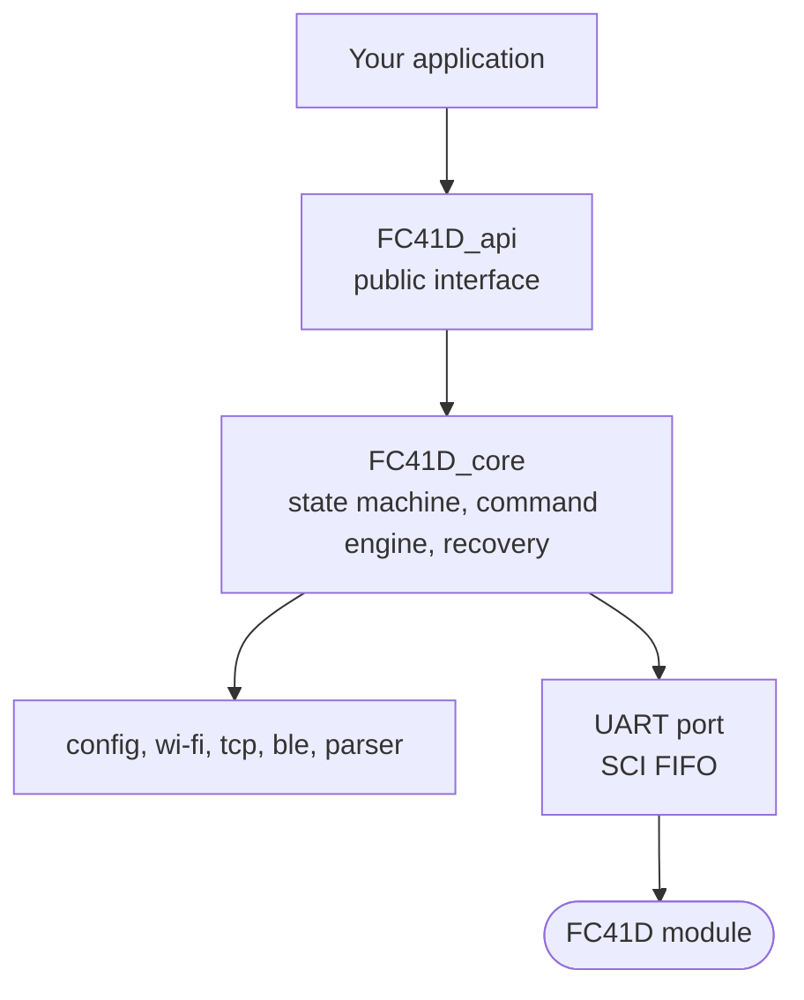

# FC41D API Firmware

**[English](#english)** | **[Türkçe](#türkçe)**

<a id="english"></a>

# English

A non-blocking C driver for the **Quectel FC41D** Wi-Fi + Bluetooth LE module on **Texas Instruments C2000** microcontrollers (developed on the TMS320F2800157-Q1), together with the field notes (AT commands, URCs, timings, firmware quirks) collected while building it.

## Features

- **BLE (GATT server), Wi-Fi (station or access point) and TCP (client or server) at the same time**, chosen with one setting. Nine communication types.
- **One call for every incoming message**: `fc41d_get_message()` returns text from BLE, from a TCP client or from the clients of a TCP server, and tells you which one.
- **Independent channels.** A lost Wi-Fi link never stops BLE, and a lost BLE link never stops TCP. Each channel is set up again on its own.
- **BLE has priority.** While a phone is connected and talking, the module is never reset. When BLE is not in use, a failed feature or a hung module is recovered with a soft reset (`AT+QRST`) and, if needed, a hard reset (enable pin).
- **Run-time changes** of the Wi-Fi name / password and of the TCP target / port (`fc41d_customize_wifi_settings`, `fc41d_customize_tcp_settings`) without disturbing a connected BLE phone.
- **No dynamic memory, no blocking calls.** Everything runs from a 1 ms tick and a polling call in the main loop.
- **Diagnostics** for a debugger watch window: command counters, reset counters, the last AT text sent and received.



## Repository layout

```
fc41d_api_firmware/
├── README.md                           this file
├── docs/
│   ├── FC41D_wireless_module.md        module reference (English)
│   └── FC41D_wireless_module.tr.md     module reference (Türkçe)
├── LICENSE                             MIT license
└── FC41D_Driver/
    ├── README.md                       driver guide: integration, usage, diagrams (English + Türkçe)
    ├── FC41D_api.h / .c                public interface
    ├── FC41D_bridge.h / .c             optional BLE <-> TCP test bridge
    ├── INC/                            internal headers, HOL_Queue.h (the ring buffer the driver uses)
    └── SRC/                            state machines, parser, UART port
```

The sources include each other as `FC41D_Driver/...`, so add the **repository root** (the folder that contains `FC41D_Driver/`) to your compiler include path.

## Quick start

1. Read **[the driver guide](FC41D_Driver/README.md)**: requirements, integration steps (include path, linker section, SCI setup) and the full API.
2. Fill one settings table, then make three calls:

```c
fc41d_api_initialize(&g_fc41d_api, SCIB_BASE, &fc41d_settings);   // once
fc41d_api_1ms_timer(&g_fc41d_api);   // every millisecond
fc41d_api_polling(&g_fc41d_api);     // every pass of the main loop
```

## Documentation

| Document | Content |
|---|---|
| [Driver guide](FC41D_Driver/README.md) | Requirements, integration, API, recovery rules, diagrams (English + Türkçe) |
| [Module reference (English)](docs/FC41D_wireless_module.md) | Wi-Fi, TCP and BLE commands, URCs, timings and test findings of the FC41D |
| [Module reference (Türkçe)](docs/FC41D_wireless_module.tr.md) | The same document in Turkish |
| Header files | Every critical function has a short Doxygen `@brief` with parameters and return values |

## Status and testing

| Verified on hardware | Not verified yet |
|---|---|
| Idle stability, BLE disconnect and reconnect, power loss of the module with automatic recovery, TCP client drop and reconnect, message throughput (no drops or freezes were seen), BLE <-> TCP bridge in both directions. Configurations: BLE only, and BLE + Wi-Fi access point + TCP server. Firmware `FC41DAAR03A16M02`. | Changing the access point name at run time, the hard reset (no enable pin was wired), the other communication types on real hardware. |

The other communication types and the recovery rules were exercised against a PC-side simulation of the module (not part of this repository).

## Known limitations

- Data is **text**. BLE: no CR/LF. TCP: no CR/LF and no double quote.
- The module's lines (`OK`, `ERROR`, `ready`) cannot be told apart from the same text written by a phone over BLE. Do not use these three words as test messages.
- The module reference is a set of lab notes. Parts of it describe older firmware (marked in the text); check the status markers (verified / documented / unknown) before relying on a detail.

## About Quectel

This project is independent. It is not affiliated with, endorsed or supported by Quectel Wireless Solutions. **Quectel** and **FC41D** are trademarks of their respective owners. For the official module documentation and downloads see <https://www.quectel.com/product/wi-fi-bluetooth-fc41d/>.

## License

Released under the [MIT License](LICENSE). Copyright (c) 2026 Furkan YAYLA.

The license covers the code and the notes of this repository. Quectel's own documents, names and trademarks are not part of it and remain the property of their owners.

## Author

Furkan YAYLA — furkan.yayla.dev@gmail.com

---

<a id="türkçe"></a>

# Türkçe

**Texas Instruments C2000** mikrodenetleyicileri (TMS320F2800157-Q1 üzerinde geliştirildi) için, **Quectel FC41D** Wi-Fi + Bluetooth LE modülünü yöneten, bloklamayan bir C sürücüsü. Yanında, sürücüyü yazarken toplanan saha notları da var (AT komutları, URC'ler, zamanlamalar, firmware tuhaflıkları).

## Özellikler

- **BLE (GATT sunucu), Wi-Fi (istasyon veya erişim noktası) ve TCP (istemci veya sunucu) aynı anda**, tek bir ayarla seçilir. Dokuz haberleşme türü.
- **Gelen her mesaj için tek çağrı:** `fc41d_get_message()` BLE'den, bir TCP istemcisinden ya da TCP sunucunun istemcilerinden gelen metni verir ve hangisi olduğunu söyler.
- **Bağımsız kanallar.** Kopan Wi-Fi bağlantısı BLE'yi, kopan BLE bağlantısı TCP'yi durdurmaz. Her kanal kendi başına yeniden kurulur.
- **BLE önceliklidir.** Bir telefon bağlı ve konuşuyorken modül asla resetlenmez. BLE kullanımda değilken pes eden bir özellik ya da takılan modül, soft reset (`AT+QRST`) ve gerekirse hard reset (enable pini) ile kurtarılır.
- Wi-Fi adı / şifresinin ve TCP hedefi / portunun **çalışma anında değiştirilmesi** (`fc41d_customize_wifi_settings`, `fc41d_customize_tcp_settings`); bağlı BLE telefonu kopmaz.
- **Dinamik bellek yok, bloklayan çağrı yok.** Her şey 1 ms'lik bir tik ve ana döngüdeki bir polling çağrısıyla çalışır.
- Debugger izleme penceresi için **tanılama**: komut ve reset sayaçları, gönderilen ve alınan son AT metni.

## Depo yapısı

```
fc41d_api_firmware/
├── README.md                           bu dosya
├── docs/
│   ├── FC41D_wireless_module.md        modül referansı (English)
│   └── FC41D_wireless_module.tr.md     modül referansı (Türkçe)
├── LICENSE                             MIT lisansı
└── FC41D_Driver/
    ├── README.md                       sürücü kılavuzu: entegrasyon, kullanım, diyagramlar (English + Türkçe)
    ├── FC41D_api.h / .c                dışarıya açılan arayüz
    ├── FC41D_bridge.h / .c             isteğe bağlı BLE <-> TCP test köprüsü
    ├── INC/                            iç başlıklar, HOL_Queue.h (sürücünün kullandığı halka tampon)
    └── SRC/                            durum makineleri, ayrıştırıcı, UART portu
```

Kaynak dosyalar birbirini `FC41D_Driver/...` biçiminde include eder, bu yüzden **depo kökünü** (`FC41D_Driver/` klasörünü içeren klasör) derleyicinin include yoluna ekleyin.

## Hızlı başlangıç

1. **[Sürücü kılavuzunu](FC41D_Driver/README.md)** okuyun: gereksinimler, entegrasyon adımları (include yolu, linker bölümü, SCI ayarı) ve tüm API.
2. Tek bir ayar tablosunu doldurun, sonra üç çağrı yapın:

```c
fc41d_api_initialize(&g_fc41d_api, SCIB_BASE, &fc41d_settings);   // bir kez
fc41d_api_1ms_timer(&g_fc41d_api);   // her milisaniye
fc41d_api_polling(&g_fc41d_api);     // ana döngünün her turunda
```

## Dokümantasyon

| Belge | İçerik |
|---|---|
| [Sürücü kılavuzu](FC41D_Driver/README.md) | Gereksinimler, entegrasyon, API, kurtarma kuralları, diyagramlar (English + Türkçe) |
| [Modül referansı (English)](docs/FC41D_wireless_module.md) | FC41D'nin Wi-Fi, TCP ve BLE komutları, URC'leri, zamanlamaları ve test bulguları |
| [Modül referansı (Türkçe)](docs/FC41D_wireless_module.tr.md) | Aynı belgenin Türkçesi |
| Başlık dosyaları | Her kritik fonksiyonda parametreleri ve dönüş değerini anlatan kısa bir Doxygen `@brief` vardır |

## Durum ve testler

| Donanımda doğrulananlar | Henüz doğrulanmayanlar |
|---|---|
| Boşta kararlılık, BLE kopma ve yeniden bağlanma, modülün gücü kesilince otomatik toparlanma, TCP istemci kopma ve yeniden bağlanma, mesaj hızı (kopma veya donma görülmedi), BLE <-> TCP köprüsü her iki yönde. Yapılandırmalar: sadece BLE, ve BLE + Wi-Fi erişim noktası + TCP sunucu. Firmware `FC41DAAR03A16M02`. | Erişim noktası adını çalışma anında değiştirme, hard reset (enable pini bağlı değildi), diğer haberleşme türlerinin gerçek donanımda denenmesi. |

Diğer haberleşme türleri ve kurtarma kuralları, modülün PC tarafındaki bir simülasyonuna karşı denendi (bu depoda yoktur).

## Bilinen kısıtlar

- Veri **metindir**. BLE'de CR/LF olmamalı; TCP'de CR/LF ve çift tırnak olmamalı.
- Modülün satırları (`OK`, `ERROR`, `ready`), bir telefonun BLE üzerinden yazdığı aynı metinden ayırt edilemez. Bu üç sözcüğü test mesajı olarak kullanmayın.
- Modül referansı bir laboratuvar notları derlemesidir. Bir kısmı eski firmware'leri anlatır (metinde işaretlidir); bir ayrıntıya güvenmeden önce durum işaretlerine (doğrulandı / dokümante / bilinmiyor) bakın.

## Quectel hakkında

Bu proje bağımsızdır; Quectel Wireless Solutions ile bağlantılı değildir, onun tarafından onaylanmamış ya da desteklenmemektedir. **Quectel** ve **FC41D**, ilgili sahiplerinin ticari markalarıdır. Resmî modül dokümantasyonu ve indirmeler için bkz. <https://www.quectel.com/product/wi-fi-bluetooth-fc41d/>.

## Lisans

[MIT Lisansı](LICENSE) ile yayınlanmıştır. Telif hakkı (c) 2026 Furkan YAYLA.

Lisans bu deponun kodunu ve notlarını kapsar. Quectel'in kendi belgeleri, adları ve ticari markaları kapsam dışıdır ve sahiplerine aittir.

## Yazar

Furkan YAYLA — furkan.yayla.dev@gmail.com
