# FC41D Wireless Module — Protocol Reference

> **Unofficial, independent document.** This document is not affiliated with Quectel Wireless Solutions and has not been endorsed by it. Its content is a set of notes compiled from the author's experiments on the FC41D module and from the Quectel documents cited as sources; it may contain errors. For authoritative information, always consult Quectel's official documentation: <https://www.quectel.com/product/wi-fi-bluetooth-fc41d/>. Quectel and FC41D are trademarks of their respective owners.
>
> The Wi-Fi network names, passwords, IP and MAC addresses in this document are **example values** changed for sharing.

> **Scope:** This document covers the **Wi-Fi** and **TCP/UDP** subsystems (the BLE sections are left empty until the relevant phase begins). The Wi-Fi section is complete as far as experiments go; the command/event dictionary of the TCP section is complete, while its live verification is still in progress (see §T15).
> **Tested hardware:** FC41D development kit, USB-TTL / COM4, firmware `FC41DAAR03A01.bin_202107021122` (2021-07-02). On 2026-09-14 it was upgraded with the official Quectel QFlash procedure to `FC41DAAR03A14M02.bin_202508171313` (2025-08-17), same physical device (MAC `64:c4:03:00:00:2d` unchanged). All findings after this date were obtained with the new firmware; older findings specific to the 2021 firmware are preserved with the **⏮ 2021 fw** label (see §W-RETEST and §B12).
> **Sources:** Quectel AT Commands Manual v2.2 (134 pp.; official page: <https://www.quectel.com/product/wi-fi-bluetooth-fc41d/>) + Quectel Wi-Fi Pairing Guide v1.0 (16 pp.) + the live USB-TTL verification session of 2026-09-10 (§19; raw logs are not published in this repository) + the post-firmware-upgrade re-test session of 2026-09-14 (§W-RETEST, §B12).
>
> Diagrams are in [Mermaid](https://mermaid.js.org) format — they are rendered graphically automatically in tools such as VS Code, GitHub, Obsidian and Typora.
>
> **Reading order:** Part A (§1-8) is the **dictionary** of the protocol — it explains what every command and event is, and what you send and receive, one by one. Part B (§9-21) shows **how this dictionary comes together in practice** (flows, scenarios, timing, open questions). Read A first, then B.

---

## Overall Table of Contents

The document consists of 4 main sections; each section's own detailed table of contents (down to the numbered subheadings) is located right below it. The list below is for top-level navigation only.

- **[Wi-Fi Commands](#wi-fi-commands)** — [Table of Contents — Wi-Fi](#icindekiler--wi-fi)
  - [PART A — Command and Event Dictionary](#bolum-a) *(§1-8: Legend, Protocol Model, System Overview, UART/STA/AP/Web Pairing commands, URCs, §7.5 Firmware re-test)*
  - [PART B — Implementation: Flows, Scenarios, Verification](#bolum-b) *(§9-21: Flow summaries, State Machine, Sequence diagrams, Timing, Open Questions, Driver-Critical Findings)*
- **[TCP Commands](#tcp-commands)** — [Table of Contents — TCP](#icindekiler--tcp)
  - [T1-T9 — Command and Event Dictionary](#t1-tcp-mimarisi-ve-temel-kavramlar) *(Architecture, socket lifecycle, data exchange, configuration, server mode, mode transitions, error query, URCs, result codes)*
  - [T10-T17 — Implementation](#t10-at-a-glance--tcp-genel-akis) *(Overall flow, decision tree, state machine, sequence diagrams, timing, experimental validation, open questions, driver-critical findings)*
- **[BLE GATT Server Commands](#ble-gatt-server-commands)** — [Table of Contents — BLE GATT Server](#icindekiler--ble-gatt-server)
  - [B1-B11 — 2021 firmware findings](#b1-en-kritik-bulgu) *(no GATT Server, command inventory, advertiser subset, firmware quirks, URC/state machine, sequence diagrams, experimental validation, open questions, driver-critical findings, PC BLE verification)*
  - [B12 — Re-test after firmware upgrade (2026-09-14)](#b12-firmware-yeniden-test) *(GATT Server now works, notify fixed, first tests of the central role, the `CMDRSP:` wrapper is gone, still no disconnect notification)*
- **[BLE GATT Client Commands](#ble-gatt-client-commands)** *(not filled in yet; for the first central-role findings see §B12.4)*


---

<a id="wi-fi-commands"></a>
## Wi-Fi Commands

<a id="icindekiler--wi-fi"></a>
### Table of Contents — Wi-Fi

**Part A — Command and Event Dictionary**
1. [Legend and Symbols](#1-legend-ve-semboller)
2. [Core Protocol Model](#2-temel-protokol-modeli)
3. [System Overview](#3-sistem-genel-bakis)
4. [Command Reference — System and UART](#4-komut-referansi--sistem-ve-uart)
5. [Command Reference — STA Client Mode](#5-komut-referansi--sta-istemci-modu)
6. [Command Reference — AP SoftAP Mode](#6-komut-referansi--ap-softap-modu)
7. [Command Reference — Web Pairing](#7-komut-referansi--web-pairing)
8. [Asynchronous Notifications — URC Reference](#8-asenkron-bildirimler--urc-referansi)

**Part B — Implementation: Flows, Scenarios, Verification**

9. [At a Glance — Overall Flow](#9-at-a-glance--genel-akis)
10. [Engineer Quick Reference](#10-engineer-quick-reference)
11. [Initialization Sequence](#11-initialization-sequence)
12. [Which Command Should I Use? — Decision Tree](#12-hangi-komutu-kullanmaliyim--decision-tree)
13. [State Machine](#13-state-machine)
14. [TX/RX Sequence Diagrams — Scenarios](#14-txrx-sequence-diyagramlari--senaryolar)
15. [Timing](#15-timing)
16. [Runtime Monitoring — Polling vs Event-Driven](#16-runtime-monitoring--polling-vs-event-driven)
17. [Connection Loss & Recovery](#17-connection-loss--recovery)
18. [Open Questions](#18-open-questions)
19. [Experimental Validation](#19-experimental-validation)
20. [Driver-Critical Findings](#20-driver-critical-findings)
21. [Appendix — Sources and Methodology](#21-ek--kaynaklar-ve-metodoloji)


---
---

<a id="bolum-a"></a>
### PART A — Command and Event Dictionary

---

<a id="1-legend-ve-semboller"></a>
#### 1. Legend and Symbols

| Symbol | Meaning |
|:---:|---|
| 📘 `DOCUMENTED` | Written verbatim in the Quectel PDFs |
| 🧪 `VERIFIED` | Observed first-hand in the 2026-09-10 USB-TTL session |
| 🔎 `INFERRED` | Logical inference from the document/observation, not directly proven |
| ❓ `UNKNOWN` | Neither in the document nor in an experiment — still needs to be tested |
| ✅ | PASS / works |
| ❌ | FAIL / does not work |
| ⬜ | NOT TESTED |
| 🔶 | INFERRED / partial |
| ⭐ | DRIVER-CRITICAL — directly affects the driver architecture |

In diagrams: **solid arrow + filled head** = command (synchronous request) · **dashed arrow + filled head** = synchronous response · **dashed arrow + open head** = asynchronous URC · **rectangular box** = step/command · **diamond (◇)** = decision point · **rounded** = start/end state.

---

<a id="2-temel-protokol-modeli"></a>
#### 2. Core Protocol Model

The loop below is the skeleton of **every** interaction with the FC41D — all diagrams in Part B are concrete examples of these five steps:

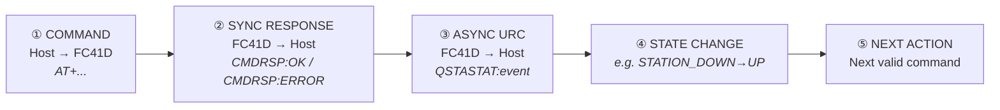

> ⭐ **DRIVER-CRITICAL:** ② and ③ are **not the same channel**. `CMDRSP:OK` indicates that the command was accepted; only the URC in ③ gives the actual outcome (whether it connected, whether it got an IP). The driver must **never** naively pair these two as if one were the continuation of the other — URCs are an independent channel and can arrive at any time.

---

<a id="3-sistem-genel-bakis"></a>
#### 3. System Overview

| Property | Value | Evidence |
|---|---|---|
| Firmware | `FC41D_VERSION:FC41DAAR03A01.bin_202107021122` | 🧪 |
| MAC (this unit) | `64:c4:03:00:00:2d` — differs on every module | 🧪 |
| UART | 115200 baud / 8N1 / no flow control | 🧪 |
| Command terminator | `<CR>` is sufficient | 📘 🧪 |
| Echo default | ON | 🧪 |
| Boot message | `ready` (~3 s after `AT+QRST`) | 🧪 |
| Default IP/gateway in AP mode | `192.168.19.1` / mask `255.255.255.0` | 🧪 |
| Wi-Fi-specific error code | None — only the generic `CMDRSP:ERROR` | 🧪 📘 |
| STA+AP concurrency | **Supported** | 🧪 |
| Persistent (remembered after reset) Wi-Fi setting | **None** — the `DEF` commands do not work | 🧪 |

> ⚠️ **The most important rule throughout this document:** This module's firmware (2021-07-02) is older than the Quectel AT Commands Manual v2.2 (some commands were added in 2025/2026). Consequence: some commands in §4-7 are marked ❌ — they do not work at all. For the ones that do work, the raw response format also differs from the document (full comparison in §19). **Always take the `🧪 real TX/RX examples` on these pages as authoritative, and rely on the document only for "purpose/parameter" information.**

---

<a id="4-komut-referansi--sistem-ve-uart"></a>
#### 4. Command Reference — System and UART

| Command | What it does | TX (send) | RX — success | RX — error/none | Notes |
|---|---|---|---|---|---|
| `AT` | Checks that the module is alive and that communication is established | `AT` | `CMDRSP:OK` | `CMDRSP:ERROR` (rare) | Use it as the first step of every session |
| `AT+QRST` | Soft-resets the module | `AT+QRST` | `CMDRSP:OK`, followed by an asynchronous **`ready`** message within ~3 s | — | The module may not be fully ready until `ready` arrives; after a reset **all** Wi-Fi settings (STA/AP) are turned off, nothing is remembered |
| `AT+QVERSION` | Reads the firmware version information | `AT+QVERSION` | `FC41D_VERSION:FC41DAAR03A01.bin_202107021122` then `CMDRSP:OK` | `CMDRSP:ERROR` | Although the document gives the format `+QVERSION: <version>`, the real device responds with a different label |
| `AT+QWLMAC` | Reads the module's hardware MAC address | `AT+QWLMAC` | `CMDRSP:+WMAC:64:c4:03:00:00:2d` then `CMDRSP:OK` | `CMDRSP:ERROR` | The MAC differs on every module — read it from your own board and record it |
| `AT+QECHO=<0\|1>` | Determines whether your commands are echoed back to you (echo) | `AT+QECHO=0` (off) / `AT+QECHO=1` (on) | `CMDRSP:OK` | `CMDRSP:ERROR` | Default: **ON**. Not persistent, it comes back ON after every reset |
| `AT+QAIRKISS=<0\|1>` | Enables/disables the AirKiss (broadcast-based Wi-Fi provisioning) feature | `AT+QAIRKISS=1` | `CMDRSP:OK` | `CMDRSP:ERROR` | Only on/off was verified; its own provisioning flow (requires a dedicated mobile app) was not tested |
| ❌ `AT+QURCCFG=<0\|1\|?>` | *(📘 Documented)* Configures enabling/disabling of URC notifications | `AT+QURCCFG=1` | — | **Always `CMDRSP:ERROR`** 🧪 | Does not work on this firmware — not needed anyway, URCs flow by default |
| ❌ `AT+QPING=<IP>` | *(📘 Documented)* Pings the specified IP | `AT+QPING=8.8.8.8` | — | **Always `CMDRSP:ERROR`** 🧪 | Does not work on this firmware |
| ❌ `AT+QSETBAND=<baud>[,<save>]` | *(📘 Documented)* Changes the serial port baud rate | `AT+QSETBAND=9600,0` | — | **Always `CMDRSP:ERROR`** 🧪 | Does not work on this firmware — the baud rate stays fixed at 115200 |
| ⬜ `AT+QWLANOTA=<URL>[,<port>]` | *(📘 Documented)* Starts an OTA firmware update | — | — | — | Not tried at all in this session because it is risky |
| ⬜ `AT+QLOWPOWER` | *(📘 Documented)* Enters low-power mode; the Wi-Fi/BLE connection is cut, execution resumes without a reboot | — | — | — | Not tried, to avoid risking the hardware |
| ⬜ `AT+QDEEPSLEEP` | *(📘 Documented)* Enters deep sleep; the module **reboots** on wake-up | — | — | — | Not tried, to avoid risking the hardware |

---

<a id="5-komut-referansi--sta-istemci-modu"></a>
#### 5. Command Reference — STA Client Mode

| Command | What it does | TX (send) | RX — success | RX — error/none | Notes |
|---|---|---|---|---|---|
| `AT+QSTAAPINFO=<SSID>[,<pwd>]` | Connects to the specified Wi-Fi network — **the only way to connect** | `AT+QSTAAPINFO=MyNetwork,password1234` (omit `,<pwd>` for a network without a password) | `CMDRSP:OK` (accepted), followed by the asynchronous `QSTASTAT:WLAN_CONNECTED` → `QSTASTAT:GOT_IP` | If the password is wrong: **nothing** (complete silence). If the SSID does not exist: repeating `QSTASTAT:SCAN_NO_AP` | `OK` only means "accepted"; you are not connected yet — the real connection completes with `GOT_IP` ⭐ |
| ❌ `AT+QSTAAPINFODEF=<SSID>[,<pwd>]` | *(📘 Documented)* Same + saves the connection info persistently | `AT+QSTAAPINFODEF=MyNetwork,password1234` | — | **Always `CMDRSP:ERROR`** 🧪 | Does not work on this firmware — there is no way to store the SSID/password persistently |
| `AT+QSTASTOP` | Shuts down STA mode / the current connection | `AT+QSTASTOP` | `CMDRSP:OK`; if you were really connected, additionally `QSTASTAT:WLAN_DISCONNECTED` | `CMDRSP:ERROR` (rare) | If you are not connected anyway (e.g. while in the `SCAN_NO_AP` loop), only `OK` arrives, `WLAN_DISCONNECTED` does not |
| `AT+QSTAST` | Queries whether STA mode is on or off | `AT+QSTAST` | `CMDRSP:STATION_UP` or `CMDRSP:STATION_DOWN`, then `CMDRSP:OK` | `CMDRSP:ERROR` (rare) | ⚠️ **Do not rely on it alone** — when the AP disappears it may keep wrongly reporting `STATION_UP` ⭐ |
| `AT+QGETWIFISTATE` | Shows whether you are really connected, and the connection details | `AT+QGETWIFISTATE` | `CMDRSP:OK` then `QGETWIFISTATE:ssid=<name>,bssid=<mac>,rssi=<dBm>,channel=<n>,cipher_type=<type>` (**reversed order**, see §15) | When not connected: `CMDRSP:ERROR` | ⭐ The most reliable "am I really connected" check. `rssi` is a real negative dBm value (e.g. `-46`) |
| `AT+QGETIP=station` | Shows the IP address obtained in STA mode | `AT+QGETIP=station` | `QGETIP:ip:<ip>,gate:<gw>,mask:<mask>,dns:<dns>,` | When not connected, all fields are `0.0.0.0` | ⚠️ This command **never** returns `OK`/`ERROR` — wait only for the data line ⭐ |
| `AT+QSTADHCP=<0\|1>` | Enables/disables the DHCP client in STA mode | `AT+QSTADHCP=1` | `CMDRSP:OK` | `CMDRSP:ERROR` | Not persistent, DHCP comes back enabled after every reset |
| ❌ `AT+QSTADHCPDEF=<0\|1>` | *(📘 Documented)* Same + saves persistently | `AT+QSTADHCPDEF=1` | — | **Always `CMDRSP:ERROR`** 🧪 | Does not work on this firmware |
| `AT+QSTASTATIC=<ip>,<mask>,<gw>,<dns>` | Assigns a fixed (static) IP for STA mode | `AT+QSTASTATIC=192.168.1.50,255.255.255.0,192.168.1.1,8.8.8.8` | `CMDRSP:OK` | `CMDRSP:ERROR` | Not persistent |
| `AT+QWSCAN` | Scans for and lists nearby Wi-Fi networks | `AT+QWSCAN` | One line per network: `CMDRSP:+WSCAN:<SSID>,<security>,<signal>,<bssid> ,<channel>`, `CMDRSP:OK` at the very end | `CMDRSP:ERROR` | Takes ~4 s. `<security>`: `OPEN`/`WEP_SHARED`/`WPA_AES_PSK`/`WPA2_AES_PSK`. Hidden network = empty SSID. `<signal>` here is on a 0-100 quality scale — a **different scale** from the real dBm in `AT+QGETWIFISTATE`! |
| ❌ `AT+QSCANINTERVAL[=?\|?\|<n>]` | *(📘 Documented)* Sets the scan period in STA mode | — | — | **Always `CMDRSP:ERROR`** 🧪 | Does not work on this firmware |

---

<a id="6-komut-referansi--ap-softap-modu"></a>
#### 6. Command Reference — AP SoftAP Mode

| Command | What it does | TX (send) | RX — success | RX — error/none | Notes |
|---|---|---|---|---|---|
| `AT+QSOFTAP=<SSID>[,<key>]` | Turns the module itself into a Wi-Fi hotspot | `AT+QSOFTAP=FC41D_AP,12345678` (omit `,<key>` for no password) | `CMDRSP:OK` (~4 s) | `CMDRSP:ERROR` | The AP starts broadcasting immediately; it also works without problems while STA mode is on (concurrent — §13) |
| `AT+QSOFTAPSTOP` | Stops the AP broadcast | `AT+QSOFTAPSTOP` | `CMDRSP:OK` | `CMDRSP:ERROR` | — |
| `AT+QAPSTATE` | Queries whether AP mode is on or off | `AT+QAPSTATE` | `CMDRSP:SOFTAP_UP` or `CMDRSP:SOFTAP_DOWN`, then `CMDRSP:OK` | `CMDRSP:ERROR` (rare) | — |
| `AT+QGETIP=ap` | Shows the IP/gateway information of AP mode | `AT+QGETIP=ap` | `QGETIP:ip:192.168.19.1,gate:192.168.19.1,mask:255.255.255.0,dns:192.168.19.1,` | — | The default/fixed address of AP mode is always `192.168.19.1` |
| `AT+QAPSTATIC=<ip>,<mask>,<gw>,<dns>` | Assigns a different static IP for AP mode | `AT+QAPSTATIC=192.168.50.1,255.255.255.0,192.168.50.1,192.168.50.1` | `CMDRSP:OK` | `CMDRSP:ERROR` | Not persistent |
| ❌ `AT+QAPGETLIST` | *(📘 Documented)* Lists the clients connected to the AP (max. 2 STAs) | `AT+QAPGETLIST` | — | **`CMDRSP:ERROR` in every case** 🧪 | Does not work on this firmware; it was also not tested separately with a real client (❓ §18) |
| ❌ `AT+QAPCFG="linknum"[,<n>]` | *(📘 Documented)* Sets the maximum number of clients that can connect to the AP | — | — | **Always `CMDRSP:ERROR`** 🧪 | Does not work on this firmware |

---

<a id="7-komut-referansi--web-pairing"></a>
#### 7. Command Reference — Web Pairing

| Command | What it does | TX | RX — success | RX — error | Notes |
|---|---|---|---|---|---|
| ❌ `AT+QWEBCFG=<0\|1>` | *(📘 Documented)* Enables Wi-Fi setup through a web browser (accessible at `192.168.19.1` in AP mode) | `AT+QWEBCFG=1` | — | **Always `CMDRSP:ERROR`** 🧪 (regardless of whether the AP is on or off) | Does not work on this firmware |

---

<a id="w-retest"></a>
#### 7.5 ⭐ Re-test After Firmware Upgrade — 2026-09-14

**New firmware:** `FC41DAAR03A14M02.bin_202508171313` (2025-08-17), flashed with Quectel QFlash. Same physical device (COM4, MAC `64:c4:03:00:00:2d`). **All 9** commands marked ❌ in §4-§7 above were tried again against this new firmware. 🧪

| Command | 2021 fw | 2025 fw | Note |
|---|:---:|:---:|---|
| `AT+QURCCFG=<n>` (execute) | ❌ | ✅ **fixed** | `AT+QURCCFG=1` → `OK` |
| `AT+QURCCFG?` (query) | ❌ | ❌ | The query form is still `ERROR`, only the execute form was fixed |
| `AT+QPING=<IP>` | ❌ | ❓ **inconclusive** | The STA connection could not be established in this session (the password of the known network `WPA3_MIXED_NET` may have changed or be inaccessible). A fair test needs a real internet connection; it should be retried |
| `AT+QSETBAND=<baud>[,<save>]` | ❌ | ❓ **not tried** | Risky because it changes the baud rate live, so it was skipped in this session; it should be tried separately under controlled conditions (spare port ready) |
| `AT+QSTAAPINFODEF=<SSID>[,<pwd>]` | ❌ | ✅ **fixed** | Returned `OK`, persistent SSID/password storage is now accepted (whether it is really remembered after a reset was not verified separately) |
| `AT+QSTADHCPDEF=<0\|1>` | ❌ | ✅ **fixed** | Returned `OK` |
| `AT+QSCANINTERVAL[=?\|?\|<n>]` | ❌ | ❌ | Unchanged, tried both while not connected and while trying to connect to a STA |
| `AT+QAPGETLIST` | ❌ | ✅ **fixed** | Returned `OK` (the list content with a real connected client was not verified separately) |
| `AT+QAPCFG="linknum"[,<n>]` | ❌ | ✅ **fixed** | Returned `OK` |
| `AT+QWEBCFG=<0\|1>` | ❌ | ✅ **fixed** | Returned `OK` (access to `192.168.19.1` from a browser was not verified separately) |

> ⭐ **Summary: of the 9 commands, 6 are fixed, 2 are still broken, 1 (`QPING`) could not be tested fairly in this session, and 1 (`QSETBAND`) was intentionally not tried.** General pattern: the new firmware has closed most of the version gap with manual v2.2. But "returning OK" and "actually doing the documented function" are separate things; none of the commands marked ✅ **fixed** was verified end to end (e.g. `QAPGETLIST` returning content with a real client), only the `CMDRSP:ERROR`→`CMDRSP:OK` transition was verified. ❓ **Still open:** `QPING` should be retried with a real internet connection, and `QSETBAND` in a controlled environment.

---

<a id="w-retest-a16"></a>
#### 7.6 ⭐⭐ End-to-End Verification After Firmware A16M02 — 2026-09-23

**New firmware:** `FC41DAAR03A16M02.bin_202512160643` (2025-12-16). Same physical device (COM4, MAC `64:c4:03:00:00:2d`). In this round, without touching the GUI, raw AT commands were sent directly with `pyserial` (raw byte stream, `\r` terminator, no line splitting) — the goal was to test the commands that §7.5 had verified only at the `OK`/`ERROR` level, this time **truly end to end** (real client, real BLE central, real internet). In addition, a real BLE central (PC) was connected with `bleak` and the data exchange was verified first-hand.

**System / STA:**

| Command | A14 fw | A16 fw | Note |
|---|:---:|:---:|---|
| `AT+QSCANINTERVAL[=?\|?\|<n>]` | ❌ | ✅ **fixed** | All three forms work: `=?` → `(1-120)`, `?` → reads the current value, `=<n>` → sets it |
| `AT+QPING=<IP>` | ❓ inconclusive | ❌ **confirmed broken** | `ERROR` even while connected to an open network with internet access and a real DHCP IP — independent of the connection state, the command does not exist at all in this firmware family |
| `AT+QSTAAPINFODEF=<SSID>[,<pwd>]` + `AT+QSTADHCPDEF=1` persistence | ✅ (persistence not verified) | ✅ **fully verified** | After `AT+QRST`, **without sending any STA command**, the module connected to the same network automatically and obtained a new DHCP IP (`STATION_UP`, `AT+QGETIP=station` populated) ⭐ |
| `AT+QAPGETLIST` (with a real client) | ✅ (empty list verified) | ✅ **fully verified** | The PC really connected to `FC41D_AP`; `AT+QAPGETLIST` returned the correct MAC+IP: `1: mac:84-9e-56-33-be-9f, ip:192.168.19.100` |
| `AT+QWEBCFG=1` (browser access) | ✅ (only `OK`) | ✅ **fully verified** | `http://192.168.19.1` really serves the "FC41D smart config" page (SSID/Password/Baud Rate form) |
| `AT+QAPCFG="linknum"[,<n>]` | ✅ | ✅ | Unchanged, still works (default `2`) |
| `AT+QURCCFG=<n>` / `AT+QURCCFG?` | ✅ / ❌ | ✅ / ❌ | Unchanged — the execute form works, the query form is still `ERROR` |

> 🔴 **Important finding — cannot connect to `WPA3_MIXED_NET`:** With the `WPA3_MIXED_NET` / `<password>` credentials provided by the user, **even after a clean `AT+QRST`** the FC41D stayed in a `WLAN_DISCONNECTED` loop and never reached `WLAN_CONNECTED`. But **at the same time this PC's own Wi-Fi adapter connected to the same SSID/password without problems** — so the password is not stale or wrong. `AT+QWSCAN` sees the network with a strong signal (quality 53/100). For comparison, a connection attempt was made to an open (passwordless) network (`ESP_XXXXXX`) and `WLAN_CONNECTED` + a DHCP IP were obtained **immediately** — so the STA/DHCP chain is generally sound, and the problem lies specifically in the security mode of `WPA3_MIXED_NET` (`WPA3_WPA2_MIXED` — WPA3 transition mode). Probable cause: incompatibility of the FC41D with the WPA3 transition-mode (mixed PMF) handshake. **VERIFICATION REQUIRED** — it should be tested separately with a WPA2-only network.

> ⚠️ **Side finding:** After `AT+QSTASTOP` or a failed `AT+QSTAAPINFO` attempt, until a clean `AT+QRST` is done, the `AT+QSTAST` command no longer produces the `+QSTAST:STATION_UP/DOWN` data line and returns only a bare `OK` (the status query becomes functionally broken, while only appearing to work). This is a behavior that had not been noted before.

**BLE (clean `AT+QBLEINIT=2` → `QBLEGATTSSRV=FFF0` → `QBLEGATTSCHAR=FFF1,FF` → `QBLEADVSTART` — set up without problems on the first attempt, repeatable):**

| Command/Behavior | Previous finding | A16 fw | Note |
|---|:---:|:---:|---|
| `AT+QBLEGATTSNTFY=<uuid>,<data>` (to a real central) | ❌ (even while connected) | ✅ **fully verified** | Sent while the `bleak` central was connected; **exactly the byte sequence sent** (`0102`) was received in the central's `notify` callback |
| `AT+QBLEGATTSIND=<uuid>,<data>` (Indicate) | ❌ "returns OK but no data arrives" | ✅ **fully verified — the previous finding was WRONG** | In the same test the data `0304` was sent via indicate and **received correctly** on the central side |
| `write` from the central to the characteristic | ⬜ | ✅ **verified** | `bleak` wrote to FFF1 with `write_gatt_char()`, no error on the FC41D side |
| `+QBLESTAT:CONNECTED` / `DISCONNECTED` URCs | ❌ "never arrive" | ✅ **fully verified — the previous finding was WRONG** | In a real connect/disconnect cycle both URCs arrived at the right time |
| `+QBLEMTU:<512>` URC | 📘 ⬜ not observed | ✅ **verified** | At connection time the MTU is raised automatically to 512 and reported with a URC (printed twice — a minor quirk, it does not affect function) |
| Advertising state after a drop | ❌ "returns to NOINIT on its own" | ✅ **fixed** | It now automatically returns to `ADVERTISING` after the central drops, it no longer falls to `NOINIT` |
| `AT+QBLEMTUMODE?` / `=<n>` | ❌ both | ✅ **fixed** | Now both return `OK` (data content not verified) |
| `AT+QBLEURC?` (query) | ❌ | 🔶 **partial fix** | It now returns a bare `OK` instead of `ERROR`, but there is still no data line |
| `AT+QBLESRDATA=<hex>` | ✅ (fixed in A14) | ❌ **BROKEN AGAIN (regression)** | It returned `OK` in A14; in A16 it returns `ERROR` in both the unquoted and the quoted form, both with advertising on and off — a real step backward |
| `AT+QBLEADVPARAM?`, `AT+QBLEQADVPARAM?`, `AT+QBLECONNPARAM?`, `AT+QBLESCANPARAM?` | ❌ all | ❌ all | Unchanged |
| `AT+QBLESEND=<conn_idx>,<uuid>,<att_cfg>,<data_len>` | ❌ (had been tried with the old/wrong syntax) | ❌ | Retried with the correct 4-parameter syntax from the manual (`conn_idx=0`, several `att_cfg` variants), all `ERROR` — the exact meaning of the `att_cfg` field remained unclear (the manual's inference is corrupted in this section). **Low importance**: the same function (pushing data to the central) has already been proven end to end by `QBLEGATTSNTFY`/`QBLEGATTSIND` |
| `AT+QBLEGATTSCFGREAD` (not connected) | ❌ | ❌ | Unchanged (not tried separately while connected) |

> ⭐⭐ **The most important result of this round:** The findings of the earlier sessions that "data cannot be sent from BLE to the central" and that "indicate/CONNECTED-DISCONNECTED URCs do not work" are **no longer valid on this firmware** — verified end to end with a real `bleak` central: the FC41D can now **send data to the central with both notify and indicate** over its own defined GATT characteristic, the connection-state URCs (`CONNECTED`/`DISCONNECTED`/`MTU`) arrive correctly, and this worked **concurrently while SoftAP + web-config were active** (another verification of BLE+TCP/Wi-Fi concurrency, see §T5.x feasibility table row 5).

> 🔵 **Quectel support suggestion tested (2026-09-23):** Support noted in the shared log that DHCP had not been disabled and suggested "disable DHCP with `AT+QSTADHCPDEF=0` before defining a static IP and before connecting to the AP". It was tested in exactly this order (`AT+QSTADHCPDEF=0` → `AT+QSTASTATIC=192.168.200.63,255.255.255.0,192.168.200.1,8.8.8.8` → `AT+QSTAAPINFO=<ssid>`): **the mechanism is proven to work** — on an open network used as a control (`ESP_XXXXXX`) `WLAN_CONNECTED` occurred immediately and `AT+QGETIP=station` returned **exactly** the given static values (`192.168.200.63/192.168.200.1/255.255.255.0/8.8.8.8`). But when the same sequence was tried with `WPA3_MIXED_NET`, `WLAN_CONNECTED` was **again never reached** — so the DHCP/static IP setting is not the cause of this network-specific connection problem; the problem is in the WLAN association/handshake layer, before the IP assignment layer. Support's diagnosis focused on the wrong layer. **The method for verifying whether the static IP really took effect became clear:** after disabling DHCP and connecting, the output of `AT+QGETIP=station` must match the given values exactly.

> 🟡 **Not yet testable:** `AT+QSETBAND` (baud change — risky, awaiting permission), `AT+QDEEPSLEEP`/`AT+QLOWPOWER` (awaiting permission), `AT+QWLANOTA` (requires a real OTA server, not tried), the test of seeing/connecting to the BLE advertising from a phone (BLE-028/029 — a physical phone is required), the FC41D's commands in the BLE **central** role (`QBLEGATTCWR`/`CRD`/`NTFCFG`/`INDCFG`/`CONNPARAM` — a BLE **peripheral** simulator to connect to could not be set up easily from this PC).

---

<a id="8-asenkron-bildirimler--urc-referansi"></a>
#### 8. Asynchronous Notifications — URC Reference

These are messages that **the module sends on its own**, without you sending a command. Their format is **`QSTASTAT:<event>`** (no leading `+`, no quotes — different from the `+QSTASTAT: "..."` notation in the documentation).

| Event | When it arrives | What it means |
|---|---|---|
| `ready` | ~3 s after `AT+QRST` | The module has fully booted and is ready to accept commands |
| `QSTASTAT:WLAN_CONNECTED` | When joining a network succeeds at the L2 level | You have joined the network but **have not received an IP yet** |
| `QSTASTAT:GOT_IP` | Shortly after `WLAN_CONNECTED` | **You are now really connected** and can exchange data |
| `QSTASTAT:WLAN_DISCONNECTED` | Only when **you** close a really connected link with `AT+QSTASTOP` | Expected, clean shutdown |
| `QSTASTAT:SCAN_NO_AP` | (a) When the target SSID is never found **or** (b) when the target AP disappears while connected — **the same** message in both cases, repeating (every ~5-10 s) | The module cannot find the target and silently keeps searching in the background — **forever, until the AP is found or you stop it** ⭐ |
| `QSTASTAT:AP_CONNECT` *(📘 documented, not observed in this session)* | When a client connects while in AP mode (expected) | ❓ Not verified with a real client |
| `QSTASTAT:AP_DISCONNECT` *(📘 documented, not observed in this session)* | When a connected client leaves while in AP mode (expected) | ❓ Not verified with a real client |

---
---

<a id="bolum-b"></a>
### PART B — Application: Flows, Scenarios, Verification

> The command/event dictionary in Part A is now in your hands like a "vocabulary" — this section shows **what sentences those words form in real operations**.

---

<a id="9-at-a-glance--genel-akis"></a>
#### 9. At a Glance — Overall Flow

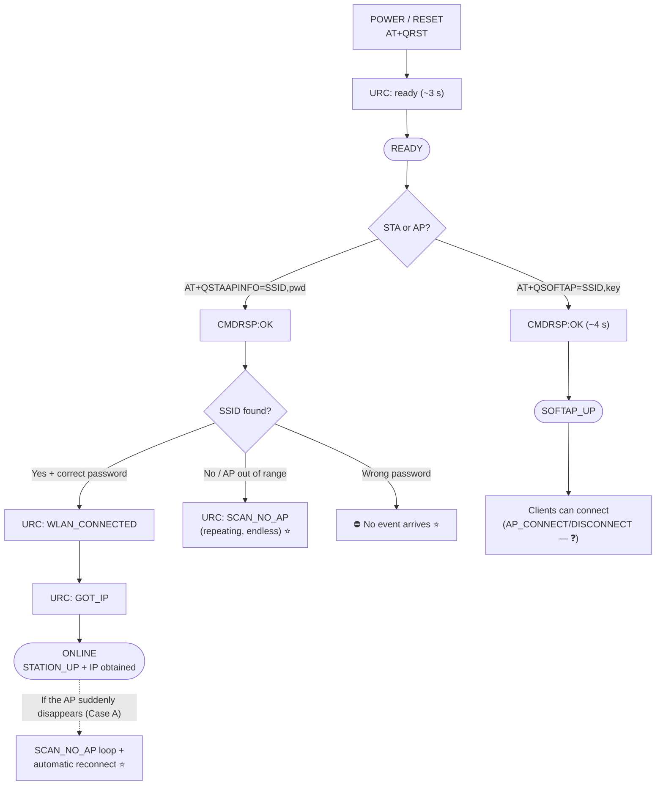

---

<a id="10-engineer-quick-reference"></a>
#### 10. Engineer Quick Reference

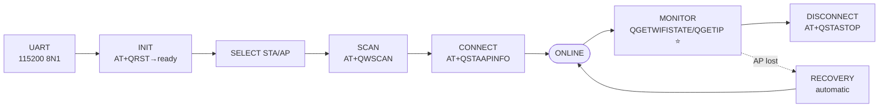

| Critical TX | Critical RX/URC | When |
|---|---|---|
| `AT+QSTAAPINFO=<SSID>,<pwd>` | `CMDRSP:OK` → `WLAN_CONNECTED` → `GOT_IP` | Establishing a connection |
| `AT+QSTASTOP` | `CMDRSP:OK` (+`WLAN_DISCONNECTED` if really connected) | Deliberate disconnect |
| `AT+QWSCAN` | `+WSCAN:...` × N lines, `CMDRSP:OK` | Network scan (~4 s) |
| `AT+QGETWIFISTATE` ⭐ | `CMDRSP:OK` + data (`CMDRSP:ERROR` if not connected) | Confirming the real state |
| `AT+QGETIP=station` | `QGETIP:ip:...,` (**OK/ERROR never arrives**) ⭐ | IP check |

---

<a id="11-initialization-sequence"></a>
#### 11. Initialization Sequence

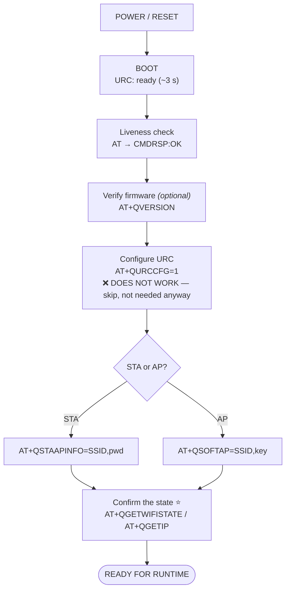

| Step | Action | TX | Expected RX | Mandatory? | Evidence |
|---|---|---|---|---|---|
| 1 | Wait for boot | — | `ready` | **Mandatory** | 🧪 |
| 2 | Liveness check | `AT` | `CMDRSP:OK` | Verification | 🧪 |
| 3 | Read firmware | `AT+QVERSION` | `FC41D_VERSION:...`+`CMDRSP:OK` | Optional | 🧪 |
| 4 | Configure URC | `AT+QURCCFG=1` | ❌ `CMDRSP:ERROR` | **Skip** — not present in this firmware, not needed | 🧪 |
| 5a | Start STA | `AT+QSTAAPINFO=<SSID>,<pwd>` | `CMDRSP:OK` → `WLAN_CONNECTED`→`GOT_IP` | Mandatory if a client is needed | 🧪 |
| 5b | Start AP | `AT+QSOFTAP=<SSID>,<key>` | `CMDRSP:OK` (~4 s) | Mandatory if a hotspot is needed | 🧪 |
| 6 | Confirm the state | `AT+QGETWIFISTATE` | `CMDRSP:OK`+data (otherwise `ERROR`) | **Mandatory** ⭐ | 🧪 |
| 7 | Get the IP | `AT+QGETIP=station\|ap` | `QGETIP:ip:...,` (no OK) | Mandatory | 🧪 |

---

<a id="12-hangi-komutu-kullanmaliyim--decision-tree"></a>
#### 12. Which Command Should I Use? — Decision Tree

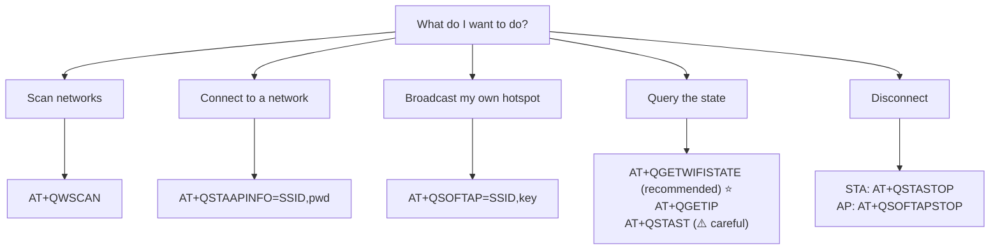

##### 12.1 Command → Event → State Relationship

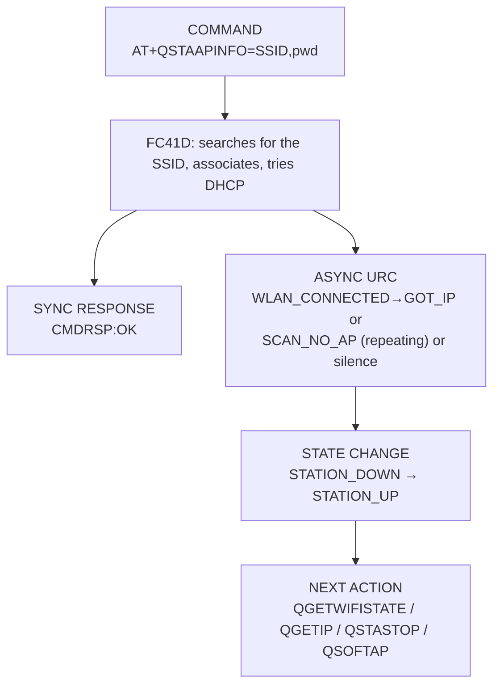

##### 12.2 Establishing a Connection — Success vs Failure Path

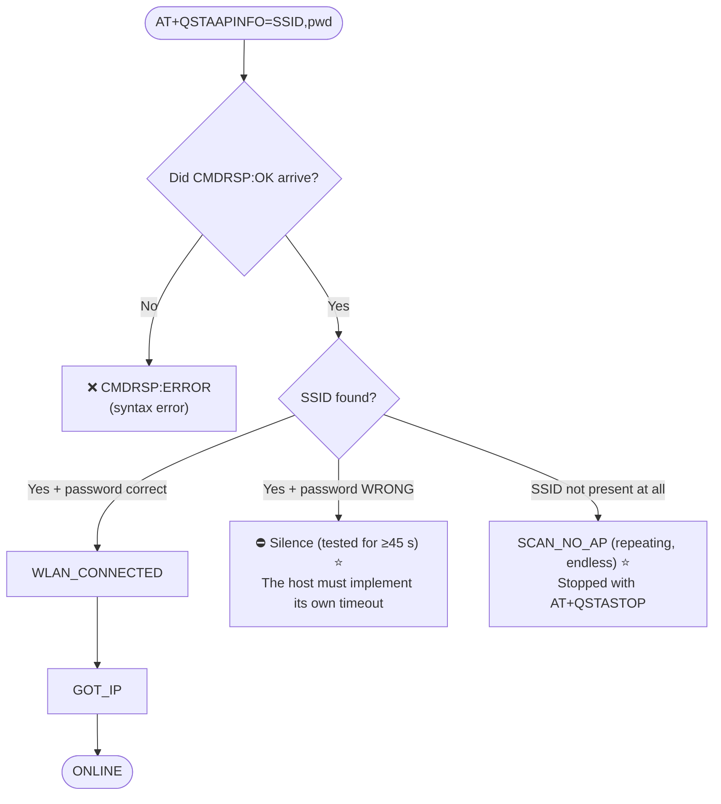

---

<a id="13-state-machine"></a>
#### 13. State Machine

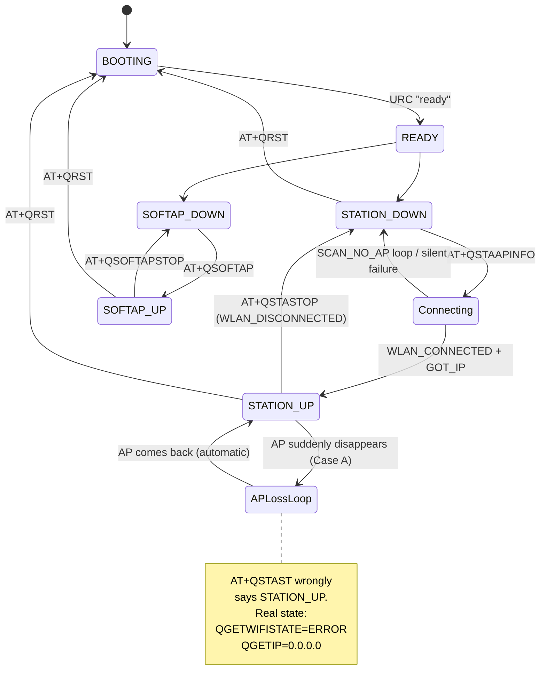

> 🧪 **VERIFIED:** The `STATION_DOWN/UP` branch and the `SOFTAP_DOWN/UP` branch are **independent of each other** and can be active at the same time (§14.6). Reset (`AT+QRST`) returns to `BOOTING` from both branches; no Wi-Fi setting is remembered.

---

<a id="14-txrx-sequence-diyagramlari--senaryolar"></a>
#### 14. TX/RX Sequence Diagrams — Scenarios

##### 14.1 Response Frame

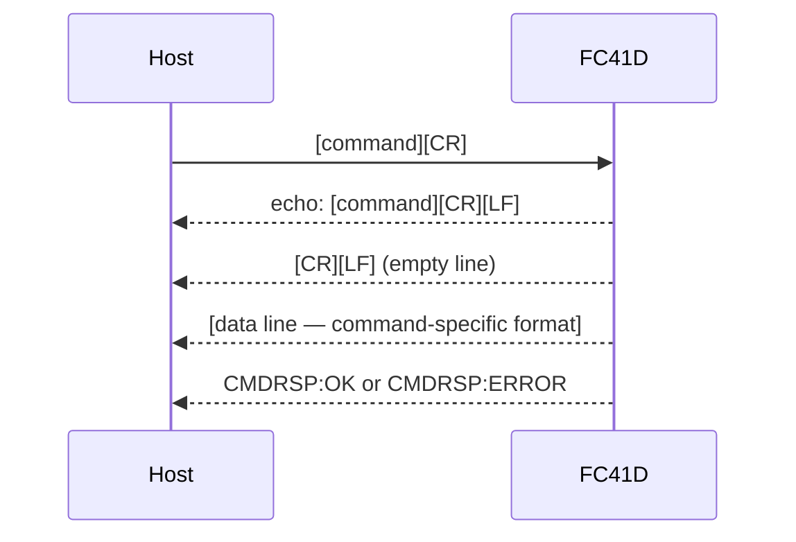

⭐ **3 exceptions:**
1. `AT+QGETIP` → **never** sends `CMDRSP:OK/ERROR`, only the data line arrives.
2. `AT+QGETWIFISTATE` → `CMDRSP:OK` arrives **before** the data line (the order is reversed).
3. `QSTASTAT:...` URCs can arrive in the middle of any command — they are not a response to a command.

##### 14.2 Establishing a Connection — Happy Path

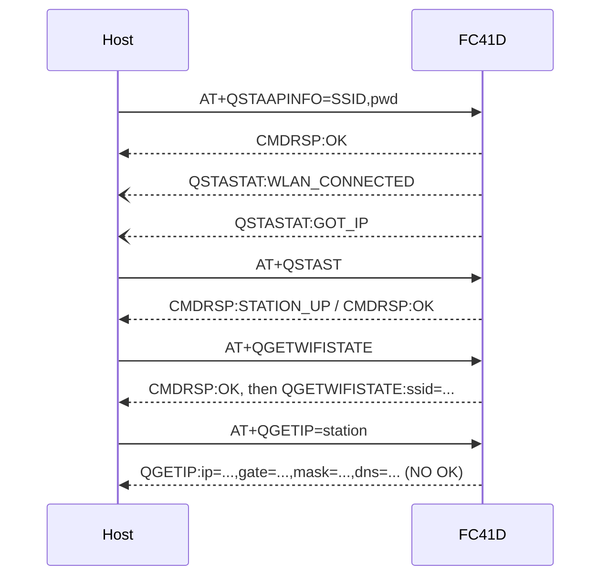

##### 14.3 Wrong Password

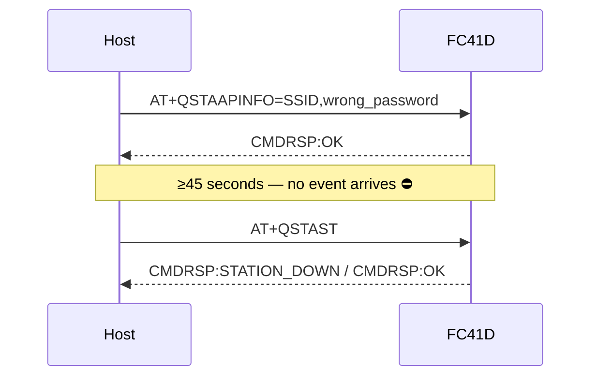

##### 14.4 SSID Not Found

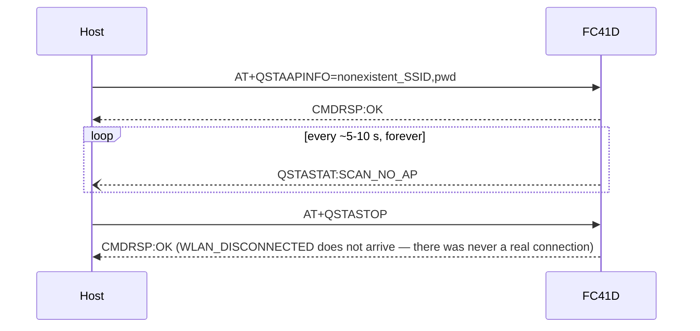

##### 14.5 AP Disappears → Comes Back ("PhoneHotspot" Test, Case A)

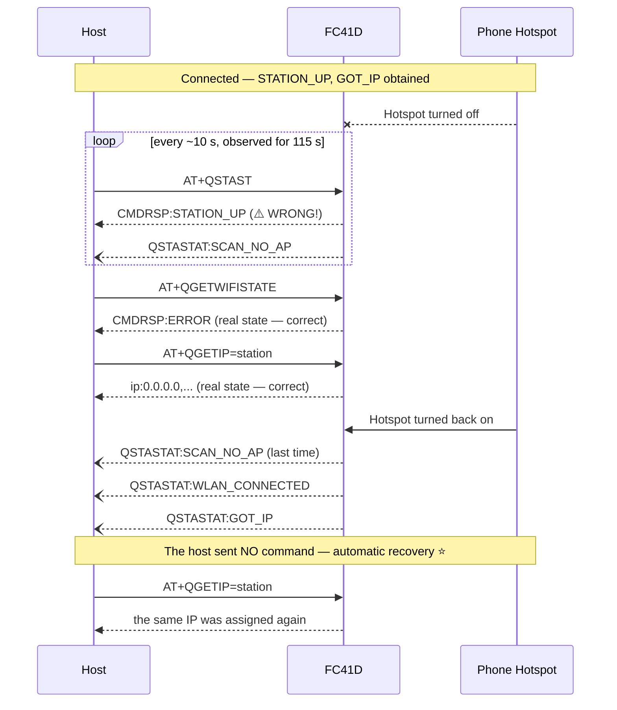

##### 14.6 Simultaneous STA + AP

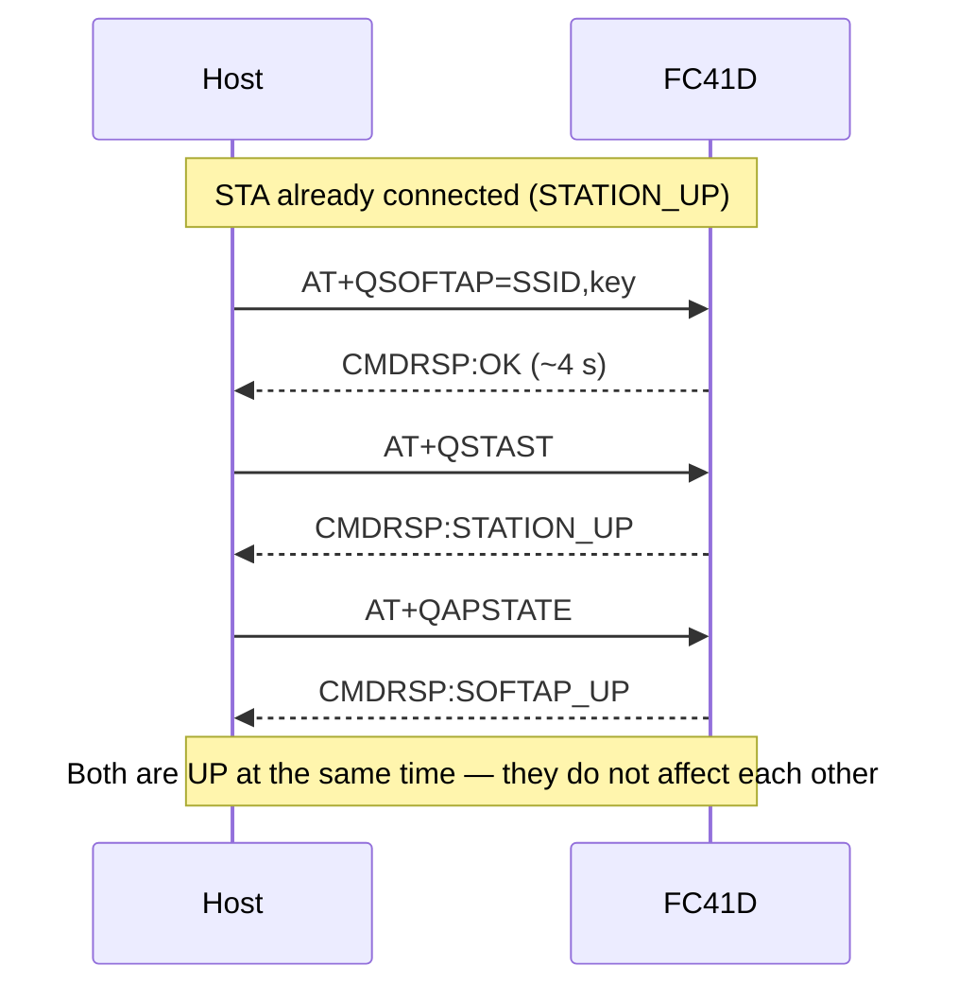

##### 14.7 Reset

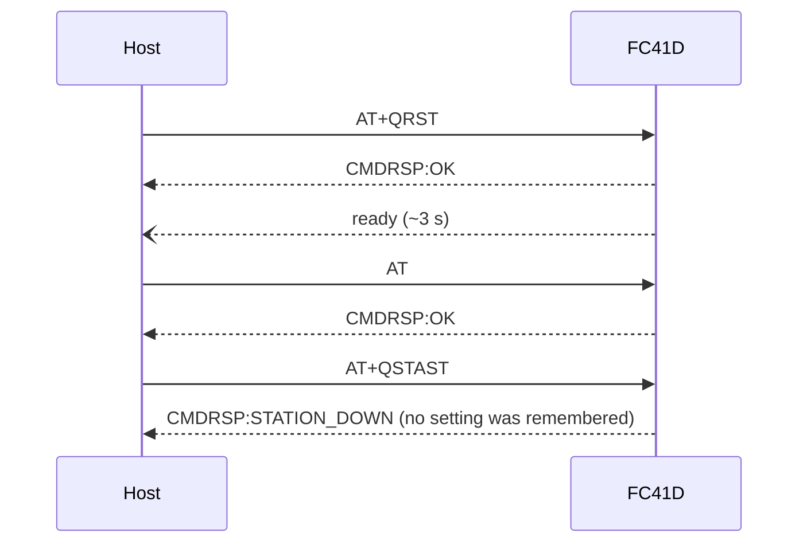

---

<a id="15-timing"></a>
#### 15. Timing

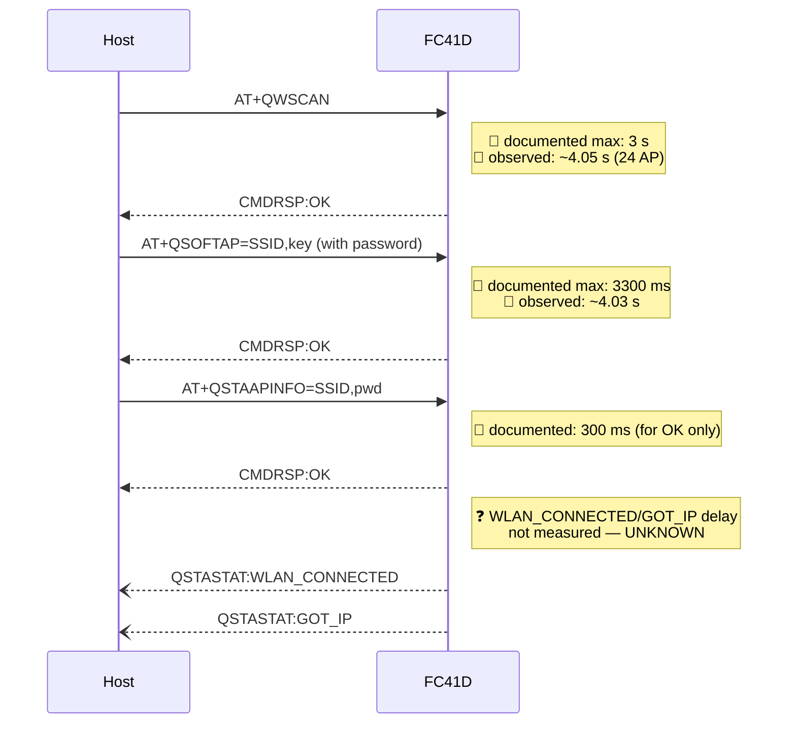

| Command/event | 📘 Documented | 🧪 Observed | Difference |
|---|---|---|---|
| Standard commands (OK/ERROR) | 300 ms | — | — |
| `AT+QWSCAN` | 3 s | **~4.05 s** | Exceeded the documentation |
| `AT+QSOFTAP` (with password) | 3300 ms | **~4.03 s** | Exceeded the documentation |
| `AT+QWLANOTA` | 120 s | Not tested | — |
| Boot/reset time | — | **~3 s** (until `ready`) | — |
| Between `WLAN_CONNECTED` and `GOT_IP` | — | Not measured (only the order was verified) | ❓ UNKNOWN |
| `SCAN_NO_AP` repeat period | — | **~5-10 s** | 🔎 approximate |
| Minimum wait between commands | — | Not tested | ❓ UNKNOWN |

---

<a id="16-runtime-monitoring--polling-vs-event-driven"></a>
#### 16. Runtime Monitoring — Polling vs Event-Driven

##### 16.1 Two Channels

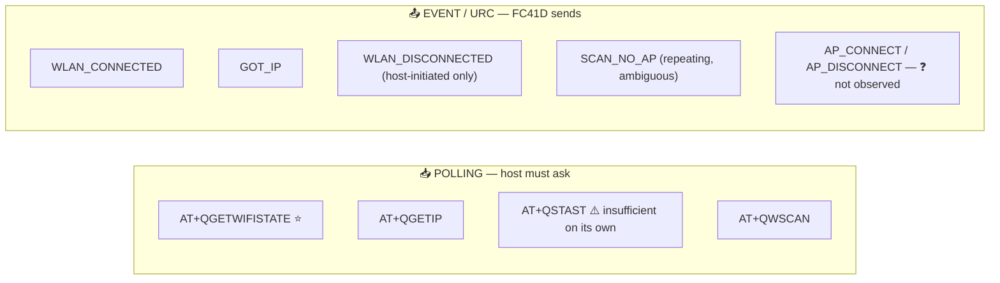

##### 16.2 Polling Flow

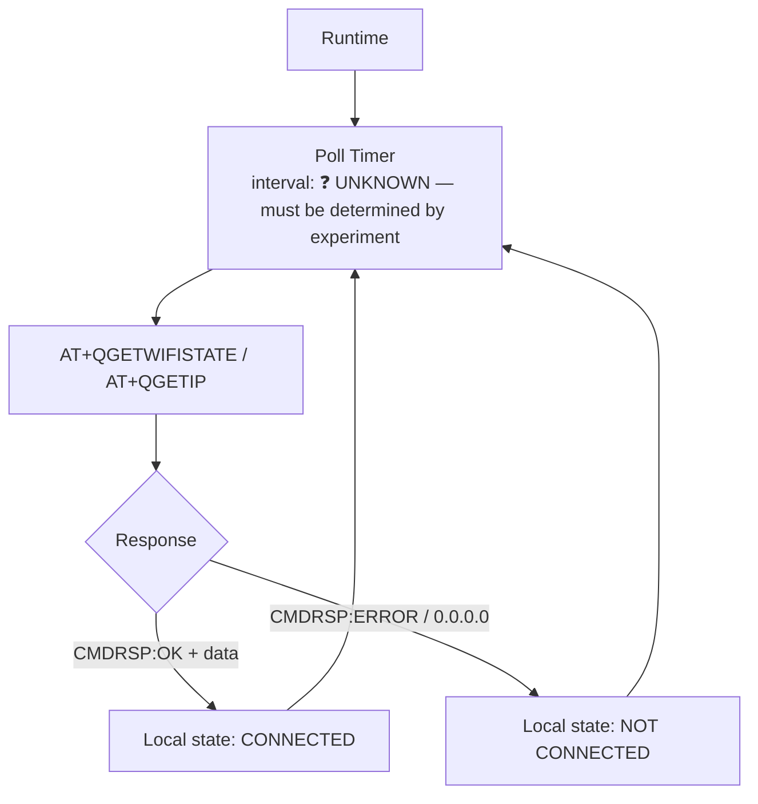

> Note: The documented default of 5 s for `AT+QSCANINTERVAL` is **the module's own internal scan behavior**, not a recommendation for the host's poll interval, and it does not work on this firmware anyway.

##### 16.3 "Do I Need to Poll This?"

| Information | Is there an event? | Poll command | Required? | Interval | Evidence |
|---|:---:|---|:---:|---|---|
| Connection established/IP obtained | ✅ | `AT+QGETWIFISTATE` | Yes, for confirmation ⭐ | ❓ UNKNOWN | 🧪 |
| Connection dropped (host-initiated) | ✅ | — | No | — | 🧪 |
| **Connection dropped (AP lost)** | ❌ | `AT+QGETWIFISTATE`/`AT+QGETIP` | **YES, mandatory** ⭐ | ❓ UNKNOWN | 🧪 |
| IP address | ❌ | `AT+QGETIP=station` | Yes | ❓ UNKNOWN | 🧪 |
| RSSI | ❌ | `AT+QGETWIFISTATE` | Yes | ❓ UNKNOWN | 🧪 |
| Clients connected to the AP | 🔶 partial | `AT+QAPGETLIST` (❌ does not work) | Currently impossible | — | 🧪 |
| Scanned network list | ❌ | `AT+QWSCAN` | Yes, command-driven | — | 🧪 |
| Firmware/MAC | ❌ | `AT+QVERSION`/`AT+QWLMAC` | No (static) | — | 🧪 |

---

<a id="17-connection-loss--recovery"></a>
#### 17. Connection Loss & Recovery

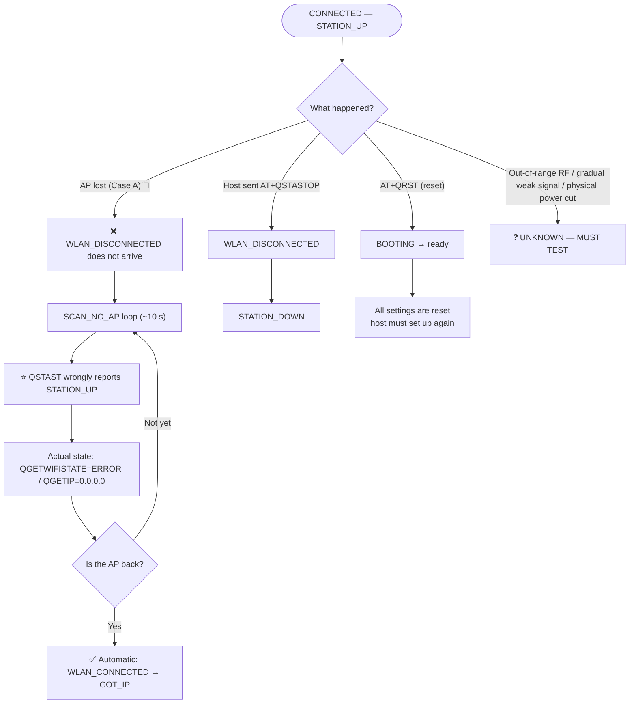

---

<a id="18-open-questions"></a>
#### 18. Open Questions

> ⚠️ **OPEN QUESTION — Boot behavior after a physical power cut**
> **Status:** ❓ UNKNOWN — MUST TEST
> **Why it matters:** Only a software `AT+QRST` was tested; a real watchdog/power-loss scenario may differ.

> ⚠️ **OPEN QUESTION — Behavior of `AT+QAPGETLIST` with a real client**
> **Status:** ❓ UNKNOWN — MUST TEST
> **Why it matters:** `ERROR` was observed in every case, but no real client ever connected to the AP — it is unclear whether the command is "not supported at all" or "returns an error when there is no client".

> ⚠️ **OPEN QUESTION — Gradual weak signal / disconnect threshold**
> **Status:** ❓ UNKNOWN — MUST TEST
> **Why it matters:** The Case A test was an abrupt AP switch-off/on; a slow signal fade may behave differently.

> ⚠️ **OPEN QUESTION — Connecting on a network without DHCP (if GOT_IP never arrives)**
> **Status:** ❓ UNKNOWN — MUST TEST
> **Why it matters:** It is unclear whether the host can distinguish a "DHCP failed" case from a "wrong password" case — both may stay silent.

> ⚠️ **OPEN QUESTION — Pipelining between commands / minimum wait**
> **Status:** ❓ UNKNOWN — MUST TEST
> **Why it matters:** It determines the driver's serialization strategy.

> ⚠️ **OPEN QUESTION — Actual behavior of `AT+QLOWPOWER` / `AT+QDEEPSLEEP`**
> **Status:** ⬜ NOT TESTED (deliberate, hardware risk)
> **Why it matters:** The wake-up mechanism is not documented; it may put the module into a state that requires physical intervention.

> ℹ️ The previously open questions on **STA+AP concurrency** and **AP loss / automatic recovery** were **conclusively resolved** in this session — they are now 🧪 VERIFIED (§13, §14.6, §17).

---

<a id="19-experimental-validation"></a>
#### 19. Experimental Validation

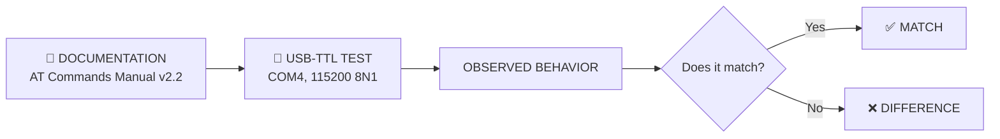

| Topic | 📘 DOCUMENTED | 🧪 OBSERVED | Result |
|---|---|---|:---:|
| Success response | `OK` | `CMDRSP:OK` | ❌ |
| Error response | `ERROR` | `CMDRSP:ERROR` | ❌ |
| `AT+QWLMAC` response | `+QWLMAC: <MAC>` | `CMDRSP:+WMAC:<MAC>` | ❌ |
| `AT+QVERSION` response | `+QVERSION: <version>` | `FC41D_VERSION:<version>` | ❌ |
| `AT+QGETWIFISTATE` response | `+QGETWIFISTATE:...` then `OK` | `CMDRSP:OK` **first**, data **after** | ❌ |
| `AT+QGETIP` response | `+QGETIP:...` then `OK` | `QGETIP:...,` — **`OK` never arrives** | ❌ |
| `+QSTASTAT` URCs | `+QSTASTAT: "EVENT"` | `QSTASTAT:EVENT` | ❌ |
| `AT+QWSCAN` duration | max. 3 s | ~4.05 s | ❌ |
| `AT+QSOFTAP` duration (with password) | max. 3300 ms | ~4.03 s | ❌ |
| MAC example | `c8:47:8c:00:00:48` | `64:c4:03:00:00:2d` (real) | ❌ (the example was apparently a placeholder) |
| AP default gateway | Not documented | `192.168.19.1` | ✅ (consistent with the Pairing Guide example) |
| `AT+QAPGETLIST`/`QAPCFG`/`QSCANINTERVAL` | Present (v2.0/v2.1) | Always `ERROR` | ❌ |
| `AT+QURCCFG`/`QPING`/`QSETBAND`/`QWEBCFG`/`QSTAAPINFODEF`/`QSTADHCPDEF` | Present | Always `ERROR` | ❌ |
| `WLAN_DISCONNECTED` on AP loss | Implied | **Never arrives**, `SCAN_NO_AP` loop | ❌ |
| `AT+QSTAST` reliability | Simple state query | Gives **wrong** information on AP loss | ❌ ⭐ |

##### 19.1 Test Matrix

| ID | Scenario | Status | Note |
|---|---|:---:|---|
| WIFI-000 | Boot/reset banner | ✅ | `ready` found |
| WIFI-001 | Firmware/MAC read | ✅🔶 | Works, format differs |
| WIFI-002 | STA connection (happy path) | ✅🔶 | Behavior correct, format differs |
| WIFI-003 | Wi-Fi scan | ✅ | 24 AP, ~4 s |
| WIFI-004 | 0 AP found | ⬜ | An isolated environment could not be provided |
| WIFI-005 | Wrong SSID | ✅ | Endless `SCAN_NO_AP` |
| WIFI-006 | Wrong password | ✅ | Silent failure |
| WIFI-007 | DHCP failure | ⬜ | Not tested |
| WIFI-008 | Status query while connected | ✅🔶 | Format exceptions exist |
| WIFI-009 | RSSI monitoring | ✅ | Real dBm values |
| WIFI-010 | Host disconnect | ✅ | Clear distinction between with/without events |
| WIFI-011 | AP switched off (external event) | ✅ | **Case A — tested extensively** |
| WIFI-012 | Weak signal (gradual) | ⬜ | Not tested |
| WIFI-013 | Reset while connected | 🔶 | Reset tested in isolation, not separately while STA-connected |
| WIFI-014 | Unexpected reboot | ⬜ | Physical power cut not attempted |
| WIFI-015 | AP mode enable | ✅ | ~4 s |
| WIFI-016 | AP client list | ❌ | `ERROR` under all conditions |
| WIFI-017 | AP mode disable | ✅ | — |
| WIFI-018 | Concurrent STA+AP | ✅ | **Critical positive finding** |
| WIFI-019 | Static IP (STA) | ✅ | — |
| WIFI-020 | Static IP (AP) | ✅ | — |
| WIFI-021 | Invalid command | ✅ | `ERROR`, ~900ms |
| WIFI-022 | Missing parameter | ⬜ | Not tested |
| WIFI-023 | Command in the wrong state | ✅ | `ERROR` verified |
| WIFI-024 | Pipelining | ⬜ | Not tested |
| WIFI-025 | Persistence — STA (`DEF`) | ❌ | Command does not work |
| WIFI-026 | Persistence — DHCP (`DEF`) | ❌ | Command does not work |
| WIFI-027 | Low-power mode | ⬜ | Deliberately skipped |
| WIFI-028 | Deep sleep | ⬜ | Deliberately skipped |
| WIFI-029 | Wi-Fi setup via web | ❌ | Command does not work |
| WIFI-030 | Baud rate change | ❌ | Command does not work |
| WIFI-031 | `AT+QURCCFG` function | ❌ | Command does not work |
| WIFI-032 | `AT+QPING` function | ❌ | Command does not work |

---

<a id="20-driver-critical-findings"></a>
#### 20. Driver-Critical Findings

> ⭐ **#1 — State tracking must not rely on a single command**
> `AT+QSTAST` can wrongly report `STATION_UP` when the AP is lost. Use `AT+QGETWIFISTATE` or `AT+QGETIP` for the real state.

> ⭐ **#2 — `AT+QGETIP` requires special parsing**
> This command never returns `OK`/`ERROR`; "wait for terminator" logic blocks forever on this command.

> ⭐ **#3 — A host-side timeout is mandatory for silent failures**
> With a wrong password the module sends no notification at all. The driver must define its own connection timeout (e.g. 15-20 s).

> ⭐ **#4 — `SCAN_NO_AP` is ambiguous**
> The same event arrives both when "the SSID does not exist at all" and when "the AP was there but disappeared" — the driver must tell them apart from context (whether it was connected before).

> ⭐ **#5 — Automatic reconnection already exists**
> On a temporary AP loss the module recovers by itself — there is **no need** to write a separate reconnect state machine, the state just has to be tracked correctly.

> ⭐ **#6 — Command/response matching must not be naive**
> Independent URCs can arrive after `OK`. URCs must always be handled as a separate channel.

> ⭐ **#7 — A per-command custom parser is required**
> A generic "single-type parser that ends with OK/ERROR" does not work reliably on this firmware (§14.1 exceptions).

> ⭐ **#8 — Timeout layering**
> At least 3 classes: standard (~300 ms), medium (~4 s — scan/encrypted AP), long (120 s — OTA, not tested). A separate, host-defined timeout is needed for connection setup.

> ⭐ **#9 — No persistence model**
> No Wi-Fi setting is remembered after a reset. Persistent SSID/password must be the host's (MCU flash) responsibility — `AT+QSTAAPINFO` must be sent again on every boot.

> ⭐ **#10 — Ordering constraint exception**
> `AT+QAPCFG` must be sent before `AT+QSOFTAP` is the only mandatory ordering rule that is documented — but this command does not work anyway, so it has no practical importance for this firmware.

> ⭐ **#11 — Boot detection**
> The `ready` message is 🧪 VERIFIED — the driver can detect that the module is ready with this message (or with `AT`→`OK`).

> ⭐ **#12 — 9 documented commands must not be used**
> The commands marked ❌ in §4-§7 do not work on this firmware; if there is no alternative, the functionality must be implemented on the host side (MCU).

---

<a id="21-ek--kaynaklar-ve-metodoloji"></a>
#### 21. Appendix — Sources and Methodology

##### Source Inventory

| Document | Version/Date | Contribution |
|---|---|---|
| Quectel FC41D AT Commands Manual | v2.2, 2026-07-13 | Main reference — 29 Wi-Fi commands, Wi-Fi URCs, FC41D-specific examples. There is no Wi-Fi-specific error code table. |
| Quectel FC41D Wi-Fi Pairing Guide | v1.0, 2023-10-08 | Wi-Fi pairing procedures over BLE and over AP-Hotspot/Web. |

Documents mentioned but not used: `Quectel_FC41D_Firmware_Download&Upgrade_Guide`, `Quectel_QCOM_User_Guide`.

Quectel's official documents and downloads: <https://www.quectel.com/product/wi-fi-bluetooth-fc41d/>

##### Methodological Limitations

- The figures/screenshots in the PDFs (including Pairing Guide Figure 7) could not be read visually in this environment (`pdftoppm` is not available); only plain text was extracted with `pdftotext`.
- The underlined default-value markup in the PDFs is lost in plain text — defaults that are not explicitly stated in plain text were left as ❓ UNKNOWN and were not guessed.

##### 2026-09-10 Test Environment

COM4, 115200 baud 8N1, direct access with `.NET System.IO.Ports.SerialPort`. ~60 command attempts + ~450 seconds of live monitoring (including Case A). Target networks: `WPA3_MIXED_NET` (a mixed-mode WPA3 network) and `PhoneHotspot` (a phone hotspot, deliberately switched on and off for the Case A test). Raw TX/RX logs are not published in this repository.

---

<a id="tcp-commands"></a>
## TCP Commands

> **Source:** AT Commands Manual v2.2 §2.3 (commands, p.49-61), §3.3 (URCs, p.97-100), §4.3 (examples, p.120-121), §5 Table 3 (result codes, p.130).
> **Experimental status (2026-09-10):** **The TCP client side is verified end to end** — connection setup, all three access modes, data send/receive, ACK tracking, mode switches and closing were tested live. Test environment: phone hotspot `PhoneHotspot`, FC41D `172.20.10.11/28`, TCP server `172.20.10.5:28` (sending 32 bytes once per second). **Server (TCP LISTENER) mode and UDP** were partly verified or not verified at all — see §T15, §T16.
>
> Symbols and evidence labels are the same as in the Wi-Fi part (see [§1 Legend](#1-legend-ve-semboller)).

<a id="icindekiler--tcp"></a>
### Contents — TCP

**Part A — Command and Event Dictionary**
- [T1. TCP Architecture and Core Concepts](#t1-tcp-mimarisi-ve-temel-kavramlar)
- [T2. Command Reference — Socket Lifecycle](#t2-komut-referansi--soket-yasam-dongusu)
- [T3. Command Reference — Data Exchange](#t3-komut-referansi--veri-alisverisi)
- [T4. Command Reference — Configuration](#t4-komut-referansi--yapilandirma)
- [T5. Command Reference — Server Mode](#t5-komut-referansi--sunucu-modu)
- [T6. Command Reference — Mode Switches](#t6-komut-referansi--mod-gecisleri)
- [T7. Command Reference — Error Query](#t7-komut-referansi--hata-sorgulama)
- [T8. Asynchronous Notifications — TCP URC Reference](#t8-asenkron-bildirimler--tcp-urc-referansi)
- [T9. Result Codes Table](#t9-sonuc-kodlari-tablosu)

**Part B — Implementation**
- [T10. At a Glance — TCP Overall Flow](#t10-at-a-glance--tcp-genel-akis)
- [T11. Access Mode Selection — Decision Tree](#t11-access-mode-secimi--decision-tree)
- [T12. Socket State Machine](#t12-soket-durum-makinesi)
- [T13. TX/RX Sequence Diagrams](#t13-txrx-sequence-diyagramlari)
- [T14. Timing](#t14-timing)
- [T15. Experimental Verification — 2026-09-10](#t15-deneysel-dogrulama--2026-09-10)
- [T16. Open Questions](#t16-open-questions)
- [T17. Driver-Critical Findings — TCP](#t17-driver-critical-findings--tcp)

---

<a id="t1-tcp-mimarisi-ve-temel-kavramlar"></a>
### T1. TCP Architecture and Core Concepts

| Concept | Description | Evidence |
|---|---|---|
| **Socket (socketID)** | **12 independent sockets** at the same time (IDs `0`–`11`). Every command states which socket it belongs to with `socketID`. | 📘 🧪 (0,1,2,3,4,5,6,7 used) |
| **Service type** | `"TCP"` client · `"UDP"` client · `"TCP LISTENER"` server · `"UDP SERVICE"`. A connection accepted by the server appears as `"TCP INCOMING"`. | 📘 · 🧪 `"TCP"` and `"TCP LISTENER"` tried |
| **Access mode (access_mode)** | `0` Buffer (read with AT) · `1` Direct push (data inside the URC) · `2` Transparent (raw data channel on the serial port). | 📘 🧪 **all three verified** |

> ⚠️ **Prerequisite:** TCP sits on top of the Wi-Fi layer. `GOT_IP` must have been received in STA mode before a socket is opened. If Wi-Fi drops, open sockets **die silently** — `AT+QISTATE` does not show it (see §T15.3). 🧪

#### T1.1 TCP Wire Format — Different from Wi-Fi 🧪

In the Wi-Fi commands the "Q" was dropped from the response labels and the data lines were wrapped with `CMDRSP:`. **In TCP the documented format is preserved:**

```
Data lines:      +QICFG:  +QISTATE:  +QIOPEN:  +QIRD:  +QISEND:  +QIACCEPT:  +QIGETERROR:  +QIURC:
                 → all keep the "+Q" prefix, they do NOT get the CMDRSP: wrapper
Closing line:    CMDRSP:OK   or   CMDRSP:ERROR
Transparent mode: CONNECT   (no CMDRSP:)
```

⭐ **Driver consequence:** The parser must apply **different rule sets** depending on the subsystem — a single global parser does not work for Wi-Fi and TCP at the same time.

> 🐞 **Firmware defect:** The `AT+QIACCEPT=?` response comes as `+QIACCEPT: (0-11),(0,1),(0-11)(null)CMDRSP:OK` — after the last parameter the literal string **`(null)`** is printed instead of `<CR><LF>`. The parser must be robust against this. 🧪

---

<a id="t2-komut-referansi--soket-yasam-dongusu"></a>
### T2. Command Reference — Socket Lifecycle

| Command | What it does | TX (you send) | RX — success | RX — error | Notes |
|---|---|---|---|---|---|
| `AT+QIOPEN=<socketID>,<service_type>,<ip/host>,<remote_port>,<local_port>,<access_mode>` | **Opens a socket** | `AT+QIOPEN=0,"TCP","172.20.10.5",28,0,0` | `access_mode` 0/1 → `CMDRSP:OK`, then asynchronous **`+QIOPEN: <socketID>,0`**<br/>`access_mode` 2 → directly **`CONNECT`** | `CMDRSP:ERROR` or `+QIOPEN: <socketID>,<err≠0>` | 🧪 All three modes verified · `local_port=0` = random port (works) · ⭐ `OK` **does not mean connected**, the `+QIOPEN` URC must be awaited |
| `AT+QIOPEN=?` | Lists the supported parameters | `AT+QIOPEN=?` | 🧪 `+QIOPEN: (0-11),"TCP"/"UDP"/"TCP LISTENER"/"UDP SERVICE","ip/dns",(1-65535),(1-65535),(0-2)` | — | ⚠️ The documented 7th parameter `<local_IP>` (STA/AP selection, added in v2.0) is **not in the list** → not present in this firmware |
| `AT+QISTATE` | Lists all sockets | `AT+QISTATE` | `+QISTATE: <id>,<type>,<remote_addr>,<remote_port>,<local_port>,<state>` for each socket; if there is no socket, only `CMDRSP:OK` | `CMDRSP:ERROR` | 🧪 `+QISTATE: 0,"TCP","172.20.10.5",28,61806,2` · ⭐ **`state` is unreliable** (§T15.3) |
| `AT+QISTATE?` | Same (Read form) | `AT+QISTATE?` | Same | — | 🧪 |
| `AT+QISTATE=<socketID>` | Queries a single socket | `AT+QISTATE=2` | 🧪 `+QISTATE: 2,"TCP","172.20.10.5",28,12467,2` | `CMDRSP:ERROR` | 🧪 |
| `AT+QICLOSE=<socketID>[,<close_timeout>]` | **Closes the socket** | `AT+QICLOSE=1` | `CMDRSP:OK`, then **`+QIURC: "closed",<socketID>`**; after that the socket disappears from the list | `CMDRSP:ERROR` | `close_timeout` 1–60 s, default 2 (📘) · ⚠️ **No `"closed"` URC arrives on a dead socket**, it gets stuck in state=4 for 20+ s (§T15.3) 🧪 |

**`<state>` values** (📘 §2.3.3 · 🧪 0,2,3,4 observed):

| Value | Meaning | Observation |
|:---:|---|---|
| `0` | Initial — connection not established | ⬜ |
| `1` | Opening — connecting / switching to listening | ⬜ (transition is very fast) |
| `2` | Connected — connection established | 🧪 ⚠️ also shown for dead sockets |
| `3` | Listening — server is listening | 🧪 |
| `4` | Closing — closing | 🧪 (persistent on a dead socket) |

---

<a id="t3-komut-referansi--veri-alisverisi"></a>
### T3. Command Reference — Data Exchange

#### ⚠️ T3.1 The Most Critical Deviation: `AT+QISEND` Requires HEX Data 🧪

The `AT+QISEND=?` response says **`"hex_data"`** instead of the `"data"` in the documentation:

```
🧪 +QISEND: (0-11),(0-1460),"hex_data"[,"remote_ip",(1-65535)]
```

Verified experimentally:

| Attempt | Result |
|---|---|
| `AT+QISEND=0,11,HELLO_FC41D` (plain text, unquoted) | ❌ `CMDRSP:ERROR` → `AT+QIGETERROR` = `550,"invalid param"` |
| `AT+QISEND=0,11,"HELLO_FC41D"` (plain text, quoted) | ❌ `CMDRSP:ERROR` |
| `AT+QISEND=0,11` (expecting a `>` prompt) | ❌ `CMDRSP:ERROR` |
| `AT+QISEND=0,11,48454C4C4F5F4643343144` (hex, unquoted) | ❌ `CMDRSP:ERROR` |
| **`AT+QISEND=0,11,"48454C4C4F5F4643343144"` (hex + quotes)** | ✅ **`+QISEND: 11`** + `CMDRSP:OK` |

⭐ **Rule:** The data must be **hex encoded** and **inside double quotes**. `<send_len>` = the **decoded byte count** (11), not the character count of the hex string (22). The driver's send path must have a mandatory **ASCII→hex encoding layer**. On this firmware the documented plain-text form and the `>` prompt form **do not work**.

#### T3.2 Command Table

| Command | What it does | TX (you send) | RX — success | RX — error | Notes |
|---|---|---|---|---|---|
| `AT+QISEND=<socketID>,<send_len>,"<hex_data>"` | **Sends data** | `AT+QISEND=0,11,"48454C4C4F5F4643343144"` | `+QISEND: <actual_send_len>` + `CMDRSP:OK` | `CMDRSP:ERROR` (`550 invalid param`) | 🧪 `send_len` 0–1460 · hex + quotes mandatory (§T3.1) |
| `AT+QISEND=<socketID>,0` | **Send/ACK statistics** | `AT+QISEND=0,0` | `+QISEND: <total_send>,<acked>,<unacked>` + `CMDRSP:OK` | `CMDRSP:ERROR` | ⭐⭐ **The ONLY reliable way to measure whether the connection is alive:** healthy → `11,11,0` · dead → `11,0,11` (§T15.3) 🧪 |
| `AT+QIRD=<socketID>,<read_len>` | **Reads incoming data** (buffer mode) | `AT+QIRD=0,100` | `+QIRD: <actual_read_len>` `<CR><LF>` `<data>` `<CR><LF>` + `CMDRSP:OK` | `CMDRSP:ERROR` (closed/nonexistent socket) | 🧪 `read_len` 0–1500 · If there is less data than requested it returns **as much as is available** (`+QIRD: 106`) |
| `AT+QIRD=<socketID>,0` | **Receive statistics** | `AT+QIRD=0,0` | `+QIRD: <total_recv>,<read>,<unread>` + `CMDRSP:OK` | `CMDRSP:ERROR` | 🧪 `+QIRD: 3232,3126,106` · Counters verified **byte-exact consistent** |

> ✅ **RESOLVED — document contradiction:** The §2.3.5 table wrote the read response as `+QISEND: <actual_read_len>`, whereas the §4.3.2 example said `+QIRD:`. **The real device uses `+QIRD:`** — the label in the document's §2.3.5 table is wrong. 🧪 VERIFIED

#### T3.3 ⭐ TCP Is a Byte Stream — Message Boundaries Are Not Preserved 🧪

While the server sends regular 32-byte messages, reads **split a message in the middle** and the next read continues **from exactly the byte where it left off**:

```
AT+QIRD=0,100   → ...TEST_MESSAGE_FROM_SERVER<CR><LF>TEST   (cut at the 100th byte)
AT+QIRD=0,26    → _MESSAGE_FROM_SERVER<CR><LF>...            (continues from the 101st byte)
AT+QIRD=0,1500  → F>TEST_MESSAGE_FROM_SERVER...              (continues from the middle of the previous one)
```

⭐ The driver must do the message framing **itself**; `AT+QIRD` only carries bytes.

---

<a id="t4-komut-referansi--yapilandirma"></a>
### T4. Command Reference — Configuration

| Sub-parameter | What it does | 📘 Range / default | 🧪 Actual value on the device | Present |
|---|---|---|---|:---:|
| `"transpktsize"` | Length of the sub-packet to be sent in transparent mode | 1–1460 bytes, default 1024 | **1024** ✓ (write tried: 512 → read back 512 ✓) · device range `(0-1460)` | ✅ |
| `"transwaittm"` | Data wait time in transparent mode; `0` = send immediately | 0–20, default **2**, unit 100 ms | **0** ⚠️ (differs from the documented default) | ✅ |
| `"accept/mode"` | Acceptance of incoming connections: `0` automatic, `1` manual (`AT+QIACCEPT`) | 0,1 | **0** ✓ | ✅ |
| `"tcp/tw_cycle"` | Release of the TCP port: `0` immediately, `1` delayed | 0,1 | **0** ✓ | ✅ |
| `"datatype"` | Data type (0 non-hex / 1 hex string / 2 hex data) | 0,1,2 | — | ❌ |
| `"tcp/retransmit"` | Retransmission interval and count | rto 1–10 s (3), retry 3–20 (10) | — | ❌ |
| `"udp/broadcast"` | UDP broadcast | 0,1 | — | ❌ |
| `"tcplistener/raw"` | Transparent transmission for the TCP server | 0,1 | — | ❌ |

**Usage:** `AT+QICFG="transpktsize"` (read) → `+QICFG: "transpktsize",1024` + `CMDRSP:OK` · `AT+QICFG="transpktsize",512` (write) → `CMDRSP:OK`. 🧪 Read/write cycle verified.

🧪 **Actual `AT+QICFG=?` output** (only 4 of the 8 sub-parameters):
```
+QICFG: "transpktsize",(0-1460)
+QICFG: "transwaittm",(0-20)
+QICFG: "accept/mode",(0,1)
+QICFG: "tcp/tw_cycle",(0,1)
CMDRSP:OK
```

> ℹ️ All 4 missing sub-parameters were added in the **v2.0 (2025-06-11)** revision of the AT manual; the module firmware dates from 2021. This is **exactly consistent with the firmware/document version gap pattern** found in the Wi-Fi part. Result: hex data type selection, TCP retransmit setting, UDP broadcast and transparent transmission for the TCP server **cannot be configured** on this firmware.

---

<a id="t5-komut-referansi--sunucu-modu"></a>
### T5. Command Reference — Server Mode

| Command | What it does | TX (you send) | RX — success | RX — error | Notes |
|---|---|---|---|---|---|
| `AT+QIOPEN=<id>,"TCP LISTENER","",0,<local_port>,0` | **Opens a TCP server** | `AT+QIOPEN=5,"TCP LISTENER","",0,8080,0` | 🧪 `CMDRSP:OK` + `+QIOPEN: 5,0`; `AT+QISTATE` → `+QISTATE: 5,"TCP LISTENER","172.20.10.11",0,8080,3` (state=3 Listening) | `CMDRSP:ERROR` | 🧪 Opens · the **module's own IP** appears in the `<remote_addr>` field · 📘 `access_mode=2` cannot be used |
| `AT+QIACCEPT=<listener_id>,<accept>[,<incoming_id>]` | **Accepts/rejects** an incoming connection | `AT+QIACCEPT=5,1,6` | 🧪 `+QIACCEPT: 6,"172.20.10.5",60177` + `CMDRSP:OK` | `CMDRSP:ERROR` | `accept`: 0=reject, 1=accept · 🧪 Format verified (IP quoted) |
| `AT+QIACCEPT=?` | Parameter list | `AT+QIACCEPT=?` | 🧪 `+QIACCEPT: (0-11),(0,1),(0-11)(null)CMDRSP:OK` | — | 🐞 `(null)` defect (§T1.1) |

#### T5.1 Server Mode Observations 🧪 — partial, re-test needed

| Observation | Result |
|---|---|
| The server socket opens and moves to the `Listening` state | ✅ |
| A TCP connection from the PC to the module is **accepted at network level** (`TcpClient.Connect` succeeded) | ✅ |
| `accept/mode=0` (automatic): the `+QIURC: "incoming"` URC **never arrives**, the new socket is **not visible** | ❌ the connection is not reflected in the AT layer |
| `accept/mode=1` (manual): **`+QIURC: "accept",<listener_id>` arrives** | ✅ |
| Accepting with `AT+QIACCEPT` → a new socket ID is assigned, the remote IP/port is reported | ✅ |
| The accepted socket **closes immediately** (`+QIURC: "recv",<id>` followed by `+QIURC: "closed",<id>`), data cannot be read | ⚠️ repeated 2 times |
| After the close, **the listener socket also disappears from the list** | ⚠️ |

> ⚠️ **IMPORTANT CAVEAT:** It was found afterwards that **the Wi-Fi connection had dropped** while these tests were being run (`AT+QSTAST` → `STATION_DOWN`). Therefore it **could not be distinguished** whether the observations "the accepted socket closes immediately" and "the listener disappears" are a **server mode defect or a side effect of the Wi-Fi drop**. Server mode must be **re-tested with stable Wi-Fi** (§T16).

#### T5.2 ⭐⭐ Re-test — SoftAP + 2025 fw: accept AND send work — the real constraint was a `datatype` format mismatch 🧪

On **2026-09-22**, the FC41D was re-tested by opening **its own SoftAP** (in a stable environment with no risk of a Wi-Fi drop — here the FC41D is the access point of its own network), with four real Docklight clients through the author's workstation tool. Firmware `FC41DAAR03A14M02` (2025-08-17).

**Accept side — the caveat of T5.1 was removed, the result improved:**

| Observation | Result |
|---|---|
| `accept/mode=0` (automatic, default): `+QIURC: "incoming",<id>,<listener_id>,"<ip>",<port>` arrived, the socket ID was **assigned by itself** | ✅ **The opposite of the "does not arrive" finding in T5.1** — consistent in two separate sessions, with 4 clients |
| In the same test `accept/mode=1` (manual) was also tried separately: `AT+QIACCEPT` is needed, the risk grows as the delay grows | ⚠️ Works but unnecessary complexity — automatic mode should be preferred |
| The accepted socket **does not close**, it keeps receiving data (`+QIURC: "recv",<id>,<len>` + data, in direct push mode) | ✅ **The "closes immediately" finding of T5.1 was not observed in this test** — that finding was indeed a side effect of the Wi-Fi drop |

**Send side — a wrong conclusion was reached first, then the root cause was found:**

Sending data with `AT+QISEND` to a socket accepted via `TCP LISTENER` using the **hex+quotes format** (`AT+QISEND=<id>,11,"48454C4C4F5F4643343144"`) failed in four independent attempts — in both direct push and buffer mode, even on sockets proven to be live (data could be read with `AT+QIRD`), it was always `ERROR` / `550,"invalid param"`. This led at first to the (wrong) conclusion **"the FC41D cannot send in the server role"**.

**When the official manual (Quectel AT Commands Manual v2.2, §2.3.4) was examined again, the real reason emerged:** the documented form of `AT+QISEND` uses exactly the same syntax for `"TCP"`/`"UDP"`/**`"TCP INCOMING"`** — in other words, sending to an accepted socket is an officially supported scenario, with no restriction note in the manual. The real variable was the **`AT+QICFG="datatype"`** sub-parameter (0 = plain text, 1 = hex string) — this parameter was **absent from the `AT+QICFG=?` output on the 2021 firmware**, and was added in the 2025 firmware. **When read on 2026-09-22 its value turned out to be `0` (plain text)** — whereas we had always been sending hex (sending a 22-character hex string while saying `send_len=11` created a length/format mismatch in plain text mode, and `550 invalid param` described exactly that).

**Definitive verification (2026-09-22, COM5, real end-to-end test):**

```
TX  AT+QICFG="datatype"                        -> RX  +QICFG: "datatype",0 + OK   (plain text mode)
TX  AT+QIOPEN=5,"TCP LISTENER","",0,8080,0      -> RX  OK + QIOPEN: 5,0             (buffer mode, SoftAP)
    (an external Python TCP client connected to 192.168.19.1:8080 and sent "Client_1 test message")
RX  +QIURC: "incoming",11,5,"192.168.19.100",62478
RX  +QIURC: "recv",11
TX  AT+QIRD=11,0                                -> RX  +QIRD: 21,0,21 + OK          (data is really waiting)
TX  AT+QISEND=11,11,"HELLO_FC41D"               -> RX  +QISEND: 11 + OK             (PLAIN TEXT - successful!)
```
It was really received on the client side (external Python socket): `RECEIVED (11 bytes): b'HELLO_FC41D'` — verified end to end.

> ⭐⭐ **Corrected result:** The FC41D **can really send data** to a socket accepted via `TCP LISTENER` — the earlier finding "cannot send in the server role" **was wrong**, the root cause was that the `datatype` sub-parameter (default `0`/plain text on this firmware) did not match our assumption (hex). **Lesson:** a sub-parameter such as `datatype`, which does not exist on the 2021 fw, can be silently added in the 2025 fw and change the default — instead of a fixed "always use hex" rule, the driver/client code must read the current mode with `AT+QICFG="datatype"` before sending and format accordingly (or explicitly pin it to hex mode with `AT+QICFG="datatype",1`).
>
> **Corrected result for the driver architecture:** While running in the server (`TCP LISTENER`) role, the FC41D **can send** data to connected clients — both the send and receive directions are reliable in the server role, just like in the client role. `fc41d_tcp.c` should only apply the correct data format (according to the current `datatype` mode) before sending; it must not make a fixed "always hex" assumption.

---

<a id="t6-komut-referansi--mod-gecisleri"></a>
### T6. Command Reference — Mode Switches

| Command | What it does | TX (send) | RX — success | RX — error | Notes |
|---|---|---|---|---|---|
| `AT+QISWTMD=<socketID>,<access_mode>` | **Changes the access mode** of an open socket | `AT+QISWTMD=4,2` | 🧪 `CONNECT` (when switching to transparent); `OK` for other modes | `CMDRSP:ERROR` | 🧪 Buffer(0)→Transparent(2) switch verified, raw data started flowing immediately |
| `ATO` | **Returns to transparent mode** after exiting it | `ATO` | 🧪 `CONNECT` | `NO CARRIER` | 🧪 Worked after exiting with `+++` · 📘 To enter transparent mode on a socket for the **first time**, `AT+QISWTMD=<id>,2` is required, calling `ATO` directly → `NO CARRIER` |
| `+++` | **Exits transparent mode** | `+++` (**DO NOT append CR/LF**) | 🧪 `CMDRSP:OK`; then `+QIURC: "recv",<id>` for pending data | — | 🧪 Verified twice · The socket stays open (`state=2`), return with `ATO` · If sent in command mode it is only **echoed** and has no effect 🧪 |

#### T6.1 Transparent Mode Observations 🧪

```
AT+QIOPEN=3,"TCP","172.20.10.5",28,0,2   →  CONNECT
                                            (then server data flows RAW:
                                             TEST_MESSAGE_FROM_SERVER<CR><LF>... — NO URC wrapper)
[write raw bytes]  PING_FROM_FC41D       →  goes out directly as TCP payload
+++                                       →  CMDRSP:OK  (back in command mode)
                                            + QIURC: "recv",3  (pending data notification)
AT+QISTATE                                →  +QISTATE: 3,"TCP","172.20.10.5",28,17864,2  (socket intact)
ATO                                       →  CONNECT  (transparent again)
+++                                       →  CMDRSP:OK
AT+QICLOSE=3                              →  CMDRSP:OK + QIURC: "closed",3
```

⭐ **Writing raw bytes in command mode does not work** — the module takes it for an AT command line and only echoes it, it does not send it to the server. Raw data is valid only in transparent mode. 🧪

---

<a id="t7-komut-referansi--hata-sorgulama"></a>
### T7. Command Reference — Error Query

| Command | What it does | TX (send) | RX — success | Notes |
|---|---|---|---|---|
| `AT+QIGETERROR` | Returns the code and the **text description** of the **last TCP/UDP error** | `AT+QIGETERROR` | 🧪 `+QIGETERROR: 0,"success"` · `+QIGETERROR: 550,"invalid param"` | ⭐ The description comes **in double quotes** (the document does not show the quotes) · It is recommended that the driver call it after every `CMDRSP:ERROR` — it turns the single generic `ERROR` into a meaningful error |

---

<a id="t8-asenkron-bildirimler--tcp-urc-referansi"></a>
### T8. Asynchronous Notifications — TCP URC Reference

| URC | When it arrives | What it means | Evidence |
|---|---|---|---|
| `+QIOPEN: <socketID>,<err>` | After `AT+QIOPEN`, once the **actual result** of the open operation is known | `err=0` → connected · `err≠0` → failed (§T9) | 🧪 `+QIOPEN: 0,0` (~1-5 s, reachable server) · `+QIOPEN: 0,551` (~17-21 s, unreachable server) |
| `+QIURC: "recv",<socketID>` | **Buffer mode** — when data arrives while the buffer holds **no data** | "There is data in the buffer, read it with `AT+QIRD`". ⭐ **No new URC arrives until the buffer is completely empty** | 🧪 **Rule verified exactly** (§T13.5) |
| `+QIURC: "recv",<socketID>,<data_len>` `<CR><LF>` `<data>` | **Direct push mode** | The data arrives directly inside the URC, `AT+QIRD` is not needed | 🧪 `+QIURC: "recv",2,32<CR><LF>` + 32 bytes |
| `+QIURC: "recv",<socketID>,<data_len>,<remote_addr>,<remote_port>` `<CR><LF>` `<data>` | Direct push + `"UDP SERVICE"` | Same + source address | 📘 ⬜ |
| `+QIURC: "closed",<socketID>` | When the socket closes | The socket is unusable, it drops off the list | 🧪 Verified after `AT+QICLOSE` · ⚠️ **does not arrive on a dead socket** |
| `+QIURC: "accept",<listener_socketID>` | Server mode, `accept/mode=1` (manual) | A decision via `AT+QIACCEPT` is awaited | 🧪 |
| `+QIURC: "incoming",<incoming_id>,<listener_id><remote_addr>,<remote_port>` | Server mode, `accept/mode=0` (automatic) | The connection was accepted automatically | 📘 · ❌ **never observed on this firmware** (§T5.1) · ⚠️ a comma is missing in the format in the document |
| `+QIURC: "incoming full"` | When the incoming connection limit is reached | A new connection could not be accepted | 📘 ⬜ |
| `NO CARRIER` | When the connection drops abnormally **in transparent mode** | The connection was cut | 📘 ⬜ |

#### T8.1 ⭐⭐ Direct Push Data May Contain CRLF — Do Not Parse Line by Line 🧪

Measured raw stream (3 URC blocks = exactly **171 bytes = 3 × 57**):

```
<CR><LF> +QIURC: "recv",2,32 <CR><LF> [32 bytes of data] <CR><LF>
   2   +        19         +    2   +        32        +    2    = 57 bytes
```

The server's 32-byte message **itself contains CRLF** (`TEST_MESSAGE_FROM_SERVER` + line endings). The parser must read the `<data_len>` field and **count exactly that many bytes**; splitting by searching for CRLF corrupts the data.

#### T8.2 ⭐ URCs Can Be Lost 🧪

URCs sent while the host UART is closed are **lost and not resent**. Combined with the buffer mode rule "no new URC until the buffer is empty", this creates a dangerous trap: a missed `"recv"` URC + a buffer that is never drained = **permanent silence**. The driver must keep the UART open at all times and **must poll** the state with `AT+QIRD=<id>,0` at every startup / after every drop.

URCs can also get in between command responses (🧪 `recv` URCs arrived right after the `AT+QISTATE=2` response) — the parser must tolerate this.

---

<a id="t9-sonuc-kodlari-tablosu"></a>
### T9. Result Code Table

| Code | Description | Code | Description |
|:---:|---|:---:|---|
| `0` | Operation success 🧪 `"success"` | `557` | Operation not supported |
| `550` | Invalid parameter 🧪 `"invalid param"` | `558` | No network |
| `551` | Unknown error 🧪 (observed on an unreachable server) | `559` | No certificate |
| `552` | Memory not enough | `560` | Operation busy |
| `553` | Socket ID has been used | `561` | Operation timeout |
| `554` | Socket ID not exist | `562` | Socket write failed |
| `555` | Socket allocate failed | `563` | Socket read failed |
| `556` | Operation not allowed | | |

> ✅ **Confidence note (upgraded):** This table came out of the PDF with shifted columns and was rebuilt. **Code 0 → `"success"`** and **code 550 → `"invalid param"`** were verified exactly with `AT+QIGETERROR`; this strongly supports that the sequential mapping is correct. 🧪 The texts of the remaining codes can be confirmed with `AT+QIGETERROR` as the corresponding error scenarios are triggered.

---

<a id="t10-at-a-glance--tcp-genel-akis"></a>
### T10. At a Glance — TCP Overall Flow

```mermaid
flowchart TD
    WIFI(["PREREQUISITE: Wi-Fi connected, GOT_IP received"]) --> OPEN["AT+QIOPEN=id,service,ip,port,local,mode"]
    OPEN --> SYNC{"Synchronous response"}
    SYNC -->|"mode 0 / 1"| OK1["CMDRSP:OK — only accepted"]
    SYNC -->|"mode 2"| CONN["CONNECT — UART raw data channel"]
    OK1 --> URC{"+QIOPEN: id,err (asynchronous, actual result)"}
    URC -->|"err = 0"| CONNECTED(["SOCKET CONNECTED — state 2"])
    URC -->|"err ≠ 0"| FAIL["Connection failed — e.g. 551"]
    CONNECTED --> MODE{"How is data received?"}
    MODE -->|"mode 0 buffer"| M0["+QIURC: recv,id → read with AT+QIRD"]
    MODE -->|"mode 1 direct push"| M1["+QIURC: recv,id,len + data"]
    CONN --> M2["Raw data flows · +++ exit · ATO return"]
    M0 --> SEND["Send: AT+QISEND=id,len,HEX (quoted)"]
    M1 --> SEND
    SEND --> ACK["Liveness: AT+QISEND=id,0 → total,acked,unacked"]
    ACK --> CLOSE["AT+QICLOSE=id"]
    CLOSE --> CLOSED["+QIURC: closed,id"]
```

---

<a id="t11-access-mode-secimi--decision-tree"></a>
### T11. Access Mode Selection — Decision Tree

```mermaid
flowchart TD
    Q["How do I want to receive incoming data?"]
    Q --> A["I want to stay in control"] --> M0["access_mode = 0 · BUFFER<br/>+QIURC:recv notifies · read with AT+QIRD"]
    Q --> B["Deliver it as soon as it arrives"] --> M1["access_mode = 1 · DIRECT PUSH<br/>data inside the URC · QIRD not needed"]
    Q --> C["Maximum throughput"] --> M2["access_mode = 2 · TRANSPARENT<br/>UART raw channel · exit with +++"]
    M0 --> N0["✅ Easy flow control<br/>❌ Extra command round<br/>⭐ If the buffer is not drained, the URC goes silent"]
    M1 --> N1["✅ Low latency<br/>❌ Counting with data_len is mandatory<br/>⭐ Data may contain CRLF"]
    M2 --> N2["✅ Highest throughput<br/>❌ Blind channel — no queries possible<br/>❌ Not possible with LISTENER/UDP SERVICE"]
```

---

<a id="t12-soket-durum-makinesi"></a>
### T12. Socket State Machine

```mermaid
stateDiagram-v2
    state "0 — Initial" as S0
    state "1 — Opening" as S1
    state "2 — Connected" as S2
    state "3 — Listening" as S3
    state "4 — Closing" as S4

    [*] --> S0
    S0 --> S1: AT+QIOPEN
    S1 --> S2: +QIOPEN id,0
    S1 --> S0: +QIOPEN id,err≠0
    S1 --> S3: service_type = TCP LISTENER
    S3 --> S2: AT+QIACCEPT (accept)
    S2 --> S4: AT+QICLOSE
    S4 --> S0: +QIURC closed,id
    S2 --> S0: peer closed / NO CARRIER

    note right of S2
        🧪 WARNING: Dead connections also
        show state=2.
        Real liveness test:
        AT+QISEND=id,0 → unacked
    end note

    note right of S4
        🧪 If the peer is unreachable it
        can hang here for 20+ s and
        the closed URC never arrives
    end note
```

---

<a id="t13-txrx-sequence-diyagramlari"></a>
### T13. TX/RX Sequence Diagrams

#### T13.1 Buffer Access Mode — Fully Verified Flow 🧪

```mermaid
sequenceDiagram
    participant H as Host
    participant M as FC41D
    participant S as 172.20.10.5:28
    H->>M: AT+QIOPEN=0,"TCP","172.20.10.5",28,0,0
    M-->>H: CMDRSP:OK
    M->>S: TCP handshake
    M--)H: +QIOPEN: 0,0
    M--)H: +QIURC: "recv",0
    H->>M: AT+QIRD=0,0
    M-->>H: +QIRD: 3200,100,3100 / CMDRSP:OK
    H->>M: AT+QIRD=0,1500
    M-->>H: +QIRD: 1500 / [1500 bytes] / CMDRSP:OK
    H->>M: AT+QISEND=0,11,"48454C4C4F5F4643343144"
    M->>S: HELLO_FC41D
    M-->>H: +QISEND: 11 / CMDRSP:OK
    H->>M: AT+QISEND=0,0
    M-->>H: +QISEND: 11,11,0 (11 sent, 11 ACKed = HEALTHY)
    H->>M: AT+QICLOSE=0
    M-->>H: CMDRSP:OK
    M--)H: +QIURC: "closed",0
```

#### T13.2 Direct Push Mode 🧪

```mermaid
sequenceDiagram
    participant H as Host
    participant M as FC41D
    participant S as 172.20.10.5:28
    H->>M: AT+QIOPEN=2,"TCP","172.20.10.5",28,0,1
    M-->>H: CMDRSP:OK
    M--)H: +QIOPEN: 2,0
    S->>M: 32 bytes
    M--)H: +QIURC: "recv",2,32 [CR][LF] [32 bytes of data]
    S->>M: 32 bytes
    M--)H: +QIURC: "recv",2,32 [CR][LF] [32 bytes of data]
    Note over H,M: AT+QIRD NOT NEEDED · data must be counted with data_len
```

#### T13.3 Transparent Mode 🧪

```mermaid
sequenceDiagram
    participant H as Host
    participant M as FC41D
    participant S as 172.20.10.5:28
    H->>M: AT+QIOPEN=3,"TCP","172.20.10.5",28,0,2
    M-->>H: CONNECT
    Note over H,M: The UART is now a raw data channel — AT commands cannot be sent
    S->>M: data
    M-->>H: raw data (no URC wrapper)
    H->>M: PING_FROM_FC41D (raw)
    M->>S: PING_FROM_FC41D
    H->>M: +++ (NO terminator)
    M-->>H: CMDRSP:OK
    M--)H: +QIURC: "recv",3
    Note over H,M: Command mode · socket still state=2
    H->>M: ATO
    M-->>H: CONNECT
    H->>M: +++
    M-->>H: CMDRSP:OK
    H->>M: AT+QICLOSE=3
    M-->>H: CMDRSP:OK
    M--)H: +QIURC: "closed",3
```

#### T13.4 ⭐⭐ Dead (Zombie) Connection — QISTATE Is Misleading 🧪

```mermaid
sequenceDiagram
    participant H as Host
    participant M as FC41D
    participant S as 172.20.10.5:28
    Note over H,S: Socket 0, data flow stopped after receiving 3232 bytes
    loop 18+ seconds
        H->>M: AT+QIRD=0,0
        M-->>H: +QIRD: 3232,3232,0 (no new data at all)
        H->>M: AT+QISTATE
        M-->>H: +QISTATE: 0,...,2 (⚠️ says "Connected"!)
    end
    H->>M: AT+QISEND=0,11,"48454C4C4F5F4643343144"
    M-->>H: +QISEND: 11 / CMDRSP:OK (write accepted)
    H->>M: AT+QISEND=0,0
    M-->>H: +QISEND: 11,0,11 (⭐ 0 ACK · connection DEAD)
    H->>M: AT+QICLOSE=0
    M-->>H: CMDRSP:OK (closed URC does NOT arrive)
    H->>M: AT+QISTATE
    M-->>H: +QISTATE: 0,...,4 (hung in Closing for 20+ s)
    Note over H,M: A new socket (ID 1) opened to the same server → worked without problems
```

#### T13.5 ⭐ Proof of the Buffer Mode URC Rule 🧪

```mermaid
sequenceDiagram
    participant H as Host
    participant M as FC41D
    Note over H,M: While there is UNREAD data in the buffer
    H->>M: AT+QIRD=1,0
    M-->>H: +QIRD: 1856,1500,356 (unread=356)
    Note over H,M: Data kept flowing but NO NEW URC arrived
    H->>M: AT+QIRD=1,0
    M-->>H: +QIRD: 1984,1500,484
    H->>M: AT+QIRD=1,1500
    M-->>H: +QIRD: 1500 / [data]
    H->>M: AT+QIRD=1,1500
    M-->>H: +QIRD: 392 / [data] (buffer FULLY drained)
    M--)H: +QIURC: "recv",1 (⭐ URC fired again!)
```

---

<a id="t14-timing"></a>
### T14. Timing

| Command/event | 📘 Documented | 🧪 Observed |
|---|---|---|
| Most TCP commands | 300 ms | <1 s (within measurement resolution) |
| `AT+QIOPEN` — TCP client, synchronous `OK` | Depends on the TCP handshake timeout (module supports 120 s) | **immediately** (<1 s) |
| `+QIOPEN` URC — **successful** connection | not documented | **~1-5 s** |
| `+QIOPEN` URC — **unreachable** server (err=551) | not documented | **~17-21 s** (consistent over 3 attempts) |
| `AT+QICLOSE` — healthy socket | not documented ("-") | `OK` + `"closed"` URC **within a few s** |
| `AT+QICLOSE` — dead socket | not documented | `OK` arrives but the `"closed"` URC **never arrives**, stays in state=4 for **20+ s** |
| `AT+QIRD=<id>,1500` (1500 bytes) | 300 ms | ~0.7 s (includes the transfer time of 1544 bytes at 115200 baud) |
| Data rate from the server (reference) | — | 32 bytes/s (+128 bytes / 4 s, two independent measurements) |

> ⭐ The driver timeout for `AT+QIOPEN` must be **at least 120 s** (the documented handshake limit); the standard 300 ms is absolutely insufficient for this command.

---

<a id="t15-deneysel-dogrulama--2026-09-10"></a>
### T15. Experimental Verification — 2026-09-10

**Environment:** COM4, 115200 8N1 · Wi-Fi: phone hotspot `PhoneHotspot`, FC41D `172.20.10.11/28`, gateway `172.20.10.1` · TCP server: `172.20.10.5:28`, 32 bytes once per second (`TEST_MESSAGE_FROM_SERVER` + line endings).

#### T15.1 Test Matrix

| ID | Scenario | Status | Finding |
|---|---|:---:|---|
| TCP-001 | `AT+QICFG=?` sub-parameter list | ✅ | 4/8 present (no v2.0 additions) |
| TCP-002 | `AT+QISTATE` (no socket) | ✅ | Empty list → `CMDRSP:OK` |
| TCP-003 | `AT+QISTATE?` / `AT+QISTATE` / `AT+QISTATE=<id>` | ✅ | All three forms work |
| TCP-004 | `AT+QIOPEN` TCP client (buffer mode) | ✅ | `CMDRSP:OK` + `+QIOPEN: 0,0` |
| TCP-005 | `+QIOPEN` URC timing | ✅ | On success ~1-5 s · on failure ~17-21 s |
| TCP-006 | `AT+QISTATE` `state` reliability | ❌ | **`Connected` even on a dead connection** ⭐ |
| TCP-007 | `AT+QIRD` (closed/nonexistent socket) | ✅ | `CMDRSP:ERROR` |
| TCP-008 | TCP wire format (is `+Q` preserved) | ✅ | Preserved — unlike Wi-Fi |
| TCP-009 | Real data read with `AT+QIRD` | ✅ | Byte-exact, counters consistent |
| TCP-010 | `+QIURC: "recv"` (buffer mode) | ✅ | Rule verified (§T13.5) |
| TCP-011 | Sending data with `AT+QISEND` | ✅ | **Hex + quotes mandatory** ⭐ |
| TCP-012 | `AT+QICLOSE` + `"closed"` URC | ✅ | Works on a healthy socket |
| TCP-013 | `AT+QIGETERROR` | ✅ | `0,"success"` · `550,"invalid param"` — confirmed the result code table |
| TCP-014 | Direct push mode (`access_mode=1`) | ✅ | `+QIURC: "recv",id,len` + data |
| TCP-015 | Transparent mode + `ATO` + `+++` | ✅ | Full cycle worked |
| TCP-016 | `AT+QISWTMD` mode switch | ✅ | Buffer→Transparent → `CONNECT` |
| TCP-017 | `"TCP LISTENER"` + `AT+QIACCEPT` | 🔶 | Opens, the `accept` URC and accepting work; **but the socket closes immediately** — a Wi-Fi drop confounded this, re-test required |
| TCP-018 | UDP client / `"UDP SERVICE"` | ⬜ | Not tested |
| TCP-019 | `NO CARRIER` (transparent drop) | ⬜ | Not tested |
| TCP-020 | Behavior when the server side closes | 🔶 | Observed indirectly in the zombie socket scenario (§T15.3) |
| TCP-021 | What happens to an open socket if Wi-Fi drops | 🔶 | The sockets died when Wi-Fi went down, `QISTATE` did not show it — controlled test required |
| TCP-022 | Multiple concurrent sockets | ✅ | IDs 0,1,2,3,4,5 were used in order; socket 1 worked without problems while zombie socket 0 existed |
| TCP-023 | `AT+QIRD` response label contradiction | ✅ | **`+QIRD:` is correct** — the document §2.3.5 is wrong |
| TCP-024 | `AT+QISEND=<id>,0` ACK counters | ✅ | Healthy `11,11,0` · dead `11,0,11` ⭐⭐ |
| TCP-025 | `AT+QICFG` read/write | ✅ | The actual default of `transwaittm` is **0** (document: 2) |
| TCP-026 | Raw data / `+++` in command mode | ✅ | Only echoed, does not go to the server |
| TCP-027 | Byte-stream semantics (message boundary) | ✅ | Reads split the message, resuming from the byte where they left off ⭐ |

#### T15.2 Unreachable Server (First Attempt, `192.168.10.106:28`)

In the first test round, while the FC41D was on the `WPA3_MIXED_NET` network (`192.168.200.44/24`), the server `192.168.10.106` **was on a different subnet**. Result: `AT+QIOPEN` → `CMDRSP:OK`, `AT+QISTATE` showed `Connected` for ~18 s, `AT+QIRD` always returned `ERROR`, and after ~17-21 s **`+QIOPEN: 0,551`** arrived. When moved to the same hotspot (`172.20.10.x`, same subnet) the connection was established on the **first attempt** → **the root cause was inter-subnet routing/firewall, not the module.** 🧪

#### T15.3 ⭐⭐ Zombie Connection — The Most Critical TCP Finding

Socket 0 worked without problems and received **3232 bytes**, after which the data flow stopped permanently. Observations:

| Query | Result | Comment |
|---|---|---|
| `AT+QIRD=0,0` (for 18+ s) | `+QIRD: 3232,3232,0` — never increases | No data arriving |
| `AT+QISTATE` | `+QISTATE: 0,...,2` → **"Connected"** | ⚠️ **MISLEADING** |
| `AT+QIGETERROR` | `0,"success"` | No error recorded |
| `AT+QISEND=0,11,"<hex>"` | `+QISEND: 11` + `OK` | Write **accepted** |
| **`AT+QISEND=0,0`** | **`+QISEND: 11,0,11`** | ⭐ **11 bytes written, 0 of them ACKed → the connection is DEAD** |
| `AT+QICLOSE=0` | `OK`, but no `"closed"` URC, stuck in state=4 for 20+ s | The close handshake cannot complete |
| **New socket (ID 1)** to the same server | `+QIOPEN: 1,0` → data flowed, `+QISEND: 11,11,0` (ACKed) | The server was up; **the problem was specific to a single socket** |

⭐⭐ **Conclusion:** The `state` field of `AT+QISTATE` is **not** proof that a TCP connection is really alive. The only reliable liveness test is tracking `acked_size`/`unack_size` via **`AT+QISEND=<id>,0`**: if `unack_size` is persistently > 0, the connection is dead. This is **the same pattern** as the unreliability of `AT+QSTAST` in the Wi-Fi section.

#### T15.4 Wi-Fi Drop During the Test

At the end of the session, `AT+QSTAST` → `STATION_DOWN` and `AT+QGETIP=station` → `0.0.0.0` were observed (the hotspot had shut down). This **confounds the server mode (TCP-017) and Wi-Fi drop (TCP-021) observations** — those findings must be re-verified with stable Wi-Fi. All other findings are valid because they were obtained while Wi-Fi was up (during the period when sockets 1/2/3/4 worked without problems).

---

<a id="t16-open-questions"></a>
### T16. Open Questions

> ⚠️ **OPEN QUESTION — Is server (TCP LISTENER) mode really usable?**
> **Status:** 🔶 Partially tested, **re-test required**
> **Why it matters:** With `accept/mode=1`, `+QIURC: "accept"` and `AT+QIACCEPT` worked, but the accepted socket closed immediately and the listener dropped. Since a Wi-Fi drop was detected at that time, the root cause could not be distinguished. It must be repeated with stable Wi-Fi. In addition, in `accept/mode=0` (automatic) mode `+QIURC: "incoming"` **never arrived** — this must be verified separately.

> ⚠️ **OPEN QUESTION — What happens to open sockets when Wi-Fi drops?**
> **Status:** 🔶 Indirect observation exists, no controlled test
> **Why it matters:** It determines the driver's cross-layer recovery logic. Controlled test: turn off the hotspot while a socket is open, and record whether `+QIURC: "closed"` arrives, what `QISTATE` says, and how the ACK counters behave.

> ⚠️ **OPEN QUESTION — UDP client and `"UDP SERVICE"` behavior**
> **Status:** ⬜ Never tested
> **Why it matters:** The UDP forms of `AT+QISEND`/`AT+QIRD` (source/destination address fields) and the absence of the `"udp/broadcast"` sub-parameter may limit UDP usage.

> ⚠️ **OPEN QUESTION — Is `NO CARRIER` really generated?**
> **Status:** ⬜ Not tested
> **Why it matters:** This is the only documented way to detect a drop in transparent mode. Test: shut down the server while in transparent mode.

> ⚠️ **OPEN QUESTION — Texts of the remaining result codes**
> **Status:** 🔶 `0` and `550` verified
> **Why it matters:** The §T9 table was reconstructed from the PDF; if codes such as `551`, `554`, `558`, `561` are confirmed with `AT+QIGETERROR` after triggering the relevant scenarios, the table becomes fully final.

> ⚠️ **OPEN QUESTION — Is the 3232-byte cutoff a buffer limit?**
> **Status:** ❓ Probably a coincidence (coincided with the socket dying)
> **Why it matters:** A long-running stream test on a stable connection should verify whether the module's total receive counter has a limit.

---

<a id="t17-driver-critical-findings--tcp"></a>
### T17. Driver-Critical Findings — TCP

> ⭐ **#T1 — The `OK` of `AT+QIOPEN` does NOT mean "connected"**
> The real result arrives only through the `+QIOPEN: <id>,<err>` URC: ~1-5 s on success, ~17-21 s on failure. After `OK` the driver must treat the socket as "Opening" and set the timeout to cover the documented 120 s handshake limit.

> ⭐⭐ **#T2 — The ACK counter is the ONLY reliable test of connection liveness**
> The `state=2` value of `AT+QISTATE` also appears on dead connections. If the `unack_size` returned by `AT+QISEND=<id>,0` is persistently > 0, the connection is dead. The driver must include a periodic "is the ACK advancing" check.

> ⭐⭐ **#T3 — `AT+QISEND` requires HEX + double quotes**
> In this firmware data is sent in the form `AT+QISEND=<id>,<byte_count>,"<HEX>"`; plain text, unquoted hex and the `>` prompt form **do not work** (`550 invalid param`). `<send_len>` is the decoded byte count. The driver needs a mandatory ASCII→hex encoding layer.

> ⭐ **#T4 — The `AT+QIRD` response label is `+QIRD:`**
> The `+QISEND:` label in the document's §2.3.5 table is wrong. The parser must expect `+QIRD:`.

> ⭐⭐ **#T5 — Data is a byte stream and may contain CRLF**
> Reads do not preserve message boundaries; the data in a direct push URC may also contain CRLF. The parser **must always read the `<data_len>`/`<actual_read_len>` field and count exactly that many bytes**, and must not split by looking for line endings. Message framing is the driver's responsibility.

> ⭐⭐ **#T6 — In buffer mode the URC goes silent if the buffer is not drained**
> `+QIURC: "recv"` fires only when the buffer is empty; no new URC arrives while there is unread data, and it is re-armed once the buffer is fully drained (verified by experiment). The driver must guarantee reading until `unread_size = 0`.

> ⭐ **#T7 — URCs are lost and not resent**
> URCs that arrive while the host UART is closed are lost. Combined with #T6 this can lead to permanent silence. The driver must keep the UART open continuously and poll with `AT+QIRD=<id>,0` at startup/after a drop.

> ⭐ **#T8 — Closing is not always clean**
> On a healthy socket `AT+QICLOSE` → `OK` + `+QIURC: "closed",<id>`. On a dead socket the `"closed"` URC does not arrive and the socket gets stuck in `state=4` for 20+ s. The driver must keep its own timeout for closing as well, and if necessary mark the socket as "lost" and use another `socketID`.

> ⭐ **#T9 — Data may be lost if the peer closes**
> In the server mode test `+QIURC: "recv",<id>` was immediately followed by `+QIURC: "closed",<id>` and `AT+QIRD` then returned `ERROR` — the reported data could not be read. The driver must process the `"recv"` notification **without delay**.

> ⭐ **#T10 — Mode switches and `+++` rules**
> The first entry into transparent mode is via `AT+QIOPEN=...,2` or `AT+QISWTMD=<id>,2` (both return `CONNECT`); exit is `+++` (**without CR/LF at the end**); return is `ATO`. Writing raw bytes in command mode only produces an echo and does not go to the server.

> ⭐ **#T11 — The parser must be subsystem-specific**
> TCP commands keep the `+Q...` prefix and data lines do not get `CMDRSP:`; Wi-Fi commands, on the other hand, may drop the "Q" and wrap in `CMDRSP:`. In addition, there are firmware defects such as a literal `(null)` in the `AT+QIACCEPT=?` response. A single uniform global parser is not enough.

> ⭐ **#T12 — `AT+QIGETERROR` must be called after every error**
> Since all commands return a uniform `CMDRSP:ERROR`, the only way to make sense of an error is to get the code + text with `AT+QIGETERROR` (e.g. `550,"invalid param"`).

> ⭐ **#T13 — This firmware lacks 4 `QICFG` sub-parameters and `<local_IP>`**
> `datatype`, `tcp/retransmit`, `udp/broadcast`, `tcplistener/raw` and the 7th parameter of `AT+QIOPEN` (STA/AP IP selection) are not present. Hex data type selection, TCP retransmit setting, UDP broadcast and interface selection **cannot be configured**.


<a id="ble-gatt-server-commands"></a>
## BLE GATT Server Commands

> **Scope:** This section covers the BLE **peripheral / GATT Server** capabilities of the FC41D.
> Sources: *Quectel FC41D&FCM100D&FCM740D&FLMx40D AT Commands Manual v2.2* (Sections 2.2.1–2.2.15, 3.2)
> and the **live USB-TTL session dated 2026-09-11** (COM4, 115200 8N1).
> Tested firmware: **`FC41DAAR03A01.bin_202107021122`** (2021-07-02).

<a id="icindekiler--ble-gatt-server"></a>
### Contents — BLE GATT Server

| # | Section |
|---|---|
| B1 | [Most Critical Finding — There Is NO GATT Server in This Firmware](#b1-en-kritik-bulgu) |
| B2 | [Command Inventory — Working / Not Working](#b2-komut-envanteri) |
| B3 | [Working Subset — BLE Advertiser (Beacon)](#b3-calisan-alt-kume) |
| B4 | [Firmware Quirks](#b4-firmware-tuhafliklari) |
| B5 | [URC Reference](#b5-urc-referansi) |
| B6 | [State Machine](#b6-durum-makinesi) |
| B7 | [Sequence Diagrams](#b7-sequence-diyagramlari) |
| B8 | [Experimental Verification — 2026-09-11](#b8-deneysel-dogrulama) |
| B9 | [Open Questions](#b9-open-questions) |
| B10 | [Driver-Critical Findings — BLE](#b10-driver-critical-findings) |
| B11 | [Verification with a PC BLE Client — Real GATT Table and Data Path](#b11-pc-ble-dogrulama) |
| B12 | [BLE Re-Test After Firmware Upgrade — 2026-09-14](#b12-firmware-yeniden-test) |

---

<a id="b1-en-kritik-bulgu"></a>
### B1. ⭐ Most Critical Finding — There Is NO GATT Server in This Firmware ⏮ *(2021 fw, see §B12 for the 2025 fw)*

> The conclusion of this section partly changed in the 2025-08-17 firmware: a custom GATT service
> can now actually be created, see [§B12.1](#b12-firmware-yeniden-test). The findings
> below remain correct for the 2021 firmware (`FC41DAAR03A01`) and are kept
> as a historical reference.

**The entire GATT Server command family returns `CMDRSP:ERROR`.** 🧪

| Command | Documented function | This firmware |
|---|---|:---:|
| `AT+QBLEGATTSSRV` | Create a BLE service | ❌ |
| `AT+QBLEGATTSCHAR` | Define a characteristic UUID | ❌ |
| `AT+QBLEGATTSCFGREAD` | Assign a read attribute value | ❌ |
| `AT+QBLEGATTSNTFY` | Send a notification | ❌ (❌ even when connected) |
| `AT+QBLEGATTSIND` | Send an indication | ❌ |
| `AT+QBLESEND` | Send data over a characteristic | ❌ |
| `AT+QBLETRANMODE` | BLE transparent transfer | ❌ |

This result was verified **by elimination** — alternative explanations were tested one by one and rejected:

| Eliminated hypothesis | Test | Result |
|---|---|:---:|
| Wrong syntax (quotes, `0x`, lowercase, index, 128-bit UUID) | 11 variants tried | all ❌ |
| Wrong role | Tried with `AT+QBLEINIT=1`, `=2`, `=3` | all ❌ |
| Wrong init order | Tried before and after init | both ❌ |
| Conflict while advertising is active | Tried after `AT+QBLEADVSTOP` | ❌ |
| Command not recognized at all | `AT+QBLEGATTSSRV=?` test form | ❌ |

> ⚠️ **Conclusion:** This module **cannot publish its own GATT service.** Since a characteristic
> cannot be defined, data cannot be sent with `AT+QBLEGATTSNTFY` / `AT+QBLEGATTSIND`.
>
> ✅ **HOWEVER — see §B11:** The module **has a built-in (vendor) GATT service**
> (`FFFF` / `FF01`, write + notify) and this service **carries data one way from the central
> to the UART**. So saying "no data can be carried over BLE at all" **would be wrong**; it can be carried,
> but only in one direction and the UUIDs are fixed.
> This is **the same firmware/document version mismatch pattern** as the 9 broken commands in the Wi-Fi section and the 4 missing
> `QICFG` sub-parameters in TCP: manual v2.2 (2026), firmware 2021.
>
> 🔎 **Inference (not proven):** In which revision of the manual these commands were added
> can be read from the revision history; however, "in which firmware version they arrived" is **unknown** —
> this question does not close until a newer firmware is requested from Quectel. ❓

---

<a id="b2-komut-envanteri"></a>
### B2. Command Inventory — Working / Not Working 🧪

2026-09-11 sweep, 30 command forms:

| Command form | Result | Response |
|---|:---:|---|
| `AT+QBLEINIT=<role>` | ✅ | `CMDRSP:OK` |
| `AT+QBLEINIT?` | 🔶 | `CMDRSP:OK` — **NO data line** (the documented `+QBLEINIT: <role>` does not arrive) |
| `AT+QBLEDEINIT` | ❌ | `CMDRSP:ERROR` |
| `AT+QBLEURC=<enable>` / `AT+QBLEURC?` | ❌ | `CMDRSP:ERROR` |
| `AT+QBLEADDR?` | 🔶 | `+QBLEADDR:<mac>` — **not terminated with OK/ERROR** |
| `AT+QBLENAME=<name>` | ✅ | `CMDRSP:OK` |
| `AT+QBLENAME?` | ✅ | `+QBTNAME:<name>` + `CMDRSP:OK` — **the label is `+QBTNAME`**, not `+QBLENAME` |
| `AT+QBLEADVPARAM=<min>,<max>` | ✅ | `CMDRSP:OK` |
| `AT+QBLEADVPARAM?` | ❌ | `CMDRSP:ERROR` |
| `AT+QBLEADVDATA=<hex>` | ✅ | `CMDRSP:OK` |
| `AT+QBLEADVDATA?` | 🔶 | `CMDRSP:OK` — **NO data line**, cannot be read back |
| `AT+QBLESRDATA=<hex>` / `?` | ❌ | `CMDRSP:ERROR` — scan response data cannot be set |
| `AT+QBLEADVSTART` | ✅ | `CMDRSP:OK` |
| `AT+QBLEADVSTART?` | ⚠️ | `CMDRSP:OK` — **does not report status, STARTS advertising** (§B4.1) |
| `AT+QBLEADVSTOP` | ✅ | `CMDRSP:OK` |
| `AT+QBLESTAT` | ✅ | `+QBLESTAT:<event>` + `CMDRSP:OK` |
| `AT+QBLECFGMTU?` | 🔶 | `+QBLECFGMTU:23` — **not terminated** |
| `AT+QBLEMTUMODE=` / `?` | ❌ | `CMDRSP:ERROR` |
| `AT+QBLEQADVPARAM?` | ❌ | `CMDRSP:ERROR` |
| `AT+QBLECONNPARAM?` | ❌ | `CMDRSP:ERROR` |
| `AT+QBLESCANPARAM?` | ❌ | `CMDRSP:ERROR` |
| `AT+QBLEDISCONN=<handle>` | ✅ | `CMDRSP:OK` (OK even when there is no connection) |
| GATT Server family (7 commands) | ❌ | §B1 |

**Summary: 10 working · 18 errors · 2 not terminated.**

---

<a id="b3-calisan-alt-kume"></a>
### B3. Working Subset — BLE Advertiser (Beacon) 🧪

This is what the firmware can actually do: **broadcast a connectable BLE advertisement.**

| Command | Purpose | TX | RX success | RX error | Notes |
|---|---|---|---|---|---|
| `AT+QBLEINIT=<role>` | Initializes the BLE stack | `AT+QBLEINIT=2<CR>` | `CMDRSP:OK` | `CMDRSP:ERROR` | 🧪 `0` off · `1` central · `2` peripheral · `3` Wi-Fi provisioning over BLE. Not persistent. |
| `AT+QBLESTAT` | **Actual BLE state** | `AT+QBLESTAT<CR>` | `+QBLESTAT:<event>` + `CMDRSP:OK` | — | ⭐ 🧪 The **only reliable way** to read the advertising state |
| `AT+QBLENAME=<name>` | Name shown in the advertisement | `AT+QBLENAME=DEMO<CR>` | `CMDRSP:OK` | `CMDRSP:ERROR` | 🧪 Read-back is corrupted at 2 and 12+ characters (§B4.3) |
| `AT+QBLEADVPARAM=<min>,<max>` | Advertising interval | `AT+QBLEADVPARAM=100,200<CR>` | `CMDRSP:OK` | `CMDRSP:ERROR` | 🧪 Writes, **cannot be read back** |
| `AT+QBLEADVDATA=<hex>` | Raw advertising packet (AD structures) | `AT+QBLEADVDATA=020106<CR>` | `CMDRSP:OK` | `CMDRSP:ERROR` | 🧪 Big-endian AD bytes, hex without quotes |
| `AT+QBLEADVSTART` | Starts advertising | `AT+QBLEADVSTART<CR>` | `CMDRSP:OK` | `CMDRSP:ERROR` | 🧪 Then `AT+QBLESTAT` = `ADVERTISING` |
| `AT+QBLEADVSTOP` | Stops advertising | `AT+QBLEADVSTOP<CR>` | `CMDRSP:OK` | `CMDRSP:ERROR` | 🧪 Then `AT+QBLESTAT` = `NOADVERTISING` |
| `AT+QBLEADDR?` | BLE MAC address | `AT+QBLEADDR?<CR>` | `+QBLEADDR:<mac>` | — | ⭐ 🧪 **No OK/ERROR arrives** — must be read with an idle timeout |
| `AT+QBLECFGMTU?` | Current MTU | `AT+QBLECFGMTU?<CR>` | `+QBLECFGMTU:23` | — | ⭐ 🧪 **No OK/ERROR arrives** · observed value **23** (BLE default minimum) |
| `AT+QBLEDISCONN=<handle>` | Drops the connection | `AT+QBLEDISCONN=0<CR>` | `CMDRSP:OK` | — | 🧪 Returns `OK` even when there is no connection — not an indicator of success |

**⭐ Observed addresses** 🧪 — **`AT+QBLEADDR?` returns the WRONG address:**

| Source | Address | |
|---|---|---|
| Wi-Fi (`AT+QWLMAC`) | `64:c4:03:00:00:2d` | — |
| `AT+QBLEADDR?` **claim** | `64:c4:03:00:00:a1` | ❌ there is **nothing** at this address |
| **Actually seen advertising** | **`64:C4:03:00:00:2E`** | ✅ verified with the PC's BLE scanner |

The real BLE address is **Wi-Fi MAC + 1**. Where the value returned by `AT+QBLEADDR?` comes
from is ❓ unknown — but it is **not** the address the module advertises on. A driver that scans
according to this command **can never find** the device (this project also failed to find it in the first two scans).

**Default BLE name:** `Quec_BLE` 🧪

---

<a id="b4-firmware-tuhafliklari"></a>
### B4. Firmware Quirks

#### ⭐ B4.1 — `AT+QBLEADVSTART?` does not query state, it STARTS advertising 🧪

The documented behavior is that it returns `+QBLEADVSTART:<adv_state>`. This firmware
**ignores the `?` suffix and behaves like an execute command**. Controlled experiment:

| Step | Command | `AT+QBLESTAT` result |
|---|---|---|
| 1 | `AT+QBLEADVSTOP` | `NOADVERTISING` |
| 2 | `AT+QBLEADVSTART?` → `CMDRSP:OK` | **`ADVERTISING`** ← it started |
| 3 | `AT+QBLEADVSTOP` | `NOADVERTISING` |
| 4 | *(nothing was sent, waited 1.5 s)* | `NOADVERTISING` ← does not start on its own |

> ⚠️ **Driver rule:** `AT+QBLEADVSTART?` must **never** be used as a state query.
> Use **only `AT+QBLESTAT`** for the advertising state.

#### ⭐ B4.2 — Unterminated responses (same class as `AT+QGETIP` in Wi-Fi) 🧪

`AT+QBLEADDR?` and `AT+QBLECFGMTU?` send the data line but **do not send `CMDRSP:OK`/`ERROR`**.
Verified repeatedly in a 3-second window.

```
TX -> AT+QBLEADDR?<CR>
RX <- AT+QBLEADDR?<CR><LF><CR><LF>+QBLEADDR:64:c4:03:00:00:a1<CR><LF>
                                                                    ^ ends here, NO OK
```

> **Driver rule:** These two commands must be read with an idle timeout. A parser that
> waits for a terminator blocks here indefinitely.

#### B4.3 — `AT+QBLENAME` read-back is corrupted 🧪

The write returns `CMDRSP:OK`, but for some lengths the read-back contains **an extra character**.
Deterministic and repeatable (5 consecutive rounds gave the same result):

| Written | Length | Read back | |
|---|:---:|---|:---:|
| `AB` | 2 | `ABA` | ❌ |
| `A_B` | 3 | `A_B` | ✅ |
| `QQQQ` | 4 | `QQQQ` | ✅ |
| `ABCDEFGH` | 8 | `ABCDEFGH` | ✅ |
| `DEMO_FC41_A` | 11 | `DEMO_FC41_A` | ✅ |
| `ABCDEFGHIJKL` | 12 | `ABCDEFGHIJKL?` | ❌ |
| `ZZZZZZZZZZZZ` | 12 | `ZZZZZZZZZZZZ?` | ❌ |
| `DEMO_FC41_AB` | 12 | `DEMO_FC41_AB?` | ❌ |

Ruled-out explanations: **not a stale buffer** (a short name read back cleanly after a long name),
**the read itself does not corrupt it** (3 consecutive reads were identical), **not related to the underscore** (`A_B` was clean).

> ❓ **The root cause could not be determined.** It is also **unknown whether the corruption
> is in the stored name or only in the read-back** — only the name seen by a BLE scanner can tell.
> **Safe range: 3–11 characters** 🔎 (above 12 was not tested).

#### B4.4 — Response label `+QBTNAME` 🧪

The `AT+QBLENAME?` response arrives with **`+QBTNAME:`**, not `+QBLENAME:`.
The same kind of label mismatch as the `AT+QWLMAC` → `+WMAC` deviation in the Wi-Fi section.

#### B4.5 — BLE is already in the `INIT` state at startup 🧪

At the start of the session, with no `AT+QBLEINIT` sent, `AT+QBLESTAT` → `+QBLESTAT:INIT`.
❓ Whether the module starts BLE on its own at power-up, or the state is left over from a previous session,
**was not determined** — it must be measured from a cold boot (after `AT+QRST`).

---

<a id="b5-urc-referansi"></a>
### B5. URC Reference

| URC | Meaning | Status |
|---|---|:---:|
| `+QBLESTAT:<event>` | BLE state change | 📘 · 🧪 **ARRIVES as a URC** — when a central connected, `+QBLESTAT:CONNECTED` arrived on its own |
| `+QBLEMTU:<value>` | MTU changed (23–512) | 📘 ⬜ not observed |
| `+QBLEINFO:<handle>,<UUID>` | Handle/UUID of the connecting device (central role) | 📘 ⬜ |
| `+QBLERECV:<peer_role>,<UUID>,<len>` | Data received | 📘 ⬜ — **cannot be triggered** because the GATT characteristic could not be set up |
| `+QBLEPEERINFO` | Message from the peer in the peripheral role | 📘 ⬜ |

Documented `<event>` values: `NOINIT` · `INIT` · `ADVERTISING` · `NOADVERTISING` ·
`CONNECTED` · `DISCONNECTED`. 🧪 Of these, **`NOINIT`, `INIT`, `ADVERTISING`,
`NOADVERTISING`, `CONNECTED`** were observed first-hand; `DISCONNECTED` ⬜ has not been captured yet.

> ⚠️ Because the `AT+QBLEURC` command returns `ERROR` in this firmware, **URC reporting
> cannot be turned on or off**. Whether URCs are on or off by default is ❓.

---

<a id="b6-durum-makinesi"></a>
### B6. State Machine 🧪

```mermaid
stateDiagram-v2
    [*] --> NOINIT
    NOINIT --> INIT : AT+QBLEINIT=1|2|3
    INIT --> NOINIT : AT+QBLEINIT=0
    INIT --> ADVERTISING : AT+QBLEADVSTART
    INIT --> ADVERTISING : AT+QBLEADVSTART? (TRAP)
    ADVERTISING --> NOADVERTISING : AT+QBLEADVSTOP
    NOADVERTISING --> ADVERTISING : AT+QBLEADVSTART
    ADVERTISING --> CONNECTED : a central connects (NOT VERIFIED)
    CONNECTED --> DISCONNECTED : AT+QBLEDISCONN (NOT VERIFIED)
    note right of NOINIT
        AT+QBLEDEINIT gives ERROR in this firmware
        return to NOINIT only via AT+QBLEINIT=0
    end note
    note right of CONNECTED
        Since the GATT service could not be set up
        there is NO meaningful data exchange in this state
    end note
```

---

<a id="b7-sequence-diyagramlari"></a>
### B7. Sequence Diagrams

**Working flow — starting BLE advertising** 🧪

```mermaid
sequenceDiagram
    autonumber
    participant H as Host (MCU/PC)
    participant M as FC41D
    H->>M: AT+QBLEINIT=2
    M-->>H: CMDRSP:OK
    H->>M: AT+QBLESTAT
    M-->>H: +QBLESTAT:INIT / CMDRSP:OK
    H->>M: AT+QBLENAME=DEMO_FC41_A
    M-->>H: CMDRSP:OK
    H->>M: AT+QBLEADVPARAM=100,200
    M-->>H: CMDRSP:OK
    H->>M: AT+QBLEADVDATA=020106
    M-->>H: CMDRSP:OK
    H->>M: AT+QBLEADVSTART
    M-->>H: CMDRSP:OK
    H->>M: AT+QBLESTAT
    M-->>H: +QBLESTAT:ADVERTISING / CMDRSP:OK
```

**Non-working flow — GATT Server setup** 🧪

```mermaid
sequenceDiagram
    autonumber
    participant H as Host
    participant M as FC41D
    H->>M: AT+QBLEINIT=2
    M-->>H: CMDRSP:OK
    H->>M: AT+QBLEGATTSSRV=FFF0
    M-->>H: CMDRSP:ERROR
    Note over H,M: The flow ends here because the service could not be set up.<br/>Characteristic, notify and indicate cannot be tried.
    H->>M: AT+QBLEGATTSCHAR=FFF1,FF
    M-->>H: CMDRSP:ERROR
    H->>M: AT+QBLEGATTSNTFY=FFF1,3132
    M-->>H: CMDRSP:ERROR
```

---

<a id="b8-deneysel-dogrulama"></a>
### B8. Experimental Verification — 2026-09-11

**Environment:** COM4 · 115200 8N1 · firmware `FC41DAAR03A01.bin_202107021122`

| ID | Test | Result | Note |
|---|---|:---:|---|
| BLE-001 | `AT+QBLESTAT` can be read | ✅ | `INIT` |
| BLE-002 | `AT+QBLEADDR?` returns the MAC | 🔶 | The value arrives but is **not terminated** |
| BLE-003 | BLE MAC ≠ Wi-Fi MAC | ✅ | `…00:00:a1` vs `…00:00:2d` |
| BLE-004 | `AT+QBLEINIT=2` peripheral | ✅ | Moved to the `INIT` state |
| BLE-005 | `AT+QBLEINIT?` returns the role | ❌ | Only `OK`, no data line |
| BLE-006 | `AT+QBLEDEINIT` | ❌ | `CMDRSP:ERROR` |
| BLE-007 | `AT+QBLENAME` write | ✅ | `OK` |
| BLE-008 | `AT+QBLENAME?` read-back correct | 🔶 | 3–11 characters ✅ · 2 and 12 ❌ (§B4.3) |
| BLE-009 | Response label `+QBTNAME` | ✅ | The document says `+QBLENAME` |
| BLE-010 | `AT+QBLEADVPARAM` write | ✅ | `100,200` accepted |
| BLE-011 | `AT+QBLEADVPARAM?` read | ❌ | `CMDRSP:ERROR` |
| BLE-012 | `AT+QBLEADVDATA` write | ✅ | `020106` accepted |
| BLE-013 | `AT+QBLEADVDATA?` read | ❌ | Only `OK`, no data |
| BLE-014 | `AT+QBLESRDATA` (scan response) | ❌ | `CMDRSP:ERROR` |
| BLE-015 | `AT+QBLEADVSTART` / `STOP` | ✅ | State `ADVERTISING` ↔ `NOADVERTISING` |
| BLE-016 | Side effect of `AT+QBLEADVSTART?` | ⚠️ | **It starts advertising** — verified with a controlled experiment |
| BLE-017 | `AT+QBLECFGMTU?` | 🔶 | `23`, **not terminated** |
| BLE-018 | `AT+QBLEMTUMODE` | ❌ | `CMDRSP:ERROR` |
| BLE-019 | `AT+QBLEGATTSSRV` — 11 syntax variants | ❌ | All `ERROR` |
| BLE-020 | `AT+QBLEGATTSSRV` — role 1/2/3 | ❌ | All `ERROR` |
| BLE-021 | `AT+QBLEGATTSCHAR` | ❌ | `CMDRSP:ERROR` |
| BLE-022 | `AT+QBLEGATTSNTFY` / `SIND` | ❌ | `CMDRSP:ERROR` |
| BLE-023 | `AT+QBLEGATTSCFGREAD` | ❌ | `CMDRSP:ERROR` |
| BLE-024 | `AT+QBLESEND` | ❌ | `CMDRSP:ERROR` |
| BLE-025 | `AT+QBLETRANMODE` | ❌ | `CMDRSP:ERROR` |
| BLE-026 | `AT+QBLEURC` on/off | ❌ | `CMDRSP:ERROR` |
| BLE-027 | `AT+QBLEDISCONN=0` | ✅ | `OK` even when there is no connection |
| BLE-028 | **Does the phone see the advertisement?** | ⬜ | **NOT TESTED YET** |
| BLE-029 | **Can the phone connect? (`CONNECTED`)** | ⬜ | **NOT TESTED YET** |
| BLE-030 | BLE state at cold boot | ⬜ | Must be measured after `AT+QRST` |

---

<a id="b9-open-questions"></a>
### B9. Open Questions

| # | Question | Why it matters |
|---|---|---|
| ~~B-Q1~~ | ~~Does the scanner see the module?~~ | ✅ **ANSWERED** (§B11.6): it sees it, the name `DEMO_FC41_A` was read correctly — i.e. storing an 11-character name is sound |
| ~~B-Q2~~ | ~~Can a central connect?~~ | ✅ **ANSWERED** (§B11.4): it connects, `+QBLESTAT:CONNECTED` arrives |
| B-Q8 | How does a name of 12+ characters appear **in the scanner**? | Settles whether the corruption in §B4.3 is in storage or in reading (tested with 11 characters, not with 12) |
| B-Q9 | Is there **any** way to send data from the UART to the central? | 3 hypotheses were ruled out; an undocumented path may remain |
| B-Q3 | If a connection is established, does the MTU rise from 23, does the `+QBLEMTU` URC arrive? | Since `AT+QBLEMTUMODE` does not work, whether an automatic MTU exchange exists is ❓ |
| B-Q4 | In which firmware version does GATT Server arrive? | The project's BLE goal depends on this answer — Quectel should be asked |
| ~~B-Q5~~ | ~~Does role 3 open a built-in service?~~ | 🔶 **PARTIALLY**: the `FFFF`/`FF01` service is present **in every role** (§B11.1), but the reverse direction does not work in role 3 either (§B11.3) |
| B-Q6 | Can an **iBeacon/custom payload** be advertised by writing raw AD structures with `AT+QBLEADVDATA`? | This is the only possible way to carry data without GATT |
| B-Q7 | Why is advertising `INIT` at startup? What is the cold boot behavior? | The state the driver should assume at startup |

---

<a id="b10-driver-critical-findings"></a>
### B10. ⭐ Driver-Critical Findings — BLE

> ⭐ **#B1 — A GATT Server based design CANNOT be built with this firmware**
> Because no service/characteristic can be created, none of the notify, indicate,
> write and read mechanisms can be used. A driver that carries data over BLE cannot
> be built on this firmware. **B-Q4 must be answered** before an architectural decision is made.

> ⭐ **#B2 — `AT+QBLEADVSTART?` is a side effect, not a query**
> A driver that queries the state starts advertising without knowing it. For the advertising state,
> **use only `AT+QBLESTAT`**.

> ⭐ **#B3 — Two command responses are never terminated**
> `AT+QBLEADDR?` and `AT+QBLECFGMTU?` do not return `OK`/`ERROR`. A parser that waits
> for a terminator blocks; they must be read with an idle-timeout. (Same class as `AT+QGETIP` in Wi-Fi.)

> ⭐ **#B4 — `AT+QBLEDISCONN` is not a success indicator**
> It returns `CMDRSP:OK` even when there is no connection at all. `AT+QBLESTAT` must be read for the actual state.

> ⭐ **#B5 — `AT+QBLEADDR?` does not give the advertising address**
> The real advertising address is **Wi-Fi MAC + 1** (`…e6:2d` → `…e6:2e`); `AT+QBLEADDR?`
> instead returns an unrelated value (`64:c4:03:00:00:a1`). A driver that will find the device by its address
> must use **`AT+QWLMAC` + 1** and must **not trust** the result of `AT+QBLEADDR?`.

> ⭐ **#B7 — The FF01 data channel works only with Write With Response**
> Write Without Response is accepted without error at the BLE level, but the data goes
> **nowhere**. The driver/application must always use write with response.

> ⭐ **#B8 — The BLE data path is ONE-WAY (central → UART)**
> There is no verified way to send data from the module to the central. Any design that assumes BLE is a
> bidirectional channel fails on this firmware.

> ⭐ **#B9 — FF01 is not an AT relay**
> `AT…` lines written to FF01 appear on the UART but are **not executed** by the module.
> Interpreting commands is the job of the side listening on the UART (the MCU).

> ⭐ **#B6 — Most of the written configuration cannot be read back**
> `ADVPARAM` and `ADVDATA` can be written but not read; `QBLEINIT?` does not return the role.
> The driver **must keep the BLE configuration it wrote on its own side** —
> it cannot verify it by querying the module.

---

<a id="b11-pc-ble-dogrulama"></a>
### B11. ⭐ Verification with PC BLE — Real GATT Table and Data Path

**Method:** We connected in the central role using the computer's own BLE adapter (`bleak` 3.0.2, Windows WinRT) and
listened on the UART (COM4) at the same time. This made it possible to **correlate by timestamp** the action on the BLE side with
what was seen on the UART.

#### B11.1 — The module's real GATT table 🧪

The service list read after the connection was established:

| Service | Characteristic | Properties | Note |
|---|---|---|---|
| `1800` Generic Access | `2A00` Device Name | read | standard |
| | `2A01` Appearance | read | standard |
| | `2AC9` Resolvable Private Address Only | read | standard |
| `1801` Generic Attribute | `2A05` Service Changed | indicate + CCCD | standard |
| | `2B29` Client Supported Features | read, write | standard |
| | `2B2A` Database Hash | read | standard |
| **`FFFF` (vendor)** | **`FF01` (vendor)** | **write, notify** + CCCD | ⭐ **data channel** |

**3 services and 7 characteristics in total.** Although a user-defined service cannot be created,
**Quectel's fixed `FFFF`/`FF01` service is already available.**

#### B11.2 — ⭐ Data path: central → UART WORKS 🧪

Data written to FF01 **appears on the UART as raw bytes** (there is no wrapper, URC prefix or
length field):

| PC → FF01 | Write type | Seen on UART | |
|---|---|---|:---:|
| `HELLO_FROM_PC` | **Write With Response** | `HELLO_FROM_PC` | ✅ |
| `AT\r\n` | Write With Response | `AT<CR><LF>` | ✅ |
| `AT+QVERSION\r\n` | Write With Response | `AT+QVERSION<CR><LF>` | ✅ |
| `01 02 03 04` | Write With Response | `<01><02><03><04>` | ✅ binary safe |
| `WITHOUT_RESPONSE` | **Write Without Response** | *(nothing)* | ❌ |

> ⭐ **Write Without Response is SILENTLY DROPPED.** No error is returned at the BLE level
> and the data does not go through either. Because the FF01 property is `write` (with response), **Write With Response
> must always be used.** This project had concluded that the channel did not work because it used
> write without response in the first two attempts — that was wrong.

**Additional observation:** The notify-enable value written to the CCCD also falls through to the UART
(`<01><00>`). So the module passes GATT writes to the UART without distinguishing them.

**Important:** AT commands sent over FF01 **appear on the UART but are
NOT EXECUTED** — `AT<CR><LF>` arrived, but no `CMDRSP:OK` was produced. FF01 is a
**raw data pipe, not an AT command relay.**

#### B11.3 — ⭐ Data path: UART → central DOES NOT WORK 🧪

Three separate hypotheses were tested for the reverse direction, and **all three were rejected**:

| Hypothesis | Test | Result |
|---|---|:---:|
| GATT commands work **while** a central is connected | `QBLEGATTSNTFY`, `QBLEGATTSIND`, `QBLESEND`, `QBLEGATTSSRV` while connected | all `CMDRSP:ERROR` ❌ |
| While a connection exists the UART becomes a **transparent channel** | `RAW_FROM_UART`, `AA BB CC` were written | only **echoed** on the UART, no notify arrived ❌ |
| **Role 3** (Wi-Fi provisioning over BLE) opens the reverse direction | In role 3, `AT`, `AT+QWSCAN`, `AT+QGETWIFISTATE` were written to FF01 | they fell through to the UART, **no notify arrived** ❌ |

> ⭐ **Conclusion: FF01 is a one-way pipe (central → UART).**
> On this firmware there is **no verified way** to send data from the module to the central.
> The `notify` property is advertised on the characteristic, but there is no command to trigger it.

#### B11.4 — The connection URC is delivered 🧪

The line that falls onto the UART **on its own** when a central connects:

```
+QBLESTAT:CONNECTED<CR><LF>
```

While connected, `AT+QBLESTAT` also returns `CONNECTED`. (This finding **corrects** the initial
"no URC arrives" observation in §B5 — in that measurement the UART capture thread had crashed
and no data was recorded.)

#### B11.5 — Advertising is not persistent 🧪

A module left in the `ADVERTISING` state was found, after some time, to have returned to the **`NOINIT`**
state on its own. The time it takes to revert and its trigger were ❓ not measured.
The driver must **not assume** that advertising stays on; it must poll with `AT+QBLESTAT`.

#### B11.6 — Experimental verification (continued)

| ID | Test | Result | Note |
|---|---|:---:|---|
| BLE-028 | PC BLE scanner sees the module | ✅ | `64:C4:03:00:00:2E`, name `DEMO_FC41_A`, −22 dBm |
| BLE-029 | Central can connect | ✅ | `+QBLESTAT:CONNECTED` |
| BLE-031 | `AT+QBLEADDR?` gives the advertising address | ❌ | Returns a different address |
| BLE-032 | Real address = Wi-Fi MAC + 1 | ✅ | `…e6:2d` → `…e6:2e` |
| BLE-033 | GATT table can be read | ✅ | 3 services, 7 characteristics |
| BLE-034 | Vendor service `FFFF`/`FF01` exists | ✅ | write + notify + CCCD |
| BLE-035 | FF01 write-with-response → UART | ✅ | Raw bytes, no wrapper |
| BLE-036 | FF01 write-without-response → UART | ❌ | **Silently dropped** |
| BLE-037 | FF01 binary data safe | ✅ | `01 02 03 04` uncorrupted |
| BLE-038 | AT command written to FF01 is executed | ❌ | Visible on UART, not executed |
| BLE-039 | UART → BLE notify (3 hypotheses) | ❌ | None of them worked |
| BLE-040 | Advertising is persistent | ❌ | Reverts to `NOINIT` on its own |
| BLE-041 | `+QBLESTAT:CONNECTED` URC | ✅ | Delivered at connection time |
| BLE-042 | `DISCONNECTED` URC | ⬜ | Not captured |
| BLE-043 | MTU increase on connection | ❌ | `AT+QBLECFGMTU?` is **23** even while connected |

#### B11.7 — What does this mean?

| Scenario | Possible |
|---|:---:|
| **Sending commands/data** from a phone/PC to the FC41D | ✅ FF01 write-with-response |
| **Sending data/telemetry** from the FC41D to the phone | ❌ no verified path |
| Defining your own service/characteristic UUIDs | ❌ |
| Using BLE as a **one-way control channel** | ✅ |
| Using BLE as a **bidirectional data channel** | ❌ on this firmware |

> An MCU can receive commands coming from a BLE central by listening on the FC41D's UART.
> This is a working architecture. But it cannot send the response back over BLE; the response
> path requires Wi-Fi/TCP or a newer firmware (§B-Q4).
>
> This result applies to the 2021 firmware. §B12 shows that with the new firmware this result
> is partially reversed: notify from the module to the central now works.

---

<a id="b12-firmware-yeniden-test"></a>
### B12. BLE Re-test After Firmware Upgrade — 2026-09-14

**New firmware:** `FC41DAAR03A14M02.bin_202508171313` (2025-08-17). Test environment: FC41D on COM4 (115200 8N1) and the PC's own BLE radio; Python/`bleak` was used to emulate the central side, and a raw WinRT `GattServiceProvider` was used to turn the PC into a temporary BLE peripheral. Every row below was verified on real hardware by observing the UART and the air side simultaneously; we did not rely only on `CMDRSP:OK/ERROR`.

#### B12.1 — The custom GATT service is now really created

The conclusion reached in §B1 for the 2021 firmware, "this module cannot advertise its own GATT service", no longer holds for this firmware.

| Step | Command | Result |
|---|---|:---:|
| 1 | `AT+QBLEINIT=2` (peripheral) | ✅ `OK` |
| 2 | `AT+QBLEGATTSSRV=1234` | ✅ `OK` |
| 3 | `AT+QBLEGATTSCHAR=5678` | ✅ `OK` |
| 4 | `AT+QBLEADVSTART` | ✅ `OK` |
| 5 | Connect from the PC with `bleak`, read the GATT table (**with the Windows GATT cache disabled**, `use_cached_services=False`) | ✅ Service `0000****1234`, characteristic `0000****5678`, `props=[write, notify]` |

This was verified by elimination. To make sure it was not a coincidence, 3 different UUID pairs (`FFF1`/`FFF2`, `ABCD`/`BEEF`, `1234`/`5678`) were tried in turn, each with a clean start via `AT+QBLEDEINIT` and `AT+QBLEINIT=2`; each time the GATT table showed exactly the requested UUIDs.

> We also fell into a trap and got out of it in this session: Windows keeps its own BLE GATT cache aggressively. When connecting normally with `bleak` right after the service changes, the previous UUID pair is shown (the cache updates with a delay), so the change is not noticed at first glance. `winrt=dict(use_cached_services=False)` is therefore required; otherwise a wrong conclusion such as "the service is still fixed, the command is a no-op" can be reached. That wrong conclusion was in fact reached in the first attempt, and it was corrected when the test was repeated with a second UUID pair.
>
> There is also a restriction: a second `AT+QBLEGATTSSRV` call within the same `AT+QBLEINIT=2` session gives `ERROR`. A service can be defined only once per init (consistent with the "the service can only be set once after initialization" note on the Quectel forum). For a new service, `AT+QBLEDEINIT` and then `AT+QBLEINIT=2` are required first.

#### B12.2 — Notify now really works (module → central)

| Command | 2021 fw | 2025 fw |
|---|:---:|:---:|
| `AT+QBLEGATTSNTFY=<uuid>,<data>` | ❌ `ERROR` (even while connected) | ✅ `OK` **AND** the data actually reached the PC |

Test: the PC subscribed to the characteristic with `start_notify`, `AT+QBLEGATTSNTFY=5678,notify_v2` was sent, and it was received on the PC side as `b'notify_v2'` (over a connection with the cache disabled, as in B12.1). Repeatable; it worked in 2 separate attempts.

> This partially invalidates the project's conclusion "FF01 is a one-way pipe (central → UART)" (§B10, §B11.7): data can now go from the module to the central as well, but not over the fixed `FFFF`/`FF01`; it goes over the service/characteristic you define yourself.

Not everything was fixed:

| Command | Result | Note |
|---|:---:|---|
| `AT+QBLEGATTSIND=<uuid>,<data>` | 🔶 `OK` but no data arrives | The characteristic is not defined with the `indicate` property (only `notify`+`write`). The command silently does nothing and gives no error either |
| `AT+QBLEGATTSCFGREAD=<uuid>,<data>` | ❌ `ERROR` | Tried in both forms with the documented syntax (`UUID,data` and `UUID,hex_length,data`) |
| `AT+QBLESEND=<uuid>,<data>` | ❌ `ERROR` | Also tried while connected |
| `AT+QBLETRANMODE=<uuid>` | ❌ `ERROR` | Unchanged |
| PC → module write (with/without response) | ✅ | Unchanged. Raw bytes appear on the UART without a wrapper, as before |

#### B12.3 — Other BLE command fixes (peripheral role, comparison with §B2)

| Command | 2021 fw | 2025 fw | Note |
|---|:---:|:---:|---|
| `AT+QBLEADDR?` | 🔶 Not terminated with OK/ERROR, **wrong address** | ✅ **fixed** | Now terminates properly with `+QBLEADDR:<mac>`+`OK` **AND** matches the actually advertised address exactly (verified with a bleak scan) |
| `AT+QBLENAME?` | 🔶 Label `+QBTNAME` (wrong) | ✅ **fixed** | Now comes with the correct `+QBLENAME:<name>` label |
| `AT+QBLEURC=<n>` | ❌ `ERROR` | ✅ **fixed** | Returns `OK` (but `AT+QBLEURC?` still gives no data line, a partial fix) |
| `AT+QBLESRDATA=<hex>` | ❌ `ERROR` | ✅ **fixed** | Returns `OK` (the `?` form is still `ERROR`) |
| `AT+QBLEDEINIT` | ❌ `ERROR` (always) | ✅ **fixed** | Returns `OK`, and really returns to `NOINIT` (it can be used to define a new service, see B12.1) |
| `AT+QBLEADVPARAM?`, `AT+QBLECFGMTU?` (not connected), `AT+QBLEMTUMODE`, `AT+QBLEQADVPARAM?`, `AT+QBLECONNPARAM?`, `AT+QBLESCANPARAM?` | ❌ | ❌ | Unchanged |
| `AT+QBLEADVDATA?` | 🔶 `OK`, no data line | 🔶 now a plain `ERROR` | A different form of the defect, but the practical result is the same: it cannot be read back |

#### B12.4 — Central (Central/Client) role — tried on real hardware for the first time

The project had never tested the central role on the 2021 firmware (it was the open question "central role untested" in §B-Q). In this session it was tried with `AT+QBLEINIT=1`:

| Command | Result | Note |
|---|:---:|---|
| `AT+QBLEINIT=1` | ✅ `OK` | Switching to central mode went without problems |
| `AT+QBLESCAN=1` | ✅ **Works** | Streamed dozens of real BLE devices in the surroundings (including `SENSOR_TPMS_ECU`) in the correct format (`+QBLESCAN:<name>,<addr_type>,<addr>`) |
| `AT+QBLESCAN=0` | ✅ `OK` | Stopped the scan |
| `AT+QBLECONN=<addr_type>,<addr>` | ❓ **inconclusive** | The command always said "accepted" with `OK`, but against two real targets (`SENSOR_TPMS_ECU`, two different addresses) the `+QBLESTAT:CONNECTED` URC **never arrived** during the documented 18 s timeout; `AT+QBLECFGMTU?` after the connection attempt also gave `ERROR`, confirming that the module was not actually connected |
| `AT+QBLEGATTCWR` / `AT+QBLEGATTCRD` / `AT+QBLEGATTCNTFCFG` / `AT+QBLEGATTCINDCFG` / `AT+QBLECONNPARAM` (in the central context) | ⬜ **could not be tried** | Because of the connection problem above, no live central connection to test against was ever established |

> **Open question (addition to B-Q):** We could not tell why `AT+QBLECONN` does not connect: is it a restriction in the module's own central implementation (e.g. it can only connect to certain advertising types), or are the target devices (the TPMS ECU) busy or asleep at that moment? Trying to connect by temporarily turning the PC into a peripheral did not work either: the same Bluetooth radio cannot both scan and see its own advertising (Windows' limitation of being unable to scan itself with a single radio), so a PC-targeted test was not possible in this environment. It should be retried with two BLE devices (e.g. a second FC41D, or a second PC with a separate BLE adapter).
>
> **2026-09-14 additional attempt (same day, separate session):** Targeting the PC's own Bluetooth adapter address (`84:9e:56:00:00:a0`, verified with WinRT `BluetoothAdapter.bluetooth_address`, not a guess), `AT+QBLECONN=0,849e560000a0` and `=1,...` (both public and random address types) were tried again; after a clean `AT+QBLEDEINIT` and `AT+QBLEINIT=1`, with 20 seconds of monitoring. It did not connect again. More telling still: none of the write/read/subscribe callbacks of the GATT provider (`GattServiceProvider`) on the PC side fired. So the FC41D's connection request appears never to have reached the PC at the radio level, even though the address was correct. This shows that the problem is not a "wrong address guess"; the likely cause is either a restriction on the FC41D's central/`QBLECONN` side, or an incompatibility between the advertising type of the Windows `GattServiceProvider` and the FC41D's central scan (e.g. an extended/legacy advertising PDU difference). To tell them apart for certain, it should be verified with an independent third device (such as a phone + nRF Connect) whether the PC's GATT server is actually connectable; this is the only step that could not be done in software in this session.

#### B12.5 — B12 summary

| Question | Answer |
|---|---|
| Can a custom GATT service/characteristic be defined? | ✅ **Yes, it now really works** (❌ on the 2021 fw) |
| Can data be sent from the module to the central (notify)? | ✅ **Yes**, over a self-defined characteristic (❌ on the 2021 fw) |
| Does indicate work? | ❌ No, the command returns `OK` but no data arrives |
| Can data be sent from the central to the module (write)? | ✅ Unchanged, it already worked |
| Does scanning (`QBLESCAN`) work in the central role? | ✅ Yes, tested for the first time and it works |
| Does connecting (`QBLECONN`) work in the central role? | ❓ Could not be verified in this session, should be retried with a second BLE device |
| Has the `AT+QVERSION` format changed? | ✅ Yes, there is no `CMDRSP:` wrapper any more, just plain `+QVERSION:...`/`OK` |
| What is the maximum number of bytes that can be sent with a single `AT+QBLEGATTSNTFY`? | `MTU − 3` (512−3 = 509 bytes in this session). See B12.6, verified with a real phone |
| Is there a notification when the central drops the connection? | ❌ No, never. See B12.8 |

#### B12.6 — Maximum data size in a single notification: `MTU − 3`

**Environment:** Through the Workstation interface (Command Library), over a live connection established with a real FC41D and **nRF Connect** on a real Android phone, with the user watching the screen.

| Step | Command | Result |
|---|---|---|
| 1 | Connection established (nRF Connect → `FC41D_Dev_Board`) | The `+QBLEMTU:<512>` URC arrived, MTU was negotiated as 512 |
| 2 | `AT+QBLEGATTSNTFY=FFF1,<509 × "A">` (532-byte command) | No `CMDRSP`, plain `OK`. Exactly 509 "A" characters arrived on the phone |
| 3 | `AT+QBLEGATTSNTFY=FFF1,<510 × "A">` (533-byte command) | Again plain `OK`, but only 509 characters arrived on the phone. 1 byte was silently truncated |

> **Conclusion:** The maximum single-notification payload is not a fixed number; it is determined by the formula `ATT_MTU − 3` (3 bytes are reserved for the ATT header; this is a standard BLE ATT restriction, not specific to this firmware). Since the MTU is 512 on this connection, the practical ceiling is 509 bytes. An important point: the `AT+QBLEGATTSNTFY` command also accepts data over the limit with `OK` and gives no error; it just silently truncates it over the air. So it would be wrong to assume from the AT response that "the data went out complete"; if the data to be sent is larger than 509 bytes, the driver layer must fragment it and send it with consecutive `AT+QBLEGATTSNTFY` calls, because BLE notifications are not automatically fragmented and reassembled like TCP.
>
> 509 bytes is a number specific to this connection; it depends on the MTU requested by the central. If an older or default central requests only a 23-byte MTU, the real limit drops to 23−3 = 20 bytes. Before sending, the driver must read the real MTU (`AT+QBLECFGMTU?` while connected, or the `+QBLEMTU:` URC at connection time) and fragment the payload accordingly.

#### B12.7 — The `CMDRSP:` wrapper is gone, the workstation software currently cannot parse this firmware correctly

For every command sent in this session (`AT`, `AT+QVERSION`, `AT+QWLMAC`, an invalid command, BLE commands, all without exception) the response came as plain `OK`/`ERROR` instead of the old `CMDRSP:OK`/`CMDRSP:ERROR` (standard Hayes AT style). Example: previously `CMDRSP:+WMAC:...` and `CMDRSP:OK`, now `+QWLMAC:...` and `OK`.

This goes beyond a documentation detail: it breaks an assumption in the real code. `classify_line()` in the workstation tool (not in this repository) recognizes the terminal result only with the equality `s == b"CMDRSP:OK"` / `s == b"CMDRSP:ERROR"`; there is no fallback path for bare `OK`/`ERROR`. As a result, the workstation currently cannot recognize any command completing, successfully or unsuccessfully, against this new firmware. This is a separate, high-priority task that requires touching the driver/workstation code; in this session it was only identified, not fixed.

#### B12.8 — No notification arrives when the central drops the connection

This was uncertain on the 2021 firmware as well: the `DISCONNECTED` value of the BLE state machine had never been observed (§B5, §B6). On 2026-09-14, through the workstation interface, in the same BLE session a phone connected and dropped three separate times (three consecutive `+QBLEMTU:<512>` URCs prove it: every new connection renegotiates the MTU). Across these three connection/drop cycles, the whole Serial Traffic log was searched for "DISCON" and not a single match turned up.

So on this firmware too, when the central drops the connection the module notifies nothing: no URC arrives, and `AT+QBLESTAT` does not give the expected `+QBLESTAT:<state>` data line either (it was noted in B12.5 that on this firmware it returns only a plain `OK` anyway). The only practical method left to the operator is to check whether the next notification send fails silently, or to poll at regular intervals; neither was separately verified in this session.

#### Overall result

This firmware upgrade partly refutes the project's most critical BLE finding (no GATT Server). The FC41D can now define its own BLE data channel and carry data in both directions (write + notify) over it; this architecture was not possible on the 2021 firmware. The central role was partly verified for the first time (scanning works, connecting remained unclear). A connection drop is still silent. These findings leave the project's BLE architecture decision (§B10, "a GATT Server based design is not possible") open to re-evaluation.

---

<a id="ble-gatt-client-commands"></a>
## BLE GATT Client Commands

*(Per user instruction, this section has not been filled in yet either; the project will not move on to the BLE phase until the Wi-Fi analysis is complete and verified by experiments. For the first real hardware findings on the central role, see §B12.4.)*

---
---

## Application Examples

> **Purpose:** The previous sections (§1-21, T1-T17, B1-B12) are the command/event **dictionary** of the FC41D. This section does not replace it. It takes the same, already verified commands and responses and arranges them into **three end-to-end flows** that a developer can follow in a real project: TCP Client, TCP Server, BLE GATT Server. Each step shows exactly what to send, what comes back on success or failure, and when to move on to the next step.
> **Rule of evidence:** The symbol system is the same as the §1 Legend (📘 documented · 🧪 verified · 🔎 inferred · ❓ unknown). Nothing that could not be verified has been invented. Any such point is explicitly marked **VERIFICATION REQUIRED**, and where possible a real verification on COM4 is suggested.
> **TX/RX notation:** <span style="color:#1a56db">**blue**</span> = Host → FC41D (TX), <span style="color:#dc2626">**red**</span> = FC41D → Host (RX, whether success or failure; the distinction is made by the heading, not by color). Some viewers (e.g. GitHub) ignore the colored `<span>` tag and show plain text; in that case the structure and readability are not affected, only the color is lost.
>
> ⚠️ **Firmware wrapper note:** The TX/RX examples in AE1/AE2 (TCP) are taken from the 2026-09-10 session in which §T1-T17 were verified. In that session the device was still on the **2021 firmware** (`FC41DAAR03A01`) and the terminal responses came with the `CMDRSP:OK`/`CMDRSP:ERROR` wrapper. The device was upgraded to the **2025 firmware** (`FC41DAAR03A14M02`) on 2026-09-14. That the Wi-Fi and BLE responses of this new firmware come without the wrapper (plain `OK`/`ERROR`) was **verified** both in the document (§7.5, §B12.7) and live on COM4 in this session. This change was **not** tested separately for TCP commands. Whether commands such as `AT+QIOPEN`/`AT+QISEND`/`AT+QICLOSE` still end with `CMDRSP:` or with plain `OK`/`ERROR` on the 2025 fw is marked here as **VERIFICATION REQUIRED**; consistent with the general pattern, a switch to the plain form is 🔎 considered likely, but it is not proven. The data lines (`+QIOPEN:`, `+QISEND:`, `+QIRD:`, `+QIURC:`, etc.) are independent of this wrapper and are not expected to be affected. **Recommendation:** on the first `AT+QIOPEN` attempt on your own COM4 device, observe the full line that comes back and confirm which form it uses. The examples in AE3 (BLE), on the other hand, use the plain `OK`/`ERROR` form verified directly on the 2025 fw (in B12, and live on COM4 in this session), so this uncertainty does not exist there.

### Contents — Application Examples

- [AE1. TCP Client Application Example](#ae1-tcp-client-application-example)
- [AE2. TCP Server Application Example](#ae2-tcp-server-application-example)
- [AE3. BLE GATT Server Application Example](#ae3-ble-gatt-server-application-example)

---

<a id="ae1-tcp-client-application-example"></a>
### AE1. TCP Client Application Example

Sources: §5 (STA client commands), §T2/§T3/§T8 (TCP socket/data/URC dictionary), §T13.1/§T13.4 (live-verified sequence flows), §T15.2/§T15.3 (real error observations). The example address/port are the real values used in the verification session (`172.20.10.5:28`); replace them with those of your own server.

**Step 1 — Verifying that the module is alive**

<span style="color:#1a56db">**TX — Host → FC41D**</span>
```text
AT
```
<span style="color:#dc2626">**Expected RX — Success**</span>
```text
CMDRSP:OK
```
<span style="color:#dc2626">**Expected RX — Failure**</span>
```text
CMDRSP:ERROR
```
*Explanation:* The first step of every session. It verifies that the UART/baud/cable connection works (§4). `ERROR` is rare; if no response comes at all, the real problem is probably the physical connection/baud rate, not the command syntax. After a successful `OK`, go on to Step 2.

---

**Step 2 — Connecting to the Wi-Fi network (prerequisite for TCP)**

<span style="color:#1a56db">**TX — Host → FC41D**</span>
```text
AT+QSTAAPINFO=<SSID>,<password>
```
<span style="color:#dc2626">**Expected RX — Success**</span>
```text
CMDRSP:OK
QSTASTAT:WLAN_CONNECTED
QSTASTAT:GOT_IP
```
<span style="color:#dc2626">**Expected RX — Failure**</span>
```text
(if the password is wrong) -> nothing at all, complete silence
(if the SSID is not found) -> QSTASTAT:SCAN_NO_AP  (repeats forever, about every 5-10 s)
```
*Explanation:* `CMDRSP:OK` only means "command accepted"; it **does not mean you are connected**. The real connection completes with the asynchronous `GOT_IP` (§5, ⭐). With a wrong password the module sends no notification at all; the driver must define its own timeout (e.g. 15-20 s). If the SSID is never found, `SCAN_NO_AP` repeats forever; send `AT+QSTASTOP` to stop it. Do not move on to Step 3 until `GOT_IP` is received.

---

**Step 3 — Verifying that the connection is really established**

<span style="color:#1a56db">**TX — Host → FC41D**</span>
```text
AT+QGETWIFISTATE
```
<span style="color:#dc2626">**Expected RX — Success**</span>
```text
CMDRSP:OK
QGETWIFISTATE:ssid=<name>,bssid=<mac>,rssi=<dBm>,channel=<n>,cipher_type=<type>
```
<span style="color:#dc2626">**Expected RX — Failure**</span>
```text
CMDRSP:ERROR
```
*Explanation:* ⭐ This is the most reliable answer to the question "am I really connected?". `AT+QSTAST` alone is not reliable, because it can wrongly say `STATION_UP` even when the AP has disappeared (§5). `rssi` is a real negative dBm value (e.g. `-46`). If it succeeds, go on to Step 4.

---

**Step 4 — Connecting to the remote TCP server (opening a socket, buffer mode)**

<span style="color:#1a56db">**TX — Host → FC41D**</span>
```text
AT+QIOPEN=0,"TCP","172.20.10.5",28,0,0
```
<span style="color:#dc2626">**Expected RX — Success**</span>
```text
CMDRSP:OK
+QIOPEN: 0,0
```
<span style="color:#dc2626">**Expected RX — Failure**</span>
```text
CMDRSP:ERROR
+QIOPEN: 0,551   (server unreachable - outside the same network/down, arrives after ~17-21 s)
```
*Explanation:* ⭐ Here too, `CMDRSP:OK` only means "request accepted". The real result is the asynchronous `+QIOPEN: <socketID>,<err>` URC; `err=0` means connected, `err≠0` means failed (code table in §T9). On a reachable server this URC arrives within ~1-5 s; on an unreachable server (e.g. wrong subnet) it takes ~17-21 s and returns `551` (§T15.2 — the root cause was network routing, not the module). The driver must therefore set its timeout to **at least 120 s** (the documented TCP handshake limit, §T14). Do not move on to Step 5 without `err=0`.

---

**Step 5 — Sending data over TCP**

<span style="color:#1a56db">**TX — Host → FC41D**</span>
```text
AT+QISEND=0,11,"48454C4C4F5F4643343144"
```
<span style="color:#dc2626">**Expected RX — Success**</span>
```text
+QISEND: 11
CMDRSP:OK
```
<span style="color:#dc2626">**Expected RX — Failure**</span>
```text
CMDRSP:ERROR
```
*Explanation:* ⭐ Critical deviation (§T3.1): data is **not accepted** as plain text or as hex without quotes; it works only **hex-encoded and inside double quotes**. The hex string above is the ASCII→hex equivalent of the text `"HELLO_FC41D"`; the `<send_len>` parameter (`11`) is not the length of the hex string itself but **the number of decoded bytes**. The driver must always have an ASCII→hex encoding layer in the send path.

---

**Step 6 — Receiving data over TCP**

<span style="color:#1a56db">**TX — Host → FC41D**</span>
```text
AT+QIRD=0,0
```
<span style="color:#dc2626">**Expected RX — Success**</span>
```text
+QIRD: 3200,100,3100
CMDRSP:OK
```
<span style="color:#dc2626">**Expected RX — Failure**</span>
```text
CMDRSP:ERROR   (socket closed/does not exist)
```
*Explanation:* This is the "poll first" step: `+QIRD: <total_recv>,<read>,<unread>`; `unread=3100` means 3100 bytes are waiting to be read. Then fetch the actual data:

<span style="color:#1a56db">**TX — Host → FC41D**</span>
```text
AT+QIRD=0,1500
```
<span style="color:#dc2626">**Expected RX — Success**</span>
```text
+QIRD: 1500
[1500 bytes of raw data]
CMDRSP:OK
```
*Explanation:* ⭐⭐ TCP is a byte stream and message boundaries are not preserved (§T3.3). If less data is available than requested, `AT+QIRD` returns what is available, and the next read continues **exactly from the byte where it left off**. The driver must do application-level message framing itself. Also, in buffer mode no new `+QIURC: "recv"` URC arrives **until the buffer is completely drained** (§T13.5); the driver must not rely on a single URC and stop polling again.

---

**Step 7 — Verifying that the connection is really alive**

<span style="color:#1a56db">**TX — Host → FC41D**</span>
```text
AT+QISEND=0,0
```
<span style="color:#dc2626">**Expected RX — Success (healthy connection)**</span>
```text
+QISEND: 11,11,0
CMDRSP:OK
```
<span style="color:#dc2626">**Expected RX — Failure (zombie connection)**</span>
```text
+QISEND: 11,0,11
CMDRSP:OK
```
*Explanation:* ⭐⭐ The most critical TCP finding (§T15.3): the `state` field of `AT+QISTATE` is **not proof** that the connection is really alive; even a dead socket can keep showing `state=2` ("Connected"). The `<total_send>,<acked>,<unacked>` triple returned by `AT+QISEND=<id>,0` is **the only reliable liveness test**: if `unacked` stays > 0 permanently, the connection is dead, and even if data is sent the peer never ACKs it. If it is healthy, go on to Step 8; if it is dead, go directly to the "zombie" branch of Step 8.

---

**Step 8 — Terminating the connection**

<span style="color:#1a56db">**TX — Host → FC41D**</span>
```text
AT+QICLOSE=0
```
<span style="color:#dc2626">**Expected RX — Success (healthy connection)**</span>
```text
CMDRSP:OK
+QIURC: "closed",0
```
<span style="color:#dc2626">**Expected RX — Failure (zombie connection)**</span>
```text
CMDRSP:OK
(("closed" URC NEVER arrives; if AT+QISTATE is queried, it stays stuck in state=4 for 20+ s))
```
*Explanation:* A healthy socket closes cleanly within a few seconds with the `"closed"` URC. A zombie socket returns `OK`, but the closing handshake never completes; in that case do not wait, go on to Step 9 and continue with **a new socketID** (in §T15.3 a new socket to the same server worked without problems; the problem was specific to the single socket, not to the server).

---

**Step 9 — Re-establishing the connection if necessary**

<span style="color:#1a56db">**TX — Host → FC41D**</span>
```text
AT+QIOPEN=1,"TCP","172.20.10.5",28,0,0
```
*Explanation:* Exactly the same flow as Step 4, only the `socketID` changed (`0` → `1`). Before reusing a closed/zombie socket ID, make sure it has been released; if unsure, try a different ID.

---
---

<a id="ae2-tcp-server-application-example"></a>
### AE2. TCP Server Application Example

Sources: §T5 (server mode commands), §T5.1 (observations and important caveat), §T8 (URCs). The Wi-Fi preparation and connection verification are identical to **AE1 Steps 1-3** and are not repeated here, so run those first.

**Step 1 — Server configuration: switching incoming connections to manual accept**

<span style="color:#1a56db">**TX — Host → FC41D**</span>
```text
AT+QICFG="accept/mode",1
```
<span style="color:#dc2626">**Expected RX — Success**</span>
```text
CMDRSP:OK
```
<span style="color:#dc2626">**Expected RX — Failure**</span>
```text
CMDRSP:ERROR
```
*Explanation:* ⭐ This step must not be skipped. In the default `accept/mode=0` (automatic) mode, an incoming TCP connection **never shows up at the AT layer**: no `+QIURC: "incoming"` URC arrives and no new socket appears (§T5.1, 🧪 verified: even when the connection is accepted at the network level, the AT side stays unaware of it). After switching to `accept/mode=1` (manual), an incoming connection is reported as `+QIURC: "accept",<listener_id>` (Step 4). The general usage rules for `AT+QICFG` in §T4 apply here as well.

---

**Step 2 — Starting the TCP server**

<span style="color:#1a56db">**TX — Host → FC41D**</span>
```text
AT+QIOPEN=5,"TCP LISTENER","",0,8080,0
```
<span style="color:#dc2626">**Expected RX — Success**</span>
```text
CMDRSP:OK
+QIOPEN: 5,0
```
<span style="color:#dc2626">**Expected RX — Failure**</span>
```text
CMDRSP:ERROR
```
*Explanation:* The service type is `"TCP LISTENER"`, the remote address field is left empty (`""`), and `local_port=8080` is the port to listen on. `access_mode=2` (transparent) is **not available** on the server side (📘). Change the port number to suit your needs.

---

**Step 3 — Verifying that the server is really listening**

<span style="color:#1a56db">**TX — Host → FC41D**</span>
```text
AT+QISTATE
```
<span style="color:#dc2626">**Expected RX — Success**</span>
```text
+QISTATE: 5,"TCP LISTENER","172.20.10.11",0,8080,3
CMDRSP:OK
```
<span style="color:#dc2626">**Expected RX — Failure**</span>
```text
CMDRSP:ERROR
```
*Explanation:* `state=3` = Listening (§T2 state table). Note: the `<remote_addr>` field unexpectedly shows **the module's own IP** (🧪 observed). This does not mean a client has connected; it is the server socket's own identity.

---

**Step 4 — Accepting an incoming client connection**

<span style="color:#dc2626">**Async URC — FC41D → Host**</span>
```text
+QIURC: "accept",5
```
<span style="color:#1a56db">**TX — Host → FC41D**</span>
```text
AT+QIACCEPT=5,1,6
```
<span style="color:#dc2626">**Expected RX — Success**</span>
```text
+QIACCEPT: 6,"172.20.10.5",60177
CMDRSP:OK
```
<span style="color:#dc2626">**Expected RX — Failure**</span>
```text
CMDRSP:ERROR
```
*Explanation:* When `+QIURC: "accept",<listener_id>` arrives, a client wants to connect; it has not been accepted yet. The decision is made with `AT+QIACCEPT=<listener_id>,<accept>,<incoming_id>` (`accept=1` accepts, `0` rejects); `<incoming_id>` must be a socketID of your choice that is not yet in use. A successful response reports the real IP/port of the peer; from then on `<incoming_id>` (here `6`) behaves like a normal connected socket.

---

**Step 5 — Exchanging data with the client**

*Explanation:* The accepted socket (`6`) is used exactly like the `AT+QISEND=6,...`/`AT+QIRD=6,...` pairs in AE1 Steps 5-6; they are not repeated here, so see there.

> ⚠️ **IMPORTANT CAVEAT (VERIFICATION REQUIRED):** In the verification session (§T5.1), right after the accepted socket appeared, it was observed to close with `+QIURC: "recv",<id>` followed by `+QIURC: "closed",<id>`, and the listener socket also dropped from the list. **However, it was later found that the Wi-Fi connection also dropped at that time in the same session.** It therefore **could not be distinguished** whether the observation "the accepted socket closes immediately" is a real server-mode defect or a side effect of the Wi-Fi drop. Do not accept this behavior as certain until you re-test it on your own COM4 device with a stable Wi-Fi connection (§T16).

---

**Step 6 — Client connection closing**

<span style="color:#dc2626">**Async URC — FC41D → Host**</span>
```text
+QIURC: "closed",6
```
*Explanation:* This URC arrives when the client closes the connection (or you do, by sending `AT+QICLOSE=6`), and the socket drops from the list (§T8). The listener socket (`5`) is not affected and keeps accepting new clients, except for the observation in the caveat above.

---

**Step 7 — Stopping / restarting the server**

<span style="color:#1a56db">**TX — Host → FC41D**</span>
```text
AT+QICLOSE=5
```
<span style="color:#dc2626">**Expected RX — Success**</span>
```text
CMDRSP:OK
```
<span style="color:#dc2626">**Expected RX — Failure**</span>
```text
CMDRSP:ERROR
```
*Explanation:* This closes the listener socket; the server no longer accepts new connections. To restart it, run Step 2 again (with the same or a different `local_port`).

---
---

<a id="ae3-ble-gatt-server-application-example"></a>
### AE3. BLE GATT Server Application Example

Sources: §B12 (2025 firmware re-test — the GATT Server now really works), §B11 (data path verified with PC BLE), §B3-B6 (advertiser/state machine dictionary). **Unlike the previous two examples, this example directly uses the verified plain `OK`/`ERROR` format of the 2025 firmware.** This was confirmed live both in §B12.7 and in this session (2026-09-14/15, COM4). In addition, Steps 1-5 were **personally run and verified on a real FC41D over COM4** in this session (noted separately below).

**Step 1 — Starting BLE from a clean state**

<span style="color:#1a56db">**TX — Host → FC41D**</span>
```text
AT+QBLEDEINIT
```
<span style="color:#dc2626">**Expected RX — Success**</span>
```text
OK
```
<span style="color:#dc2626">**Expected RX — Failure**</span>
```text
ERROR
```
*Explanation:* 🧪 Run personally on COM4 in this session: when sent while BLE had never been started (nothing to clean up), it really did return `ERROR`. This is **expected and harmless**, and you can continue to the next step. If BLE is already active (`INIT`/`ADVERTISING`/`CONNECTED`), this command really does return it to `NOINIT` (B12.3; on the 2021 fw this command always returned `ERROR`, and it was fixed on the 2025 fw). If you want to define a **second** service within the same `AT+QBLEINIT=2` session, you must first exit with this command and run `AT+QBLEINIT=2` again (B12.1); only one service can be defined per init.

---

**Step 2 — Enabling the GATT Server (peripheral) role**

<span style="color:#1a56db">**TX — Host → FC41D**</span>
```text
AT+QBLEINIT=2
```
<span style="color:#dc2626">**Expected RX — Success**</span>
```text
OK
```
<span style="color:#dc2626">**Expected RX — Failure**</span>
```text
ERROR
```
*Explanation:* 🧪 Verified personally on COM4 in this session. `2` = peripheral/GATT server role (`0` off, `1` central, `3` Wi-Fi provisioning over BLE — §B3). You can query the state at any time with `AT+QBLESTAT` (`+QBLESTAT:INIT` is expected).

---

**Step 3 — Creating the GATT service**

<span style="color:#1a56db">**TX — Host → FC41D**</span>
```text
AT+QBLEGATTSSRV=FFF0
```
<span style="color:#dc2626">**Expected RX — Success**</span>
```text
OK
```
<span style="color:#dc2626">**Expected RX — Failure**</span>
```text
ERROR   (if a second service definition is attempted in the same AT+QBLEINIT=2 session)
```
*Explanation:* 🧪 Verified personally on COM4 in this session. On the 2021 firmware this command family returned `ERROR` under all conditions (§B1); on the 2025 fw the service is **really** created: when a central device (Windows `bleak`, with the cache disabled) connects and reads the GATT table, exactly the requested UUID is seen (B12.1, verified by repeating with 3 different UUID pairs).

---

**Step 4 — Creating a characteristic and setting its properties**

<span style="color:#1a56db">**TX — Host → FC41D**</span>
```text
AT+QBLEGATTSCHAR=FFF1,FF
```
<span style="color:#dc2626">**Expected RX — Success**</span>
```text
OK
```
<span style="color:#dc2626">**Expected RX — Failure**</span>
```text
ERROR   (if this command is sent before the service (Step 3) is defined)
```
*Explanation:* 🧪 Verified personally on COM4 in this session, both the success and the failure branch: with the service defined it returned `OK` and the characteristic really appeared in the GATT table with `write`+`notify` properties (B12.1/B12.3); in a separate attempt, when this command was tried without ever sending the service (Step 3), a real `ERROR` was received, so the order is mandatory.
The second parameter (`FF`, `att_cfg`) is the property/permission bit field. **VERIFICATION REQUIRED:** which bit of this bit field corresponds to which property (read/write/notify/indicate) is not documented in any source (Quectel PDF, project tests); only the fact that the value `FF` in practice yields `write`+`notify` has been verified (B11.1, B12.1). If you want to enable the `read` property separately, you need to try different `att_cfg` values on your own COM4 device and verify by reading the GATT table with a central (e.g. nRF Connect).

---

**Step 5 — Starting advertising**

<span style="color:#1a56db">**TX — Host → FC41D**</span>
```text
AT+QBLEADVSTART
```
<span style="color:#dc2626">**Expected RX — Success**</span>
```text
OK
```
<span style="color:#dc2626">**Expected RX — Failure**</span>
```text
ERROR
```
*Explanation:* 🧪 Verified personally on COM4 in this session. To verify the state, additionally query it:

<span style="color:#1a56db">**TX — Host → FC41D**</span>
```text
AT+QBLESTAT
```
<span style="color:#dc2626">**Expected RX — Success**</span>
```text
+QBLESTAT:ADVERTISING
OK
```
*Explanation:* ⭐ When `AT+QBLEADVSTART` succeeds, a `+QBLESTAT:ADVERTISING` URC is **not** sent on its own (verified in this session); the state can only be learned by querying it separately. Also, **`AT+QBLEADVSTART?`** (with a question mark) must never be used as a state query: this firmware ignores the `?` and executes it **like a command that starts** advertising (§B4.1, trap). Advertising is not persistent: after some time it may return to `NOINIT` on its own, with an unknown trigger (§B11.5, ❓), so the driver must not assume this and must poll periodically.

---

**Step 6 — BLE client connecting**

<span style="color:#dc2626">**Async URC — FC41D → Host**</span>
```text
+QBLESTAT:CONNECTED
+QBLEMTU:<mtu>
```
*Explanation:* This step is initiated not by the host but by the **central device** (phone/PC); the FC41D sees the advertising and sends no AT command to the connecting side. When the connection is established, `+QBLESTAT:CONNECTED` arrives on its own (B5, B11.4, B12); right after it, an MTU negotiation URC arrives (e.g. `+QBLEMTU:<512>` with a real phone, B12.6). You can also confirm the connection state with `AT+QBLESTAT`. From this point on, the data exchange in Steps 7-9 is possible.

---

**Step 7 — Characteristic write (from central to module)**

<span style="color:#dc2626">**RX — FC41D → Host (data the central wrote to FFF1 with "write with response")**</span>
```text
HELLO_FROM_CENTRAL
```
<span style="color:#dc2626">**Failure — silent loss**</span>
```text
(if Write Without Response is used: NOTHING arrives, neither data nor an error)
```
*Explanation:* This is also not a command the host sends. The data the central device wrote to FFF1 appears to the host directly on the UART as **raw bytes, without any wrapper or URC** (B11.2, B12.2: "unchanged", meaning this behavior also holds for custom characteristics). ⭐ Critical warning: if the central uses **Write Without Response**, the data is silently dropped at the BLE level without an error, so the central side must always use **Write With Response** (B11.2). Even if the incoming raw data looks like an AT command on the UART, it is **not executed**: FF01/the custom characteristic is not an AT command channel but a raw data pipe.

---

**Step 8 — Characteristic read**

> ⚠️ **VERIFICATION REQUIRED — this step could not be verified in the project sources.** The only properties observed on the custom service/characteristic defined (Steps 3-4) are `write`+`notify` (B11.1, B12.1); how to enable the `read` property on this firmware is unknown. There is also direct negative evidence supporting this: the documented command for assigning the read-attribute value, `AT+QBLEGATTSCFGREAD=<uuid>,<data>`, always returned `ERROR` in all syntax variants tried (`UUID,data` and `UUID,hex_length,data`) (B12.2). Before using this step, it is recommended to verify it on your own COM4 device by trying different `att_cfg` values (Step 4) and sending a GATT read request from a real central (nRF Connect, etc.). The fixed vendor characteristic `FF01` also has **no** `read` property (only `write`+`notify`, B11.1), so it cannot be used as an alternative reference.

---

**Step 9 — Using notifications (from module to central)**

<span style="color:#1a56db">**TX — Host → FC41D**</span>
```text
AT+QBLEGATTSNTFY=FFF1,HELLO
```
<span style="color:#dc2626">**Expected RX — Success**</span>
```text
OK
```
<span style="color:#dc2626">**Expected RX — Failure**</span>
```text
VERIFICATION REQUIRED — a failed attempt (e.g. sending while
not connected) was not separately observed in these sessions; whether ERROR is returned has not been verified.
```
*Explanation:* 🧪 Verified (B12.2): after the central subscribes to the characteristic (`CCCD` notify enabled), when this command is sent the data **really reaches the central**; on the 2021 fw this command always returned `ERROR` even while connected, and it was fixed on the 2025 fw. ⭐ The maximum data that can be sent in a single notification is not a fixed number but is limited by the formula `ATT_MTU − 3` (B12.6; with a real phone at MTU 512, a practical ceiling of 509 bytes was verified); data beyond the limit is **silently truncated without an error**. Before sending, the driver must read the real MTU (`AT+QBLECFGMTU?` or the `+QBLEMTU:` URC at connection time) and split the payload accordingly. Note: although `AT+QBLEGATTSIND` (indication) looks syntactically similar, it returns `OK` but **transmits no data**: because the characteristic is not defined with the `indicate` property, it is silently ignored (B12.2); for this reason it is not used in this example.

---

**Step 10 — Terminating the client connection**

<span style="color:#dc2626">**Expected (verified) behavior — NO notification**</span>
```text
(neither a URC nor an AT+QBLESTAT change arrives)
```
*Explanation:* ⭐ This is not missing documentation but **verified real behavior** (§B12.8): in this session, 3 separate connect/drop cycles were performed in the same BLE session (three consecutive different `+QBLEMTU:` URCs prove this, since every new connection renegotiates the MTU), and the whole Serial Traffic log was searched for "DISCON"; not a single match was found. The driver can **never learn immediately** that the connection has dropped. The only practical methods are polling `AT+QBLESTAT` at regular intervals or looking at the result of the next `AT+QBLEGATTSNTFY` send; this second method has not been separately verified (**VERIFICATION REQUIRED**).

If you want to disconnect from the host side:

<span style="color:#1a56db">**TX — Host → FC41D**</span>
```text
AT+QBLEDISCONN=<handle>
```
<span style="color:#dc2626">**Expected RX**</span>
```text
OK
```
*Explanation:* ⚠️ `OK` is returned even when there is no connection (§B3); this response is not proof that the connection was really terminated, it only shows that the command was accepted.

---

**Step 11 — Restarting advertising if needed**

<span style="color:#1a56db">**TX — Host → FC41D**</span>
```text
AT+QBLEADVSTART
```
*Explanation:* Exactly the same step as Step 5. After the connection drops (Step 10), advertising must be restarted so that a new central can find and connect. The service/characteristic definition (Steps 3-4) is preserved unless `AT+QBLEDEINIT` is called, so there is no need to define it again.

---
---

### AE4. Accuracy / Verification Summary

| Example | Source | Live verification on COM4 in this session |
|---|---|:---:|
| AE1 TCP Client | §5, §T2/T3/T8, §T13.1/T13.4, §T15.2/T15.3 (2026-09-10 session, 2021 fw) | ❌ Not done in this session: it requires a working Wi-Fi network and was not tried while the user was dealing with the SCAN_NO_AP problem. Whether the `CMDRSP:` wrapper is still valid on the 2025 fw is **VERIFICATION REQUIRED**. |
| AE2 TCP Server | §T5, §T5.1, §T8 (2026-09-10 session, 2021 fw) | ❌ Not done for the same reason. Also, the caveat in §T5.1 itself (an observation possibly confounded by a Wi-Fi drop) is still open. |
| AE3 BLE GATT Server, Steps 1-5 | §B12.1, this session | ✅ **Yes**: `AT+QBLEDEINIT` → `AT+QBLEINIT=2` → `AT+QBLEGATTSSRV=FFF0` → `AT+QBLEGATTSCHAR=FFF1,FF` → `AT+QBLEADVSTART` were sent in this order, each was answered with `OK`/`ERROR` by the real COM4 device, and `AT+QBLESTAT` confirmed that the state reached `ADVERTISING`. |
| AE3, Steps 6-11 | §B11, §B12.2, §B12.6, §B12.8 (2026-09-11 / 2026-09-14 sessions) | 🧪 Verified, but **not in this latest session**: taken from earlier test sessions; Step 8 (read) could not be verified in any session and is explicitly marked VERIFICATION REQUIRED. |

These three examples aim not just to list the commands but to show how to use the FC41D end to end in a real project: what each step sends, what it expects, where it goes on success/failure, and the condition for moving to the next step are all written out explicitly. No point that could not be verified is presented as a real result; instead it is marked VERIFICATION REQUIRED, with a note on how it can be verified on COM4.
