# FC41D Wireless Module — Protocol Reference

> **Resmî olmayan, bağımsız belge.** Bu doküman Quectel Wireless Solutions ile bağlantılı değildir ve onun tarafından onaylanmamıştır. İçeriği, yazarın FC41D modülü üzerinde yaptığı deneylerden ve kaynak olarak belirtilen Quectel belgelerinden derlenmiş notlardır; hata içerebilir. Kesin bilgi için her zaman Quectel'in resmî belgelerine bakın: <https://www.quectel.com/product/wi-fi-bluetooth-fc41d/>. Quectel ve FC41D, ilgili sahiplerinin ticari markalarıdır.
>
> Bu belgedeki Wi-Fi ağ adları, parolalar, IP ve MAC adresleri paylaşım için değiştirilmiş **örnek değerlerdir**.

> **Kapsam:** Bu doküman **Wi-Fi** ve **TCP/UDP** alt sistemlerini kapsar (BLE bölümleri ilgili faz başlayana kadar boş bırakılmıştır). Wi-Fi bölümü deneysel olarak tamamlanmıştır; TCP bölümünün komut/olay sözlüğü tamamdır, canlı doğrulaması ise devam etmektedir (bkz. §T15).
> **Test edilen donanım:** FC41D geliştirme kiti, USB-TTL / COM4, firmware `FC41DAAR03A01.bin_202107021122` (2021-07-02). 2026-09-14'te resmi Quectel QFlash prosedürüyle `FC41DAAR03A14M02.bin_202508171313`e (2025-08-17) güncellendi, aynı fiziksel cihaz (MAC `64:c4:03:00:00:2d` değişmedi). Bu tarihten sonraki tüm bulgular yeni firmware ile alınmıştır; 2021 firmware'ine özgü eski bulgular **⏮ 2021 fw** etiketiyle korunmuştur (bkz. §W-RETEST ve §B12).
> **Kaynaklar:** Quectel AT Commands Manual v2.2 (134 s.; resmî sayfa: <https://www.quectel.com/product/wi-fi-bluetooth-fc41d/>) + Quectel Wi-Fi Pairing Guide v1.0 (16 s.) + 2026-09-10 tarihli canlı USB-TTL doğrulama oturumu (§19; ham loglar bu depoda yayınlanmamıştır) + 2026-09-14 tarihli firmware-yükseltme sonrası yeniden test oturumu (§W-RETEST, §B12).
>
> Diyagramlar [Mermaid](https://mermaid.js.org) formatındadır — VS Code, GitHub, Obsidian, Typora gibi araçlarda otomatik grafiksel render edilir.
>
> **Okuma sırası:** Bölüm A (§1-8) protokolün **sözlüğüdür** — her komutun ve olayın ne olduğunu, ne gönderip ne alacağınızı tek tek anlatır. Bölüm B (§9-21) bu sözlüğün **pratikte nasıl bir araya geldiğini** (akışlar, senaryolar, zamanlama, açık sorular) gösterir. Önce A'yı, sonra B'yi okuyun.

---

## Genel İçindekiler

Doküman 4 ana bölümden oluşur; her bölümün kendi ayrıntılı içindekiler kısmı (numaralı alt başlıklara kadar) hemen altında yer alır. Aşağıdaki liste sadece üst seviye gezinme içindir.

- **[Wi-Fi Commands](#wi-fi-commands)** — [İçindekiler — Wi-Fi](#icindekiler--wi-fi)
  - [BÖLÜM A — Komut ve Olay Sözlüğü](#bolum-a) *(§1-8: Legend, Protokol Modeli, Sistem Bakışı, UART/STA/AP/Web Pairing komutları, URC'ler, §7.5 Firmware yeniden test)*
  - [BÖLÜM B — Uygulama: Akışlar, Senaryolar, Doğrulama](#bolum-b) *(§9-21: Akış özetleri, State Machine, Sequence diyagramları, Timing, Open Questions, Driver-Critical Findings)*
- **[TCP Commands](#tcp-commands)** — [İçindekiler — TCP](#icindekiler--tcp)
  - [T1-T9 — Komut ve Olay Sözlüğü](#t1-tcp-mimarisi-ve-temel-kavramlar) *(Mimari, soket yaşam döngüsü, veri alışverişi, yapılandırma, sunucu modu, mod geçişleri, hata sorgulama, URC'ler, sonuç kodları)*
  - [T10-T17 — Uygulama](#t10-at-a-glance--tcp-genel-akis) *(Genel akış, decision tree, state machine, sequence diyagramları, timing, deneysel doğrulama, open questions, driver-critical findings)*
- **[BLE GATT Server Commands](#ble-gatt-server-commands)** — [İçindekiler — BLE GATT Server](#icindekiler--ble-gatt-server)
  - [B1-B11 — 2021 firmware bulguları](#b1-en-kritik-bulgu) *(GATT Server yok, komut envanteri, advertiser alt kümesi, firmware tuhaflıkları, URC/state machine, sequence diyagramları, deneysel doğrulama, open questions, driver-critical findings, PC BLE doğrulaması)*
  - [B12 — Firmware yükseltme sonrası yeniden test (2026-09-14)](#b12-firmware-yeniden-test) *(GATT Server artık çalışıyor, notify düzeldi, merkez/central rolü ilk testleri, `CMDRSP:` sarmalayıcısının kalkması, disconnect bildirimi hâlâ yok)*
- **[BLE GATT Client Commands](#ble-gatt-client-commands)** *(henüz doldurulmadı; ilk merkez rolü bulguları için §B12.4'e bakın)*


---

<a id="wi-fi-commands"></a>
## Wi-Fi Commands

<a id="icindekiler--wi-fi"></a>
### İçindekiler — Wi-Fi

**Bölüm A — Komut ve Olay Sözlüğü**
1. [Legend ve Semboller](#1-legend-ve-semboller)
2. [Temel Protokol Modeli](#2-temel-protokol-modeli)
3. [Sistem Genel Bakış](#3-sistem-genel-bakis)
4. [Komut Referansı — Sistem ve UART](#4-komut-referansi--sistem-ve-uart)
5. [Komut Referansı — STA İstemci Modu](#5-komut-referansi--sta-istemci-modu)
6. [Komut Referansı — AP SoftAP Modu](#6-komut-referansi--ap-softap-modu)
7. [Komut Referansı — Web Pairing](#7-komut-referansi--web-pairing)
8. [Asenkron Bildirimler — URC Referansı](#8-asenkron-bildirimler--urc-referansi)

**Bölüm B — Uygulama: Akışlar, Senaryolar, Doğrulama**

9. [At a Glance — Genel Akış](#9-at-a-glance--genel-akis)
10. [Engineer Quick Reference](#10-engineer-quick-reference)
11. [Initialization Sequence](#11-initialization-sequence)
12. [Hangi Komutu Kullanmalıyım? — Decision Tree](#12-hangi-komutu-kullanmaliyim--decision-tree)
13. [State Machine](#13-state-machine)
14. [TX/RX Sequence Diyagramları — Senaryolar](#14-txrx-sequence-diyagramlari--senaryolar)
15. [Timing](#15-timing)
16. [Runtime Monitoring — Polling vs Event-Driven](#16-runtime-monitoring--polling-vs-event-driven)
17. [Connection Loss & Recovery](#17-connection-loss--recovery)
18. [Open Questions](#18-open-questions)
19. [Experimental Validation](#19-experimental-validation)
20. [Driver-Critical Findings](#20-driver-critical-findings)
21. [Ek — Kaynaklar ve Metodoloji](#21-ek--kaynaklar-ve-metodoloji)


---
---

<a id="bolum-a"></a>
### BÖLÜM A — Komut ve Olay Sözlüğü

---

<a id="1-legend-ve-semboller"></a>
#### 1. Legend ve Semboller

| Sembol | Anlamı |
|:---:|---|
| 📘 `DOCUMENTED` | Quectel PDF'lerinde birebir yazılı |
| 🧪 `VERIFIED` | 2026-09-10 USB-TTL oturumunda bizzat gözlemlendi |
| 🔎 `INFERRED` | Dokümandan/gözlemden mantıksal çıkarım, doğrudan kanıtlanmadı |
| ❓ `UNKNOWN` | Ne dokümanda ne deneyde var — hâlâ test edilmeli |
| ✅ | PASS / çalışıyor |
| ❌ | FAIL / çalışmıyor |
| ⬜ | NOT TESTED |
| 🔶 | INFERRED / kısmi |
| ⭐ | DRIVER-CRITICAL — sürücü mimarisini doğrudan etkiler |

Diyagramlarda: **düz ok + dolu uç** = komut (senkron istek) · **kesikli ok + dolu uç** = senkron yanıt · **kesikli ok + açık uç** = asenkron URC · **köşeli kutu** = adım/komut · **baklava (◇)** = karar noktası · **yuvarlak** = başlangıç/bitiş durumu.

---

<a id="2-temel-protokol-modeli"></a>
#### 2. Temel Protokol Modeli

Aşağıdaki döngü, FC41D ile yapılan **her** etkileşimin iskeletidir — Bölüm B'deki tüm diyagramlar bu beş adımın somut örnekleridir:

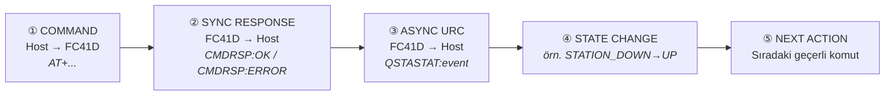

> ⭐ **DRIVER-CRITICAL:** ② ve ③ **aynı kanal değildir**. `CMDRSP:OK`, komutun kabul edildiğini gösterir; asıl sonucu (bağlandı mı, IP aldı mı) sadece ③'teki URC verir. Sürücü bu ikisini **asla** birbirinin devamı gibi naif şekilde eşleştirmemeli — URC'ler bağımsız bir kanaldır ve her an gelebilir.

---

<a id="3-sistem-genel-bakis"></a>
#### 3. Sistem Genel Bakış

| Özellik | Değer | Kanıt |
|---|---|---|
| Firmware | `FC41D_VERSION:FC41DAAR03A01.bin_202107021122` | 🧪 |
| MAC (bu birim) | `64:c4:03:00:00:2d` — her modülde farklı | 🧪 |
| UART | 115200 baud / 8N1 / akış kontrolü yok | 🧪 |
| Komut sonu | `<CR>` yeterli | 📘 🧪 |
| Echo varsayılanı | AÇIK | 🧪 |
| Boot mesajı | `ready` (`AT+QRST` sonrası ~3 sn) | 🧪 |
| AP modu varsayılan IP/gateway | `192.168.19.1` / maske `255.255.255.0` | 🧪 |
| Wi-Fi'ye özel hata kodu | Yok — sadece genel `CMDRSP:ERROR` | 🧪 📘 |
| STA+AP eşzamanlılık | **Destekleniyor** | 🧪 |
| Kalıcı (reset sonrası hatırlanan) Wi-Fi ayarı | **Yok** — `DEF` komutları çalışmıyor | 🧪 |

> ⚠️ **Bu doküman boyunca en önemli kural:** Bu modülün firmware'i (2021-07-02) Quectel AT Commands Manual v2.2'den (bazı komutlar 2025/2026'da eklenmiş) daha eskidir. Sonuç: §4-7'deki bazı komutlar ❌ olarak işaretli — hiç çalışmıyor. Çalışanların da ham yanıt formatı dokümandan farklı (§19'da tam karşılaştırma). **Her zaman bu sayfalardaki `🧪 gerçek TX/RX örneklerini` esas alın, sadece "amaç/parametre" bilgisi için dokümana güvenin.**

---

<a id="4-komut-referansi--sistem-ve-uart"></a>
#### 4. Komut Referansı — Sistem ve UART

| Komut | Ne işe yarar | TX (gönderin) | RX — başarı | RX — hata/yok | Notlar |
|---|---|---|---|---|---|
| `AT` | Modülün canlı olup olmadığını, iletişimin kurulduğunu kontrol eder | `AT` | `CMDRSP:OK` | `CMDRSP:ERROR` (nadir) | Her oturumun ilk adımı olarak kullanın |
| `AT+QRST` | Modülü yazılımsal olarak yeniden başlatır | `AT+QRST` | `CMDRSP:OK`, ardından ~3 sn içinde asenkron **`ready`** mesajı | — | `ready` gelene kadar modül tam hazır olmayabilir; reset sonrası **tüm** Wi-Fi ayarları (STA/AP) kapanır, hiçbir şey hatırlanmaz |
| `AT+QVERSION` | Firmware sürüm bilgisini okur | `AT+QVERSION` | `FC41D_VERSION:FC41DAAR03A01.bin_202107021122` sonra `CMDRSP:OK` | `CMDRSP:ERROR` | Dokümanda `+QVERSION: <version>` formatı yazsa da gerçek cihaz farklı bir etiketle yanıtlıyor |
| `AT+QWLMAC` | Modülün donanım MAC adresini okur | `AT+QWLMAC` | `CMDRSP:+WMAC:64:c4:03:00:00:2d` sonra `CMDRSP:OK` | `CMDRSP:ERROR` | MAC her modülde farklıdır — kendi kartınızdan okuyup kaydedin |
| `AT+QECHO=<0\|1>` | Komutlarınızın size geri yansıtılıp yansıtılmayacağını (echo) belirler | `AT+QECHO=0` (kapat) / `AT+QECHO=1` (aç) | `CMDRSP:OK` | `CMDRSP:ERROR` | Varsayılan: **AÇIK**. Kalıcı değil, her reset'te tekrar açık gelir |
| `AT+QAIRKISS=<0\|1>` | AirKiss (broadcast tabanlı Wi-Fi kurulum) özelliğini açar/kapatır | `AT+QAIRKISS=1` | `CMDRSP:OK` | `CMDRSP:ERROR` | Sadece aç/kapa doğrulandı; kendi kurulum akışı (özel mobil uygulama gerektirir) test edilmedi |
| ❌ `AT+QURCCFG=<0\|1\|?>` | *(📘 Dokümante)* URC bildirimlerini aç/kapa yapılandırır | `AT+QURCCFG=1` | — | **Her zaman `CMDRSP:ERROR`** 🧪 | Bu firmware'de çalışmıyor — zaten gerekmiyor, URC'ler varsayılan olarak akıyor |
| ❌ `AT+QPING=<IP>` | *(📘 Dokümante)* Belirtilen IP'ye ping atar | `AT+QPING=8.8.8.8` | — | **Her zaman `CMDRSP:ERROR`** 🧪 | Bu firmware'de çalışmıyor |
| ❌ `AT+QSETBAND=<baud>[,<save>]` | *(📘 Dokümante)* Seri port baud hızını değiştirir | `AT+QSETBAND=9600,0` | — | **Her zaman `CMDRSP:ERROR`** 🧪 | Bu firmware'de çalışmıyor — baud rate 115200 sabit kalıyor |
| ⬜ `AT+QWLANOTA=<URL>[,<port>]` | *(📘 Dokümante)* OTA firmware güncellemesi başlatır | — | — | — | Riskli olduğu için bu oturumda hiç denenmedi |
| ⬜ `AT+QLOWPOWER` | *(📘 Dokümante)* Düşük güç moduna geçer; Wi-Fi/BLE bağlantısı kesilir, reboot olmadan devam eder | — | — | — | Donanımı riske atmamak için denenmedi |
| ⬜ `AT+QDEEPSLEEP` | *(📘 Dokümante)* Derin uykuya geçer; uyanınca modül **reboot** olur | — | — | — | Donanımı riske atmamak için denenmedi |

---

<a id="5-komut-referansi--sta-istemci-modu"></a>
#### 5. Komut Referansı — STA İstemci Modu

| Komut | Ne işe yarar | TX (gönderin) | RX — başarı | RX — hata/yok | Notlar |
|---|---|---|---|---|---|
| `AT+QSTAAPINFO=<SSID>[,<pwd>]` | Belirtilen Wi-Fi ağına bağlanır — **bağlanmanın tek yolu** | `AT+QSTAAPINFO=MyNetwork,password1234` (şifresiz ağ için `,<pwd>` atlayın) | `CMDRSP:OK` (kabul edildi), ardından asenkron `QSTASTAT:WLAN_CONNECTED` → `QSTASTAT:GOT_IP` | Şifre yanlışsa: **hiçbir şey** (tam sessizlik). SSID yoksa: tekrarlayan `QSTASTAT:SCAN_NO_AP` | `OK` sadece "kabul edildi" demektir, henüz bağlı değilsiniz — gerçek bağlantı `GOT_IP` ile tamamlanır ⭐ |
| ❌ `AT+QSTAAPINFODEF=<SSID>[,<pwd>]` | *(📘 Dokümante)* Aynısı + bağlantı bilgisini kalıcı kaydeder | `AT+QSTAAPINFODEF=MyNetwork,password1234` | — | **Her zaman `CMDRSP:ERROR`** 🧪 | Bu firmware'de çalışmıyor — kalıcı SSID/şifre saklama imkanı yok |
| `AT+QSTASTOP` | STA modunu / mevcut bağlantıyı kapatır | `AT+QSTASTOP` | `CMDRSP:OK`; gerçekten bağlıysanız ayrıca `QSTASTAT:WLAN_DISCONNECTED` | `CMDRSP:ERROR` (nadir) | Zaten bağlı değilseniz (örn. `SCAN_NO_AP` döngüsündeyken) sadece `OK` gelir, `WLAN_DISCONNECTED` gelmez |
| `AT+QSTAST` | STA modunun açık/kapalı olduğunu sorgular | `AT+QSTAST` | `CMDRSP:STATION_UP` veya `CMDRSP:STATION_DOWN`, sonra `CMDRSP:OK` | `CMDRSP:ERROR` (nadir) | ⚠️ **Tek başına güvenmeyin** — AP kaybolduğunda yanlışlıkla `STATION_UP` demeye devam edebiliyor ⭐ |
| `AT+QGETWIFISTATE` | Gerçekten bağlı olup olmadığınızı ve bağlantı detaylarını gösterir | `AT+QGETWIFISTATE` | `CMDRSP:OK` sonra `QGETWIFISTATE:ssid=<ad>,bssid=<mac>,rssi=<dBm>,channel=<n>,cipher_type=<tip>` (**sıra ters**, bkz. §15) | Bağlı değilken: `CMDRSP:ERROR` | ⭐ En güvenilir "gerçekten bağlı mıyım" kontrolü. `rssi` gerçek negatif dBm değeridir (örn. `-46`) |
| `AT+QGETIP=station` | STA modunda alınan IP adresini gösterir | `AT+QGETIP=station` | `QGETIP:ip:<ip>,gate:<gw>,mask:<mask>,dns:<dns>,` | Bağlı değilken tüm alanlar `0.0.0.0` | ⚠️ Bu komut **asla** `OK`/`ERROR` döndürmez — sadece veri satırını bekleyin ⭐ |
| `AT+QSTADHCP=<0\|1>` | STA modunda DHCP istemcisini aç/kapat | `AT+QSTADHCP=1` | `CMDRSP:OK` | `CMDRSP:ERROR` | Kalıcı değil, her reset'te DHCP tekrar açık gelir |
| ❌ `AT+QSTADHCPDEF=<0\|1>` | *(📘 Dokümante)* Aynısı + kalıcı kaydeder | `AT+QSTADHCPDEF=1` | — | **Her zaman `CMDRSP:ERROR`** 🧪 | Bu firmware'de çalışmıyor |
| `AT+QSTASTATIC=<ip>,<mask>,<gw>,<dns>` | STA modu için sabit (statik) IP atar | `AT+QSTASTATIC=192.168.1.50,255.255.255.0,192.168.1.1,8.8.8.8` | `CMDRSP:OK` | `CMDRSP:ERROR` | Kalıcı değil |
| `AT+QWSCAN` | Çevredeki Wi-Fi ağlarını tarar ve listeler | `AT+QWSCAN` | Her ağ için bir satır: `CMDRSP:+WSCAN:<SSID>,<güvenlik>,<sinyal>,<bssid> ,<kanal>`, en sonda `CMDRSP:OK` | `CMDRSP:ERROR` | ~4 sn sürer. `<güvenlik>`: `OPEN`/`WEP_SHARED`/`WPA_AES_PSK`/`WPA2_AES_PSK`. Gizli ağ = boş SSID. `<sinyal>` burada 0-100 kalite ölçeğinde — `AT+QGETWIFISTATE`'teki gerçek dBm'den **farklı ölçek**! |
| ❌ `AT+QSCANINTERVAL[=?\|?\|<n>]` | *(📘 Dokümante)* STA modunda tarama periyodunu ayarlar | — | — | **Her zaman `CMDRSP:ERROR`** 🧪 | Bu firmware'de çalışmıyor |

---

<a id="6-komut-referansi--ap-softap-modu"></a>
#### 6. Komut Referansı — AP SoftAP Modu

| Komut | Ne işe yarar | TX (gönderin) | RX — başarı | RX — hata/yok | Notlar |
|---|---|---|---|---|---|
| `AT+QSOFTAP=<SSID>[,<key>]` | Modülü kendisi bir Wi-Fi hotspot'u yapar | `AT+QSOFTAP=FC41D_AP,12345678` (şifresiz için `,<key>` atlayın) | `CMDRSP:OK` (~4 sn) | `CMDRSP:ERROR` | AP hemen yayına başlar; STA modu açıkken de sorunsuz çalışır (eşzamanlı — §13) |
| `AT+QSOFTAPSTOP` | AP yayınını kapatır | `AT+QSOFTAPSTOP` | `CMDRSP:OK` | `CMDRSP:ERROR` | — |
| `AT+QAPSTATE` | AP modunun açık/kapalı olduğunu sorgular | `AT+QAPSTATE` | `CMDRSP:SOFTAP_UP` veya `CMDRSP:SOFTAP_DOWN`, sonra `CMDRSP:OK` | `CMDRSP:ERROR` (nadir) | — |
| `AT+QGETIP=ap` | AP modunun IP/gateway bilgisini gösterir | `AT+QGETIP=ap` | `QGETIP:ip:192.168.19.1,gate:192.168.19.1,mask:255.255.255.0,dns:192.168.19.1,` | — | AP modunun varsayılan/sabit adresi her zaman `192.168.19.1` |
| `AT+QAPSTATIC=<ip>,<mask>,<gw>,<dns>` | AP modu için farklı bir sabit IP atar | `AT+QAPSTATIC=192.168.50.1,255.255.255.0,192.168.50.1,192.168.50.1` | `CMDRSP:OK` | `CMDRSP:ERROR` | Kalıcı değil |
| ❌ `AT+QAPGETLIST` | *(📘 Dokümante)* AP'ye bağlı istemcileri listeler (maks. 2 STA) | `AT+QAPGETLIST` | — | **Her koşulda `CMDRSP:ERROR`** 🧪 | Bu firmware'de çalışmıyor; gerçek istemciyle de ayrıca test edilmedi (❓ §18) |
| ❌ `AT+QAPCFG="linknum"[,<n>]` | *(📘 Dokümante)* AP'ye bağlanabilecek maksimum istemci sayısını ayarlar | — | — | **Her zaman `CMDRSP:ERROR`** 🧪 | Bu firmware'de çalışmıyor |

---

<a id="7-komut-referansi--web-pairing"></a>
#### 7. Komut Referansı — Web Pairing

| Komut | Ne işe yarar | TX | RX — başarı | RX — hata | Notlar |
|---|---|---|---|---|---|
| ❌ `AT+QWEBCFG=<0\|1>` | *(📘 Dokümante)* Web tarayıcısı üzerinden Wi-Fi kurulumunu açar (AP modunda `192.168.19.1` adresinden erişim) | `AT+QWEBCFG=1` | — | **Her zaman `CMDRSP:ERROR`** 🧪 (AP açık/kapalı fark etmeksizin) | Bu firmware'de çalışmıyor |

---

<a id="w-retest"></a>
#### 7.5 ⭐ Firmware Yükseltme Sonrası Yeniden Test — 2026-09-14

**Yeni firmware:** `FC41DAAR03A14M02.bin_202508171313` (2025-08-17), Quectel QFlash ile yüklendi. Aynı fiziksel cihaz (COM4, MAC `64:c4:03:00:00:2d`). Yukarıdaki §4-§7'de ❌ işaretli **9 komutun tamamı** bu yeni firmware'e karşı tekrar denendi. 🧪

| Komut | 2021 fw | 2025 fw | Not |
|---|:---:|:---:|---|
| `AT+QURCCFG=<n>` (execute) | ❌ | ✅ **düzeldi** | `AT+QURCCFG=1` → `OK` |
| `AT+QURCCFG?` (query) | ❌ | ❌ | Sorgu formu hâlâ `ERROR`, sadece execute formu düzeldi |
| `AT+QPING=<IP>` | ❌ | ❓ **sonuçsuz** | STA bağlantısı bu oturumda kurulamadı (bilinen ağ `WPA3_MIXED_NET` şifresi değişmiş/erişilemez olabilir). Adil bir test için gerçek internet bağlantısı gerekiyor, tekrar denenmeli |
| `AT+QSETBAND=<baud>[,<save>]` | ❌ | ❓ **denenmedi** | Baud hızını canlı değiştirdiği için riskli, bu oturumda atlandı; kontrollü koşulda (yedek port hazır) ayrıca denenmeli |
| `AT+QSTAAPINFODEF=<SSID>[,<pwd>]` | ❌ | ✅ **düzeldi** | `OK` döndü, kalıcı SSID/şifre saklama artık kabul ediliyor (reset sonrası gerçekten hatırlıyor mu ayrıca doğrulanmadı) |
| `AT+QSTADHCPDEF=<0\|1>` | ❌ | ✅ **düzeldi** | `OK` döndü |
| `AT+QSCANINTERVAL[=?\|?\|<n>]` | ❌ | ❌ | Değişmedi, hem bağlantısızken hem STA'ya bağlanmaya çalışırken denendi |
| `AT+QAPGETLIST` | ❌ | ✅ **düzeldi** | `OK` döndü (gerçek bağlı istemciyle liste içeriği ayrıca doğrulanmadı) |
| `AT+QAPCFG="linknum"[,<n>]` | ❌ | ✅ **düzeldi** | `OK` döndü |
| `AT+QWEBCFG=<0\|1>` | ❌ | ✅ **düzeldi** | `OK` döndü (tarayıcıdan `192.168.19.1`e erişim ayrıca doğrulanmadı) |

> ⭐ **Özet: 9 komuttan 6'sı düzelmiş, 2'si hâlâ bozuk, 1'i (`QPING`) bu oturumda adil test edilemedi, 1'i (`QSETBAND`) kasıtlı olarak denenmedi.** Genel örüntü: yeni firmware, manuel v2.2 ile olan sürüm farkının büyük kısmını kapatmış. Ama "OK dönmesi" ile "gerçekten belgelenen işlevi yapması" ayrı şeyler; ✅ **düzeldi** işaretli komutların hiçbiri uçtan uca (örn. `QAPGETLIST`'in gerçek bir istemciyle içerik döndürmesi) doğrulanmadı, sadece `CMDRSP:ERROR`→`CMDRSP:OK` geçişi doğrulandı. ❓ **Açık kalan:** `QPING` gerçek internet ile, `QSETBAND` kontrollü ortamda yeniden denenmeli.

---

<a id="w-retest-a16"></a>
#### 7.6 ⭐⭐ Firmware A16M02 Sonrası Uçtan Uca Doğrulama — 2026-09-23

**Yeni firmware:** `FC41DAAR03A16M02.bin_202512160643` (2025-12-16). Aynı fiziksel cihaz (COM4, MAC `64:c4:03:00:00:2d`). Bu turda GUI'ye dokunmadan, doğrudan `pyserial` ile ham AT komutları gönderildi (ham bayt akışı, `\r` sonlandırıcı, satır bölme yok) — amaç, §7.5'te sadece `OK`/`ERROR` seviyesinde doğrulanan komutları bu kez **gerçek uçtan uca** (gerçek istemci, gerçek BLE merkez, gerçek internet) test etmekti. Ayrıca `bleak` ile gerçek bir BLE merkez (PC) bağlanıp veri alışverişi bizzat doğrulandı.

**Sistem / STA:**

| Komut | A14 fw | A16 fw | Not |
|---|:---:|:---:|---|
| `AT+QSCANINTERVAL[=?\|?\|<n>]` | ❌ | ✅ **düzeldi** | Üç formu da çalışıyor: `=?` → `(1-120)`, `?` → mevcut değeri okuyor, `=<n>` → ayarlıyor |
| `AT+QPING=<IP>` | ❓ sonuçsuz | ❌ **doğrulanmış kırık** | Gerçek DHCP IP alınmış, internet erişimi olan açık bir ağa bağlıyken bile `ERROR` — bağlantı durumundan bağımsız, komut bu firmware ailesinde hiç yok |
| `AT+QSTAAPINFODEF=<SSID>[,<pwd>]` + `AT+QSTADHCPDEF=1` kalıcılığı | ✅ (kalıcılık doğrulanmadı) | ✅ **tam doğrulandı** | `AT+QRST` sonrası **hiçbir STA komutu göndermeden** modül otomatik olarak aynı ağa bağlandı ve yeni bir DHCP IP aldı (`STATION_UP`, `AT+QGETIP=station` dolu) ⭐ |
| `AT+QAPGETLIST` (gerçek istemciyle) | ✅ (boş liste doğrulandı) | ✅ **tam doğrulandı** | PC, `FC41D_AP`'ye gerçekten bağlandı; `AT+QAPGETLIST` doğru MAC+IP'yi döndürdü: `1: mac:84-9e-56-33-be-9f, ip:192.168.19.100` |
| `AT+QWEBCFG=1` (tarayıcı erişimi) | ✅ (sadece `OK`) | ✅ **tam doğrulandı** | `http://192.168.19.1` gerçekten "FC41D smart config" sayfasını sunuyor (SSID/Password/Baud Rate formu) |
| `AT+QAPCFG="linknum"[,<n>]` | ✅ | ✅ | Değişmedi, hâlâ çalışıyor (varsayılan `2`) |
| `AT+QURCCFG=<n>` / `AT+QURCCFG?` | ✅ / ❌ | ✅ / ❌ | Değişmedi — execute formu çalışıyor, query formu hâlâ `ERROR` |

> 🔴 **Önemli bulgu — `WPA3_MIXED_NET`'e bağlanamıyor:** Kullanıcının verdiği `WPA3_MIXED_NET` / `<password>` bilgileriyle **temiz bir `AT+QRST` sonrasında bile** FC41D `WLAN_DISCONNECTED` döngüsünde kaldı, hiç `WLAN_CONNECTED`'a ulaşmadı. Ama **aynı anda bu PC'nin kendi Wi-Fi adaptörü aynı SSID/şifre ile sorunsuz bağlandı** — yani şifre bayat/yanlış değil. `AT+QWSCAN` ağı güçlü sinyalle (kalite 53/100) görüyor. Karşılaştırma için açık (şifresiz) bir ağa (`ESP_XXXXXX`) deneme yapıldı ve **anında** `WLAN_CONNECTED` + DHCP IP alındı — yani STA/DHCP zinciri genel olarak sağlam, sorun özellikle `WPA3_MIXED_NET`'in güvenlik modunda (`WPA3_WPA2_MIXED` — WPA3 geçiş modu). Olası neden: FC41D'nin WPA3-geçiş-modu (mixed PMF) el sıkışmasıyla uyumsuzluğu. **VERIFICATION REQUIRED** — sadece WPA2-only bir ağla ayrıca denenmeli.

> ⚠️ **Yan bulgu:** `AT+QSTASTOP` veya başarısız bir `AT+QSTAAPINFO` denemesinden sonra, temiz bir `AT+QRST` yapılana kadar `AT+QSTAST` komutu artık `+QSTAST:STATION_UP/DOWN` veri satırını üretmiyor, sadece çıplak `OK` dönüyor (durum sorgusu fonksiyonel olarak bozuluyor, sadece görünüşte). Bu daha önce hiç not edilmemiş bir davranış.

**BLE (temiz `AT+QBLEINIT=2` → `QBLEGATTSSRV=FFF0` → `QBLEGATTSCHAR=FFF1,FF` → `QBLEADVSTART` — ilk denemede sorunsuz kuruldu, tekrar edilebilir):**

| Komut/Davranış | Önceki bulgu | A16 fw | Not |
|---|:---:|:---:|---|
| `AT+QBLEGATTSNTFY=<uuid>,<data>` (gerçek merkeze) | ❌ (bağlıyken de) | ✅ **tam doğrulandı** | `bleak` merkezi bağlıyken gönderildi, **tam olarak gönderilen bayt dizisi** (`0102`) merkez tarafında `notify` callback'inde alındı |
| `AT+QBLEGATTSIND=<uuid>,<data>` (Indicate) | ❌ "OK dönüyor ama veri gelmiyor" | ✅ **tam doğrulandı — önceki bulgu YANLIŞTI** | Aynı testte `0304` verisi indicate ile gönderildi, merkez tarafında **doğru şekilde alındı** |
| Merkezden karakteristiğe `write` | ⬜ | ✅ **doğrulandı** | `bleak` `write_gatt_char()` ile FFF1'e yazdı, FC41D tarafında hata olmadı |
| `+QBLESTAT:CONNECTED` / `DISCONNECTED` URC'leri | ❌ "hiç gelmiyor" | ✅ **tam doğrulandı — önceki bulgu YANLIŞTI** | Gerçek bağlan/kopar döngüsünde her iki URC de doğru zamanda geldi |
| `+QBLEMTU:<512>` URC | 📘 ⬜ gözlenmedi | ✅ **doğrulandı** | Bağlantı anında otomatik MTU 512'ye çıkıyor ve URC ile bildiriliyor (iki kez basılıyor — küçük bir tuhaflık, işlevi etkilemiyor) |
| Kopma sonrası reklam durumu | ❌ "kendiliğinden NOINIT'e dönüyor" | ✅ **düzeldi** | Artık merkez koptuktan sonra otomatik olarak `ADVERTISING`'e geri dönüyor, `NOINIT`'e düşmüyor |
| `AT+QBLEMTUMODE?` / `=<n>` | ❌ her ikisi de | ✅ **düzeldi** | Artık ikisi de `OK` dönüyor (veri içeriği doğrulanmadı) |
| `AT+QBLEURC?` (query) | ❌ | 🔶 **kısmi düzelme** | Artık `ERROR` yerine çıplak `OK` dönüyor, ama hâlâ veri satırı yok |
| `AT+QBLESRDATA=<hex>` | ✅ (A14'te düzelmişti) | ❌ **YENİDEN BOZULDU (regresyon)** | A14'te `OK` dönüyordu, A16'da hem tırnaksız hem tırnaklı biçimde, hem reklam açıkken hem kapalıyken `ERROR` — gerçek bir geri adım |
| `AT+QBLEADVPARAM?`, `AT+QBLEQADVPARAM?`, `AT+QBLECONNPARAM?`, `AT+QBLESCANPARAM?` | ❌ hepsi | ❌ hepsi | Değişmedi |
| `AT+QBLESEND=<conn_idx>,<uuid>,<att_cfg>,<data_len>` | ❌ (eski/yanlış sözdizimiyle denenmişti) | ❌ | Manuel'deki doğru 4 parametreli sözdizimiyle (`conn_idx=0`, birkaç `att_cfg` varyantı) tekrar denendi, hepsi `ERROR` — `att_cfg` alanının tam anlamı belirsiz kaldı (manuel çıkarımı bu bölümde bozuk). **Önemi düşük**: aynı işlevi (merkeze veri push) `QBLEGATTSNTFY`/`QBLEGATTSIND` zaten uçtan uca kanıtlanmış durumda |
| `AT+QBLEGATTSCFGREAD` (bağlısız) | ❌ | ❌ | Değişmedi (bağlıyken ayrıca denenmedi) |

> ⭐⭐ **Bu turun en önemli sonucu:** Önceki oturumların "BLE'den merkeze veri gönderilemiyor" ve "indicate/CONNECTED-DISCONNECTED URC'leri çalışmıyor" bulguları **bu firmware'de artık geçerli değil** — gerçek bir `bleak` merkeziyle uçtan uca doğrulandı: FC41D artık kendi tanımlı GATT karakteristiği üzerinden **hem notify hem indicate ile merkeze veri gönderebiliyor**, bağlantı durum URC'leri (`CONNECTED`/`DISCONNECTED`/`MTU`) doğru geliyor, ve bu **SoftAP + web-config aktifken eşzamanlı** çalıştı (BLE+TCP/Wi-Fi eşzamanlılığının bir başka doğrulaması, bkz. §T5.x feasibility tablosu satır 5).

> 🔵 **Quectel destek önerisi test edildi (2026-09-23):** Destek, paylaşılan logda DHCP'nin kapatılmadığını belirtip "statik IP tanımlamadan ve AP'ye bağlanmadan önce `AT+QSTADHCPDEF=0` ile DHCP'yi kapatın" önerisini verdi. Tam olarak bu sırayla (`AT+QSTADHCPDEF=0` → `AT+QSTASTATIC=192.168.200.63,255.255.255.0,192.168.200.1,8.8.8.8` → `AT+QSTAAPINFO=<ssid>`) test edildi: **mekanizma kanıtlanmış şekilde çalışıyor** — kontrol amaçlı açık bir ağda (`ESP_XXXXXX`) anında `WLAN_CONNECTED` oldu ve `AT+QGETIP=station` **tam olarak** verilen statik değerleri döndürdü (`192.168.200.63/192.168.200.1/255.255.255.0/8.8.8.8`). Ama `WPA3_MIXED_NET` ile aynı sırayla denendiğinde **yine `WLAN_CONNECTED`'a hiç ulaşılmadı** — yani DHCP/statik IP ayarı bu ağa özgü bağlantı sorununun nedeni değil; sorun IP atama katmanından önceki WLAN association/handshake katmanında. Destek'in teşhisi yanlış katmana odaklanmış. **Statik IP'nin gerçekten geçip geçmediğini doğrulamanın yöntemi netleşti:** DHCP'yi kapatıp bağlandıktan sonra `AT+QGETIP=station` çıktısının verilen değerlerle birebir eşleşmesi.

> 🟡 **Henüz test edilemeyenler:** `AT+QSETBAND` (baud değişimi — riskli, izin bekliyor), `AT+QDEEPSLEEP`/`AT+QLOWPOWER` (izin bekliyor), `AT+QWLANOTA` (gerçek OTA sunucusu gerektirir, denenmedi), telefonla BLE reklamını görme/bağlanma testi (BLE-028/029 — fiziksel telefon gerekiyor), FC41D'nin BLE **merkez** rolündeki komutları (`QBLEGATTCWR`/`CRD`/`NTFCFG`/`INDCFG`/`CONNPARAM` — bağlanacak bir BLE **çevre birimi** simülatörü bu PC'den kolayca kurulamadı).

---

<a id="8-asenkron-bildirimler--urc-referansi"></a>
#### 8. Asenkron Bildirimler — URC Referansı

Bunlar, siz bir komut göndermeden **modülün kendiliğinden gönderdiği** mesajlardır. Formatları: **`QSTASTAT:<olay>`** (başında `+` işareti yok, tırnak yok — dokümandaki `+QSTASTAT: "..."` gösteriminden farklı).

| Olay | Ne zaman gelir | Ne anlama gelir |
|---|---|---|
| `ready` | `AT+QRST` sonrası ~3 sn | Modül tamamen açıldı, komut kabul etmeye hazır |
| `QSTASTAT:WLAN_CONNECTED` | Bir ağa L2 düzeyinde katılma başarılı olduğunda | Ağa katıldınız ama **henüz IP almadınız** |
| `QSTASTAT:GOT_IP` | `WLAN_CONNECTED`'dan kısa süre sonra | **Artık gerçekten bağlısınız**, veri alışverişi yapabilirsiniz |
| `QSTASTAT:WLAN_DISCONNECTED` | Sadece **siz** `AT+QSTASTOP` ile gerçekten bağlı bir bağlantıyı kapattığınızda | Beklenen, temiz bir kapanış |
| `QSTASTAT:SCAN_NO_AP` | (a) Hedef SSID hiç bulunamadığında **veya** (b) bağlıyken hedef AP kaybolduğunda — ikisinde de **aynı** mesaj, tekrarlayarak (~5-10 sn'de bir) gelir | Modül hedefi bulamıyor, arka planda sessizce yeniden arıyor — **AP bulunana veya siz durdurana kadar sonsuza dek** ⭐ |
| `QSTASTAT:AP_CONNECT` *(📘 dokümante, bu oturumda gözlenmedi)* | AP modundayken bir istemci bağlandığında (beklenen) | ❓ Gerçek istemciyle doğrulanmadı |
| `QSTASTAT:AP_DISCONNECT` *(📘 dokümante, bu oturumda gözlenmedi)* | AP modundayken bağlı istemci ayrıldığında (beklenen) | ❓ Gerçek istemciyle doğrulanmadı |

---
---

<a id="bolum-b"></a>
### BÖLÜM B — Uygulama: Akışlar, Senaryolar, Doğrulama

> Bölüm A'daki komut/olay sözlüğü artık bir "kelime dağarcığı" gibi elinizde — bu bölüm, o kelimelerin **gerçek işlemlerde nasıl bir cümle kurduğunu** gösterir.

---

<a id="9-at-a-glance--genel-akis"></a>
#### 9. At a Glance — Genel Akış

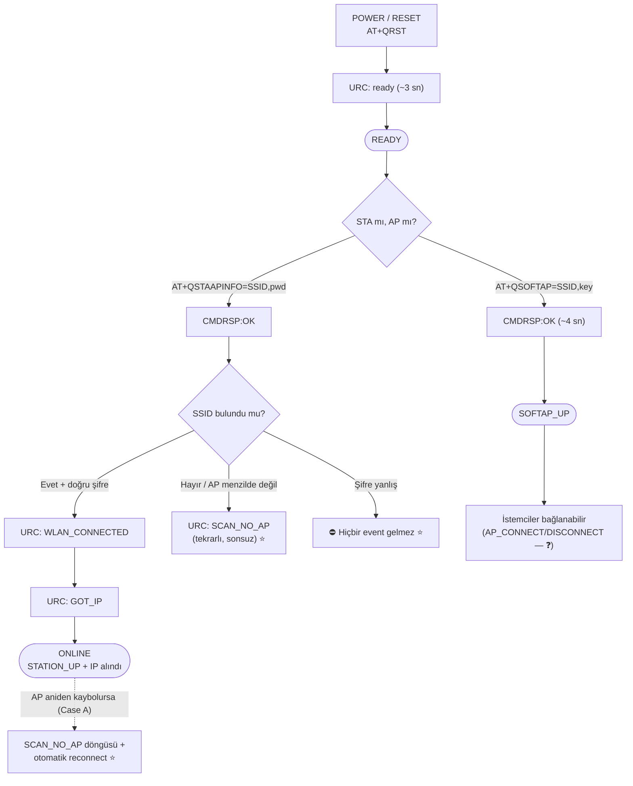

---

<a id="10-engineer-quick-reference"></a>
#### 10. Engineer Quick Reference

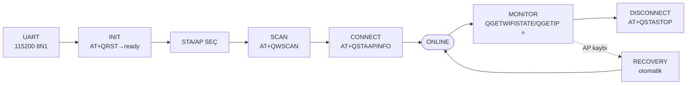

| Kritik TX | Kritik RX/URC | Ne zaman |
|---|---|---|
| `AT+QSTAAPINFO=<SSID>,<pwd>` | `CMDRSP:OK` → `WLAN_CONNECTED` → `GOT_IP` | Bağlantı kurma |
| `AT+QSTASTOP` | `CMDRSP:OK` (+`WLAN_DISCONNECTED` gerçekten bağlıysa) | Bilinçli kesme |
| `AT+QWSCAN` | `+WSCAN:...` × N satır, `CMDRSP:OK` | Ağ tarama (~4 sn) |
| `AT+QGETWIFISTATE` ⭐ | `CMDRSP:OK` + veri (bağlı değilse `CMDRSP:ERROR`) | Gerçek durum teyidi |
| `AT+QGETIP=station` | `QGETIP:ip:...,` (**OK/ERROR asla gelmez**) ⭐ | IP kontrolü |

---

<a id="11-initialization-sequence"></a>
#### 11. Initialization Sequence

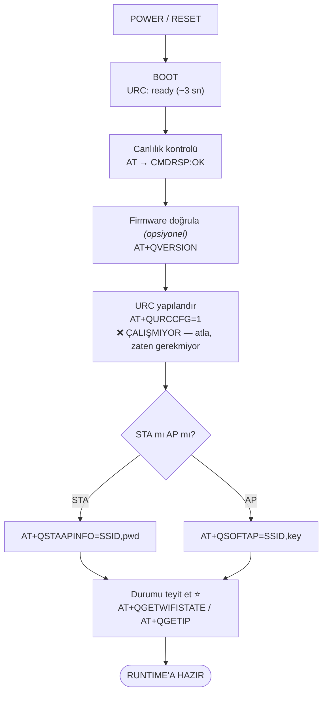

| Sıra | İşlem | TX | Beklenen RX | Zorunlu mu? | Kanıt |
|---|---|---|---|---|---|
| 1 | Boot bekle | — | `ready` | **Zorunlu** | 🧪 |
| 2 | Canlılık kontrolü | `AT` | `CMDRSP:OK` | Doğrulama | 🧪 |
| 3 | Firmware oku | `AT+QVERSION` | `FC41D_VERSION:...`+`CMDRSP:OK` | Opsiyonel | 🧪 |
| 4 | URC yapılandır | `AT+QURCCFG=1` | ❌ `CMDRSP:ERROR` | **Atla** — bu firmware'de yok, gerekmiyor | 🧪 |
| 5a | STA başlat | `AT+QSTAAPINFO=<SSID>,<pwd>` | `CMDRSP:OK` → `WLAN_CONNECTED`→`GOT_IP` | İstemci gerekiyorsa zorunlu | 🧪 |
| 5b | AP başlat | `AT+QSOFTAP=<SSID>,<key>` | `CMDRSP:OK` (~4 sn) | Hotspot gerekiyorsa zorunlu | 🧪 |
| 6 | Durumu teyit et | `AT+QGETWIFISTATE` | `CMDRSP:OK`+veri (yoksa `ERROR`) | **Zorunlu** ⭐ | 🧪 |
| 7 | IP'yi al | `AT+QGETIP=station\|ap` | `QGETIP:ip:...,` (OK gelmez) | Zorunlu | 🧪 |

---

<a id="12-hangi-komutu-kullanmaliyim--decision-tree"></a>
#### 12. Hangi Komutu Kullanmalıyım? — Decision Tree

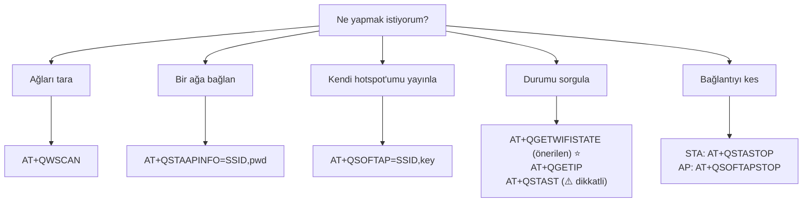

##### 12.1 Command → Event → State İlişkisi

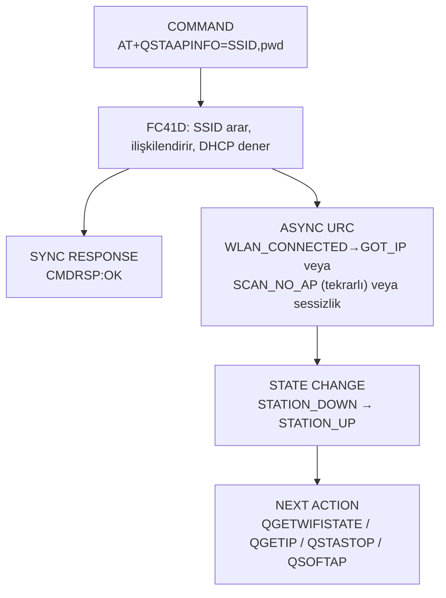

##### 12.2 Bağlantı Kurma — Success vs Failure Path

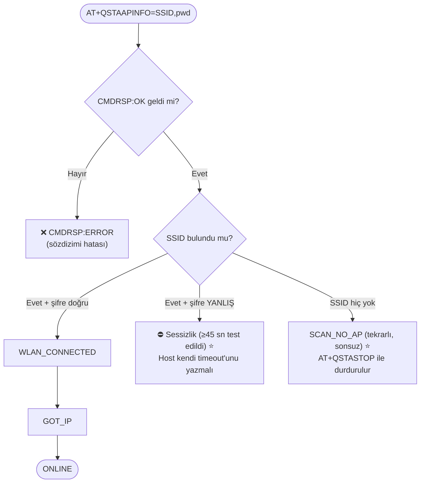

---

<a id="13-state-machine"></a>
#### 13. State Machine

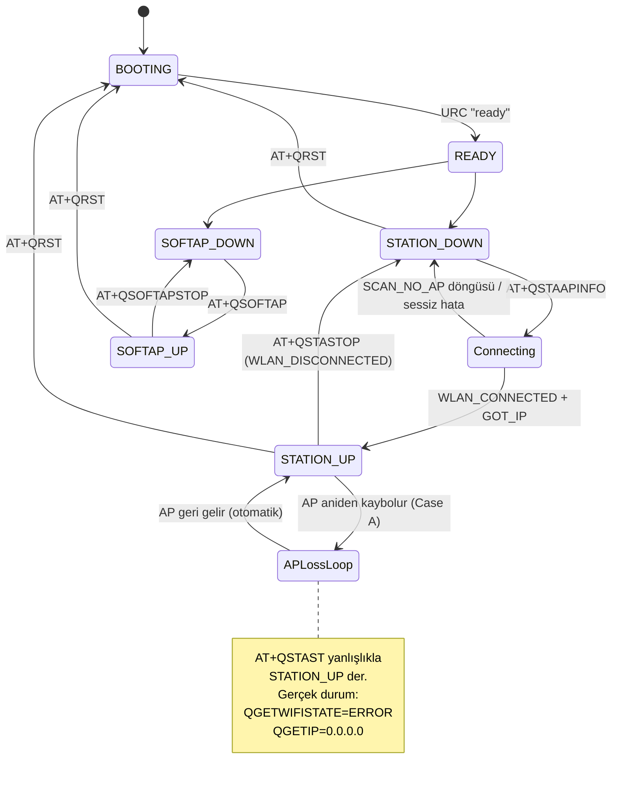

> 🧪 **VERIFIED:** `STATION_DOWN/UP` dalı ile `SOFTAP_DOWN/UP` dalı **birbirinden bağımsızdır** ve aynı anda aktif olabilir (§14.6). Reset (`AT+QRST`) her iki daldan da `BOOTING`'e döner; hiçbir Wi-Fi ayarı hatırlanmaz.

---

<a id="14-txrx-sequence-diyagramlari--senaryolar"></a>
#### 14. TX/RX Sequence Diyagramları — Senaryolar

##### 14.1 Yanıt Çerçevesi

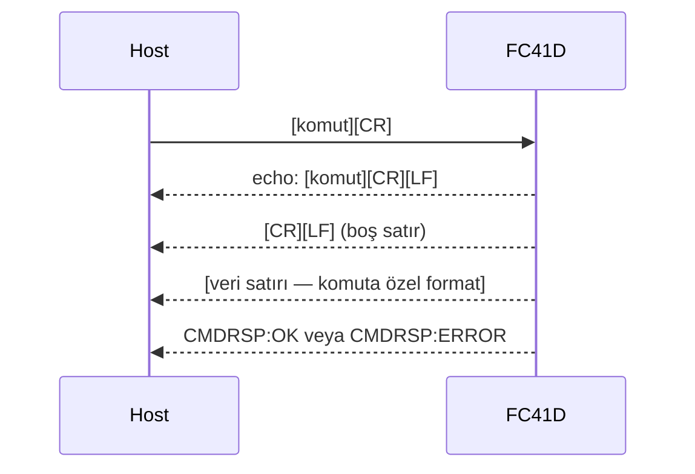

⭐ **3 istisna:**
1. `AT+QGETIP` → **hiçbir zaman** `CMDRSP:OK/ERROR` göndermez, sadece veri satırı gelir.
2. `AT+QGETWIFISTATE` → `CMDRSP:OK` veri satırından **önce** gelir (sıra ters).
3. `QSTASTAT:...` URC'leri herhangi bir komutun ortasında gelebilir — bir komutun cevabı değildir.

##### 14.2 Bağlantı Kurma — Mutlu Yol

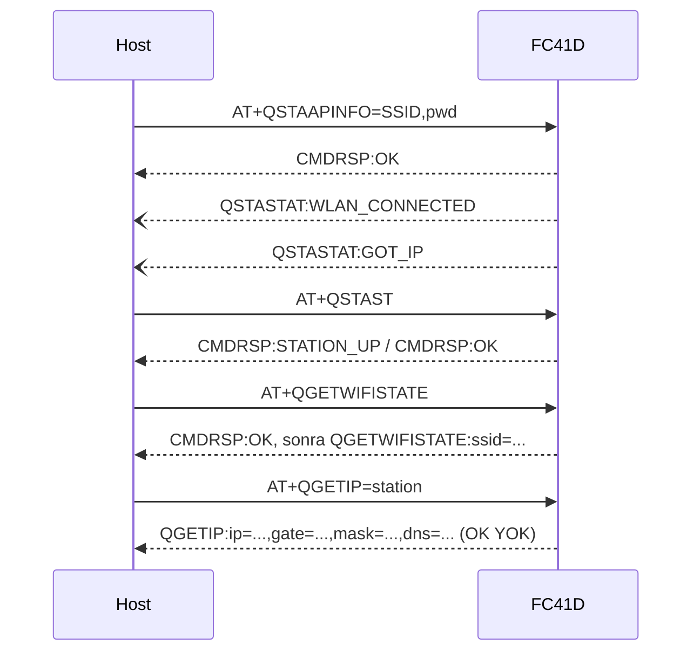

##### 14.3 Yanlış Şifre

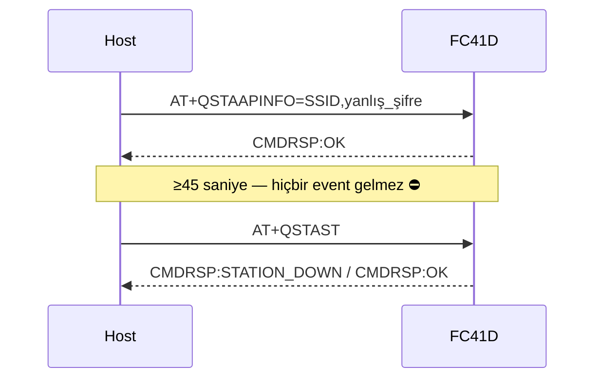

##### 14.4 SSID Bulunamadı

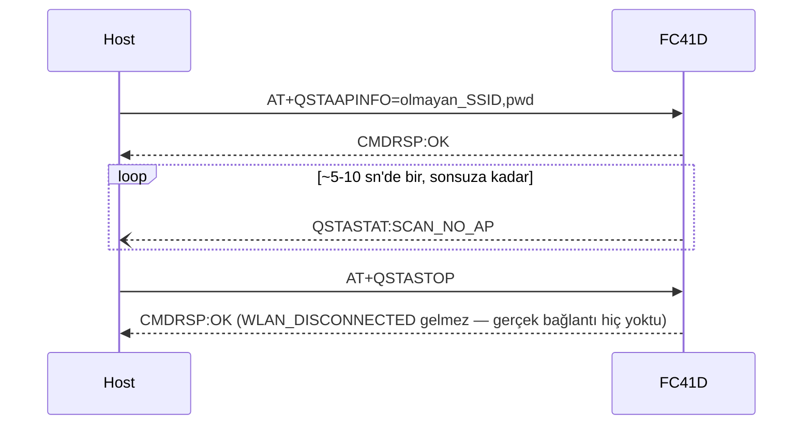

##### 14.5 AP Kaybolur → Geri Gelir ("PhoneHotspot" Testi, Case A)

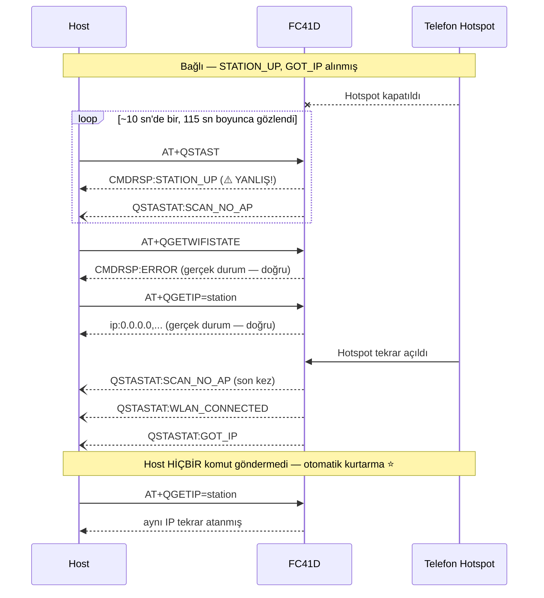

##### 14.6 Eşzamanlı STA + AP

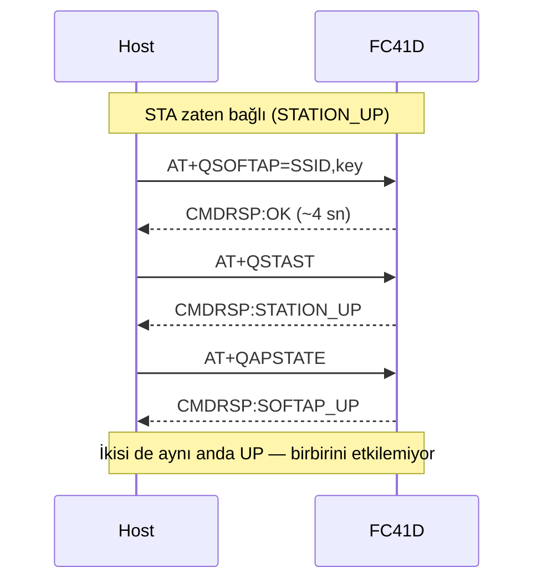

##### 14.7 Reset

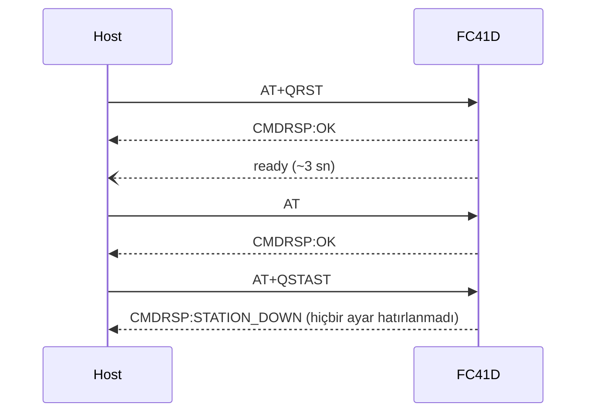

---

<a id="15-timing"></a>
#### 15. Timing

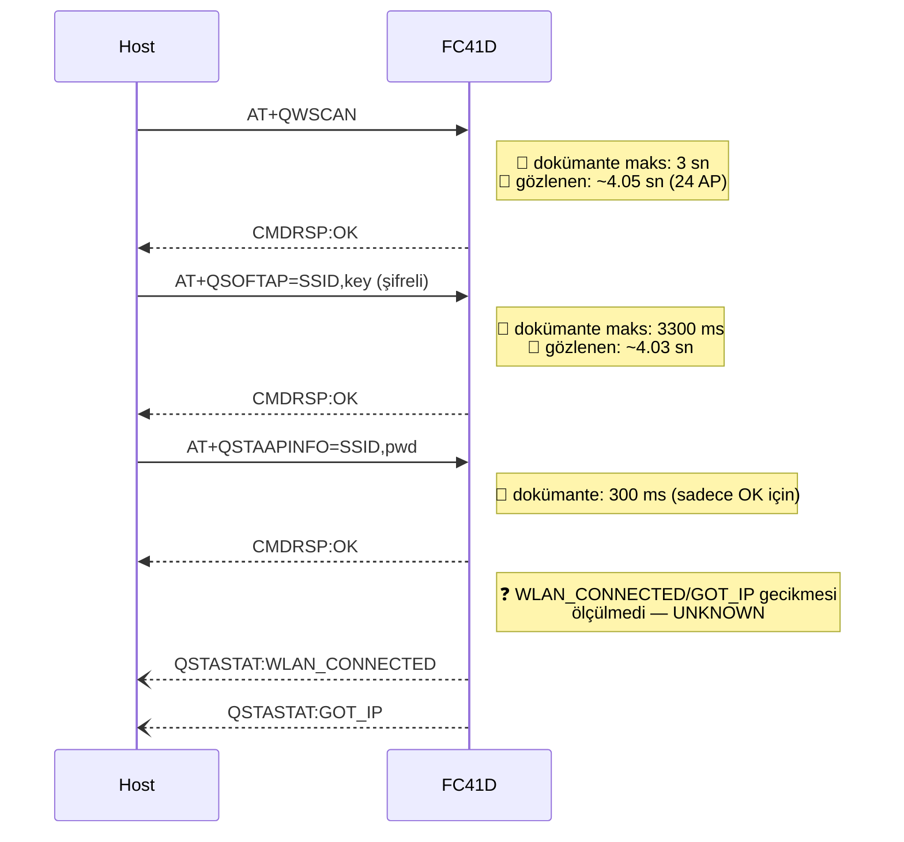

| Komut/olay | 📘 Dokümante | 🧪 Gözlenen | Fark |
|---|---|---|---|
| Standart komutlar (OK/ERROR) | 300 ms | — | — |
| `AT+QWSCAN` | 3 sn | **~4.05 sn** | Dokümanı aştı |
| `AT+QSOFTAP` (şifreli) | 3300 ms | **~4.03 sn** | Dokümanı aştı |
| `AT+QWLANOTA` | 120 sn | Test edilmedi | — |
| Boot/reset süresi | — | **~3 sn** (`ready`'e kadar) | — |
| `WLAN_CONNECTED`↔`GOT_IP` arası | — | Ölçülmedi (sadece sıra doğrulandı) | ❓ UNKNOWN |
| `SCAN_NO_AP` tekrar periyodu | — | **~5-10 sn** | 🔎 yaklaşık |
| Komutlar arası minimum bekleme | — | Test edilmedi | ❓ UNKNOWN |

---

<a id="16-runtime-monitoring--polling-vs-event-driven"></a>
#### 16. Runtime Monitoring — Polling vs Event-Driven

##### 16.1 İki Kanal

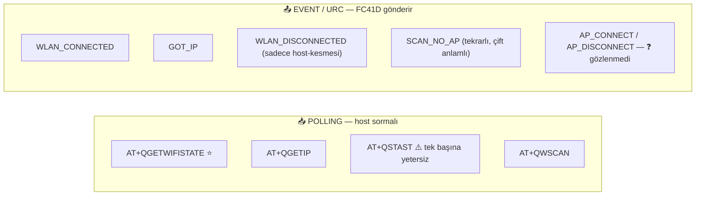

##### 16.2 Polling Flow

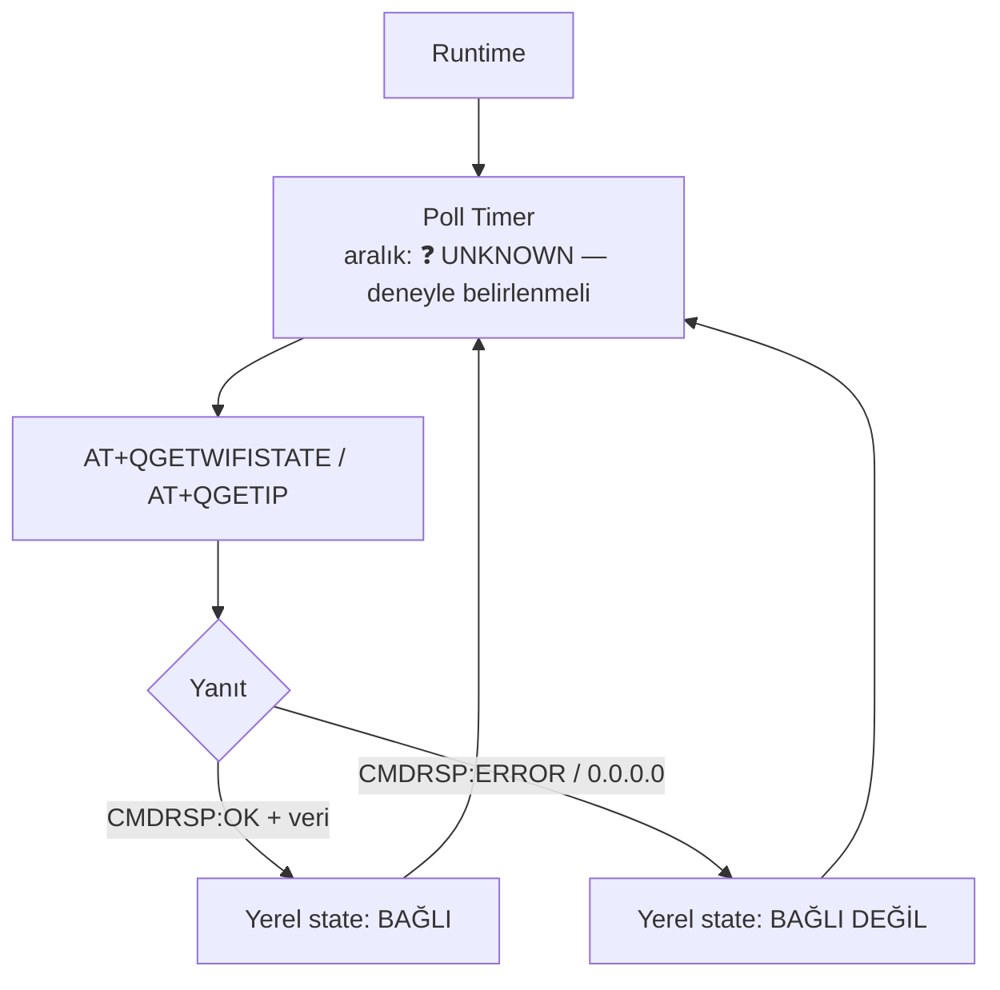

> Not: `AT+QSCANINTERVAL`'in dokümante varsayılan 5 sn'si modülün **kendi iç tarama davranışıdır**, host'un poll aralığı için bir tavsiye değildir ve zaten bu firmware'de çalışmıyor.

##### 16.3 "Bunu Poll Etmem mi Gerekiyor?"

| Bilgi | Event var mı? | Poll komutu | Gerekli mi? | Aralık | Kanıt |
|---|:---:|---|:---:|---|---|
| Bağlantı kuruldu/IP alındı | ✅ | `AT+QGETWIFISTATE` | Teyit için evet ⭐ | ❓ UNKNOWN | 🧪 |
| Bağlantı koptu (host-kesmesi) | ✅ | — | Hayır | — | 🧪 |
| **Bağlantı koptu (AP kaybı)** | ❌ | `AT+QGETWIFISTATE`/`AT+QGETIP` | **EVET, zorunlu** ⭐ | ❓ UNKNOWN | 🧪 |
| IP adresi | ❌ | `AT+QGETIP=station` | Evet | ❓ UNKNOWN | 🧪 |
| RSSI | ❌ | `AT+QGETWIFISTATE` | Evet | ❓ UNKNOWN | 🧪 |
| AP'ye bağlı istemciler | 🔶 kısmen | `AT+QAPGETLIST` (❌ çalışmıyor) | Şu an imkansız | — | 🧪 |
| Taranan ağ listesi | ❌ | `AT+QWSCAN` | Evet, komuta bağlı | — | 🧪 |
| Firmware/MAC | ❌ | `AT+QVERSION`/`AT+QWLMAC` | Hayır (statik) | — | 🧪 |

---

<a id="17-connection-loss--recovery"></a>
#### 17. Connection Loss & Recovery

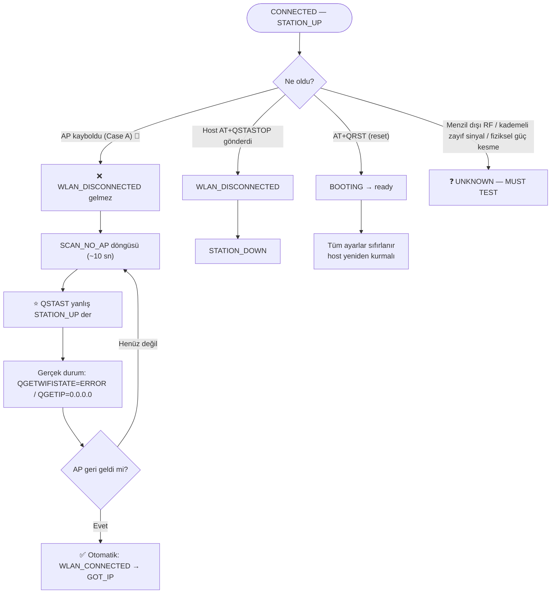

---

<a id="18-open-questions"></a>
#### 18. Open Questions

> ⚠️ **AÇIK SORU — Fiziksel güç kesme sonrası boot davranışı**
> **Durum:** ❓ UNKNOWN — MUST TEST
> **Neden önemli:** Sadece yazılımsal `AT+QRST` test edildi; gerçek watchdog/güç kaybı senaryosu farklı olabilir.

> ⚠️ **AÇIK SORU — `AT+QAPGETLIST`'in gerçek istemciyle davranışı**
> **Durum:** ❓ UNKNOWN — MUST TEST
> **Neden önemli:** Her durumda `ERROR` gözlendi ama hiçbir gerçek istemci AP'ye bağlanmadı — "hiç desteklenmiyor" mu yoksa "istemci yoksa hata veriyor" mu belirsiz.

> ⚠️ **AÇIK SORU — Kademeli zayıf sinyal / disconnect eşiği**
> **Durum:** ❓ UNKNOWN — MUST TEST
> **Neden önemli:** Case A testi ani AP kapatma/açmaydı; yavaş sinyal zayıflaması farklı davranabilir.

> ⚠️ **AÇIK SORU — DHCP'siz ağda bağlanma (GOT_IP hiç gelmezse)**
> **Durum:** ❓ UNKNOWN — MUST TEST
> **Neden önemli:** Host'un "DHCP başarısız" durumunu "yanlış şifre" durumundan ayırt edip edemeyeceği belirsiz — ikisi de sessiz kalabilir.

> ⚠️ **AÇIK SORU — Komutlar arası pipelining / minimum bekleme**
> **Durum:** ❓ UNKNOWN — MUST TEST
> **Neden önemli:** Sürücü serileştirme stratejisini belirler.

> ⚠️ **AÇIK SORU — `AT+QLOWPOWER` / `AT+QDEEPSLEEP` gerçek davranışı**
> **Durum:** ⬜ NOT TESTED (bilinçli, donanım riski)
> **Neden önemli:** Uyandırma mekanizması dokümante değil, modülü fiziksel müdahale gerektiren duruma sokabilir.

> ℹ️ Daha önce açık olan **STA+AP eşzamanlılığı** ve **AP kaybı/otomatik kurtarma** soruları bu oturumda **kesin çözüldü** — artık 🧪 VERIFIED (§13, §14.6, §17).

---

<a id="19-experimental-validation"></a>
#### 19. Experimental Validation

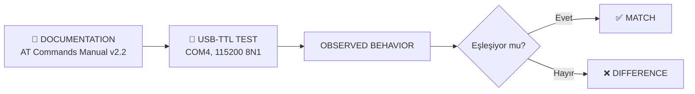

| Konu | 📘 DOCUMENTED | 🧪 OBSERVED | Sonuç |
|---|---|---|:---:|
| Başarı yanıtı | `OK` | `CMDRSP:OK` | ❌ |
| Hata yanıtı | `ERROR` | `CMDRSP:ERROR` | ❌ |
| `AT+QWLMAC` yanıtı | `+QWLMAC: <MAC>` | `CMDRSP:+WMAC:<MAC>` | ❌ |
| `AT+QVERSION` yanıtı | `+QVERSION: <version>` | `FC41D_VERSION:<version>` | ❌ |
| `AT+QGETWIFISTATE` yanıtı | `+QGETWIFISTATE:...` sonra `OK` | `CMDRSP:OK` **önce**, veri **sonra** | ❌ |
| `AT+QGETIP` yanıtı | `+QGETIP:...` sonra `OK` | `QGETIP:...,` — **`OK` hiç gelmiyor** | ❌ |
| `+QSTASTAT` URC'leri | `+QSTASTAT: "EVENT"` | `QSTASTAT:EVENT` | ❌ |
| `AT+QWSCAN` süresi | maks. 3 sn | ~4.05 sn | ❌ |
| `AT+QSOFTAP` süresi (şifreli) | maks. 3300 ms | ~4.03 sn | ❌ |
| MAC örneği | `c8:47:8c:00:00:48` | `64:c4:03:00:00:2d` (gerçek) | ❌ (örnek placeholder'mış) |
| AP varsayılan gateway | Dokümante değil | `192.168.19.1` | ✅ (Pairing Guide örneğiyle uyumlu) |
| `AT+QAPGETLIST`/`QAPCFG`/`QSCANINTERVAL` | Var (v2.0/v2.1) | Her zaman `ERROR` | ❌ |
| `AT+QURCCFG`/`QPING`/`QSETBAND`/`QWEBCFG`/`QSTAAPINFODEF`/`QSTADHCPDEF` | Var | Her zaman `ERROR` | ❌ |
| AP kaybında `WLAN_DISCONNECTED` | İma ediliyor | **Hiç gelmiyor**, `SCAN_NO_AP` döngüsü | ❌ |
| `AT+QSTAST` güvenilirliği | Basit durum sorgusu | AP kaybında **yanlış** bilgi veriyor | ❌ ⭐ |

##### 19.1 Test Matrisi

| ID | Senaryo | Durum | Not |
|---|---|:---:|---|
| WIFI-000 | Boot/reset banner | ✅ | `ready` bulundu |
| WIFI-001 | Firmware/MAC okuma | ✅🔶 | Çalışıyor, format farklı |
| WIFI-002 | STA bağlantı (mutlu yol) | ✅🔶 | Davranış doğru, format farklı |
| WIFI-003 | Wi-Fi tarama | ✅ | 24 AP, ~4 sn |
| WIFI-004 | 0 AP bulunması | ⬜ | İzole ortam sağlanamadı |
| WIFI-005 | Yanlış SSID | ✅ | Sonsuz `SCAN_NO_AP` |
| WIFI-006 | Yanlış şifre | ✅ | Sessiz başarısızlık |
| WIFI-007 | DHCP başarısız | ⬜ | Test edilmedi |
| WIFI-008 | Bağlıyken durum sorgusu | ✅🔶 | Format istisnaları var |
| WIFI-009 | RSSI izleme | ✅ | Gerçek dBm değerleri |
| WIFI-010 | Host disconnect | ✅ | Olaylı/olaysız ayrımı net |
| WIFI-011 | AP kapatılması (dış olay) | ✅ | **Case A — kapsamlı test edildi** |
| WIFI-012 | Zayıf sinyal (kademeli) | ⬜ | Test edilmedi |
| WIFI-013 | Bağlıyken reset | 🔶 | Reset izole test edildi, STA-bağlıyken ayrıca değil |
| WIFI-014 | Beklenmeyen reboot | ⬜ | Fiziksel güç kesme denenmedi |
| WIFI-015 | AP modu etkinleştirme | ✅ | ~4 sn |
| WIFI-016 | AP istemci listesi | ❌ | Her koşulda `ERROR` |
| WIFI-017 | AP modu kapatma | ✅ | — |
| WIFI-018 | Eşzamanlı STA+AP | ✅ | **Kritik olumlu bulgu** |
| WIFI-019 | Statik IP (STA) | ✅ | — |
| WIFI-020 | Statik IP (AP) | ✅ | — |
| WIFI-021 | Geçersiz komut | ✅ | `ERROR`, ~900ms |
| WIFI-022 | Eksik parametre | ⬜ | Test edilmedi |
| WIFI-023 | Yanlış durumda komut | ✅ | `ERROR` doğrulandı |
| WIFI-024 | Pipelining | ⬜ | Test edilmedi |
| WIFI-025 | Kalıcılık — STA (`DEF`) | ❌ | Komut çalışmıyor |
| WIFI-026 | Kalıcılık — DHCP (`DEF`) | ❌ | Komut çalışmıyor |
| WIFI-027 | Düşük güç modu | ⬜ | Bilinçli atlandı |
| WIFI-028 | Derin uyku | ⬜ | Bilinçli atlandı |
| WIFI-029 | Web ile Wi-Fi kurulumu | ❌ | Komut çalışmıyor |
| WIFI-030 | Baud rate değişimi | ❌ | Komut çalışmıyor |
| WIFI-031 | `AT+QURCCFG` işlevi | ❌ | Komut çalışmıyor |
| WIFI-032 | `AT+QPING` işlevi | ❌ | Komut çalışmıyor |

---

<a id="20-driver-critical-findings"></a>
#### 20. Driver-Critical Findings

> ⭐ **#1 — Durum takibi tek komuta dayanmamalı**
> `AT+QSTAST`, AP kaybında yanlış `STATION_UP` diyebiliyor. Gerçek durum için `AT+QGETWIFISTATE` veya `AT+QGETIP` kullanılmalı.

> ⭐ **#2 — `AT+QGETIP` özel parse gerektirir**
> Bu komut asla `OK`/`ERROR` döndürmüyor; "sonlandırıcı bekle" mantığı bu komutta sonsuza kadar bloklar.

> ⭐ **#3 — Sessiz başarısızlıklar için host-side timeout şart**
> Yanlış şifrede modül hiçbir bildirim göndermiyor. Sürücü kendi bağlantı zaman aşımını (örn. 15-20 sn) tanımlamalı.

> ⭐ **#4 — `SCAN_NO_AP` çift anlamlı**
> Hem "SSID hiç yok" hem "AP vardı, kayboldu" durumunda aynı event geliyor — sürücü bunu bağlamdan (önceden bağlı mıydı) ayırt etmeli.

> ⭐ **#5 — Otomatik yeniden bağlanma zaten var**
> Geçici AP kaybında modül kendiliğinden toparlanıyor — ayrı bir reconnect state machine'i yazmaya **gerek yok**, sadece durum doğru izlenmeli.

> ⭐ **#6 — Komut/yanıt eşleştirme naif olmamalı**
> `OK`'dan sonra bağımsız URC'ler gelebiliyor. URC'ler her zaman ayrı bir kanal olarak işlenmeli.

> ⭐ **#7 — Komut bazlı özel parser gerekli**
> Genel "OK/ERROR ile biten tek tip parser" bu firmware'de güvenilir çalışmıyor (§14.1 istisnaları).

> ⭐ **#8 — Zaman aşımı katmanlaması**
> En az 3 sınıf: standart (~300 ms), orta (~4 sn — tarama/şifreli AP), uzun (120 sn — OTA, test edilmedi). Bağlantı kurma için ayrı, host-tanımlı timeout gerekiyor.

> ⭐ **#9 — Kalıcılık modeli yok**
> Hiçbir Wi-Fi ayarı reset sonrası hatırlanmıyor. Kalıcı SSID/şifre host'un (MCU flash) sorumluluğunda olmalı — her boot'ta `AT+QSTAAPINFO` tekrar gönderilmeli.

> ⭐ **#10 — Sıralama kısıtı istisnası**
> `AT+QAPCFG`, `AT+QSOFTAP`'tan önce gönderilmeli diye dokümante edilmiş tek zorunlu sıra kuralıdır — ama bu komut zaten çalışmıyor, bu firmware için pratik önemi yok.

> ⭐ **#11 — Boot algılama**
> `ready` mesajı 🧪 VERIFIED — sürücü modülün hazır olduğunu bu mesajla (veya `AT`→`OK` ile) tespit edebilir.

> ⭐ **#12 — 9 dokümante komut kullanılmamalı**
> §4-§7'deki ❌ işaretli komutlar bu firmware'de çalışmıyor; alternatif yoksa işlevsellik host tarafında (MCU) implemente edilmelidir.

---

<a id="21-ek--kaynaklar-ve-metodoloji"></a>
#### 21. Ek — Kaynaklar ve Metodoloji

##### Kaynak Envanteri

| Belge | Sürüm/Tarih | Katkısı |
|---|---|---|
| Quectel FC41D AT Commands Manual | v2.2, 2026-07-13 | Ana referans — 29 Wi-Fi komutu, Wi-Fi URC'leri, FC41D özelinde örnek. Wi-Fi'ye özel hata kodu tablosu yok. |
| Quectel FC41D Wi-Fi Pairing Guide | v1.0, 2023-10-08 | BLE ve AP-Hotspot/Web üzerinden Wi-Fi eşleştirme prosedürleri. |

Adı geçen ama kullanılmayan belgeler: `Quectel_FC41D_Firmware_Download&Upgrade_Guide`, `Quectel_QCOM_User_Guide`.

Quectel'in resmî belgeleri ve indirmeleri: <https://www.quectel.com/product/wi-fi-bluetooth-fc41d/>

##### Metodolojik Sınırlamalar

- PDF'lerdeki şekiller/ekran görüntüleri (Pairing Guide Figure 7 dahil) bu ortamda görsel olarak okunamadı (`pdftoppm` yok); sadece `pdftotext` ile düz metin çıkarıldı.
- PDF'deki alt çizili (underline) varsayılan değer işaretlemesi düz metinde kayboluyor — düz yazıyla açıkça belirtilmeyen varsayılanlar ❓ UNKNOWN bırakıldı, tahmin edilmedi.

##### 2026-09-10 Test Ortamı

COM4, 115200 baud 8N1, `.NET System.IO.Ports.SerialPort` ile doğrudan erişim. ~60 komut denemesi + ~450 saniyelik canlı izleme (Case A dahil). Hedef ağlar: `WPA3_MIXED_NET` (WPA3 karma modlu bir ağ) ve `PhoneHotspot` (telefon hotspot'u, Case A testi için kasıtlı açılıp kapatıldı). Ham TX/RX logları bu depoda yayınlanmamıştır.

---

<a id="tcp-commands"></a>
## TCP Commands

> **Kaynak:** AT Commands Manual v2.2 §2.3 (komutlar, s.49-61), §3.3 (URC'ler, s.97-100), §4.3 (örnekler, s.120-121), §5 Tablo 3 (sonuç kodları, s.130).
> **Deneysel durum (2026-09-10):** **TCP istemci tarafı uçtan uca doğrulandı** — bağlantı kurma, üç erişim modunun tamamı, veri gönderme/alma, ACK takibi, mod geçişleri ve kapatma canlı test edildi. Test ortamı: telefon hotspot'u `PhoneHotspot`, FC41D `172.20.10.11/28`, TCP sunucu `172.20.10.5:28` (saniyede bir 32 bayt gönderiyor). **Sunucu (TCP LISTENER) modu ve UDP** kısmen/hiç doğrulanmadı — bkz. §T15, §T16.
>
> Semboller ve kanıt etiketleri Wi-Fi bölümüyle aynıdır (bkz. [§1 Legend](#1-legend-ve-semboller)).

<a id="icindekiler--tcp"></a>
### İçindekiler — TCP

**Bölüm A — Komut ve Olay Sözlüğü**
- [T1. TCP Mimarisi ve Temel Kavramlar](#t1-tcp-mimarisi-ve-temel-kavramlar)
- [T2. Komut Referansı — Soket Yaşam Döngüsü](#t2-komut-referansi--soket-yasam-dongusu)
- [T3. Komut Referansı — Veri Alışverişi](#t3-komut-referansi--veri-alisverisi)
- [T4. Komut Referansı — Yapılandırma](#t4-komut-referansi--yapilandirma)
- [T5. Komut Referansı — Sunucu Modu](#t5-komut-referansi--sunucu-modu)
- [T6. Komut Referansı — Mod Geçişleri](#t6-komut-referansi--mod-gecisleri)
- [T7. Komut Referansı — Hata Sorgulama](#t7-komut-referansi--hata-sorgulama)
- [T8. Asenkron Bildirimler — TCP URC Referansı](#t8-asenkron-bildirimler--tcp-urc-referansi)
- [T9. Sonuç Kodları Tablosu](#t9-sonuc-kodlari-tablosu)

**Bölüm B — Uygulama**
- [T10. At a Glance — TCP Genel Akış](#t10-at-a-glance--tcp-genel-akis)
- [T11. Access Mode Seçimi — Decision Tree](#t11-access-mode-secimi--decision-tree)
- [T12. Soket Durum Makinesi](#t12-soket-durum-makinesi)
- [T13. TX/RX Sequence Diyagramları](#t13-txrx-sequence-diyagramlari)
- [T14. Timing](#t14-timing)
- [T15. Deneysel Doğrulama — 2026-09-10](#t15-deneysel-dogrulama--2026-09-10)
- [T16. Open Questions](#t16-open-questions)
- [T17. Driver-Critical Findings — TCP](#t17-driver-critical-findings--tcp)

---

<a id="t1-tcp-mimarisi-ve-temel-kavramlar"></a>
### T1. TCP Mimarisi ve Temel Kavramlar

| Kavram | Açıklama | Kanıt |
|---|---|---|
| **Soket (socketID)** | Aynı anda **12 bağımsız soket** (ID `0`–`11`). Her komut `socketID` ile hangi sokete ait olduğunu belirtir. | 📘 🧪 (0,1,2,3,4,5,6,7 kullanıldı) |
| **Servis tipi** | `"TCP"` istemci · `"UDP"` istemci · `"TCP LISTENER"` sunucu · `"UDP SERVICE"`. Sunucunun kabul ettiği bağlantı `"TCP INCOMING"` olarak görünür. | 📘 · 🧪 `"TCP"` ve `"TCP LISTENER"` denendi |
| **Erişim modu (access_mode)** | `0` Buffer (AT ile oku) · `1` Direct push (veri URC içinde) · `2` Transparent (seri port ham veri kanalı). | 📘 🧪 **üçü de doğrulandı** |

> ⚠️ **Ön koşul:** TCP, Wi-Fi katmanının üzerindedir. Soket açmadan önce STA modunda `GOT_IP` alınmış olmalıdır. Wi-Fi düşerse açık soketler **sessizce ölür** — `AT+QISTATE` bunu göstermez (bkz. §T15.3). 🧪

#### T1.1 TCP Wire Formatı — Wi-Fi'den Farklı 🧪

Wi-Fi komutlarında yanıt etiketlerinden "Q" düşüyor ve veri satırları `CMDRSP:` ile sarılıyordu. **TCP'de dokümante format korunuyor:**

```
Veri satırları:  +QICFG:  +QISTATE:  +QIOPEN:  +QIRD:  +QISEND:  +QIACCEPT:  +QIGETERROR:  +QIURC:
                 → hepsi "+Q" önekini korur, CMDRSP: sarmalayıcısı ALMAZ
Kapanış satırı:  CMDRSP:OK   veya   CMDRSP:ERROR
Transparent mod: CONNECT   (CMDRSP: yok)
```

⭐ **Sürücü sonucu:** Parser, alt sisteme göre **farklı kural setleri** uygulamak zorundadır — tek tip global parser Wi-Fi ve TCP'de birden çalışmaz.

> 🐞 **Firmware kusuru:** `AT+QIACCEPT=?` yanıtı `+QIACCEPT: (0-11),(0,1),(0-11)(null)CMDRSP:OK` şeklinde geliyor — son parametreden sonra `<CR><LF>` yerine literal **`(null)`** dizesi basılıyor. Parser buna dayanıklı olmalı. 🧪

---

<a id="t2-komut-referansi--soket-yasam-dongusu"></a>
### T2. Komut Referansı — Soket Yaşam Döngüsü

| Komut | Ne işe yarar | TX (gönderin) | RX — başarı | RX — hata | Notlar |
|---|---|---|---|---|---|
| `AT+QIOPEN=<socketID>,<service_type>,<ip/host>,<remote_port>,<local_port>,<access_mode>` | **Soket açar** | `AT+QIOPEN=0,"TCP","172.20.10.5",28,0,0` | `access_mode` 0/1 → `CMDRSP:OK`, ardından asenkron **`+QIOPEN: <socketID>,0`**<br/>`access_mode` 2 → doğrudan **`CONNECT`** | `CMDRSP:ERROR` veya `+QIOPEN: <socketID>,<err≠0>` | 🧪 Üç mod da doğrulandı · `local_port=0` = rastgele port (çalışıyor) · ⭐ `OK` **bağlandı demek değil**, `+QIOPEN` URC'si beklenmeli |
| `AT+QIOPEN=?` | Desteklenen parametreleri listeler | `AT+QIOPEN=?` | 🧪 `+QIOPEN: (0-11),"TCP"/"UDP"/"TCP LISTENER"/"UDP SERVICE","ip/dns",(1-65535),(1-65535),(0-2)` | — | ⚠️ Dokümante 7. parametre `<local_IP>` (STA/AP seçimi, v2.0 eklemesi) **listede yok** → bu firmware'de yok |
| `AT+QISTATE` | Tüm soketleri listeler | `AT+QISTATE` | `+QISTATE: <id>,<type>,<remote_addr>,<remote_port>,<local_port>,<state>` her soket için; soket yoksa sadece `CMDRSP:OK` | `CMDRSP:ERROR` | 🧪 `+QISTATE: 0,"TCP","172.20.10.5",28,61806,2` · ⭐ **`state` güvenilmez** (§T15.3) |
| `AT+QISTATE?` | Aynısı (Read formu) | `AT+QISTATE?` | Aynı | — | 🧪 |
| `AT+QISTATE=<socketID>` | Tek soket sorgular | `AT+QISTATE=2` | 🧪 `+QISTATE: 2,"TCP","172.20.10.5",28,12467,2` | `CMDRSP:ERROR` | 🧪 |
| `AT+QICLOSE=<socketID>[,<close_timeout>]` | **Soketi kapatır** | `AT+QICLOSE=1` | `CMDRSP:OK`, ardından **`+QIURC: "closed",<socketID>`**; sonra soket listeden düşer | `CMDRSP:ERROR` | `close_timeout` 1–60 sn, varsayılan 2 (📘) · ⚠️ **Ölü soketde `"closed"` URC'si gelmez**, state=4'te 20+ sn takılır (§T15.3) 🧪 |

**`<state>` değerleri** (📘 §2.3.3 · 🧪 0,2,3,4 gözlendi):

| Değer | Anlam | Gözlem |
|:---:|---|---|
| `0` | Initial — bağlantı kurulmadı | ⬜ |
| `1` | Opening — bağlanıyor / dinlemeye geçiyor | ⬜ (geçiş çok hızlı) |
| `2` | Connected — bağlantı kuruldu | 🧪 ⚠️ ölü soketlerde de gösteriliyor |
| `3` | Listening — sunucu dinliyor | 🧪 |
| `4` | Closing — kapanıyor | 🧪 (ölü soketde kalıcı) |

---

<a id="t3-komut-referansi--veri-alisverisi"></a>
### T3. Komut Referansı — Veri Alışverişi

#### ⚠️ T3.1 En Kritik Sapma: `AT+QISEND` HEX veri istiyor 🧪

`AT+QISEND=?` yanıtı, dokümandaki `"data"` yerine **`"hex_data"`** diyor:

```
🧪 +QISEND: (0-11),(0-1460),"hex_data"[,"remote_ip",(1-65535)]
```

Deneysel olarak doğrulandı:

| Deneme | Sonuç |
|---|---|
| `AT+QISEND=0,11,HELLO_FC41D` (düz metin, tırnaksız) | ❌ `CMDRSP:ERROR` → `AT+QIGETERROR` = `550,"invalid param"` |
| `AT+QISEND=0,11,"HELLO_FC41D"` (düz metin, tırnaklı) | ❌ `CMDRSP:ERROR` |
| `AT+QISEND=0,11` (prompt `>` beklentisi) | ❌ `CMDRSP:ERROR` |
| `AT+QISEND=0,11,48454C4C4F5F4643343144` (hex, tırnaksız) | ❌ `CMDRSP:ERROR` |
| **`AT+QISEND=0,11,"48454C4C4F5F4643343144"` (hex + tırnak)** | ✅ **`+QISEND: 11`** + `CMDRSP:OK` |

⭐ **Kural:** Veri **hex kodlanmış** ve **çift tırnak içinde** olmalıdır. `<send_len>` = **çözülmüş bayt sayısı** (11), hex dizesinin karakter sayısı (22) değil. Sürücünün gönderim yolunda zorunlu bir **ASCII→hex kodlama katmanı** olmalıdır. Bu firmware'de dokümante düz-metin formu ve `>` prompt formu **çalışmıyor**.

#### T3.2 Komut Tablosu

| Komut | Ne işe yarar | TX (gönderin) | RX — başarı | RX — hata | Notlar |
|---|---|---|---|---|---|
| `AT+QISEND=<socketID>,<send_len>,"<hex_data>"` | **Veri gönderir** | `AT+QISEND=0,11,"48454C4C4F5F4643343144"` | `+QISEND: <actual_send_len>` + `CMDRSP:OK` | `CMDRSP:ERROR` (`550 invalid param`) | 🧪 `send_len` 0–1460 · hex + tırnak zorunlu (§T3.1) |
| `AT+QISEND=<socketID>,0` | **Gönderim/ACK istatistiği** | `AT+QISEND=0,0` | `+QISEND: <total_send>,<acked>,<unacked>` + `CMDRSP:OK` | `CMDRSP:ERROR` | ⭐⭐ **Bağlantının canlılığını ölçmenin TEK güvenilir yolu:** sağlıklı → `11,11,0` · ölü → `11,0,11` (§T15.3) 🧪 |
| `AT+QIRD=<socketID>,<read_len>` | **Gelen veriyi okur** (buffer mode) | `AT+QIRD=0,100` | `+QIRD: <actual_read_len>` `<CR><LF>` `<veri>` `<CR><LF>` + `CMDRSP:OK` | `CMDRSP:ERROR` (kapalı/olmayan soket) | 🧪 `read_len` 0–1500 · İstenenden az veri varsa **mevcut kadarını** döndürür (`+QIRD: 106`) |
| `AT+QIRD=<socketID>,0` | **Alım istatistiği** | `AT+QIRD=0,0` | `+QIRD: <total_recv>,<read>,<unread>` + `CMDRSP:OK` | `CMDRSP:ERROR` | 🧪 `+QIRD: 3232,3126,106` · Sayaçlar **bayt-tam tutarlı** doğrulandı |

> ✅ **ÇÖZÜLDÜ — doküman çelişkisi:** §2.3.5 tablosu okuma yanıtını `+QISEND: <actual_read_len>` diye yazıyordu, §4.3.2 örneği ise `+QIRD:` diyordu. **Gerçek cihaz `+QIRD:` kullanıyor** — dokümanın §2.3.5 tablosundaki etiket hatalıdır. 🧪 VERIFIED

#### T3.3 ⭐ TCP Bir Bayt Akışıdır — Mesaj Sınırı Korunmaz 🧪

Sunucu düzenli 32 baytlık mesajlar gönderirken yapılan okumalar mesajı **ortadan böler** ve sonraki okuma **tam kaldığı bayttan** devam eder:

```
AT+QIRD=0,100   → ...TEST_MESSAGE_FROM_SERVER<CR><LF>TEST   (100. baytta kesildi)
AT+QIRD=0,26    → _MESSAGE_FROM_SERVER<CR><LF>...            (101. bayttan devam)
AT+QIRD=0,1500  → F>TEST_MESSAGE_FROM_SERVER...              (bir öncekinin ortasından devam)
```

⭐ Sürücü, mesaj çerçeveleme (framing) işini **kendisi** yapmalıdır; `AT+QIRD` sadece bayt taşır.

---

<a id="t4-komut-referansi--yapilandirma"></a>
### T4. Komut Referansı — Yapılandırma

| Alt parametre | Ne işe yarar | 📘 Aralık / varsayılan | 🧪 Cihazdaki gerçek değer | Var mı |
|---|---|---|---|:---:|
| `"transpktsize"` | Transparent mode'da gönderilecek alt-paket uzunluğu | 1–1460 byte, vars. 1024 | **1024** ✓ (yazma denendi: 512 → geri okundu 512 ✓) · cihaz aralığı `(0-1460)` | ✅ |
| `"transwaittm"` | Transparent mode'da veri bekleme süresi; `0` = anında gönder | 0–20, vars. **2**, birim 100 ms | **0** ⚠️ (dokümante varsayılandan farklı) | ✅ |
| `"accept/mode"` | Gelen bağlantı kabulü: `0` otomatik, `1` manuel (`AT+QIACCEPT`) | 0,1 | **0** ✓ | ✅ |
| `"tcp/tw_cycle"` | TCP portunun serbest bırakılması: `0` hemen, `1` gecikmeli | 0,1 | **0** ✓ | ✅ |
| `"datatype"` | Veri tipi (0 non-hex / 1 hex string / 2 hex data) | 0,1,2 | — | ❌ |
| `"tcp/retransmit"` | Yeniden gönderim aralığı ve sayısı | rto 1–10 sn (3), retry 3–20 (10) | — | ❌ |
| `"udp/broadcast"` | UDP broadcast | 0,1 | — | ❌ |
| `"tcplistener/raw"` | TCP sunucu transparent iletimi | 0,1 | — | ❌ |

**Kullanım:** `AT+QICFG="transpktsize"` (oku) → `+QICFG: "transpktsize",1024` + `CMDRSP:OK` · `AT+QICFG="transpktsize",512` (yaz) → `CMDRSP:OK`. 🧪 Oku/yaz döngüsü doğrulandı.

🧪 **Gerçek `AT+QICFG=?` çıktısı** (8 alt parametrenin sadece 4'ü):
```
+QICFG: "transpktsize",(0-1460)
+QICFG: "transwaittm",(0-20)
+QICFG: "accept/mode",(0,1)
+QICFG: "tcp/tw_cycle",(0,1)
CMDRSP:OK
```

> ℹ️ Eksik 4 alt parametrenin tamamı AT manuelinin **v2.0 (2025-06-11)** revizyonunda eklenmiş; modül firmware'i 2021 tarihli. Wi-Fi bölümünde tespit edilen **firmware/doküman sürüm farkı örüntüsüyle birebir tutarlı**. Sonuç: hex-veri tipi seçimi, TCP retransmit ayarı, UDP broadcast ve TCP-sunucu transparent iletimi bu firmware'de **yapılandırılamaz**.

---

<a id="t5-komut-referansi--sunucu-modu"></a>
### T5. Komut Referansı — Sunucu Modu

| Komut | Ne işe yarar | TX (gönderin) | RX — başarı | RX — hata | Notlar |
|---|---|---|---|---|---|
| `AT+QIOPEN=<id>,"TCP LISTENER","",0,<local_port>,0` | **TCP sunucusu açar** | `AT+QIOPEN=5,"TCP LISTENER","",0,8080,0` | 🧪 `CMDRSP:OK` + `+QIOPEN: 5,0`; `AT+QISTATE` → `+QISTATE: 5,"TCP LISTENER","172.20.10.11",0,8080,3` (state=3 Listening) | `CMDRSP:ERROR` | 🧪 Açılıyor · `<remote_addr>` alanında **modülün kendi IP'si** görünüyor · 📘 `access_mode=2` kullanılamaz |
| `AT+QIACCEPT=<listener_id>,<accept>[,<incoming_id>]` | Gelen bağlantıyı **kabul/red** eder | `AT+QIACCEPT=5,1,6` | 🧪 `+QIACCEPT: 6,"172.20.10.5",60177` + `CMDRSP:OK` | `CMDRSP:ERROR` | `accept`: 0=red, 1=kabul · 🧪 Format doğrulandı (IP tırnaklı) |
| `AT+QIACCEPT=?` | Parametre listesi | `AT+QIACCEPT=?` | 🧪 `+QIACCEPT: (0-11),(0,1),(0-11)(null)CMDRSP:OK` | — | 🐞 `(null)` kusuru (§T1.1) |

#### T5.1 Sunucu Modu Gözlemleri 🧪 — kısmi, yeniden test gerekli

| Gözlem | Sonuç |
|---|---|
| Sunucu soketi açılıyor, `Listening` durumuna geçiyor | ✅ |
| PC'den modüle TCP bağlantısı **ağ seviyesinde kabul ediliyor** (`TcpClient.Connect` başarılı) | ✅ |
| `accept/mode=0` (otomatik): `+QIURC: "incoming"` URC'si **hiç gelmiyor**, yeni soket **görünmüyor** | ❌ bağlantı AT katmanına yansımıyor |
| `accept/mode=1` (manuel): **`+QIURC: "accept",<listener_id>` geliyor** | ✅ |
| `AT+QIACCEPT` ile kabul → yeni soket ID atanıyor, uzak IP/port bildiriliyor | ✅ |
| Kabul edilen soket **hemen kapanıyor** (`+QIURC: "recv",<id>` ardından `+QIURC: "closed",<id>`), veri okunamıyor | ⚠️ 2 kez tekrarlandı |
| Kapanma sonrası **dinleyici soket de listeden düşüyor** | ⚠️ |

> ⚠️ **ÖNEMLİ ÇEKİNCE:** Bu testlerin yapıldığı sırada **Wi-Fi bağlantısının düştüğü** sonradan tespit edildi (`AT+QSTAST` → `STATION_DOWN`). Dolayısıyla "kabul edilen soket hemen kapanıyor" ve "dinleyici düşüyor" gözlemlerinin **sunucu modu kusuru mu, yoksa Wi-Fi kopmasının yan etkisi mi** olduğu **ayırt edilemedi**. Sunucu modu, kararlı Wi-Fi ile **yeniden test edilmelidir** (§T16).

#### T5.2 ⭐⭐ Yeniden test — SoftAP + 2025 fw: kabul VE gönderim çalışıyor — asıl kısıt `datatype` format uyuşmazlığıydı 🧪

**2026-09-22** tarihinde, FC41D **kendi SoftAP'ını** açarak (Wi-Fi kopma riski olmayan kararlı bir ortamda — FC41D burada kendi ağının erişim noktası) yazarın workstation aracı üzerinden dört gerçek Docklight istemcisiyle tekrar test edildi. Firmware `FC41DAAR03A14M02` (2025-08-17).

**Kabul tarafı — T5.1'in çekincesi giderildi, sonuç düzeldi:**

| Gözlem | Sonuç |
|---|---|
| `accept/mode=0` (otomatik, varsayılan): `+QIURC: "incoming",<id>,<listener_id>,"<ip>",<port>` geldi, soket kimliği **kendiliğinden atandı** | ✅ **T5.1'deki "gelmiyor" bulgusunun tersi** — iki ayrı oturumda, 4 istemciyle tutarlı |
| Aynı testte `accept/mode=1` (manuel) da ayrıca denendi: `AT+QIACCEPT` gerekiyor, gecikme büyüdükçe risk artıyor | ⚠️ Çalışıyor ama gereksiz karmaşıklık — otomatik mod tercih edilmeli |
| Kabul edilen soket **kapanmıyor**, veri almaya devam ediyor (`+QIURC: "recv",<id>,<len>` + veri, direct push modunda) | ✅ **T5.1'deki "hemen kapanıyor" bulgusu bu testte gözlenmedi** — o bulgu gerçekten Wi-Fi kopmasının yan etkisiymiş |

**Gönderim tarafı — önce yanlış bir sonuca varıldı, sonra kök neden bulundu:**

`TCP LISTENER` ile kabul edilen bir sokete `AT+QISEND` ile veri göndermek, **hex+tırnak formatıyla** (`AT+QISEND=<id>,11,"48454C4C4F5F4643343144"`) dört bağımsız denemede de başarısız oldu — hem direct push hem buffer modunda, kanıtlanmış şekilde canlı soketlerde bile (`AT+QIRD` ile veri okunabiliyordu) hep `ERROR` / `550,"invalid param"`. Bu, ilk aşamada **"FC41D sunucu rolünde gönderemiyor"** şeklinde (yanlış) bir sonuca çıkarılmıştı.

**Resmi kılavuz (Quectel AT Commands Manual v2.2, §2.3.4) yeniden incelenince gerçek sebep ortaya çıktı:** `AT+QISEND`'in dokümante formu `"TCP"`/`"UDP"`/**`"TCP INCOMING"`** için birebir aynı sözdizimini kullanıyor — yani kabul edilen bir sokete gönderim resmi olarak desteklenen bir senaryo, kılavuzda hiçbir kısıtlama notu yok. Asıl değişken **`AT+QICFG="datatype"`** alt parametresiydi (0 = düz metin, 1 = hex string) — bu parametre **2021 firmware'inde `AT+QICFG=?` çıktısında hiç yoktu**, 2025 firmware'inde eklenmiş. **2026-09-22'de okunduğunda değeri `0` (düz metin) çıktı** — biz ise her zaman hex gönderiyorduk (`send_len=11` derken 22 karakterlik bir hex string yollamak, düz metin modunda bir uzunluk/format uyuşmazlığı yaratıyordu, `550 invalid param` da tam bunu anlatıyordu).

**Kesin doğrulama (2026-09-22, COM5, gerçek uçtan uca test):**

```
TX  AT+QICFG="datatype"                        -> RX  +QICFG: "datatype",0 + OK   (duz metin modu)
TX  AT+QIOPEN=5,"TCP LISTENER","",0,8080,0      -> RX  OK + QIOPEN: 5,0             (buffer mode, SoftAP)
    (harici bir Python TCP istemcisi 192.168.19.1:8080'e baglanip "Client_1 test message" gonderdi)
RX  +QIURC: "incoming",11,5,"192.168.19.100",62478
RX  +QIURC: "recv",11
TX  AT+QIRD=11,0                                -> RX  +QIRD: 21,0,21 + OK          (veri gercekten bekliyor)
TX  AT+QISEND=11,11,"HELLO_FC41D"               -> RX  +QISEND: 11 + OK             (DUZ METIN - basarili!)
```
İstemci tarafında (harici Python soketi) gerçekten alındı: `RECEIVED (11 bytes): b'HELLO_FC41D'` — uçtan uca doğrulandı.

> ⭐⭐ **Düzeltilmiş sonuç:** FC41D, `TCP LISTENER` ile kabul edilen bir sokete **gerçekten veri gönderebiliyor** — önceki "sunucu rolünde gönderemiyor" bulgusu **yanlıştı**, kök neden `datatype` alt parametresinin (bu firmware'de varsayılan `0`/düz metin) bizim varsayımımızla (hex) uyuşmamasıydı. **Ders:** `datatype` gibi 2021 fw'de var olmayan bir alt parametre, 2025 fw'de sessizce eklenip varsayılanı değiştirebiliyor — sabit bir "hep hex kullan" kuralı yerine, driver/istemci kodu göndermeden önce `AT+QICFG="datatype"` ile mevcut modu okuyup ona göre biçimlendirmeli (ya da açıkça `AT+QICFG="datatype",1` ile hex moduna sabitlemeli).
>
> **Sürücü mimarisi için düzeltilmiş sonuç:** FC41D sunucu (`TCP LISTENER`) rolünde çalışırken bağlı istemcilere veri **gönderebiliyor** — hem gönderme hem alma yönü sunucu rolünde güvenilir, tıpkı client rolünde olduğu gibi. `fc41d_tcp.c` sadece gönderim öncesi doğru veri formatını (mevcut `datatype` moduna göre) uygulamalı; sabit "hep hex" varsayımı yapmamalı.

---

<a id="t6-komut-referansi--mod-gecisleri"></a>
### T6. Komut Referansı — Mod Geçişleri

| Komut | Ne işe yarar | TX (gönderin) | RX — başarı | RX — hata | Notlar |
|---|---|---|---|---|---|
| `AT+QISWTMD=<socketID>,<access_mode>` | Açık soketin **erişim modunu değiştirir** | `AT+QISWTMD=4,2` | 🧪 `CONNECT` (transparent'a geçişte); diğer modlarda `OK` | `CMDRSP:ERROR` | 🧪 Buffer(0)→Transparent(2) geçişi doğrulandı, ham veri hemen akmaya başladı |
| `ATO` | Çıkılmış **transparent mode'a geri döner** | `ATO` | 🧪 `CONNECT` | `NO CARRIER` | 🧪 `+++` ile çıkıldıktan sonra çalıştı · 📘 Bir sokete **ilk kez** transparent'a girmek için `AT+QISWTMD=<id>,2` gerekir, doğrudan `ATO` → `NO CARRIER` |
| `+++` | **Transparent mode'dan çıkar** | `+++` (**sonuna CR/LF EKLEMEYİN**) | 🧪 `CMDRSP:OK`; ardından bekleyen veri için `+QIURC: "recv",<id>` | — | 🧪 İki kez doğrulandı · Soket açık kalır (`state=2`), `ATO` ile geri dönülür · Komut modunda gönderilirse sadece **echo**'lanır, etkisi olmaz 🧪 |

#### T6.1 Transparent Mode Gözlemleri 🧪

```
AT+QIOPEN=3,"TCP","172.20.10.5",28,0,2   →  CONNECT
                                            (ardından sunucu verisi HAM olarak akar:
                                             TEST_MESSAGE_FROM_SERVER<CR><LF>... — URC sarmalayıcı YOK)
[ham bayt yaz]  PING_FROM_FC41D          →  doğrudan TCP payload olarak gider
+++                                       →  CMDRSP:OK  (komut moduna dönüldü)
                                            + QIURC: "recv",3  (bekleyen veri bildirimi)
AT+QISTATE                                →  +QISTATE: 3,"TCP","172.20.10.5",28,17864,2  (soket sağlam)
ATO                                       →  CONNECT  (tekrar transparent)
+++                                       →  CMDRSP:OK
AT+QICLOSE=3                              →  CMDRSP:OK + QIURC: "closed",3
```

⭐ **Komut modunda ham bayt yazmak işe yaramaz** — modül onu AT komut satırı sanıp yalnızca echo'lar, sunucuya göndermez. Ham veri sadece transparent mode'da geçerlidir. 🧪

---

<a id="t7-komut-referansi--hata-sorgulama"></a>
### T7. Komut Referansı — Hata Sorgulama

| Komut | Ne işe yarar | TX (gönderin) | RX — başarı | Notlar |
|---|---|---|---|---|
| `AT+QIGETERROR` | **Son TCP/UDP hatasının** kodunu ve **metin açıklamasını** döndürür | `AT+QIGETERROR` | 🧪 `+QIGETERROR: 0,"success"` · `+QIGETERROR: 550,"invalid param"` | ⭐ Açıklama **çift tırnak içinde** gelir (dokümanda tırnak gösterilmemiş) · Sürücüde her `CMDRSP:ERROR` sonrası çağrılması önerilir — tek genel `ERROR`'u anlamlı hataya çevirir |

---

<a id="t8-asenkron-bildirimler--tcp-urc-referansi"></a>
### T8. Asenkron Bildirimler — TCP URC Referansı

| URC | Ne zaman gelir | Ne anlama gelir | Kanıt |
|---|---|---|---|
| `+QIOPEN: <socketID>,<err>` | `AT+QIOPEN` sonrası, açma işleminin **gerçek sonucu** belli olunca | `err=0` → bağlandı · `err≠0` → başarısız (§T9) | 🧪 `+QIOPEN: 0,0` (~1-5 sn, erişilebilir sunucu) · `+QIOPEN: 0,551` (~17-21 sn, erişilemeyen sunucu) |
| `+QIURC: "recv",<socketID>` | **Buffer mode** — tamponda veri **yokken** veri geldiğinde | "Tamponda veri var, `AT+QIRD` ile oku". ⭐ **Tampon tamamen boşalana kadar yeni URC gelmez** | 🧪 **Kural birebir doğrulandı** (§T13.5) |
| `+QIURC: "recv",<socketID>,<data_len>` `<CR><LF>` `<data>` | **Direct push mode** | Veri doğrudan URC içinde gelir, `AT+QIRD` gerekmez | 🧪 `+QIURC: "recv",2,32<CR><LF>` + 32 bayt |
| `+QIURC: "recv",<socketID>,<data_len>,<remote_addr>,<remote_port>` `<CR><LF>` `<data>` | Direct push + `"UDP SERVICE"` | Aynısı + kaynak adres | 📘 ⬜ |
| `+QIURC: "closed",<socketID>` | Soket kapandığında | Soket kullanılamaz, listeden düşer | 🧪 `AT+QICLOSE` sonrası doğrulandı · ⚠️ **ölü sokette gelmez** |
| `+QIURC: "accept",<listener_socketID>` | Sunucu modu, `accept/mode=1` (manuel) | `AT+QIACCEPT` ile karar bekleniyor | 🧪 |
| `+QIURC: "incoming",<incoming_id>,<listener_id><remote_addr>,<remote_port>` | Sunucu modu, `accept/mode=0` (otomatik) | Bağlantı otomatik kabul edildi | 📘 · ❌ **bu firmware'de hiç gözlenmedi** (§T5.1) · ⚠️ dokümandaki formatta virgül eksik |
| `+QIURC: "incoming full"` | Gelen bağlantı sınırına ulaşıldığında | Yeni bağlantı kabul edilemedi | 📘 ⬜ |
| `NO CARRIER` | **Transparent mode'da** bağlantı anormal koptuğunda | Bağlantı kesildi | 📘 ⬜ |

#### T8.1 ⭐⭐ Direct Push Verisi CRLF İçerebilir — Satır Bazlı Parse Etmeyin 🧪

Ölçülen ham akış (3 URC bloğu = tam **171 bayt = 3 × 57**):

```
<CR><LF> +QIURC: "recv",2,32 <CR><LF> [32 baytlık veri] <CR><LF>
   2   +        19         +    2   +        32        +    2    = 57 bayt
```

Sunucunun 32 baytlık mesajı **kendi içinde CRLF barındırıyor** (`TEST_MESSAGE_FROM_SERVER` + satır sonları). Parser `<data_len>` alanını okuyup **tam o kadar bayt saymalıdır**; CRLF arayarak bölmek veriyi bozar.

#### T8.2 ⭐ URC'ler Kaybolabilir 🧪

Host UART'ı kapalıyken gönderilen URC'ler **kaybolur ve tekrar gönderilmez**. Buffer mode'un "tampon boşalmadan yeni URC gelmez" kuralıyla birleşince tehlikeli bir tuzak oluşur: kaçırılan bir `"recv"` URC'si + hiç boşaltılmayan tampon = **kalıcı sessizlik**. Sürücü UART'ı sürekli açık tutmalı ve her başlangıçta/kopuş sonrasında `AT+QIRD=<id>,0` ile durumu **yoklamalıdır**.

URC'ler komut yanıtlarının arasına da girebilir (🧪 `AT+QISTATE=2` yanıtının hemen ardından `recv` URC'leri geldi) — parser bunu tolere etmelidir.

---

<a id="t9-sonuc-kodlari-tablosu"></a>
### T9. Sonuç Kodları Tablosu

| Kod | Açıklama | Kod | Açıklama |
|:---:|---|:---:|---|
| `0` | Operation success 🧪 `"success"` | `557` | Operation not supported |
| `550` | Invalid parameter 🧪 `"invalid param"` | `558` | No network |
| `551` | Unknown error 🧪 (erişilemeyen sunucuda gözlendi) | `559` | No certificate |
| `552` | Memory not enough | `560` | Operation busy |
| `553` | Socket ID has been used | `561` | Operation timeout |
| `554` | Socket ID not exist | `562` | Socket write failed |
| `555` | Socket allocate failed | `563` | Socket read failed |
| `556` | Operation not allowed | | |

> ✅ **Güven notu (yükseltildi):** Bu tablo PDF'ten sütunları kaymış halde çıkmıştı ve yeniden kurulmuştu. `AT+QIGETERROR` ile **kod 0 → `"success"`** ve **kod 550 → `"invalid param"`** birebir doğrulandı; bu, sıralı eşleştirmenin doğru olduğunu güçlü şekilde destekler. 🧪 Kalan kodların metinleri, ilgili hata senaryoları tetiklendikçe `AT+QIGETERROR` ile teyit edilebilir.

---

<a id="t10-at-a-glance--tcp-genel-akis"></a>
### T10. At a Glance — TCP Genel Akış

```mermaid
flowchart TD
    WIFI(["ÖN KOŞUL: Wi-Fi bağlı, GOT_IP alınmış"]) --> OPEN["AT+QIOPEN=id,servis,ip,port,local,mode"]
    OPEN --> SYNC{"Senkron yanıt"}
    SYNC -->|"mode 0 / 1"| OK1["CMDRSP:OK — sadece kabul edildi"]
    SYNC -->|"mode 2"| CONN["CONNECT — UART ham veri kanalı"]
    OK1 --> URC{"+QIOPEN: id,err (asenkron, gerçek sonuç)"}
    URC -->|"err = 0"| CONNECTED(["SOKET BAĞLI — state 2"])
    URC -->|"err ≠ 0"| FAIL["Bağlantı başarısız — örn. 551"]
    CONNECTED --> MODE{"Veri nasıl alınır?"}
    MODE -->|"mode 0 buffer"| M0["+QIURC: recv,id → AT+QIRD ile oku"]
    MODE -->|"mode 1 direct push"| M1["+QIURC: recv,id,len + veri"]
    CONN --> M2["Ham veri akar · +++ çık · ATO dön"]
    M0 --> SEND["Gönderim: AT+QISEND=id,len,HEX (tırnaklı)"]
    M1 --> SEND
    SEND --> ACK["Canlılık: AT+QISEND=id,0 → total,acked,unacked"]
    ACK --> CLOSE["AT+QICLOSE=id"]
    CLOSE --> CLOSED["+QIURC: closed,id"]
```

---

<a id="t11-access-mode-secimi--decision-tree"></a>
### T11. Access Mode Seçimi — Decision Tree

```mermaid
flowchart TD
    Q["Gelen veriyi nasıl almak istiyorum?"]
    Q --> A["Kontrol bende olsun"] --> M0["access_mode = 0 · BUFFER<br/>+QIURC:recv bildirir · AT+QIRD ile okunur"]
    Q --> B["Veri gelir gelmez iletilsin"] --> M1["access_mode = 1 · DIRECT PUSH<br/>veri URC içinde · QIRD gerekmez"]
    Q --> C["Maksimum verim"] --> M2["access_mode = 2 · TRANSPARENT<br/>UART ham kanal · +++ ile çıkılır"]
    M0 --> N0["✅ Akış kontrolü kolay<br/>❌ Ekstra komut turu<br/>⭐ Tampon boşalmazsa URC susar"]
    M1 --> N1["✅ Gecikme düşük<br/>❌ data_len ile saymak zorunlu<br/>⭐ Veri CRLF içerebilir"]
    M2 --> N2["✅ En yüksek verim<br/>❌ Kör kanal — sorgu yapılamaz<br/>❌ LISTENER/UDP SERVICE ile olmaz"]
```

---

<a id="t12-soket-durum-makinesi"></a>
### T12. Soket Durum Makinesi

```mermaid
stateDiagram-v2
    state "0 — Initial" as S0
    state "1 — Opening" as S1
    state "2 — Connected" as S2
    state "3 — Listening" as S3
    state "4 — Closing" as S4

    [*] --> S0
    S0 --> S1: AT+QIOPEN
    S1 --> S2: +QIOPEN id,0
    S1 --> S0: +QIOPEN id,err≠0
    S1 --> S3: service_type = TCP LISTENER
    S3 --> S2: AT+QIACCEPT (kabul)
    S2 --> S4: AT+QICLOSE
    S4 --> S0: +QIURC closed,id
    S2 --> S0: karşı taraf kapattı / NO CARRIER

    note right of S2
        🧪 UYARI: Ölü bağlantılarda da
        state=2 gösteriliyor.
        Gerçek canlılık testi:
        AT+QISEND=id,0 → unacked
    end note

    note right of S4
        🧪 Karşı taraf erişilemezse
        burada 20+ sn takılabilir ve
        closed URC'si hiç gelmez
    end note
```

---

<a id="t13-txrx-sequence-diyagramlari"></a>
### T13. TX/RX Sequence Diyagramları

#### T13.1 Buffer Access Mode — Tam Doğrulanmış Akış 🧪

```mermaid
sequenceDiagram
    participant H as Host
    participant M as FC41D
    participant S as 172.20.10.5:28
    H->>M: AT+QIOPEN=0,"TCP","172.20.10.5",28,0,0
    M-->>H: CMDRSP:OK
    M->>S: TCP el sıkışma
    M--)H: +QIOPEN: 0,0
    M--)H: +QIURC: "recv",0
    H->>M: AT+QIRD=0,0
    M-->>H: +QIRD: 3200,100,3100 / CMDRSP:OK
    H->>M: AT+QIRD=0,1500
    M-->>H: +QIRD: 1500 / [1500 bayt] / CMDRSP:OK
    H->>M: AT+QISEND=0,11,"48454C4C4F5F4643343144"
    M->>S: HELLO_FC41D
    M-->>H: +QISEND: 11 / CMDRSP:OK
    H->>M: AT+QISEND=0,0
    M-->>H: +QISEND: 11,11,0 (11 gönderildi, 11 ACK'li = SAĞLIKLI)
    H->>M: AT+QICLOSE=0
    M-->>H: CMDRSP:OK
    M--)H: +QIURC: "closed",0
```

#### T13.2 Direct Push Mode 🧪

```mermaid
sequenceDiagram
    participant H as Host
    participant M as FC41D
    participant S as 172.20.10.5:28
    H->>M: AT+QIOPEN=2,"TCP","172.20.10.5",28,0,1
    M-->>H: CMDRSP:OK
    M--)H: +QIOPEN: 2,0
    S->>M: 32 bayt
    M--)H: +QIURC: "recv",2,32 [CR][LF] [32 bayt veri]
    S->>M: 32 bayt
    M--)H: +QIURC: "recv",2,32 [CR][LF] [32 bayt veri]
    Note over H,M: AT+QIRD GEREKMEZ · veri data_len ile sayılmalı
```

#### T13.3 Transparent Mode 🧪

```mermaid
sequenceDiagram
    participant H as Host
    participant M as FC41D
    participant S as 172.20.10.5:28
    H->>M: AT+QIOPEN=3,"TCP","172.20.10.5",28,0,2
    M-->>H: CONNECT
    Note over H,M: UART artık ham veri kanalı — AT komutu gönderilemez
    S->>M: veri
    M-->>H: ham veri (URC sarmalayıcı yok)
    H->>M: PING_FROM_FC41D (ham)
    M->>S: PING_FROM_FC41D
    H->>M: +++ (terminator YOK)
    M-->>H: CMDRSP:OK
    M--)H: +QIURC: "recv",3
    Note over H,M: Komut modu · soket hâlâ state=2
    H->>M: ATO
    M-->>H: CONNECT
    H->>M: +++
    M-->>H: CMDRSP:OK
    H->>M: AT+QICLOSE=3
    M-->>H: CMDRSP:OK
    M--)H: +QIURC: "closed",3
```

#### T13.4 ⭐⭐ Ölü (Zombi) Bağlantı — QISTATE Yanıltıyor 🧪

```mermaid
sequenceDiagram
    participant H as Host
    participant M as FC41D
    participant S as 172.20.10.5:28
    Note over H,S: Soket 0, 3232 bayt aldıktan sonra veri akışı durdu
    loop 18+ saniye
        H->>M: AT+QIRD=0,0
        M-->>H: +QIRD: 3232,3232,0 (hiç yeni veri yok)
        H->>M: AT+QISTATE
        M-->>H: +QISTATE: 0,...,2 (⚠️ "Connected" diyor!)
    end
    H->>M: AT+QISEND=0,11,"48454C4C4F5F4643343144"
    M-->>H: +QISEND: 11 / CMDRSP:OK (yazma kabul edildi)
    H->>M: AT+QISEND=0,0
    M-->>H: +QISEND: 11,0,11 (⭐ 0 ACK · bağlantı ÖLÜ)
    H->>M: AT+QICLOSE=0
    M-->>H: CMDRSP:OK (closed URC'si GELMEZ)
    H->>M: AT+QISTATE
    M-->>H: +QISTATE: 0,...,4 (Closing'de 20+ sn takıldı)
    Note over H,M: Aynı sunucuya yeni soket (ID 1) açıldı → sorunsuz çalıştı
```

#### T13.5 ⭐ Buffer Mode URC Kuralının Kanıtı 🧪

```mermaid
sequenceDiagram
    participant H as Host
    participant M as FC41D
    Note over H,M: Tamponda okunmamış veri VARKEN
    H->>M: AT+QIRD=1,0
    M-->>H: +QIRD: 1856,1500,356 (unread=356)
    Note over H,M: Veri akmaya devam etti ama YENİ URC GELMEDİ
    H->>M: AT+QIRD=1,0
    M-->>H: +QIRD: 1984,1500,484
    H->>M: AT+QIRD=1,1500
    M-->>H: +QIRD: 1500 / [veri]
    H->>M: AT+QIRD=1,1500
    M-->>H: +QIRD: 392 / [veri] (tampon TAM boşaldı)
    M--)H: +QIURC: "recv",1 (⭐ URC yeniden tetiklendi!)
```

---

<a id="t14-timing"></a>
### T14. Timing

| Komut/olay | 📘 Dokümante | 🧪 Gözlenen |
|---|---|---|
| Çoğu TCP komutu | 300 ms | <1 sn (ölçüm çözünürlüğü içinde) |
| `AT+QIOPEN` — TCP istemci, senkron `OK` | TCP el sıkışma zaman aşımına bağlı (modül 120 sn destekler) | **hemen** (<1 sn) |
| `+QIOPEN` URC — **başarılı** bağlantı | dokümante değil | **~1-5 sn** |
| `+QIOPEN` URC — **erişilemeyen** sunucu (err=551) | dokümante değil | **~17-21 sn** (3 denemede tutarlı) |
| `AT+QICLOSE` — sağlıklı soket | dokümante değil ("-") | `OK` + `"closed"` URC **birkaç sn içinde** |
| `AT+QICLOSE` — ölü soket | dokümante değil | `OK` gelir ama `"closed"` URC **hiç gelmez**, state=4'te **20+ sn** |
| `AT+QIRD=<id>,1500` (1500 bayt) | 300 ms | ~0.7 sn (115200 baud'da 1544 baytın taşınma süresi dahil) |
| Sunucudan veri hızı (referans) | — | 32 bayt/sn (+128 bayt / 4 sn, iki bağımsız ölçüm) |

> ⭐ `AT+QIOPEN` için sürücü timeout'u **en az 120 sn** (dokümante el sıkışma sınırı) olmalı; standart 300 ms bu komut için kesinlikle yetersizdir.

---

<a id="t15-deneysel-dogrulama--2026-09-10"></a>
### T15. Deneysel Doğrulama — 2026-09-10

**Ortam:** COM4, 115200 8N1 · Wi-Fi: telefon hotspot'u `PhoneHotspot`, FC41D `172.20.10.11/28`, gateway `172.20.10.1` · TCP sunucu: `172.20.10.5:28`, saniyede bir 32 bayt (`TEST_MESSAGE_FROM_SERVER` + satır sonları).

#### T15.1 Test Matrisi

| ID | Senaryo | Durum | Bulgu |
|---|---|:---:|---|
| TCP-001 | `AT+QICFG=?` alt parametre listesi | ✅ | 4/8 mevcut (v2.0 eklemeleri yok) |
| TCP-002 | `AT+QISTATE` (soket yokken) | ✅ | Boş liste → `CMDRSP:OK` |
| TCP-003 | `AT+QISTATE?` / `AT+QISTATE` / `AT+QISTATE=<id>` | ✅ | Üç form da çalışıyor |
| TCP-004 | `AT+QIOPEN` TCP istemci (buffer mode) | ✅ | `CMDRSP:OK` + `+QIOPEN: 0,0` |
| TCP-005 | `+QIOPEN` URC zamanlaması | ✅ | Başarıda ~1-5 sn · başarısızlıkta ~17-21 sn |
| TCP-006 | `AT+QISTATE` `state` güvenilirliği | ❌ | **Ölü bağlantıda da `Connected`** ⭐ |
| TCP-007 | `AT+QIRD` (kapalı/olmayan soket) | ✅ | `CMDRSP:ERROR` |
| TCP-008 | TCP wire formatı (`+Q` korunuyor mu) | ✅ | Korunuyor — Wi-Fi'den farklı |
| TCP-009 | `AT+QIRD` ile gerçek veri okuma | ✅ | Bayt-tam, sayaçlar tutarlı |
| TCP-010 | `+QIURC: "recv"` (buffer mode) | ✅ | Kural doğrulandı (§T13.5) |
| TCP-011 | `AT+QISEND` ile veri gönderme | ✅ | **Hex + tırnak zorunlu** ⭐ |
| TCP-012 | `AT+QICLOSE` + `"closed"` URC | ✅ | Sağlıklı sokette çalışıyor |
| TCP-013 | `AT+QIGETERROR` | ✅ | `0,"success"` · `550,"invalid param"` — sonuç kodu tablosunu doğruladı |
| TCP-014 | Direct push mode (`access_mode=1`) | ✅ | `+QIURC: "recv",id,len` + veri |
| TCP-015 | Transparent mode + `ATO` + `+++` | ✅ | Tam döngü çalıştı |
| TCP-016 | `AT+QISWTMD` mod geçişi | ✅ | Buffer→Transparent → `CONNECT` |
| TCP-017 | `"TCP LISTENER"` + `AT+QIACCEPT` | 🔶 | Açılıyor, `accept` URC'si ve kabul çalışıyor; **ama soket hemen kapanıyor** — Wi-Fi kopması karıştırdı, yeniden test gerekli |
| TCP-018 | UDP istemci / `"UDP SERVICE"` | ⬜ | Test edilmedi |
| TCP-019 | `NO CARRIER` (transparent kopma) | ⬜ | Test edilmedi |
| TCP-020 | Sunucu tarafı kapatınca davranış | 🔶 | Zombi soket senaryosunda dolaylı gözlendi (§T15.3) |
| TCP-021 | Wi-Fi koparsa açık soket ne olur | 🔶 | Wi-Fi düştüğünde soketler öldü, `QISTATE` bunu göstermedi — kontrollü test gerekli |
| TCP-022 | Birden fazla eşzamanlı soket | ✅ | ID 0,1,2,3,4,5 sırayla kullanıldı; zombi soket 0 varken soket 1 sorunsuz çalıştı |
| TCP-023 | `AT+QIRD` yanıt etiketi çelişkisi | ✅ | **`+QIRD:` doğru** — doküman §2.3.5 hatalı |
| TCP-024 | `AT+QISEND=<id>,0` ACK sayaçları | ✅ | Sağlıklı `11,11,0` · ölü `11,0,11` ⭐⭐ |
| TCP-025 | `AT+QICFG` oku/yaz | ✅ | `transwaittm` gerçek varsayılanı **0** (doküman: 2) |
| TCP-026 | Komut modunda ham veri / `+++` | ✅ | Sadece echo'lanıyor, sunucuya gitmiyor |
| TCP-027 | Byte-stream semantiği (mesaj sınırı) | ✅ | Okumalar mesajı bölüyor, kaldığı bayttan devam ediyor ⭐ |

#### T15.2 Erişilemeyen Sunucu (İlk Deneme, `192.168.10.106:28`)

İlk test turunda FC41D `WPA3_MIXED_NET` ağında (`192.168.200.44/24`) iken sunucu `192.168.10.106` **farklı bir alt ağdaydı**. Sonuç: `AT+QIOPEN` → `CMDRSP:OK`, `AT+QISTATE` ~18 sn boyunca `Connected` gösterdi, `AT+QIRD` hep `ERROR` verdi, ve ~17-21 sn sonra **`+QIOPEN: 0,551`** geldi. Aynı hotspot'a taşındığında (`172.20.10.x`, aynı alt ağ) bağlantı **ilk denemede** kuruldu → **kök neden alt ağlar arası yönlendirme/güvenlik duvarıydı, modül değil.** 🧪

#### T15.3 ⭐⭐ Zombi Bağlantı — En Kritik TCP Bulgusu

Soket 0, sorunsuz çalışıp **3232 bayt** aldıktan sonra veri akışı kalıcı olarak durdu. Gözlemler:

| Sorgu | Sonuç | Yorum |
|---|---|---|
| `AT+QIRD=0,0` (18+ sn boyunca) | `+QIRD: 3232,3232,0` — hiç artmıyor | Veri gelmiyor |
| `AT+QISTATE` | `+QISTATE: 0,...,2` → **"Connected"** | ⚠️ **YANILTICI** |
| `AT+QIGETERROR` | `0,"success"` | Hata kaydı yok |
| `AT+QISEND=0,11,"<hex>"` | `+QISEND: 11` + `OK` | Yazma **kabul edildi** |
| **`AT+QISEND=0,0`** | **`+QISEND: 11,0,11`** | ⭐ **11 bayt yazıldı, 0'ı ACK'lendi → bağlantı ÖLÜ** |
| `AT+QICLOSE=0` | `OK`, ama `"closed"` URC'si yok, state=4'te 20+ sn takıldı | Kapanış el sıkışması tamamlanamıyor |
| Aynı sunucuya **yeni soket (ID 1)** | `+QIOPEN: 1,0` → veri aktı, `+QISEND: 11,11,0` (ACK'li) | Sunucu ayaktaydı; **sorun tek sokete özgüydü** |

⭐⭐ **Sonuç:** `AT+QISTATE`'in `state` alanı bir TCP bağlantısının gerçekten canlı olduğunun kanıtı **değildir**. Tek güvenilir canlılık testi **`AT+QISEND=<id>,0`** ile `acked_size`/`unack_size` takibidir: `unack_size` kalıcı olarak > 0 ise bağlantı ölmüştür. Bu, Wi-Fi bölümündeki `AT+QSTAST` güvenilmezliğiyle **aynı örüntüdür**.

#### T15.4 Test Sırasında Wi-Fi Kopması

Oturumun sonunda `AT+QSTAST` → `STATION_DOWN`, `AT+QGETIP=station` → `0.0.0.0` tespit edildi (hotspot kapanmış). Bu, **sunucu modu (TCP-017) ve Wi-Fi-kopması (TCP-021) gözlemlerini karıştırmaktadır** — o bulgular kararlı Wi-Fi ile yeniden doğrulanmalıdır. Diğer tüm bulgular Wi-Fi ayaktayken (soket 1/2/3/4'ün sorunsuz çalıştığı dönemde) elde edildiğinden geçerlidir.

---

<a id="t16-open-questions"></a>
### T16. Open Questions

> ⚠️ **AÇIK SORU — Sunucu (TCP LISTENER) modu gerçekten kullanılabilir mi?**
> **Durum:** 🔶 Kısmen test edildi, **yeniden test gerekli**
> **Neden önemli:** `accept/mode=1` ile `+QIURC: "accept"` ve `AT+QIACCEPT` çalıştı, ama kabul edilen soket hemen kapandı ve dinleyici düştü. O sırada Wi-Fi'nin koptuğu tespit edildiğinden kök neden ayırt edilemedi. Kararlı Wi-Fi ile tekrarlanmalı. Ayrıca `accept/mode=0` (otomatik) modunda `+QIURC: "incoming"` **hiç gelmedi** — bu ayrıca doğrulanmalı.

> ⚠️ **AÇIK SORU — Wi-Fi koptuğunda açık soketlere ne olur?**
> **Durum:** 🔶 Dolaylı gözlem var, kontrollü test yok
> **Neden önemli:** Sürücünün katman-arası kurtarma mantığını belirler. Kontrollü test: soket açıkken hotspot'u kapat, `+QIURC: "closed"` gelip gelmediğini, `QISTATE`'in ne dediğini ve ACK sayaçlarının nasıl davrandığını kaydet.

> ⚠️ **AÇIK SORU — UDP istemci ve `"UDP SERVICE"` davranışı**
> **Durum:** ⬜ Hiç test edilmedi
> **Neden önemli:** `AT+QISEND`/`AT+QIRD`'ın UDP formları (kaynak/hedef adres alanları) ve `"udp/broadcast"` alt parametresinin olmaması UDP kullanımını kısıtlayabilir.

> ⚠️ **AÇIK SORU — `NO CARRIER` gerçekten üretiliyor mu?**
> **Durum:** ⬜ Test edilmedi
> **Neden önemli:** Transparent mode'da kopmayı tespit etmenin tek dokümante yolu bu. Test: transparent modda sunucuyu kapat.

> ⚠️ **AÇIK SORU — Kalan sonuç kodlarının metinleri**
> **Durum:** 🔶 `0` ve `550` doğrulandı
> **Neden önemli:** §T9 tablosu PDF'ten yeniden kurulmuştu; `551`, `554`, `558`, `561` gibi kodlar ilgili senaryolar tetiklenip `AT+QIGETERROR` ile teyit edilirse tablo tamamen kesinleşir.

> ⚠️ **AÇIK SORU — 3232 baytlık kesinti bir tampon sınırı mı?**
> **Durum:** ❓ Muhtemelen tesadüf (soket ölümüyle çakıştı)
> **Neden önemli:** Kararlı bağlantıda uzun süreli akış testi yapılıp modülün toplam alım sayacının sınırı olup olmadığı doğrulanmalı.

---

<a id="t17-driver-critical-findings--tcp"></a>
### T17. Driver-Critical Findings — TCP

> ⭐ **#T1 — `AT+QIOPEN`'in `OK`'ı "bağlandı" demek DEĞİLDİR**
> Gerçek sonuç yalnızca `+QIOPEN: <id>,<err>` URC'siyle gelir: başarıda ~1-5 sn, başarısızlıkta ~17-21 sn. Sürücü `OK` sonrası soketi "Opening" saymalı ve timeout'u dokümante 120 sn el sıkışma sınırını kapsayacak şekilde kurmalıdır.

> ⭐⭐ **#T2 — Bağlantı canlılığının TEK güvenilir testi ACK sayacıdır**
> `AT+QISTATE`'in `state=2` değeri ölü bağlantılarda da görünür. `AT+QISEND=<id>,0` ile dönen `unack_size` kalıcı olarak > 0 ise bağlantı ölüdür. Sürücü periyodik bir "ACK ilerliyor mu" kontrolü içermelidir.

> ⭐⭐ **#T3 — `AT+QISEND` HEX + çift tırnak zorunludur**
> Bu firmware'de veri `AT+QISEND=<id>,<bayt_sayısı>,"<HEX>"` biçiminde gönderilir; düz metin, tırnaksız hex ve `>` prompt formu **çalışmaz** (`550 invalid param`). `<send_len>` çözülmüş bayt sayısıdır. Sürücüde zorunlu bir ASCII→hex kodlama katmanı gerekir.

> ⭐ **#T4 — `AT+QIRD` yanıt etiketi `+QIRD:`**
> Dokümanın §2.3.5 tablosundaki `+QISEND:` etiketi hatalıdır. Parser `+QIRD:` beklemelidir.

> ⭐⭐ **#T5 — Veri bayt akışıdır ve CRLF içerebilir**
> Okumalar mesaj sınırını korumaz; direct push URC'sindeki veri de CRLF barındırabilir. Parser **her zaman `<data_len>`/`<actual_read_len>` alanını okuyup tam o kadar bayt saymalı**, satır sonu arayarak bölmemelidir. Mesaj çerçeveleme sürücünün sorumluluğundadır.

> ⭐⭐ **#T6 — Buffer mode'da tampon boşaltılmazsa URC susar**
> `+QIURC: "recv"` yalnızca tampon boşken tetiklenir; okunmamış veri varken yeni URC gelmez ve tampon tamamen boşaltıldığında yeniden kurulur (deneyle doğrulandı). Sürücü `unread_size = 0` olana kadar okumayı garanti etmelidir.

> ⭐ **#T7 — URC'ler kaybolur ve tekrar gönderilmez**
> Host UART'ı kapalıyken gelen URC'ler yok olur. #T6 ile birleşince kalıcı sessizliğe yol açabilir. Sürücü UART'ı sürekli açık tutmalı ve başlangıçta/kopuş sonrasında `AT+QIRD=<id>,0` ile yoklama yapmalıdır.

> ⭐ **#T8 — Kapanış her zaman temiz değildir**
> Sağlıklı sokette `AT+QICLOSE` → `OK` + `+QIURC: "closed",<id>`. Ölü sokette `"closed"` URC'si gelmez ve soket `state=4`'te 20+ sn takılır. Sürücü kapanış için de kendi timeout'unu tutmalı ve gerekirse soketi "kayıp" işaretleyip başka bir `socketID` kullanmalıdır.

> ⭐ **#T9 — Karşı taraf kapatırsa veri kaybolabilir**
> Sunucu modu testinde `+QIURC: "recv",<id>` hemen ardından `+QIURC: "closed",<id>` geldi ve `AT+QIRD` artık `ERROR` verdi — bildirilen veri okunamadı. Sürücü `"recv"` bildirimini **gecikmeden** işlemelidir.

> ⭐ **#T10 — Mod geçişleri ve `+++` kuralları**
> Transparent mode'a ilk giriş `AT+QIOPEN=...,2` veya `AT+QISWTMD=<id>,2` ile olur (ikisi de `CONNECT` döner); çıkış `+++` (**sonuna CR/LF konmadan**); geri dönüş `ATO`. Komut modunda ham bayt yazmak yalnızca echo üretir, sunucuya gitmez.

> ⭐ **#T11 — Parser alt sisteme özel olmalı**
> TCP komutları `+Q...` önekini korur ve veri satırları `CMDRSP:` almaz; Wi-Fi komutları ise "Q"yu düşürüp `CMDRSP:` ile sarabilir. Ayrıca `AT+QIACCEPT=?` yanıtında literal `(null)` gibi firmware kusurları vardır. Tek tip global parser yeterli değildir.

> ⭐ **#T12 — `AT+QIGETERROR` her hata sonrası çağrılmalı**
> Tüm komutlar tek tip `CMDRSP:ERROR` döndürdüğü için, hatayı anlamlandırmanın tek yolu `AT+QIGETERROR` ile kod + metin almaktır (örn. `550,"invalid param"`).

> ⭐ **#T13 — Bu firmware'de 4 `QICFG` alt parametresi ve `<local_IP>` yok**
> `datatype`, `tcp/retransmit`, `udp/broadcast`, `tcplistener/raw` ve `AT+QIOPEN`'in 7. parametresi (STA/AP IP seçimi) mevcut değildir. Hex veri tipi seçimi, TCP retransmit ayarı, UDP broadcast ve arayüz seçimi **yapılandırılamaz**.


<a id="ble-gatt-server-commands"></a>
## BLE GATT Server Commands

> **Kapsam:** Bu bölüm FC41D'nin BLE **peripheral / GATT Server** yeteneklerini kapsar.
> Kaynaklar: *Quectel FC41D&FCM100D&FCM740D&FLMx40D AT Commands Manual v2.2* (Bölüm 2.2.1–2.2.15, 3.2)
> ve **2026-09-11 tarihli canlı USB-TTL oturumu** (COM4, 115200 8N1).
> Test edilen firmware: **`FC41DAAR03A01.bin_202107021122`** (2021-07-02).

<a id="icindekiler--ble-gatt-server"></a>
### İçindekiler — BLE GATT Server

| # | Bölüm |
|---|---|
| B1 | [En Kritik Bulgu — GATT Server bu firmware'de YOK](#b1-en-kritik-bulgu) |
| B2 | [Komut Envanteri — Çalışan / Çalışmayan](#b2-komut-envanteri) |
| B3 | [Çalışan Alt Küme — BLE Advertiser (Beacon)](#b3-calisan-alt-kume) |
| B4 | [Firmware Tuhaflıkları](#b4-firmware-tuhafliklari) |
| B5 | [URC Referansı](#b5-urc-referansi) |
| B6 | [Durum Makinesi](#b6-durum-makinesi) |
| B7 | [Sequence Diyagramları](#b7-sequence-diyagramlari) |
| B8 | [Deneysel Doğrulama — 2026-09-11](#b8-deneysel-dogrulama) |
| B9 | [Open Questions](#b9-open-questions) |
| B10 | [Driver-Critical Findings — BLE](#b10-driver-critical-findings) |
| B11 | [PC BLE ile Doğrulama — Gerçek GATT Tablosu ve Veri Yolu](#b11-pc-ble-dogrulama) |
| B12 | [Firmware Yükseltme Sonrası BLE Yeniden Testi — 2026-09-14](#b12-firmware-yeniden-test) |

---

<a id="b1-en-kritik-bulgu"></a>
### B1. ⭐ En Kritik Bulgu — GATT Server bu firmware'de YOK ⏮ *(2021 fw, bkz. §B12 için 2025 fw)*

> Bu bölümün sonucu 2025-08-17 firmware'inde kısmen değişti: özel GATT servisi
> artık gerçekten oluşturulabiliyor, bkz. [§B12.1](#b12-firmware-yeniden-test). Aşağıdaki
> bulgular 2021 firmware'i (`FC41DAAR03A01`) için doğru kalmaya devam ediyor ve
> tarihsel referans olarak korunuyor.

**GATT Server komut ailesinin tamamı `CMDRSP:ERROR` döndürüyor.** 🧪

| Komut | Dokümante işlevi | Bu firmware |
|---|---|:---:|
| `AT+QBLEGATTSSRV` | BLE servisi oluştur | ❌ |
| `AT+QBLEGATTSCHAR` | Karakteristik UUID tanımla | ❌ |
| `AT+QBLEGATTSCFGREAD` | Read attribute değeri ata | ❌ |
| `AT+QBLEGATTSNTFY` | Notification gönder | ❌ (bağlıyken de ❌) |
| `AT+QBLEGATTSIND` | Indication gönder | ❌ |
| `AT+QBLESEND` | Karakteristik üzerinden veri gönder | ❌ |
| `AT+QBLETRANMODE` | BLE transparent iletim | ❌ |

Bu sonuç **elenerek** doğrulandı — alternatif açıklamalar tek tek test edilip reddedildi:

| Elenen hipotez | Test | Sonuç |
|---|---|:---:|
| Sözdizimi yanlış (tırnak, `0x`, küçük harf, index, 128-bit UUID) | 11 varyant denendi | hepsi ❌ |
| Yanlış rol | `AT+QBLEINIT=1`, `=2`, `=3` ile denendi | hepsi ❌ |
| Init sırası yanlış | init öncesi ve sonrası denendi | ikisi de ❌ |
| Reklam açıkken çakışma | `AT+QBLEADVSTOP` sonrası denendi | ❌ |
| Komut hiç tanınmıyor | `AT+QBLEGATTSSRV=?` test formu | ❌ |

> ⚠️ **Sonuç:** Bu modül **kendi GATT servisini yayınlayamaz.** Karakteristik
> tanımlanamadığı için `AT+QBLEGATTSNTFY` / `AT+QBLEGATTSIND` ile veri gönderilemez.
>
> ✅ **ANCAK — §B11'e bakın:** Modülde **hazır (vendor) bir GATT servisi vardır**
> (`FFFF` / `FF01`, write + notify) ve bu servis **merkezden UART'a tek yönlü veri
> taşır**. Yani "BLE üzerinden hiç veri taşınamaz" demek **yanlış olur**; taşınabilir,
> ama yalnızca tek yönde ve UUID'ler sabittir.
> Bu, Wi-Fi bölümündeki 9 bozuk komut ve TCP'deki 4 eksik `QICFG` alt parametresiyle **aynı
> firmware/doküman sürüm farkı örüntüsüdür**: manuel v2.2 (2026), firmware 2021.
>
> 🔎 **Çıkarım (kanıtlanmadı):** Bu komutların manuelin hangi revizyonunda eklendiği
> revizyon geçmişinden okunabilir; ancak "hangi firmware sürümünde geldiği" **bilinmiyor** —
> Quectel'den daha yeni bir firmware talep edilmeden bu soru kapanmaz. ❓

---

<a id="b2-komut-envanteri"></a>
### B2. Komut Envanteri — Çalışan / Çalışmayan 🧪

2026-09-11 taraması, 30 komut formu:

| Komut formu | Sonuç | Yanıt |
|---|:---:|---|
| `AT+QBLEINIT=<role>` | ✅ | `CMDRSP:OK` |
| `AT+QBLEINIT?` | 🔶 | `CMDRSP:OK` — **veri satırı YOK** (dokümante `+QBLEINIT: <role>` gelmiyor) |
| `AT+QBLEDEINIT` | ❌ | `CMDRSP:ERROR` |
| `AT+QBLEURC=<enable>` / `AT+QBLEURC?` | ❌ | `CMDRSP:ERROR` |
| `AT+QBLEADDR?` | 🔶 | `+QBLEADDR:<mac>` — **OK/ERROR ile sonlandırılmıyor** |
| `AT+QBLENAME=<name>` | ✅ | `CMDRSP:OK` |
| `AT+QBLENAME?` | ✅ | `+QBTNAME:<name>` + `CMDRSP:OK` — **etiket `+QBTNAME`**, `+QBLENAME` değil |
| `AT+QBLEADVPARAM=<min>,<max>` | ✅ | `CMDRSP:OK` |
| `AT+QBLEADVPARAM?` | ❌ | `CMDRSP:ERROR` |
| `AT+QBLEADVDATA=<hex>` | ✅ | `CMDRSP:OK` |
| `AT+QBLEADVDATA?` | 🔶 | `CMDRSP:OK` — **veri satırı YOK**, geri okunamıyor |
| `AT+QBLESRDATA=<hex>` / `?` | ❌ | `CMDRSP:ERROR` — scan response verisi ayarlanamıyor |
| `AT+QBLEADVSTART` | ✅ | `CMDRSP:OK` |
| `AT+QBLEADVSTART?` | ⚠️ | `CMDRSP:OK` — **durum bildirmez, reklamı BAŞLATIR** (§B4.1) |
| `AT+QBLEADVSTOP` | ✅ | `CMDRSP:OK` |
| `AT+QBLESTAT` | ✅ | `+QBLESTAT:<event>` + `CMDRSP:OK` |
| `AT+QBLECFGMTU?` | 🔶 | `+QBLECFGMTU:23` — **sonlandırılmıyor** |
| `AT+QBLEMTUMODE=` / `?` | ❌ | `CMDRSP:ERROR` |
| `AT+QBLEQADVPARAM?` | ❌ | `CMDRSP:ERROR` |
| `AT+QBLECONNPARAM?` | ❌ | `CMDRSP:ERROR` |
| `AT+QBLESCANPARAM?` | ❌ | `CMDRSP:ERROR` |
| `AT+QBLEDISCONN=<handle>` | ✅ | `CMDRSP:OK` (bağlantı yokken bile OK) |
| GATT Server ailesi (7 komut) | ❌ | §B1 |

**Özet: 10 çalışıyor · 18 hata · 2 sonlandırılmıyor.**

---

<a id="b3-calisan-alt-kume"></a>
### B3. Çalışan Alt Küme — BLE Advertiser (Beacon) 🧪

Firmware'in gerçekten yapabildiği şey bu: **bağlanılabilir bir BLE reklamı yayınlamak.**

| Komut | Ne işe yarar | TX | RX-başarı | RX-hata | Notlar |
|---|---|---|---|---|---|
| `AT+QBLEINIT=<role>` | BLE yığınını başlatır | `AT+QBLEINIT=2<CR>` | `CMDRSP:OK` | `CMDRSP:ERROR` | 🧪 `0` kapalı · `1` central · `2` peripheral · `3` BLE üzerinden Wi-Fi kurulumu. Kalıcı değil. |
| `AT+QBLESTAT` | **Gerçek BLE durumu** | `AT+QBLESTAT<CR>` | `+QBLESTAT:<event>` + `CMDRSP:OK` | — | ⭐ 🧪 Reklam durumunu okumanın **tek güvenli yolu** |
| `AT+QBLENAME=<name>` | Reklamda görünecek ad | `AT+QBLENAME=DEMO<CR>` | `CMDRSP:OK` | `CMDRSP:ERROR` | 🧪 Geri okuma 2 ve 12+ karakterde bozuk (§B4.3) |
| `AT+QBLEADVPARAM=<min>,<max>` | Reklam aralığı | `AT+QBLEADVPARAM=100,200<CR>` | `CMDRSP:OK` | `CMDRSP:ERROR` | 🧪 Yazılıyor, **geri okunamıyor** |
| `AT+QBLEADVDATA=<hex>` | Ham reklam paketi (AD yapıları) | `AT+QBLEADVDATA=020106<CR>` | `CMDRSP:OK` | `CMDRSP:ERROR` | 🧪 Büyük-endian AD baytları, tırnaksız hex |
| `AT+QBLEADVSTART` | Reklamı başlatır | `AT+QBLEADVSTART<CR>` | `CMDRSP:OK` | `CMDRSP:ERROR` | 🧪 Sonra `AT+QBLESTAT` = `ADVERTISING` |
| `AT+QBLEADVSTOP` | Reklamı durdurur | `AT+QBLEADVSTOP<CR>` | `CMDRSP:OK` | `CMDRSP:ERROR` | 🧪 Sonra `AT+QBLESTAT` = `NOADVERTISING` |
| `AT+QBLEADDR?` | BLE MAC adresi | `AT+QBLEADDR?<CR>` | `+QBLEADDR:<mac>` | — | ⭐ 🧪 **OK/ERROR gelmez** — idle timeout ile okunmalı |
| `AT+QBLECFGMTU?` | Geçerli MTU | `AT+QBLECFGMTU?<CR>` | `+QBLECFGMTU:23` | — | ⭐ 🧪 **OK/ERROR gelmez** · gözlenen değer **23** (BLE varsayılan minimumu) |
| `AT+QBLEDISCONN=<handle>` | Bağlantıyı keser | `AT+QBLEDISCONN=0<CR>` | `CMDRSP:OK` | — | 🧪 Bağlantı yokken de `OK` dönüyor — başarı göstergesi değil |

**⭐ Gözlenen adresler** 🧪 — **`AT+QBLEADDR?` YANLIŞ adres döndürüyor:**

| Kaynak | Adres | |
|---|---|---|
| Wi-Fi (`AT+QWLMAC`) | `64:c4:03:00:00:2d` | — |
| `AT+QBLEADDR?` **iddiası** | `64:c4:03:00:00:a1` | ❌ bu adreste **hiçbir şey yok** |
| **Gerçekte yayında görülen** | **`64:C4:03:00:00:2E`** | ✅ PC'nin BLE tarayıcısıyla doğrulandı |

Gerçek BLE adresi **Wi-Fi MAC + 1**'dir. `AT+QBLEADDR?`'ın döndürdüğü değerin nereden
geldiği ❓ bilinmiyor — ama modülün yayın yaptığı adres **değildir**. Bu komuta göre
tarama yapan bir sürücü cihazı **asla bulamaz** (bu proje de ilk iki taramada bulamadı).

**Varsayılan BLE adı:** `Quec_BLE` 🧪

---

<a id="b4-firmware-tuhafliklari"></a>
### B4. Firmware Tuhaflıkları

#### ⭐ B4.1 — `AT+QBLEADVSTART?` durum sormaz, reklamı BAŞLATIR 🧪

Dokümante davranış `+QBLEADVSTART:<adv_state>` döndürmesidir. Bu firmware `?` ekini
**yok sayıp yürütme komutu gibi davranıyor**. Kontrollü deney:

| Adım | Komut | `AT+QBLESTAT` sonucu |
|---|---|---|
| 1 | `AT+QBLEADVSTOP` | `NOADVERTISING` |
| 2 | `AT+QBLEADVSTART?` → `CMDRSP:OK` | **`ADVERTISING`** ← başlattı |
| 3 | `AT+QBLEADVSTOP` | `NOADVERTISING` |
| 4 | *(hiçbir şey gönderilmedi, 1.5 s beklendi)* | `NOADVERTISING` ← kendiliğinden başlamıyor |

> ⚠️ **Sürücü kuralı:** `AT+QBLEADVSTART?` **asla** durum sorgusu olarak kullanılmamalıdır.
> Reklam durumu için **yalnızca `AT+QBLESTAT`** kullanın.

#### ⭐ B4.2 — Sonlandırılmayan yanıtlar (Wi-Fi'daki `AT+QGETIP` ile aynı sınıf) 🧪

`AT+QBLEADDR?` ve `AT+QBLECFGMTU?` veri satırını gönderip **`CMDRSP:OK`/`ERROR` göndermez**.
3 saniyelik pencerede tekrar tekrar doğrulandı.

```
TX -> AT+QBLEADDR?<CR>
RX <- AT+QBLEADDR?<CR><LF><CR><LF>+QBLEADDR:64:c4:03:00:00:a1<CR><LF>
                                                                    ^ burada biter, OK YOK
```

> **Sürücü kuralı:** Bu iki komut idle-timeout ile okunmalıdır. Terminatör bekleyen bir
> ayrıştırıcı burada süresiz bloke olur.

#### B4.3 — `AT+QBLENAME` geri okuması bozuk 🧪

Yazma `CMDRSP:OK` veriyor, ama geri okuma bazı uzunluklarda **fazladan bir karakter** içeriyor.
Deterministik ve tekrarlanabilir (5 ardışık tur aynı sonucu verdi):

| Yazılan | Uzunluk | Geri okunan | |
|---|:---:|---|:---:|
| `AB` | 2 | `ABA` | ❌ |
| `A_B` | 3 | `A_B` | ✅ |
| `QQQQ` | 4 | `QQQQ` | ✅ |
| `ABCDEFGH` | 8 | `ABCDEFGH` | ✅ |
| `DEMO_FC41_A` | 11 | `DEMO_FC41_A` | ✅ |
| `ABCDEFGHIJKL` | 12 | `ABCDEFGHIJKL?` | ❌ |
| `ZZZZZZZZZZZZ` | 12 | `ZZZZZZZZZZZZ?` | ❌ |
| `DEMO_FC41_AB` | 12 | `DEMO_FC41_AB?` | ❌ |

Elenen açıklamalar: **bayat tampon değil** (uzun isimden sonra kısa isim temiz okundu),
**okumanın kendisi bozmuyor** (üst üste 3 okuma aynı), **alt çizgiye bağlı değil** (`A_B` temiz).

> ❓ **Kök neden belirlenemedi.** Ayrıca **bozulmanın saklanan isimde mi yoksa yalnızca
> geri okumada mı olduğu bilinmiyor** — bunu ancak bir BLE tarayıcısının gördüğü ad söyler.
> **Güvenli aralık: 3–11 karakter** 🔎 (12'nin üstü test edilmedi).

#### B4.4 — Yanıt etiketi `+QBTNAME` 🧪

`AT+QBLENAME?` yanıtı `+QBLENAME:` değil **`+QBTNAME:`** ile geliyor.
Wi-Fi bölümündeki `AT+QWLMAC` → `+WMAC` sapmasıyla aynı tür etiket uyuşmazlığı.

#### B4.5 — BLE başlangıçta zaten `INIT` durumunda 🧪

Oturum başında hiçbir `AT+QBLEINIT` gönderilmeden `AT+QBLESTAT` → `+QBLESTAT:INIT`.
❓ Modülün açılışta BLE'yi kendiliğinden mi başlattığı, yoksa önceki oturumdan mı kaldığı
**belirlenmedi** — soğuk açılıştan (`AT+QRST` sonrası) ölçülmelidir.

---

<a id="b5-urc-referansi"></a>
### B5. URC Referansı

| URC | Anlamı | Durum |
|---|---|:---:|
| `+QBLESTAT:<event>` | BLE durum değişimi | 📘 · 🧪 **URC olarak GELİYOR** — merkez bağlandığında `+QBLESTAT:CONNECTED` kendiliğinden düştü |
| `+QBLEMTU:<value>` | MTU değişti (23–512) | 📘 ⬜ gözlenmedi |
| `+QBLEINFO:<handle>,<UUID>` | Bağlanan cihazın handle/UUID'si (central rolü) | 📘 ⬜ |
| `+QBLERECV:<peer_role>,<UUID>,<len>` | Veri alındı | 📘 ⬜ — GATT karakteristiği kurulamadığı için **tetiklenemez** |
| `+QBLEPEERINFO` | Peripheral rolünde karşı taraftan mesaj | 📘 ⬜ |

Dokümante `<event>` değerleri: `NOINIT` · `INIT` · `ADVERTISING` · `NOADVERTISING` ·
`CONNECTED` · `DISCONNECTED`. 🧪 Bunlardan **`NOINIT`, `INIT`, `ADVERTISING`,
`NOADVERTISING`, `CONNECTED`** bizzat gözlendi; `DISCONNECTED` ⬜ henüz yakalanmadı.

> ⚠️ `AT+QBLEURC` komutu bu firmware'de `ERROR` verdiği için **URC raporlaması
> açılıp kapatılamıyor**. URC'lerin varsayılan olarak açık mı kapalı mı olduğu ❓.

---

<a id="b6-durum-makinesi"></a>
### B6. Durum Makinesi 🧪

```mermaid
stateDiagram-v2
    [*] --> NOINIT
    NOINIT --> INIT : AT+QBLEINIT=1|2|3
    INIT --> NOINIT : AT+QBLEINIT=0
    INIT --> ADVERTISING : AT+QBLEADVSTART
    INIT --> ADVERTISING : AT+QBLEADVSTART? (TUZAK)
    ADVERTISING --> NOADVERTISING : AT+QBLEADVSTOP
    NOADVERTISING --> ADVERTISING : AT+QBLEADVSTART
    ADVERTISING --> CONNECTED : bir merkez baglanir (DOGRULANMADI)
    CONNECTED --> DISCONNECTED : AT+QBLEDISCONN (DOGRULANMADI)
    note right of NOINIT
        AT+QBLEDEINIT bu firmware'de ERROR
        NOINIT'e donus yalnizca AT+QBLEINIT=0 ile
    end note
    note right of CONNECTED
        GATT servisi kurulamadigi icin
        bu durumda anlamli veri alisverisi YOK
    end note
```

---

<a id="b7-sequence-diyagramlari"></a>
### B7. Sequence Diyagramları

**Çalışan akış — BLE reklamı başlatma** 🧪

```mermaid
sequenceDiagram
    autonumber
    participant H as Host (MCU/PC)
    participant M as FC41D
    H->>M: AT+QBLEINIT=2
    M-->>H: CMDRSP:OK
    H->>M: AT+QBLESTAT
    M-->>H: +QBLESTAT:INIT / CMDRSP:OK
    H->>M: AT+QBLENAME=DEMO_FC41_A
    M-->>H: CMDRSP:OK
    H->>M: AT+QBLEADVPARAM=100,200
    M-->>H: CMDRSP:OK
    H->>M: AT+QBLEADVDATA=020106
    M-->>H: CMDRSP:OK
    H->>M: AT+QBLEADVSTART
    M-->>H: CMDRSP:OK
    H->>M: AT+QBLESTAT
    M-->>H: +QBLESTAT:ADVERTISING / CMDRSP:OK
```

**Çalışmayan akış — GATT Server kurulumu** 🧪

```mermaid
sequenceDiagram
    autonumber
    participant H as Host
    participant M as FC41D
    H->>M: AT+QBLEINIT=2
    M-->>H: CMDRSP:OK
    H->>M: AT+QBLEGATTSSRV=FFF0
    M-->>H: CMDRSP:ERROR
    Note over H,M: Servis kurulamadigi icin akis burada biter.<br/>Karakteristik, notify ve indicate denenemez.
    H->>M: AT+QBLEGATTSCHAR=FFF1,FF
    M-->>H: CMDRSP:ERROR
    H->>M: AT+QBLEGATTSNTFY=FFF1,3132
    M-->>H: CMDRSP:ERROR
```

---

<a id="b8-deneysel-dogrulama"></a>
### B8. Deneysel Doğrulama — 2026-09-11

**Ortam:** COM4 · 115200 8N1 · firmware `FC41DAAR03A01.bin_202107021122`

| ID | Test | Sonuç | Not |
|---|---|:---:|---|
| BLE-001 | `AT+QBLESTAT` okunabiliyor | ✅ | `INIT` |
| BLE-002 | `AT+QBLEADDR?` MAC döndürüyor | 🔶 | Değer geliyor ama **sonlandırılmıyor** |
| BLE-003 | BLE MAC ≠ Wi-Fi MAC | ✅ | `…00:00:a1` vs `…00:00:2d` |
| BLE-004 | `AT+QBLEINIT=2` peripheral | ✅ | `INIT` durumuna geçti |
| BLE-005 | `AT+QBLEINIT?` rolü döndürüyor | ❌ | Sadece `OK`, veri satırı yok |
| BLE-006 | `AT+QBLEDEINIT` | ❌ | `CMDRSP:ERROR` |
| BLE-007 | `AT+QBLENAME` yazma | ✅ | `OK` |
| BLE-008 | `AT+QBLENAME?` geri okuma doğru | 🔶 | 3–11 karakter ✅ · 2 ve 12 ❌ (§B4.3) |
| BLE-009 | Yanıt etiketi `+QBTNAME` | ✅ | Doküman `+QBLENAME` diyor |
| BLE-010 | `AT+QBLEADVPARAM` yazma | ✅ | `100,200` kabul edildi |
| BLE-011 | `AT+QBLEADVPARAM?` okuma | ❌ | `CMDRSP:ERROR` |
| BLE-012 | `AT+QBLEADVDATA` yazma | ✅ | `020106` kabul edildi |
| BLE-013 | `AT+QBLEADVDATA?` okuma | ❌ | Sadece `OK`, veri yok |
| BLE-014 | `AT+QBLESRDATA` (scan response) | ❌ | `CMDRSP:ERROR` |
| BLE-015 | `AT+QBLEADVSTART` / `STOP` | ✅ | Durum `ADVERTISING` ↔ `NOADVERTISING` |
| BLE-016 | `AT+QBLEADVSTART?` yan etkisi | ⚠️ | **Reklamı başlatıyor** — kontrollü deneyle doğrulandı |
| BLE-017 | `AT+QBLECFGMTU?` | 🔶 | `23`, **sonlandırılmıyor** |
| BLE-018 | `AT+QBLEMTUMODE` | ❌ | `CMDRSP:ERROR` |
| BLE-019 | `AT+QBLEGATTSSRV` — 11 sözdizimi varyantı | ❌ | Hepsi `ERROR` |
| BLE-020 | `AT+QBLEGATTSSRV` — rol 1/2/3 | ❌ | Hepsi `ERROR` |
| BLE-021 | `AT+QBLEGATTSCHAR` | ❌ | `CMDRSP:ERROR` |
| BLE-022 | `AT+QBLEGATTSNTFY` / `SIND` | ❌ | `CMDRSP:ERROR` |
| BLE-023 | `AT+QBLEGATTSCFGREAD` | ❌ | `CMDRSP:ERROR` |
| BLE-024 | `AT+QBLESEND` | ❌ | `CMDRSP:ERROR` |
| BLE-025 | `AT+QBLETRANMODE` | ❌ | `CMDRSP:ERROR` |
| BLE-026 | `AT+QBLEURC` aç/kapa | ❌ | `CMDRSP:ERROR` |
| BLE-027 | `AT+QBLEDISCONN=0` | ✅ | Bağlantı yokken bile `OK` |
| BLE-028 | **Telefon reklamı görüyor mu?** | ⬜ | **HENÜZ TEST EDİLMEDİ** |
| BLE-029 | **Telefon bağlanabiliyor mu? (`CONNECTED`)** | ⬜ | **HENÜZ TEST EDİLMEDİ** |
| BLE-030 | Soğuk açılışta BLE durumu | ⬜ | `AT+QRST` sonrası ölçülmeli |

---

<a id="b9-open-questions"></a>
### B9. Open Questions

| # | Soru | Neden önemli |
|---|---|---|
| ~~B-Q1~~ | ~~Tarayıcı modülü görüyor mu?~~ | ✅ **CEVAPLANDI** (§B11.6): görüyor, ad `DEMO_FC41_A` doğru okundu — yani 11 karakterlik isimde saklama sağlam |
| ~~B-Q2~~ | ~~Merkez bağlanabiliyor mu?~~ | ✅ **CEVAPLANDI** (§B11.4): bağlanıyor, `+QBLESTAT:CONNECTED` geliyor |
| B-Q8 | 12+ karakterlik bir isim **tarayıcıda** nasıl görünüyor? | §B4.3'teki bozulmanın saklamada mı okumada mı olduğunu kesinleştirir (11 karakterle test edildi, 12 ile edilmedi) |
| B-Q9 | UART'tan merkeze veri göndermenin **herhangi** bir yolu var mı? | 3 hipotez elendi; dokümante olmayan bir yol kalmış olabilir |
| B-Q3 | Bağlantı kurulursa MTU 23'ten yükseliyor mu, `+QBLEMTU` URC'si geliyor mu? | `AT+QBLEMTUMODE` çalışmadığı için otomatik MTU exchange'in var olup olmadığı ❓ |
| B-Q4 | GATT Server hangi firmware sürümünde geliyor? | Projenin BLE hedefi bu cevaba bağlı — Quectel'e sorulmalı |
| ~~B-Q5~~ | ~~Rol 3 dahili servis açıyor mu?~~ | 🔶 **KISMEN**: `FFFF`/`FF01` servisi **her rolde** mevcut (§B11.1), ama rol 3'te de ters yön çalışmıyor (§B11.3) |
| B-Q6 | `AT+QBLEADVDATA` ile ham AD yapıları yazılarak **iBeacon/özel payload** yayınlanabilir mi? | GATT yokken veri taşımanın tek olası yolu bu |
| B-Q7 | Reklam başlangıçta neden `INIT`? Soğuk açılış davranışı nedir? | Sürücünün açılışta varsayacağı durum |

---

<a id="b10-driver-critical-findings"></a>
### B10. ⭐ Driver-Critical Findings — BLE

> ⭐ **#B1 — Bu firmware ile GATT Server tabanlı bir tasarım YAPILAMAZ**
> Servis/karakteristik oluşturulamadığı için notify, indicate, write ve read
> mekanizmalarının hiçbiri kullanılamaz. BLE üzerinden veri taşıyacak bir sürücü
> bu firmware üzerine inşa edilemez. Mimari karar verilmeden önce **B-Q4 cevaplanmalıdır**.

> ⭐ **#B2 — `AT+QBLEADVSTART?` bir yan etkidir, sorgu değildir**
> Durum sorgulayan bir sürücü farkında olmadan reklamı başlatır. Reklam durumu için
> **yalnızca `AT+QBLESTAT`** kullanılmalıdır.

> ⭐ **#B3 — İki komut yanıtı hiç sonlandırılmıyor**
> `AT+QBLEADDR?` ve `AT+QBLECFGMTU?` `OK`/`ERROR` döndürmez. Terminatör bekleyen
> ayrıştırıcı bloke olur; idle-timeout ile okunmalıdır. (Wi-Fi'daki `AT+QGETIP` ile aynı sınıf.)

> ⭐ **#B4 — `AT+QBLEDISCONN` başarı göstergesi değildir**
> Hiç bağlantı yokken bile `CMDRSP:OK` döner. Gerçek durum için `AT+QBLESTAT` okunmalıdır.

> ⭐ **#B5 — `AT+QBLEADDR?` yayın adresini vermez**
> Gerçek yayın adresi **Wi-Fi MAC + 1**'dir (`…e6:2d` → `…e6:2e`); `AT+QBLEADDR?`
> ise alakasız bir değer (`64:c4:03:00:00:a1`) döndürür. Cihazı adresinden bulacak
> bir sürücü **`AT+QWLMAC` + 1** kullanmalı, `AT+QBLEADDR?` sonucuna **güvenmemelidir**.

> ⭐ **#B7 — FF01 veri kanalı yalnızca Write With Response ile çalışır**
> Write Without Response BLE seviyesinde hatasız kabul edilir ama veri **hiçbir yere
> gitmez**. Sürücü/uygulama daima yanıtlı yazma kullanmalıdır.

> ⭐ **#B8 — BLE veri yolu TEK YÖNLÜDÜR (merkez → UART)**
> Modülden merkeze veri göndermenin doğrulanmış bir yolu yoktur. BLE'yi çift yönlü
> kanal varsayan her tasarım bu firmware'de başarısız olur.

> ⭐ **#B9 — FF01 bir AT relay'i değildir**
> FF01'e yazılan `AT…` satırları UART'ta görünür fakat modül tarafından
> **çalıştırılmaz**. Komut yorumlama, UART'ı dinleyen tarafın (MCU) işidir.

> ⭐ **#B6 — Yazılan yapılandırmanın çoğu geri okunamaz**
> `ADVPARAM`, `ADVDATA` yazılır ama okunamaz; `QBLEINIT?` rolü döndürmez.
> Sürücü, yazdığı BLE yapılandırmasını **kendi tarafında saklamak zorundadır** —
> modüle sorarak doğrulayamaz.

---

<a id="b11-pc-ble-dogrulama"></a>
### B11. ⭐ PC BLE ile Doğrulama — Gerçek GATT Tablosu ve Veri Yolu

**Yöntem:** Bilgisayarın kendi BLE adaptörü (`bleak` 3.0.2, Windows WinRT) ile merkez
rolünde bağlanıldı; aynı anda UART (COM4) dinlendi. Böylece BLE tarafındaki eylem ile
UART'ta görüleni **zaman damgasıyla ilişkilendirmek** mümkün oldu.

#### B11.1 — Modülün gerçek GATT tablosu 🧪

Bağlantı kurulduktan sonra okunan servis listesi:

| Servis | Karakteristik | Özellikler | Not |
|---|---|---|---|
| `1800` Generic Access | `2A00` Device Name | read | standart |
| | `2A01` Appearance | read | standart |
| | `2AC9` Resolvable Private Address Only | read | standart |
| `1801` Generic Attribute | `2A05` Service Changed | indicate + CCCD | standart |
| | `2B29` Client Supported Features | read, write | standart |
| | `2B2A` Database Hash | read | standart |
| **`FFFF` (vendor)** | **`FF01` (vendor)** | **write, notify** + CCCD | ⭐ **veri kanalı** |

**Toplam 3 servis, 7 karakteristik.** Kullanıcı tanımlı servis oluşturulamasa da
**Quectel'in sabit `FFFF`/`FF01` servisi hazır durumda.**

#### B11.2 — ⭐ Veri yolu: merkez → UART ÇALIŞIYOR 🧪

FF01'e yazılan veri, **ham bayt olarak UART'ta belirir** (sarmalayıcı, URC öneki veya
uzunluk alanı yoktur):

| PC → FF01 | Yazma tipi | UART'ta görülen | |
|---|---|---|:---:|
| `HELLO_FROM_PC` | **Write With Response** | `HELLO_FROM_PC` | ✅ |
| `AT\r\n` | Write With Response | `AT<CR><LF>` | ✅ |
| `AT+QVERSION\r\n` | Write With Response | `AT+QVERSION<CR><LF>` | ✅ |
| `01 02 03 04` | Write With Response | `<01><02><03><04>` | ✅ ikili güvenli |
| `WITHOUT_RESPONSE` | **Write Without Response** | *(hiçbir şey)* | ❌ |

> ⭐ **Write Without Response SESSİZCE DÜŞÜRÜLÜR.** BLE seviyesinde hata dönmez,
> veri de gitmez. FF01'in özelliği `write` (yanıtlı) olduğu için **her zaman
> Write With Response kullanılmalıdır.** Bu proje ilk iki denemede yanıtsız yazma
> kullandığı için kanalın çalışmadığı sonucuna varmıştı — yanlıştı.

**Ek gözlem:** CCCD'ye yazılan notify-etkinleştirme değeri de UART'a düşüyor
(`<01><00>`). Yani modül GATT yazmalarını ayırt etmeden UART'a aktarıyor.

**Önemli:** FF01 üzerinden gönderilen AT komutları UART'ta **görünür ama
ÇALIŞTIRILMAZ** — `AT<CR><LF>` geldi, fakat `CMDRSP:OK` üretilmedi. FF01 bir
**AT komut relay'i değil, ham veri borusudur.**

#### B11.3 — ⭐ Veri yolu: UART → merkez ÇALIŞMIYOR 🧪

Ters yön için üç ayrı hipotez test edildi ve **üçü de reddedildi**:

| Hipotez | Test | Sonuç |
|---|---|:---:|
| GATT komutları bir merkez **bağlıyken** çalışır | Bağlıyken `QBLEGATTSNTFY`, `QBLEGATTSIND`, `QBLESEND`, `QBLEGATTSSRV` | hepsi `CMDRSP:ERROR` ❌ |
| Bağlantı varken UART **şeffaf kanal** olur | `RAW_FROM_UART`, `AA BB CC` yazıldı | yalnızca UART'ta **yankılandı**, notify gelmedi ❌ |
| **Rol 3** (BLE üzerinden Wi-Fi kurulumu) ters yönü açar | Rol 3'te `AT`, `AT+QWSCAN`, `AT+QGETWIFISTATE` FF01'e yazıldı | UART'a düştüler, **hiçbir notify gelmedi** ❌ |

> ⭐ **Sonuç: FF01 tek yönlü bir borudur (merkez → UART).**
> Bu firmware'de modülden merkeze veri göndermenin **doğrulanmış bir yolu yoktur.**
> `notify` özelliği karakteristikte ilan edilmiştir ama tetikleyecek bir komut yoktur.

#### B11.4 — Bağlantı URC'si geliyor 🧪

Merkez bağlandığında UART'a **kendiliğinden** düşen satır:

```
+QBLESTAT:CONNECTED<CR><LF>
```

Bağlıyken `AT+QBLESTAT` de `CONNECTED` döndürüyor. (Bu bulgu, §B5'teki ilk
"URC gelmiyor" tespitini **düzeltir** — o ölçümde UART yakalama thread'i çökmüştü
ve veri kaydedilmemişti.)

#### B11.5 — Reklam kalıcı değil 🧪

`ADVERTISING` durumunda bırakılan modül, bir süre sonra kendiliğinden **`NOINIT`**
durumuna dönmüş olarak bulundu. Geri dönüş süresi ve tetikleyicisi ❓ ölçülmedi.
Sürücü, reklamın açık kaldığını **varsaymamalı**, `AT+QBLESTAT` ile yoklamalıdır.

#### B11.6 — Deneysel doğrulama (devam)

| ID | Test | Sonuç | Not |
|---|---|:---:|---|
| BLE-028 | PC BLE tarayıcısı modülü görüyor | ✅ | `64:C4:03:00:00:2E`, ad `DEMO_FC41_A`, −22 dBm |
| BLE-029 | Merkez bağlanabiliyor | ✅ | `+QBLESTAT:CONNECTED` |
| BLE-031 | `AT+QBLEADDR?` yayın adresini veriyor | ❌ | Farklı adres döndürüyor |
| BLE-032 | Gerçek adres = Wi-Fi MAC + 1 | ✅ | `…e6:2d` → `…e6:2e` |
| BLE-033 | GATT tablosu okunabiliyor | ✅ | 3 servis, 7 karakteristik |
| BLE-034 | Vendor servisi `FFFF`/`FF01` var | ✅ | write + notify + CCCD |
| BLE-035 | FF01 write-with-response → UART | ✅ | Ham bayt, sarmalayıcısız |
| BLE-036 | FF01 write-without-response → UART | ❌ | **Sessizce düşüyor** |
| BLE-037 | FF01 ikili veri güvenli | ✅ | `01 02 03 04` bozulmadan |
| BLE-038 | FF01'e yazılan AT komutu çalıştırılıyor | ❌ | UART'ta görünür, yürütülmez |
| BLE-039 | UART → BLE notify (3 hipotez) | ❌ | Hiçbiri çalışmadı |
| BLE-040 | Reklam kalıcı | ❌ | Kendiliğinden `NOINIT`'e dönüyor |
| BLE-041 | `+QBLESTAT:CONNECTED` URC | ✅ | Bağlantı anında düştü |
| BLE-042 | `DISCONNECTED` URC | ⬜ | Yakalanmadı |
| BLE-043 | Bağlantıda MTU artışı | ❌ | `AT+QBLECFGMTU?` bağlıyken de **23** |

#### B11.7 — Bu ne anlama geliyor?

| Senaryo | Mümkün mü |
|---|:---:|
| Telefon/PC'den FC41D'ye **komut/veri göndermek** | ✅ FF01 write-with-response |
| FC41D'den telefona **veri/telemetri göndermek** | ❌ doğrulanmış yol yok |
| Kendi servis/karakteristik UUID'lerini tanımlamak | ❌ |
| BLE'yi **tek yönlü kontrol kanalı** olarak kullanmak | ✅ |
| BLE'yi **çift yönlü veri kanalı** olarak kullanmak | ❌ bu firmware'de |

> Bir MCU, FC41D'nin UART'ını dinleyerek BLE merkezinden gelen komutları alabilir.
> Bu çalışan bir mimaridir. Ama cevabı BLE üzerinden geri gönderemez; yanıt
> yolu için Wi-Fi/TCP gerekir ya da daha yeni bir firmware (§B-Q4).
>
> Bu sonuç 2021 firmware'i içindir. §B12'de yeni firmware ile bu sonucun
> kısmen tersine döndüğü gösteriliyor: modülden merkeze notify artık çalışıyor.

---

<a id="b12-firmware-yeniden-test"></a>
### B12. Firmware Yükseltme Sonrası BLE Yeniden Testi — 2026-09-14

**Yeni firmware:** `FC41DAAR03A14M02.bin_202508171313` (2025-08-17). Test ortamı: FC41D COM4 (115200 8N1) ve PC'nin kendi BLE radyosu; merkez tarafını taklit etmek için Python/`bleak`, PC'yi geçici bir BLE peripheral'a çevirmek için ham WinRT `GattServiceProvider` kullanıldı. Aşağıdaki her satır gerçek donanımla, UART ve hava tarafı eş zamanlı gözlemlenerek doğrulandı; sadece `CMDRSP:OK/ERROR`'a bakılmadı.

#### B12.1 — Özel GATT servisi artık gerçekten oluşturuluyor

2021 firmware'inde §B1'in vardığı sonuç, "bu modül kendi GATT servisini yayınlayamaz", bu firmware için artık geçerli değil.

| Adım | Komut | Sonuç |
|---|---|:---:|
| 1 | `AT+QBLEINIT=2` (peripheral) | ✅ `OK` |
| 2 | `AT+QBLEGATTSSRV=1234` | ✅ `OK` |
| 3 | `AT+QBLEGATTSCHAR=5678` | ✅ `OK` |
| 4 | `AT+QBLEADVSTART` | ✅ `OK` |
| 5 | PC'den `bleak` ile bağlan, GATT tablosunu oku (**Windows GATT önbelleği kapatılarak**, `use_cached_services=False`) | ✅ Servis `0000****1234`, karakteristik `0000****5678`, `props=[write, notify]` |

Bu, elenerek doğrulandı. Tesadüf olmadığından emin olmak için 3 farklı UUID çifti (`FFF1`/`FFF2`, `ABCD`/`BEEF`, `1234`/`5678`) sırayla `AT+QBLEDEINIT` ve `AT+QBLEINIT=2` ile temiz başlatılarak denendi; her seferinde GATT tablosu tam olarak istenen UUID'leri gösterdi.

> Bir tuzağa da düşülüp çıkıldı bu oturumda: Windows kendi BLE GATT önbelleğini agresif tutuyor. Servis değiştikten hemen sonra `bleak` ile normal bağlanınca bir önceki UUID çifti görünüyor (önbellek gecikmeli güncelleniyor), değişiklik ilk bakışta fark edilmiyor. `winrt=dict(use_cached_services=False)` bu yüzden gerekli; yoksa "hâlâ sabit servis, komut no-op" gibi yanlış bir sonuca varılabilir. İlk denemede tam da bu yanlış sonuca varılmış, ikinci bir UUID çiftiyle tekrar test edilince düzeltilmiştir.
>
> Bir kısıt da var: aynı `AT+QBLEINIT=2` oturumunda ikinci bir `AT+QBLEGATTSSRV` çağrısı `ERROR` veriyor. Servis sadece init başına bir kez tanımlanabiliyor (Quectel forumundaki "the service can only be set once after initialization" notuyla tutarlı). Yeni bir servis için önce `AT+QBLEDEINIT`, sonra `AT+QBLEINIT=2` gerekiyor.

#### B12.2 — Notify artık gerçekten çalışıyor (modül → merkez)

| Komut | 2021 fw | 2025 fw |
|---|:---:|:---:|
| `AT+QBLEGATTSNTFY=<uuid>,<data>` | ❌ `ERROR` (bağlıyken de) | ✅ `OK` **VE** veri gerçekten PC'ye ulaştı |

Test: PC, karakteristiğe `start_notify` ile abone oldu, `AT+QBLEGATTSNTFY=5678,notify_v2` gönderildi, PC tarafında `b'notify_v2'` olarak alındı (B12.1'deki gibi önbelleği kapatılmış bir bağlantıyla). Tekrarlanabilir; 2 ayrı denemede de çalıştı.

> Bu, projenin "FF01 tek yönlü bir borudur (merkez → UART)" (§B10, §B11.7) sonucunu kısmen geçersiz kılıyor: artık modülden merkeze de gerçek veri gidebiliyor, ama sabit `FFFF`/`FF01` üzerinden değil, kendi tanımladığınız servis/karakteristik üzerinden.

Her şey düzelmedi:

| Komut | Sonuç | Not |
|---|:---:|---|
| `AT+QBLEGATTSIND=<uuid>,<data>` | 🔶 `OK` ama veri gelmiyor | Karakteristik `indicate` özelliğiyle tanımlanmıyor (sadece `notify`+`write`). Komut sessizce hiçbir şey yapmıyor, hata da vermiyor |
| `AT+QBLEGATTSCFGREAD=<uuid>,<data>` | ❌ `ERROR` | Dokümante sözdizimiyle (`UUID,data` ve `UUID,hex_length,data`) iki biçimde de denendi |
| `AT+QBLESEND=<uuid>,<data>` | ❌ `ERROR` | Bağlıyken de denendi |
| `AT+QBLETRANMODE=<uuid>` | ❌ `ERROR` | Değişmedi |
| PC → modül write (with/without response) | ✅ | Değişmedi. Ham bayt UART'ta sarmalayıcısız görünüyor, eskisi gibi |

#### B12.3 — Diğer BLE komut düzeltmeleri (peripheral rolü, §B2 karşılaştırması)

| Komut | 2021 fw | 2025 fw | Not |
|---|:---:|:---:|---|
| `AT+QBLEADDR?` | 🔶 OK/ERROR ile sonlanmıyor, **yanlış adres** | ✅ **düzeldi** | Artık `+QBLEADDR:<mac>`+`OK` ile düzgün sonlanıyor **VE** gerçek yayınlanan adresle birebir eşleşiyor (bleak taramasıyla doğrulandı) |
| `AT+QBLENAME?` | 🔶 Etiket `+QBTNAME` (yanlış) | ✅ **düzeldi** | Artık doğru `+QBLENAME:<ad>` etiketiyle geliyor |
| `AT+QBLEURC=<n>` | ❌ `ERROR` | ✅ **düzeldi** | `OK` dönüyor (ama `AT+QBLEURC?` hâlâ veri satırı vermiyor, kısmi düzelme) |
| `AT+QBLESRDATA=<hex>` | ❌ `ERROR` | ✅ **düzeldi** | `OK` dönüyor (`?` formu hâlâ `ERROR`) |
| `AT+QBLEDEINIT` | ❌ `ERROR` (her zaman) | ✅ **düzeldi** | `OK` dönüyor, `NOINIT`'e gerçekten dönüyor (yeni servis tanımlamak için kullanılabiliyor, bkz. B12.1) |
| `AT+QBLEADVPARAM?`, `AT+QBLECFGMTU?` (bağlısız), `AT+QBLEMTUMODE`, `AT+QBLEQADVPARAM?`, `AT+QBLECONNPARAM?`, `AT+QBLESCANPARAM?` | ❌ | ❌ | Değişmedi |
| `AT+QBLEADVDATA?` | 🔶 `OK`, veri satırı yok | 🔶 artık düz `ERROR` | Farklı bir bozukluk biçimi, ama pratik sonuç aynı: geri okunamıyor |

#### B12.4 — Merkez (Central/Client) rolü — ilk kez gerçek donanımla denendi

Proje, 2021 firmware'inde merkez rolünü hiç test etmemişti (§B-Q "central role untested" açık sorusuydu). Bu oturumda `AT+QBLEINIT=1` ile denendi:

| Komut | Sonuç | Not |
|---|:---:|---|
| `AT+QBLEINIT=1` | ✅ `OK` | Merkez moduna geçiş sorunsuz |
| `AT+QBLESCAN=1` | ✅ **Çalışıyor** | Çevredeki onlarca gerçek BLE cihazını (`SENSOR_TPMS_ECU` dahil) doğru formatta (`+QBLESCAN:<ad>,<addr_type>,<addr>`) akıttı |
| `AT+QBLESCAN=0` | ✅ `OK` | Taramayı durdurdu |
| `AT+QBLECONN=<addr_type>,<addr>` | ❓ **sonuçsuz** | Komut her zaman `OK` ile "kabul edildi" dedi, ama iki gerçek hedefe karşı da (`SENSOR_TPMS_ECU`, iki farklı adresi) 18 sn'lik dokümante zaman aşımı boyunca `+QBLESTAT:CONNECTED` URC'si **hiç gelmedi**; bağlantı sonrası `AT+QBLECFGMTU?` de `ERROR` vererek gerçekten bağlı olunmadığını doğruladı |
| `AT+QBLEGATTCWR` / `AT+QBLEGATTCRD` / `AT+QBLEGATTCNTFCFG` / `AT+QBLEGATTCINDCFG` / `AT+QBLECONNPARAM` (merkez bağlamında) | ⬜ **denenemedi** | Yukarıdaki bağlantı sorunu yüzünden test edilecek canlı bir merkez bağlantısı hiç kurulamadı |

> **Açık soru (B-Q'ya ek):** `AT+QBLECONN` neden bağlanmıyor, ayırt edilemedi: modülün kendi merkez implementasyonundaki bir kısıt mı (örn. sadece belirli reklam türlerine bağlanabiliyor), yoksa hedef cihazların (TPMS ECU) o anda meşgul veya uykuda olması mı? PC'yi geçici bir peripheral yapıp bağlanmayı denemek de işe yaramadı: aynı Bluetooth radyosu hem tarayıp hem kendi reklamını göremiyor (Windows'un tek radyoyla kendi kendini tarayamama kısıtı), bu yüzden PC hedefli test bu ortamda mümkün olmadı. İki BLE cihazıyla (örn. ikinci bir FC41D veya ayrı bir BLE adaptörlü ikinci bir PC) tekrar denenmeli.
>
> **2026-09-14 ek deneme (aynı gün, ayrı oturum):** PC'nin kendi Bluetooth adaptör adresi (`84:9e:56:00:00:a0`, WinRT `BluetoothAdapter.bluetooth_address` ile doğrulandı, tahmin değil) hedeflenerek `AT+QBLECONN=0,849e560000a0` ve `=1,...` (hem public hem random adres tipi) tekrar denendi; temiz bir `AT+QBLEDEINIT` ve `AT+QBLEINIT=1` sonrası, 20 saniyelik izlemeyle. Yine bağlanmadı. Daha da açıklayıcı olan: PC tarafındaki GATT sağlayıcısının (`GattServiceProvider`) write/read/subscribe callback'lerinden hiçbiri tetiklenmedi. Yani FC41D'nin bağlanma isteği radyo seviyesinde PC'ye hiç ulaşmamış görünüyor, adres doğru olsa bile. Bu, sorunun "yanlış adres tahmini" olmadığını gösteriyor; muhtemel sebep ya FC41D'nin merkez/`QBLECONN` tarafındaki bir kısıt, ya da Windows `GattServiceProvider`'ın reklam türüyle FC41D'nin merkez taramasının uyumsuzluğu (örn. genişletilmiş/legacy reklam PDU farkı). Kesin ayrım için bağımsız bir üçüncü cihazla (telefon + nRF Connect gibi) PC'nin GATT sunucusunun gerçekten bağlanabilir olup olmadığı doğrulanmalı; bu oturumda yazılımla yapılamayan tek adım budur.

#### B12.5 — B12 özeti

| Soru | Cevap |
|---|---|
| Özel GATT servisi/karakteristiği tanımlanabiliyor mu? | ✅ **Evet, artık gerçekten çalışıyor** (2021 fw'de ❌) |
| Modülden merkeze veri (notify) gönderilebiliyor mu? | ✅ **Evet**, kendi tanımlı karakteristik üzerinden (2021 fw'de ❌) |
| Indicate çalışıyor mu? | ❌ Hayır, komut `OK` dönüyor ama veri gelmiyor |
| Merkezden modüle veri (write) gönderilebiliyor mu? | ✅ Değişmedi, zaten çalışıyordu |
| Merkez rolünde tarama (`QBLESCAN`) çalışıyor mu? | ✅ Evet, ilk kez test edildi ve çalışıyor |
| Merkez rolünde bağlanma (`QBLECONN`) çalışıyor mu? | ❓ Bu oturumda doğrulanamadı, ikinci bir BLE cihazıyla tekrar denenmeli |
| `AT+QVERSION` formatı değişti mi? | ✅ Evet, artık `CMDRSP:` sarmalayıcısı yok, düz `+QVERSION:...`/`OK` |
| Tek bir `AT+QBLEGATTSNTFY` ile maksimum kaç byte gönderilebiliyor? | `MTU − 3` (bu oturumda 512−3 = 509 byte). Bkz. B12.6, gerçek telefonla doğrulandı |
| Merkez bağlantıyı kestiğinde bir bildirim geliyor mu? | ❌ Hayır, hiçbir zaman. Bkz. B12.8 |

#### B12.6 — Tek bildirimde maksimum veri boyutu: `MTU − 3`

**Ortam:** Workstation arayüzü (Command Library) üzerinden, gerçek FC41D + gerçek Android telefonda **nRF Connect** ile kurulmuş canlı bir bağlantı üzerinden, kullanıcı ekranı izlerken.

| Adım | Komut | Sonuç |
|---|---|---|
| 1 | Bağlantı kuruldu (nRF Connect → `FC41D_Dev_Board`) | `+QBLEMTU:<512>` URC'si düştü, MTU 512 olarak pazarlık edilmiş |
| 2 | `AT+QBLEGATTSNTFY=FFF1,<509 × "A">` (532 bayt komut) | `CMDRSP` yok, düz `OK`. Telefonda tam 509 "A" karakteri geldi |
| 3 | `AT+QBLEGATTSNTFY=FFF1,<510 × "A">` (533 bayt komut) | Yine düz `OK`, ama telefonda yalnızca 509 karakter geldi. 1 bayt sessizce kırpıldı |

> **Sonuç:** Maksimum tek bildirim yükü sabit bir sayı değil, `ATT_MTU − 3` formülüyle belirleniyor (3 bayt ATT başlığı için ayrılır; standart BLE ATT kısıtı, bu firmware'e özgü değil). Bu bağlantıda MTU 512 olduğu için pratik tavan 509 byte. Önemli bir nokta: `AT+QBLEGATTSNTFY` komutu, sınırı aşan veriyi de `OK` ile kabul ediyor, hata vermiyor, sadece havada sessizce kırpıyor. Yani AT yanıtına bakarak "veri eksiksiz gitti" varsaymak yanlış olur; gönderilecek veri 509 bayttan büyükse sürücü katmanında parçalanıp ardışık `AT+QBLEGATTSNTFY` çağrılarıyla gönderilmelidir, çünkü BLE notification'lar TCP gibi otomatik parçalanıp birleştirilmez.
>
> 509 byte bu bağlantıya özel bir sayı, merkezin talep ettiği MTU'ya bağlı. Daha eski veya varsayılan bir merkez sadece 23 baytlık MTU isterse gerçek limit 23−3 = 20 byte'a düşer. Sürücü, gönderim öncesi gerçek MTU'yu (`AT+QBLECFGMTU?` bağlıyken, ya da bağlantı anındaki `+QBLEMTU:` URC'si) okuyup payload'ı buna göre parçalamalıdır.

#### B12.7 — `CMDRSP:` sarmalayıcısı kalkmış, workstation yazılımı bu firmware'i şu an doğru parse edemiyor

Bu oturumda gönderilen her komutta (`AT`, `AT+QVERSION`, `AT+QWLMAC`, geçersiz komut, BLE komutları, istisnasız hepsi) yanıt eski `CMDRSP:OK`/`CMDRSP:ERROR` yerine düz `OK`/`ERROR` olarak geldi (standart Hayes AT tarzı). Örnek: eskiden `CMDRSP:+WMAC:...` ve `CMDRSP:OK`, şimdi `+QWLMAC:...` ve `OK`.

Bu, dokümantasyon detayının ötesinde: gerçek koddaki bir varsayımı kırıyor. Workstation aracındaki (bu depoda yok) `classify_line()`, terminal sonucu sadece `s == b"CMDRSP:OK"` / `s == b"CMDRSP:ERROR"` eşitliğiyle tanıyor; bare `OK`/`ERROR` için bir yedek yol yok. Sonuç olarak workstation, bu yeni firmware'e karşı hiçbir komutun başarılı ya da başarısız tamamlandığını şu an tanıyamıyor. Bu, driver/workstation koduna dokunulması gereken ayrı, öncelikli bir görev; bu oturumda sadece tespit edildi, düzeltilmedi.

#### B12.8 — Merkez bağlantıyı kestiğinde hiçbir bildirim gelmiyor

2021 firmware'inde de bu belirsizdi: BLE durum makinesinin `DISCONNECTED` değeri hiç gözlenmemişti (§B5, §B6). 2026-09-14'te, workstation arayüzü üzerinden aynı BLE oturumunda üç ayrı kez telefon bağlanıp koptu (art arda gelen üç `+QBLEMTU:<512>` URC'si bunu kanıtlıyor: her yeni bağlantı MTU'yu yeniden pazarlık eder). Bu üç bağlantı/kopma döngüsü arasında Serial Traffic kaydının tamamı "DISCON" için arandı ve tek bir eşleşme bile çıkmadı.

Yani bu firmware'de de merkez bağlantıyı kestiğinde modül hiçbir şey bildirmiyor: ne bir URC geliyor, ne de `AT+QBLESTAT` beklenen `+QBLESTAT:<durum>` veri satırını veriyor (bu firmware'de zaten sadece düz `OK` döndüğü B12.5'te not edildi). Operatörün elindeki tek pratik yöntem, bir sonraki bildirim gönderiminin sessizce başarısız olup olmadığına bakmak ya da düzenli aralıklarla yoklama yapmaktır; ikisi de bu oturumda ayrıca doğrulanmadı.

#### Genel sonuç

Bu firmware yükseltmesi, projenin en kritik BLE bulgusunu (GATT Server yok) kısmen çürütüyor. FC41D artık kendi BLE veri kanalını tanımlayabiliyor ve bu kanaldan iki yönlü (write + notify) veri taşıyabiliyor; 2021 firmware'inde bu mimari mümkün değildi. Merkez rolü ilk kez kısmen doğrulandı (tarama çalışıyor, bağlanma belirsiz kaldı). Bağlantı kopması hâlâ sessiz. Bu bulgular, projenin BLE mimarisi kararını (§B10, "GATT Server tabanlı tasarım yapılamaz") yeniden değerlendirmeye açık hale getiriyor.

---

<a id="ble-gatt-client-commands"></a>
## BLE GATT Client Commands

*(Bu bölüm de kullanıcı talimatı gereği henüz doldurulmamıştır; Wi-Fi analizi tamamlanıp deneylerle doğrulanmadan BLE fazına geçilmeyecektir. Merkez rolünün ilk gerçek donanım bulguları için bkz. §B12.4.)*

---
---

## Application Examples

> **Amaç:** Önceki bölümler (§1-21, T1-T17, B1-B12) FC41D'nin komut/olay **sözlüğüdür**. Bu bölüm onun yerine geçmez — aynı, zaten doğrulanmış komut ve cevapları alıp bir geliştiricinin gerçek bir projede izleyebileceği **uçtan uca üç akışa** dizer: TCP İstemci, TCP Sunucu, BLE GATT Server. Her adımda tam olarak ne gönderileceği, başarı/hata durumunda ne geleceği ve bir sonraki adıma ne zaman geçileceği gösterilir.
> **Kanıt kuralı:** Sembol sistemi §1 Legend ile aynıdır (📘 dokümante · 🧪 doğrulandı · 🔎 çıkarım · ❓ bilinmiyor). Doğrulanamayan hiçbir nokta uydurulmamıştır — böyle bir nokta **VERIFICATION REQUIRED** olarak açıkça işaretlenmiş ve mümkün olduğunda COM4 üzerinde gerçek doğrulama önerilmiştir.
> **TX/RX gösterimi:** <span style="color:#1a56db">**mavi**</span> = Host → FC41D (TX), <span style="color:#dc2626">**kırmızı**</span> = FC41D → Host (RX, başarı veya hata fark etmeksizin — ayrım renkle değil başlıkla yapılır). Bazı görüntüleyiciler (örn. GitHub) renkli `<span>` etiketini yok sayıp düz metin gösterebilir; bu durumda yapı ve okunabilirlik bozulmaz, sadece renk kaybolur.
>
> ⚠️ **Firmware sarmalayıcı notu:** AE1/AE2'deki (TCP) TX/RX örnekleri, §T1-T17'nin doğrulandığı 2026-09-10 oturumundan alınmıştır — o oturumda cihaz hâlâ **2021 firmware'indeydi** (`FC41DAAR03A01`) ve terminal yanıtları `CMDRSP:OK`/`CMDRSP:ERROR` sarmalayıcısı ile geliyordu. Cihaz 2026-09-14'te **2025 firmware'ine** (`FC41DAAR03A14M02`) yükseltildi; bu yeni firmware'de Wi-Fi ve BLE yanıtlarının sarmalayıcısız (düz `OK`/`ERROR`) geldiği hem dokümanda (§7.5, §B12.7) hem bu oturumda COM4 üzerinde canlı olarak **doğrulandı**. TCP komutları için bu değişim ayrıca test **edilmedi** — `AT+QIOPEN`/`AT+QISEND`/`AT+QICLOSE` gibi komutların 2025 fw'de hâlâ `CMDRSP:` ile mi yoksa düz `OK`/`ERROR` ile mi sonuçlandığı burada **VERIFICATION REQUIRED** olarak işaretlenmiştir; genel örüntüyle tutarlı olarak düz forma geçmiş olması 🔎 muhtemel görülüyor ama kanıtlanmadı. Veri satırları (`+QIOPEN:`, `+QISEND:`, `+QIRD:`, `+QIURC:` vb.) bu sarmalayıcıdan bağımsızdır ve etkilenmesi beklenmez. **Öneri:** kendi COM4 cihazınızda ilk `AT+QIOPEN` denemesinde gelen tam satırı gözlemleyip hangi formu kullandığını doğrulayın. AE3'teki (BLE) örnekler ise doğrudan 2025 fw'de (B12, ve bu oturumda COM4'te canlı) doğrulanmış düz `OK`/`ERROR` formunu kullanır — orada bu belirsizlik yoktur.

### İçindekiler — Application Examples

- [AE1. TCP Client Application Example](#ae1-tcp-client-application-example)
- [AE2. TCP Server Application Example](#ae2-tcp-server-application-example)
- [AE3. BLE GATT Server Application Example](#ae3-ble-gatt-server-application-example)

---

<a id="ae1-tcp-client-application-example"></a>
### AE1. TCP Client Application Example

Kaynaklar: §5 (STA istemci komutları), §T2/§T3/§T8 (TCP soket/veri/URC sözlüğü), §T13.1/§T13.4 (canlı doğrulanmış sequence akışları), §T15.2/§T15.3 (gerçek hata gözlemleri). Örnek adres/port, doğrulama oturumunda kullanılan gerçek değerlerdir (`172.20.10.5:28`); kendi sunucunuzunkiyle değiştirin.

**Step 1 — Modülün canlı olduğunu doğrulama**

<span style="color:#1a56db">**TX — Host → FC41D**</span>
```text
AT
```
<span style="color:#dc2626">**Expected RX — Success**</span>
```text
CMDRSP:OK
```
<span style="color:#dc2626">**Expected RX — Failure**</span>
```text
CMDRSP:ERROR
```
*Explanation:* Her oturumun ilk adımı — UART/baud/kablo bağlantısının çalıştığını doğrular (§4). `ERROR` nadirdir; hiç yanıt gelmiyorsa asıl sorun muhtemelen fiziksel bağlantı/baud hızıdır, komut sözdizimi değil. Başarılı `OK` alındıktan sonra Adım 2'ye geçin.

---

**Step 2 — Wi-Fi ağına bağlanma (TCP'nin ön koşulu)**

<span style="color:#1a56db">**TX — Host → FC41D**</span>
```text
AT+QSTAAPINFO=<SSID>,<sifre>
```
<span style="color:#dc2626">**Expected RX — Success**</span>
```text
CMDRSP:OK
QSTASTAT:WLAN_CONNECTED
QSTASTAT:GOT_IP
```
<span style="color:#dc2626">**Expected RX — Failure**</span>
```text
(sifre yanlissa) -> hicbir seyi, tam sessizlik
(SSID bulunamazsa) -> QSTASTAT:SCAN_NO_AP  (~5-10 sn'de bir, sonsuza kadar tekrarlar)
```
*Explanation:* `CMDRSP:OK` yalnızca "komut kabul edildi" demektir, **bağlandınız anlamına gelmez** — gerçek bağlantı asenkron `GOT_IP` ile tamamlanır (§5, ⭐). Yanlış şifrede modül hiçbir bildirim göndermez; sürücü kendi zaman aşımını (örn. 15-20 sn) tanımlamalıdır. SSID hiç bulunamazsa `SCAN_NO_AP` sonsuza kadar tekrar eder — durdurmak için `AT+QSTASTOP` gönderin. `GOT_IP` alınana kadar Adım 3'e geçmeyin.

---

**Step 3 — Bağlantının gerçekten kurulduğunu doğrulama**

<span style="color:#1a56db">**TX — Host → FC41D**</span>
```text
AT+QGETWIFISTATE
```
<span style="color:#dc2626">**Expected RX — Success**</span>
```text
CMDRSP:OK
QGETWIFISTATE:ssid=<ad>,bssid=<mac>,rssi=<dBm>,channel=<n>,cipher_type=<tip>
```
<span style="color:#dc2626">**Expected RX — Failure**</span>
```text
CMDRSP:ERROR
```
*Explanation:* ⭐ Bu, "gerçekten bağlı mıyım" sorusuna en güvenilir cevaptır — `AT+QSTAST` tek başına güvenilmez, çünkü AP kaybolduğunda bile yanlışlıkla `STATION_UP` diyebilir (§5). `rssi` gerçek negatif dBm değeridir (örn. `-46`). Başarılıysa Adım 4'e geçin.

---

**Step 4 — Uzak TCP sunucuya bağlanma (soket açma, buffer mode)**

<span style="color:#1a56db">**TX — Host → FC41D**</span>
```text
AT+QIOPEN=0,"TCP","172.20.10.5",28,0,0
```
<span style="color:#dc2626">**Expected RX — Success**</span>
```text
CMDRSP:OK
+QIOPEN: 0,0
```
<span style="color:#dc2626">**Expected RX — Failure**</span>
```text
CMDRSP:ERROR
+QIOPEN: 0,551   (sunucuya ulasilamiyor - ayni ag disinda/kapali, ~17-21 sn sonra gelir)
```
*Explanation:* ⭐ `CMDRSP:OK` burada da yalnızca "istek kabul edildi" demektir — gerçek sonuç asenkron `+QIOPEN: <socketID>,<err>` URC'sidir; `err=0` bağlandı, `err≠0` başarısız (kod tablosu §T9). Erişilebilir bir sunucuda bu URC ~1-5 sn içinde gelir; erişilemeyen bir sunucuda (örn. yanlış alt ağ) ~17-21 sn sürer ve `551` döner (§T15.2 — kök neden ağ yönlendirmesiydi, modül değil). Sürücü zaman aşımını buna göre **en az 120 sn** tutmalıdır (dokümante TCP el sıkışma sınırı, §T14). `err=0` alınmadan Adım 5'e geçmeyin.

---

**Step 5 — TCP üzerinden veri gönderme**

<span style="color:#1a56db">**TX — Host → FC41D**</span>
```text
AT+QISEND=0,11,"48454C4C4F5F4643343144"
```
<span style="color:#dc2626">**Expected RX — Success**</span>
```text
+QISEND: 11
CMDRSP:OK
```
<span style="color:#dc2626">**Expected RX — Failure**</span>
```text
CMDRSP:ERROR
```
*Explanation:* ⭐ Kritik sapma (§T3.1): veri düz metin veya tırnaksız hex olarak **kabul edilmez** — yalnızca **hex kodlanmış ve çift tırnak içinde** çalışır. Yukarıdaki hex dizesi `"HELLO_FC41D"` metninin ASCII→hex karşılığıdır; `<send_len>` parametresi (`11`) hex dizesinin kendi uzunluğu değil, **çözülmüş bayt sayısıdır**. Sürücü gönderim yolunda mutlaka bir ASCII→hex kodlama katmanı bulundurmalıdır.

---

**Step 6 — TCP üzerinden veri alma**

<span style="color:#1a56db">**TX — Host → FC41D**</span>
```text
AT+QIRD=0,0
```
<span style="color:#dc2626">**Expected RX — Success**</span>
```text
+QIRD: 3200,100,3100
CMDRSP:OK
```
<span style="color:#dc2626">**Expected RX — Failure**</span>
```text
CMDRSP:ERROR   (soket kapali/yok)
```
*Explanation:* Bu, "önce yokla" adımıdır: `+QIRD: <total_recv>,<read>,<unread>` — `unread=3100` demek, okunmayı bekleyen 3100 bayt var demektir. Ardından gerçek veriyi çekin:

<span style="color:#1a56db">**TX — Host → FC41D**</span>
```text
AT+QIRD=0,1500
```
<span style="color:#dc2626">**Expected RX — Success**</span>
```text
+QIRD: 1500
[1500 bayt ham veri]
CMDRSP:OK
```
*Explanation:* ⭐⭐ TCP bir bayt akışıdır, mesaj sınırı korunmaz (§T3.3) — `AT+QIRD` istenenden az veri varsa mevcut kadarını döndürür ve bir sonraki okuma **tam kaldığı bayttan** devam eder. Sürücü, uygulama-seviyesi mesaj çerçevelemesini (framing) kendisi yapmalıdır; ayrıca buffer mode'da tampon **tamamen boşalana kadar** yeni bir `+QIURC: "recv"` URC'si gelmez (§T13.5) — sürücü tek URC'ye güvenip yeniden yoklamayı bırakmamalıdır.

---

**Step 7 — Bağlantının gerçekten canlı olduğunu doğrulama**

<span style="color:#1a56db">**TX — Host → FC41D**</span>
```text
AT+QISEND=0,0
```
<span style="color:#dc2626">**Expected RX — Success (saglikli baglanti)**</span>
```text
+QISEND: 11,11,0
CMDRSP:OK
```
<span style="color:#dc2626">**Expected RX — Failure (zombi baglanti)**</span>
```text
+QISEND: 11,0,11
CMDRSP:OK
```
*Explanation:* ⭐⭐ En kritik TCP bulgusu (§T15.3): `AT+QISTATE`'in `state` alanı bağlantının gerçekten canlı olduğunun **kanıtı değildir** — ölü bir soket bile `state=2` ("Connected") göstermeye devam edebilir. `AT+QISEND=<id>,0` ile dönen `<total_send>,<acked>,<unacked>` üçlüsü **tek güvenilir canlılık testidir**: `unacked` kalıcı olarak > 0 ise bağlantı ölmüştür, veri gönderilse bile karşı taraf hiçbir zaman ACK'lemez. Sağlıklıysa Adım 8'e, ölüyse doğrudan Adım 8'in "zombi" dalına geçin.

---

**Step 8 — Bağlantıyı sonlandırma**

<span style="color:#1a56db">**TX — Host → FC41D**</span>
```text
AT+QICLOSE=0
```
<span style="color:#dc2626">**Expected RX — Success (saglikli baglanti)**</span>
```text
CMDRSP:OK
+QIURC: "closed",0
```
<span style="color:#dc2626">**Expected RX — Failure (zombi baglanti)**</span>
```text
CMDRSP:OK
(("closed" URC'si HIC gelmez; AT+QISTATE sorgulanirsa state=4'te 20+ sn takili kalir))
```
*Explanation:* Sağlıklı bir soket birkaç saniye içinde `"closed"` URC'siyle temiz kapanır. Zombi bir soket `OK` döndürür ama kapanma el sıkışması hiç tamamlanmaz — bu durumda beklemeyin, Adım 9'a geçip **yeni bir socketID** ile devam edin (§T15.3'te aynı sunucuya yeni bir soket sorunsuz çalışmıştır; sorun tek sokete özgüydü, sunucuya değil).

---

**Step 9 — Gerekirse bağlantının yeniden kurulması**

<span style="color:#1a56db">**TX — Host → FC41D**</span>
```text
AT+QIOPEN=1,"TCP","172.20.10.5",28,0,0
```
*Explanation:* Adım 4 ile birebir aynı akış, yalnızca `socketID` değişti (`0` → `1`). Kapanmış/zombi bir soket ID'sini yeniden kullanmadan önce serbest bıraktığından emin olun; belirsizse farklı bir ID deneyin.

---
---

<a id="ae2-tcp-server-application-example"></a>
### AE2. TCP Server Application Example

Kaynaklar: §T5 (sunucu modu komutları), §T5.1 (gözlemler ve önemli çekince), §T8 (URC'ler). Wi-Fi hazırlığı ve bağlantı doğrulaması **AE1 Adım 1-3** ile birebir aynıdır — burada tekrar edilmemiştir, önce onları uygulayın.

**Step 1 — Sunucu yapılandırması: gelen bağlantıları manuel kabule alma**

<span style="color:#1a56db">**TX — Host → FC41D**</span>
```text
AT+QICFG="accept/mode",1
```
<span style="color:#dc2626">**Expected RX — Success**</span>
```text
CMDRSP:OK
```
<span style="color:#dc2626">**Expected RX — Failure**</span>
```text
CMDRSP:ERROR
```
*Explanation:* ⭐ Bu adım atlanmamalıdır. Varsayılan `accept/mode=0` (otomatik) modunda, gelen bir TCP bağlantısı **AT katmanına hiç yansımaz** — `+QIURC: "incoming"` URC'si gelmez, yeni soket görünmez (§T5.1, 🧪 doğrulandı: bağlantı ağ seviyesinde kabul edilse bile AT tarafı bundan habersiz kalır). `accept/mode=1` (manuel) ile geçince gelen bağlantı `+QIURC: "accept",<listener_id>` olarak bildirilir (Adım 4). §T4'teki `AT+QICFG` genel kullanım kuralları burada da geçerlidir.

---

**Step 2 — TCP sunucusunun başlatılması**

<span style="color:#1a56db">**TX — Host → FC41D**</span>
```text
AT+QIOPEN=5,"TCP LISTENER","",0,8080,0
```
<span style="color:#dc2626">**Expected RX — Success**</span>
```text
CMDRSP:OK
+QIOPEN: 5,0
```
<span style="color:#dc2626">**Expected RX — Failure**</span>
```text
CMDRSP:ERROR
```
*Explanation:* Servis tipi `"TCP LISTENER"`, uzak adres alanı boş bırakılır (`""`), `local_port=8080` dinlenecek porttur. `access_mode=2` (transparent) sunucu tarafında **kullanılamaz** (📘). Port numarasını kendi ihtiyacınıza göre değiştirin.

---

**Step 3 — Sunucunun gerçekten dinlediğini doğrulama**

<span style="color:#1a56db">**TX — Host → FC41D**</span>
```text
AT+QISTATE
```
<span style="color:#dc2626">**Expected RX — Success**</span>
```text
+QISTATE: 5,"TCP LISTENER","172.20.10.11",0,8080,3
CMDRSP:OK
```
<span style="color:#dc2626">**Expected RX — Failure**</span>
```text
CMDRSP:ERROR
```
*Explanation:* `state=3` = Listening (§T2 durum tablosu). Dikkat: `<remote_addr>` alanında beklenmedik biçimde **modülün kendi IP'si** görünür (🧪 gözlendi) — bu bir istemci bağlandığı anlamına gelmez, sunucu soketinin kendi kimliğidir.

---

**Step 4 — Gelen istemci bağlantısının kabul edilmesi**

<span style="color:#dc2626">**Async URC — FC41D → Host**</span>
```text
+QIURC: "accept",5
```
<span style="color:#1a56db">**TX — Host → FC41D**</span>
```text
AT+QIACCEPT=5,1,6
```
<span style="color:#dc2626">**Expected RX — Success**</span>
```text
+QIACCEPT: 6,"172.20.10.5",60177
CMDRSP:OK
```
<span style="color:#dc2626">**Expected RX — Failure**</span>
```text
CMDRSP:ERROR
```
*Explanation:* `+QIURC: "accept",<listener_id>` geldiğinde bir istemci bağlanmak istiyor demektir — henüz kabul edilmedi. `AT+QIACCEPT=<listener_id>,<accept>,<incoming_id>` ile karar verilir (`accept=1` kabul, `0` red); `<incoming_id>` sizin seçtiğiniz, henüz kullanılmayan bir socketID olmalıdır. Başarılı yanıt karşı tarafın gerçek IP/portunu bildirir — bundan sonra `<incoming_id>` (burada `6`) normal bir bağlı soket gibi davranır.

---

**Step 5 — İstemciyle veri alışverişi**

*Explanation:* Kabul edilen soket (`6`), AE1 Adım 5-6'daki `AT+QISEND=6,...`/`AT+QIRD=6,...` çiftleriyle birebir aynı şekilde kullanılır — tekrar yazılmamıştır, oraya bakın.

> ⚠️ **ÖNEMLİ ÇEKİNCE (VERIFICATION REQUIRED):** Doğrulama oturumunda (§T5.1) kabul edilen soketin hemen ardından `+QIURC: "recv",<id>` sonra `+QIURC: "closed",<id>` ile kapandığı ve dinleyici soketin de listeden düştüğü gözlemlendi — **ancak aynı oturumda Wi-Fi bağlantısının da o sırada koptuğu** sonradan tespit edildi. Bu yüzden "kabul edilen soket hemen kapanıyor" gözleminin gerçek bir sunucu-modu kusuru mu yoksa Wi-Fi kopmasının yan etkisi mi olduğu **ayırt edilemedi**. Bu davranışı kararlı bir Wi-Fi bağlantısıyla kendi COM4 cihazınızda yeniden test etmeden kesin kabul etmeyin (§T16).

---

**Step 6 — İstemci bağlantısının kapanması**

<span style="color:#dc2626">**Async URC — FC41D → Host**</span>
```text
+QIURC: "closed",6
```
*Explanation:* İstemci (veya siz `AT+QICLOSE=6` göndererek) bağlantıyı kapattığında bu URC gelir ve soket listeden düşer (§T8). Dinleyici soket (`5`) etkilenmez, yeni istemcileri kabul etmeye devam eder — yukarıdaki çekincedeki gözlem dışında.

---

**Step 7 — Sunucunun durdurulması / yeniden başlatılması**

<span style="color:#1a56db">**TX — Host → FC41D**</span>
```text
AT+QICLOSE=5
```
<span style="color:#dc2626">**Expected RX — Success**</span>
```text
CMDRSP:OK
```
<span style="color:#dc2626">**Expected RX — Failure**</span>
```text
CMDRSP:ERROR
```
*Explanation:* Dinleyici soketi kapatır, sunucu artık yeni bağlantı kabul etmez. Yeniden başlatmak için Adım 2'yi (aynı ya da farklı bir `local_port` ile) tekrar çalıştırın.

---
---

<a id="ae3-ble-gatt-server-application-example"></a>
### AE3. BLE GATT Server Application Example

Kaynaklar: §B12 (2025 firmware yeniden testi — GATT Server artık gerçekten çalışıyor), §B11 (PC BLE ile doğrulanmış veri yolu), §B3-B6 (advertiser/durum makinesi sözlüğü). **Bu örnek, önceki iki örnekten farklı olarak doğrudan 2025 firmware'inin doğrulanmış düz `OK`/`ERROR` formatını kullanır** — hem §B12.7'de hem bu oturumda (2026-09-14/15, COM4) canlı olarak teyit edilmiştir; ayrıca Adım 1-5 bu oturumda **bizzat, gerçek FC41D üzerinden COM4'te çalıştırılıp doğrulanmıştır** (aşağıda ayrıca belirtilmiştir).

**Step 1 — BLE'nin temiz bir durumdan başlatılması**

<span style="color:#1a56db">**TX — Host → FC41D**</span>
```text
AT+QBLEDEINIT
```
<span style="color:#dc2626">**Expected RX — Success**</span>
```text
OK
```
<span style="color:#dc2626">**Expected RX — Failure**</span>
```text
ERROR
```
*Explanation:* 🧪 Bu oturumda COM4'te bizzat çalıştırıldı: BLE hiç başlatılmamışken (temizlenecek bir şey yokken) gönderilince gerçekten `ERROR` döndü — bu **beklenen ve zararsızdır**, bir sonraki adıma devam edilebilir. BLE zaten etkinse (`INIT`/`ADVERTISING`/`CONNECTED`), bu komut onu gerçekten `NOINIT`'e döndürür (B12.3, 2021 fw'de bu komut hep `ERROR` veriyordu, 2025 fw'de düzeldi). Aynı `AT+QBLEINIT=2` oturumunda **ikinci bir** servis tanımlamak istiyorsanız önce mutlaka bu komutla çıkıp yeniden `AT+QBLEINIT=2` yapmanız gerekir (B12.1) — servis init başına yalnızca bir kez tanımlanabilir.

---

**Step 2 — GATT Server (peripheral) rolünün etkinleştirilmesi**

<span style="color:#1a56db">**TX — Host → FC41D**</span>
```text
AT+QBLEINIT=2
```
<span style="color:#dc2626">**Expected RX — Success**</span>
```text
OK
```
<span style="color:#dc2626">**Expected RX — Failure**</span>
```text
ERROR
```
*Explanation:* 🧪 Bu oturumda COM4'te bizzat doğrulandı. `2` = peripheral/GATT server rolü (`0` kapalı, `1` central, `3` BLE üzerinden Wi-Fi kurulumu — §B3). Durumu istediğiniz an `AT+QBLESTAT` ile sorgulayabilirsiniz (`+QBLESTAT:INIT` beklenir).

---

**Step 3 — GATT servisinin oluşturulması**

<span style="color:#1a56db">**TX — Host → FC41D**</span>
```text
AT+QBLEGATTSSRV=FFF0
```
<span style="color:#dc2626">**Expected RX — Success**</span>
```text
OK
```
<span style="color:#dc2626">**Expected RX — Failure**</span>
```text
ERROR   (ayni AT+QBLEINIT=2 oturumunda servis ikinci kez tanimlanmaya calisilirsa)
```
*Explanation:* 🧪 Bu oturumda COM4'te bizzat doğrulandı. 2021 firmware'inde bu komut ailesi her koşulda `ERROR` veriyordu (§B1); 2025 fw'de servis **gerçekten** oluşturuluyor — bir merkez cihazla (Windows `bleak`, önbellek kapatılarak) bağlanıp GATT tablosu okunduğunda tam istenen UUID görülüyor (B12.1, 3 farklı UUID çiftiyle tekrarlanarak doğrulandı).

---

**Step 4 — Characteristic oluşturulması ve özelliklerinin ayarlanması**

<span style="color:#1a56db">**TX — Host → FC41D**</span>
```text
AT+QBLEGATTSCHAR=FFF1,FF
```
<span style="color:#dc2626">**Expected RX — Success**</span>
```text
OK
```
<span style="color:#dc2626">**Expected RX — Failure**</span>
```text
ERROR   (servis (Adim 3) once tanimlanmadan bu komut gonderilirse)
```
*Explanation:* 🧪 Bu oturumda COM4'te bizzat doğrulandı — hem başarı hem hata dalı: servis tanımlıyken `OK` döndü ve karakteristik gerçekten `write`+`notify` özellikleriyle GATT tablosunda çıktı (B12.1/B12.3); ayrı bir denemede servis (Adım 3) hiç gönderilmeden bu komut denendiğinde gerçek bir `ERROR` alındı — sıralama zorunludur.
İkinci parametre (`FF`, `att_cfg`) özellik/izin bit alanıdır. **VERIFICATION REQUIRED:** bu bit alanının hangi bitinin hangi özelliğe (read/write/notify/indicate) karşılık geldiği hiçbir kaynakta (Quectel PDF'i, proje testleri) dokümante değil; yalnızca `FF` değerinin pratikte `write`+`notify` ürettiği doğrulanmıştır (B11.1, B12.1). `read` özelliğini ayrıca etkinleştirmek isterseniz farklı `att_cfg` değerlerini kendi COM4 cihazınızda deneyip bir merkezle (örn. nRF Connect) GATT tablosunu okuyarak doğrulamanız gerekir.

---

**Step 5 — Advertising'in başlatılması**

<span style="color:#1a56db">**TX — Host → FC41D**</span>
```text
AT+QBLEADVSTART
```
<span style="color:#dc2626">**Expected RX — Success**</span>
```text
OK
```
<span style="color:#dc2626">**Expected RX — Failure**</span>
```text
ERROR
```
*Explanation:* 🧪 Bu oturumda COM4'te bizzat doğrulandı. Durumu doğrulamak için ayrıca sorgulayın:

<span style="color:#1a56db">**TX — Host → FC41D**</span>
```text
AT+QBLESTAT
```
<span style="color:#dc2626">**Expected RX — Success**</span>
```text
+QBLESTAT:ADVERTISING
OK
```
*Explanation:* ⭐ `AT+QBLEADVSTART` başarılı olduğunda kendiliğinden bir `+QBLESTAT:ADVERTISING` URC'si **gelmez** (bu oturumda doğrulandı) — durum yalnızca ayrıca sorgulanarak öğrenilir. Ayrıca **`AT+QBLEADVSTART?`** (soru işaretli) asla durum sorgusu olarak kullanılmamalıdır — bu firmware `?`'yi yok sayıp reklamı **başlatan bir komut gibi** çalıştırır (§B4.1, tuzak). Reklam kalıcı değildir: bir süre sonra tetikleyicisi bilinmeyen bir şekilde kendiliğinden `NOINIT`'e dönebilir (§B11.5, ❓) — sürücü bunu varsaymamalı, periyodik olarak yoklamalıdır.

---

**Step 6 — BLE Client'ın bağlanması**

<span style="color:#dc2626">**Async URC — FC41D → Host**</span>
```text
+QBLESTAT:CONNECTED
+QBLEMTU:<mtu>
```
*Explanation:* Bu adımı host değil, **merkez cihaz** (telefon/PC) başlatır — FC41D reklamı görüp bağlanan tarafa AT komutu göndermez. Bağlantı kurulduğunda `+QBLESTAT:CONNECTED` kendiliğinden gelir (B5, B11.4, B12); hemen ardından bir MTU pazarlığı URC'si düşer (örn. gerçek bir telefonla `+QBLEMTU:<512>`, B12.6). Bağlantı durumunu `AT+QBLESTAT` ile de teyit edebilirsiniz. Bu noktadan sonra Adım 7-9'daki veri alışverişi mümkündür.

---

**Step 7 — Characteristic write işlemi (merkezden modüle)**

<span style="color:#dc2626">**RX — FC41D → Host (merkezin FFF1'e "write with response" yazdigi veri)**</span>
```text
HELLO_FROM_CENTRAL
```
<span style="color:#dc2626">**Failure — sessiz kayip**</span>
```text
(Write Without Response kullanilirsa: HICBIR SEY gelmez, ne veri ne hata)
```
*Explanation:* Bu da host'un göndereceği bir komut değildir — merkez cihazın FFF1'e yazdığı veri, **hiçbir sarmalayıcı veya URC olmadan ham bayt** olarak doğrudan UART'ta host'a görünür (B11.2, B12.2 — "değişmedi", yani bu davranış özel karakteristikler için de geçerlidir). ⭐ Kritik uyarı: merkez **Write Without Response** kullanırsa veri BLE seviyesinde hata vermeden sessizce düşer — merkez tarafı mutlaka **Write With Response** kullanmalıdır (B11.2). Gelen ham veri UART'ta AT komutuna benziyorsa bile **yürütülmez** — FF01/özel karakteristik bir AT komut kanalı değil, ham veri borusudur.

---

**Step 8 — Characteristic read işlemi**

> ⚠️ **VERIFICATION REQUIRED — bu adım proje kaynaklarında doğrulanamadı.** Özel olarak tanımlanan (Adım 3-4) servis/karakteristikte gözlemlenen özellikler yalnızca `write`+`notify`'dır (B11.1, B12.1); `read` özelliğinin bu firmware'de nasıl etkinleştirileceği bilinmiyor. Bunu destekleyen doğrudan bir olumsuz kanıt da var: read-attribute değerini atamak için dokümante edilen `AT+QBLEGATTSCFGREAD=<uuid>,<data>` komutu, denenen tüm sözdizimi varyantlarında (`UUID,data` ve `UUID,hex_length,data`) her zaman `ERROR` döndürmüştür (B12.2). Bu adımı kullanmadan önce kendi COM4 cihazınızda farklı `att_cfg` değerleriyle (Adım 4) deneyip gerçek bir merkezle (nRF Connect vb.) bir GATT read isteği göndererek doğrulamanız önerilir. Sabit vendor karakteristiği `FF01`'in de `read` özelliği **yoktur** (yalnızca `write`+`notify`, B11.1) — alternatif bir referans olarak kullanılamaz.

---

**Step 9 — Notification kullanımı (modülden merkeze)**

<span style="color:#1a56db">**TX — Host → FC41D**</span>
```text
AT+QBLEGATTSNTFY=FFF1,HELLO
```
<span style="color:#dc2626">**Expected RX — Success**</span>
```text
OK
```
<span style="color:#dc2626">**Expected RX — Failure**</span>
```text
VERIFICATION REQUIRED — bu oturumlarda basarisiz bir deneme (or. baglanti yokken
gonderim) ayrica gozlenmedi; ERROR donup donmeyecegi dogrulanmamistir.
```
*Explanation:* 🧪 Doğrulandı (B12.2): merkez karakteristiğe abone olduktan (`CCCD` notify açık) sonra bu komut gönderildiğinde veri **gerçekten merkeze ulaşıyor** — 2021 fw'de bu komut bağlıyken bile hep `ERROR` veriyordu, 2025 fw'de düzeldi. ⭐ Tek bildirimde gönderilebilecek maksimum veri sabit bir sayı değil, `ATT_MTU − 3` formülüyle sınırlıdır (B12.6, gerçek telefonla MTU 512 iken pratik tavan 509 bayt doğrulandı); sınırı aşan veri **hata vermeden, sessizce kırpılır**. Sürücü, gönderim öncesi gerçek MTU'yu (`AT+QBLECFGMTU?` veya bağlantı anındaki `+QBLEMTU:` URC'si) okuyup payload'ı buna göre parçalamalıdır. Not: `AT+QBLEGATTSIND` (indication) sözdizimsel olarak benzer görünse de `OK` döndürüp **hiçbir veri iletmez** — karakteristik `indicate` özelliğiyle tanımlanmadığı için sessizce yok sayılır (B12.2); bu yüzden bu örnekte kullanılmamıştır.

---

**Step 10 — Client bağlantısının sonlandırılması**

<span style="color:#dc2626">**Beklenen (dogrulanmis) davranis — HICBIR bildirim**</span>
```text
(ne bir URC, ne AT+QBLESTAT degisimi gelir)
```
*Explanation:* ⭐ Bu, eksik dokümantasyon değil, **doğrulanmış gerçek davranıştır** (§B12.8): bu oturumda aynı BLE oturumunda 3 ayrı bağlan/kopma döngüsü yapıldı (ardışık üç farklı `+QBLEMTU:` URC'si bunu kanıtlıyor — her yeni bağlantı MTU'yu yeniden pazarlık eder) ve "DISCON" için Serial Traffic kaydının tamamı arandı, tek bir eşleşme bile çıkmadı. Sürücü, bağlantının koptuğunu **hiçbir zaman anlık olarak öğrenemez** — tek pratik yöntem düzenli aralıklarla `AT+QBLESTAT` yoklaması ya da bir sonraki `AT+QBLEGATTSNTFY` gönderiminin sonucuna bakmaktır; bu ikinci yöntem ayrıca doğrulanmamıştır (**VERIFICATION REQUIRED**).

Host tarafından bağlantıyı kesmek isterseniz:

<span style="color:#1a56db">**TX — Host → FC41D**</span>
```text
AT+QBLEDISCONN=<handle>
```
<span style="color:#dc2626">**Expected RX**</span>
```text
OK
```
*Explanation:* ⚠️ Bağlantı zaten yokken de `OK` döner (§B3) — bu yanıt bağlantının gerçekten kesildiğinin kanıtı değildir, yalnızca komutun kabul edildiğini gösterir.

---

**Step 11 — Gerekirse advertising'in tekrar başlatılması**

<span style="color:#1a56db">**TX — Host → FC41D**</span>
```text
AT+QBLEADVSTART
```
*Explanation:* Adım 5 ile birebir aynı adım — bağlantı koptuktan sonra (Adım 10) yeni bir merkezin bulup bağlanabilmesi için reklamın yeniden başlatılması gerekir. Servis/karakteristik tanımı (Adım 3-4) `AT+QBLEDEINIT` çağrılmadığı sürece korunur, tekrar tanımlamaya gerek yoktur.

---
---

### AE4. Accuracy / Verification Özeti

| Örnek | Kaynak | Bu oturumda COM4'te canlı doğrulama |
|---|---|:---:|
| AE1 TCP Client | §5, §T2/T3/T8, §T13.1/T13.4, §T15.2/T15.3 (2026-09-10 oturumu, 2021 fw) | ❌ Bu oturumda yapılmadı — çalışan bir Wi-Fi ağı gerektirir, kullanıcının o an SCAN_NO_AP sorunuyla uğraştığı bir sırada denenmedi. `CMDRSP:` sarmalayıcısının 2025 fw'de hâlâ geçerli olup olmadığı **VERIFICATION REQUIRED**. |
| AE2 TCP Server | §T5, §T5.1, §T8 (2026-09-10 oturumu, 2021 fw) | ❌ Aynı sebeple yapılmadı. Ayrıca §T5.1'in kendi çekincesi (Wi-Fi kopmasıyla karışmış olabilecek gözlem) hâlâ açık. |
| AE3 BLE GATT Server, Adım 1-5 | §B12.1, bu oturum | ✅ **Evet** — `AT+QBLEDEINIT` → `AT+QBLEINIT=2` → `AT+QBLEGATTSSRV=FFF0` → `AT+QBLEGATTSCHAR=FFF1,FF` → `AT+QBLEADVSTART` sırasıyla gönderildi, her biri gerçek COM4 cihazından `OK`/`ERROR` olarak yanıtlandı, `AT+QBLESTAT` durumun `ADVERTISING`'e ulaştığını doğruladı. |
| AE3, Adım 6-11 | §B11, §B12.2, §B12.6, §B12.8 (2026-09-11 / 2026-09-14 oturumları) | 🧪 Doğrulandı ama **bu en son oturumda değil** — önceki test oturumlarından alınmıştır; Adım 8 (read) hiçbir oturumda doğrulanamadı, açıkça VERIFICATION REQUIRED işaretlenmiştir. |

Bu üç örnek, komutları yalnızca listelemek değil, FC41D'yi gerçek bir projede uçtan uca nasıl kullanacağını göstermeyi amaçlar — her adımın ne gönderdiği, ne beklediği, başarı/hata durumunda nereye gittiği ve bir sonraki adıma geçiş koşulu açıkça yazılmıştır. Doğrulanamayan hiçbir nokta gerçek bir sonuçmuş gibi sunulmamış, bunun yerine VERIFICATION REQUIRED olarak işaretlenip COM4 üzerinde nasıl doğrulanabileceği belirtilmiştir.
